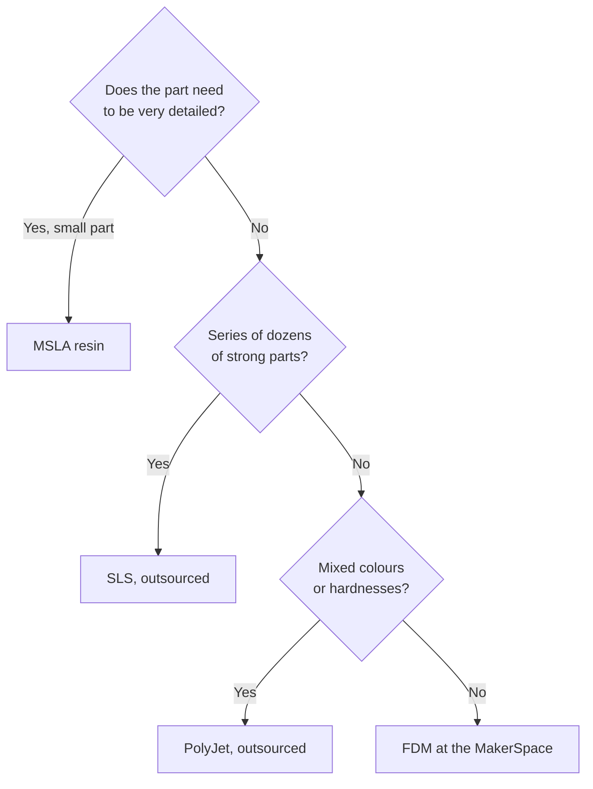



## Three main families

All 3D printers build an object layer by layer, but they do not do it with the same material or the same energy source. Three families cover most uses:

| | Fused filament (FDM) | Resin (SLA, DLP, MSLA) | Powder (SLS) |
|---|---|---|---|
| **Material** | Thermoplastic filament | Liquid photosensitive resin | Fine powder (polymer, metal) |
| **Solidified by** | Melting then cooling | UV light | Laser (sintering or melting) |
| **For** | Prototypes, functional parts | Fine details, jewellery, dental | Industrial parts, small series |
| **Strength** | Affordable, simple, safe | Precision, smooth surface | No supports, strong parts |
| **Limit** | Visible layers, anisotropic part | Toxic resin, post-processing | Expensive machines, depowdering |

The ISO/ASTM 52900 standard sorts the processes into seven categories: material extrusion (FDM), vat photopolymerisation (resin), powder bed fusion (SLS, DMLS), binder jetting, material jetting (PolyJet), directed energy deposition (DED, to repair or build up metal parts) and sheet lamination. The first three account for the vast majority of the machines you will come across.

No technology is universal: each has its advantages, its limits and its ways of failing. You choose the process to suit the part, not the other way round.

## Fused filament deposition (FDM / FFF)

### Principle

A thermoplastic filament, most often **1.75 mm** in diameter (sometimes 2.85 mm), is pushed into a **heated nozzle** where it melts. The head lays down a bead of molten plastic that follows the outline and the infill of each layer, then the bed moves down (or the head moves up) by one layer height and the operation starts again.

- **Layer height**: from 0.05 to 0.3 mm with a 0.4 mm nozzle. The layers remain visible to the naked eye.
- **Anisotropic part**: the beads within a layer are well fused together, but two successive layers only bond through a thin remelted zone. An FDM part is therefore clearly weaker in the vertical direction (Z) than in the plane of the layer. This property guides the whole design (see [The software workflow](/docs/concepts/3d-printing-workflow/#orienting-the-layers-to-suit-the-load)).
- **FDM or FFF**: *Fused Deposition Modeling* is a registered trademark of Stratasys, which patented the process in 1989. The RepRap project popularised the free term *Fused Filament Fabrication*. Both mean the same thing.

It is the most widespread and most affordable technology, and the one used by most of the printers at the MakerSpace.

### Machine architectures

An FDM printer must move the nozzle relative to the bed along three axes. There are several ways of sharing out these movements.

| Architecture | What moves | Strength | Limit | At the MakerSpace |
|---|---|---|---|---|
| Bed slinger | Bed in Y, head in X, gantry in Z | Simple, inexpensive | Inertia of the bed | [Artillery Sidewinder X2](/docs/references/machines/artillery_sidewinder_x2/), [Genius Pro](/docs/references/machines/artillery_genius/) |
| Cantilever | Head on an arm held on one side only | Compact, light | Arm deflection | [Bambu Lab A1 Mini](/docs/references/machines/bambulab_a1_mini/) |
| CoreXY | Head in X and Y, bed in Z | Fast, precise | Belts to tune, more expensive | [Bambu Lab P1P](/docs/references/machines/bambulab_p1p/), [X1C](/docs/references/machines/bambulab_x1c/) |
| Delta | Three articulated arms on three columns | Fast, tall build height | Tricky calibration, round bed | |

#### Bed slinger

The three axes are orthogonal (Cartesian) and the **bed moves in Y**. The design is simple and inexpensive, which made it the standard for consumer printers (Prusa i3, Ender-3). But the bed and the part being printed are heavy: at every change of direction, their inertia limits accelerations and can make a tall part wobble.



#### Cantilever

A Cartesian variant in which the head travels on an **arm held on one side only**. The structure is minimal, light and compact, ideal for small formats. On a large volume, the arm flexes and vibrates: that is why this architecture is kept for small machines.



#### CoreXY

Two fixed motors drive **two crossed belts** that together move the head in X and Y. The bed only moves in Z, slowly. Since only the head and the carriage move fast, the moving masses are small: the machine can accelerate hard without vibrating, which explains the speed of recent printers.

The movement of the head is derived from the rotations $\Delta A$ and $\Delta B$ of the two motors (expressed as belt length):

$$\Delta X = \frac{\Delta A + \Delta B}{2} \qquad \Delta Y = \frac{\Delta A - \Delta B}{2}$$

Both motors turn in the same direction: the head moves in X. They turn in opposite directions: it moves in Y. For a diagonal move, only one motor turns.



In return, both belts must have exactly the same tension, otherwise the machine prints squares as diamonds. CoreXY machines are generally enclosed, which also helps with materials that are sensitive to cooling (ABS, ASA).



To go further: [CoreXY theory](https://corexy.com/theory.html).

#### Delta

Three carriages move up and down three vertical columns, linked to the head by articulated arms. The position of the head results from the combination of the three heights: the firmware continuously computes this inverse kinematics. The head, which is very light, moves fast, and the machine can be tall. On the other hand, the bed is round, the usable area shrinks towards the top, and the slightest error in arm length or column alignment distorts the whole part: calibration is tricky.



### The extrusion assembly

The extrusion assembly feeds the filament to the nozzle and meters the material deposited. It comprises a **stepper motor**, **drive gears** that grip the filament, and the **hotend** that melts it.

#### Direct drive or Bowden

- **Direct drive**: the extruder is mounted on the head, just above the hotend. The filament travels only a few centimetres between the gears and the nozzle: control is precise, retractions are short (about 0.5 to 2 mm), and flexible filaments (TPU) feed without trouble. The head is heavier, though.
- **Bowden**: the extruder is fixed to the frame and pushes the filament through a PTFE tube to the head. The head is light and fast, but the tube introduces play and elasticity: retractions must be longer (often 4 to 6 mm) and a flexible filament bunches up in the tube instead of moving forward.

#### The extruder

The extruder pushes the filament into the hotend and sets the **flow rate**. Simple models have a single toothed drive gear and an idler bearing; **dual-drive** extruders pinch the filament between two driven gears, which limits slipping. Many include a gear **reduction** (about 3:1): the motor makes more turns for the same length of filament, giving more torque and finer metering resolution.



A good extruder avoids jams and keeps a steady flow, especially with demanding filaments such as TPU.

#### The hotend

1. **PTFE tube**: guides the filament to the hot zone.
2. **Heat sink**: carries away the heat that creeps up.
3. Hotend **fan**: cools the heat sink at all times.
4. **Heat break**: a narrow, poorly conducting tube that separates the cold zone from the hot zone.
5. **Heater block**: holds the **heater cartridge** and the **thermistor** that measures the temperature, from 180 to 260 °C depending on the material, regulated by the firmware.
6. **Nozzle**: sizes the bead coming out.

The filament must stay solid up to the heat break, then melt all at once in the block. If the heat creeps too far up (*heat creep*), the filament softens in the cold zone, swells and clogs the head: this is one of the leading causes of jams, especially with PLA in a hot enclosure.

On some hotends, the PTFE tube goes all the way down to the nozzle. PTFE degrades above about 250 °C: these hotends are limited to common materials. *All-metal* hotends, with no PTFE in the hot zone, are needed for engineering filaments (nylon, PC).

#### The nozzle

| Material | For | Limit |
|---|---|---|
| **Brass** | The standard: PLA, PETG, ABS, TPU | Wears quickly with filled filaments |
| **Hardened steel** | Abrasive filaments (carbon fibre, glass, metal, wood) | Conducts heat less well |
| **Plated brass** (nickel, copper) | Plastic sticks less, better durability | More expensive |

The **diameter** sets the trade-off between fineness and speed:

| Diameter | Advantage | Limit |
|---|---|---|
| 0.2 mm | Fine details | Slow printing, clogs easily |
| **0.4 mm** | **The standard: a good compromise** | |
| 0.6 to 1 mm | Large parts, fast, stronger parts | Less fine |

Two rules of thumb link the nozzle to the settings:

- the **bead width** is generally 100 to 120% of the nozzle diameter (about 0.45 mm for a 0.4 mm nozzle);
- the **layer height** must not exceed about 75% of the nozzle diameter (0.3 mm for a 0.4 mm nozzle), otherwise the layers bond poorly.

The maximum speed is limited by the **volumetric flow rate** the hotend can melt:

$$Q = \text{width} \times \text{height} \times \text{speed}$$

A 0.45 × 0.2 mm bead at 100 mm/s requires $Q = 9\ \text{mm}^3/\text{s}$. A conventional hotend tops out at around 10 to 15 mm³/s; beyond that, the filament does not have time to melt and the part lacks material (under-extrusion). So-called *high flow* hotends, with a longer heater block, push this limit back.

## Vat photopolymerisation (SLA, DLP, MSLA)

### Principle

A **liquid photosensitive resin** hardens when it receives ultraviolet light (most often at 405 nm). The resin contains monomers and **photoinitiators**: under the light, the latter trigger a polymerisation that turns the liquid into a solid, only where the light has struck.

1. Build platform
2. Lead screw
3. Z axis
4. Resin tank (vat)
5. Photopolymer (liquid resin)
6. Stepper motor
7. Printed object

On desktop printers, printing is done **upside down** (*bottom-up*):

1. The platform moves down into the vat and leaves a thin layer of resin between the object and the bottom, a transparent film (FEP).
2. The light, sent from underneath, solidifies the shape of the layer.
3. The platform moves up to **peel** the layer off the film, then moves back down for the next layer.

This peeling exerts a significant force. It explains three rules specific to resin: the part is almost always tilted on its supports to reduce the area of each layer, a hollow part must be **hollowed out and drilled** (otherwise it forms a suction cup with the bottom of the vat and the resin stays trapped inside), and the first layer is overexposed so that it sticks well to the platform.

**Strengths**: layers of 0.01 to 0.05 mm that are almost invisible, a smooth surface, details impossible in FDM. **Limits**: a small build volume, parts that are often more brittle, and a toxic resin that calls for precautions.

### Laser, DLP or MSLA

The three processes differ in the way each layer is exposed:

| Process | Light source | Time per layer | XY resolution |
|---|---|---|---|
| Laser SLA | UV laser steered by two mirrors (galvanometers) | Proportional to the area to trace | Fineness of the laser spot |
| DLP | Digital projector (micromirror array) | Constant | Resolution of the projector |
| MSLA | UV LED array behind an LCD screen that acts as a mask | Constant | Pixel size of the screen |

In **laser SLA**, the light spot "draws" each layer: precision is very high, but a platform full of parts takes longer than a single one.

In **DLP**, a projector exposes the whole layer at once: the time per layer no longer depends on the number of parts, but the resolution is that of the projector, spread over the whole surface.

In **MSLA**, the LCD screen only lets light through the pixels of the layer. It is the cheapest technology and today the most widespread. The XY resolution is the size of one pixel: on the MakerSpace's [Phrozen Sonic Mighty 4K](/docs/references/machines/phrozen_mighty_4k/), about 3840 pixels over 200 mm, that is, roughly 52 µm. The LCD screen is a consumable: UV degrades it over the hours of printing.

### Post-processing and safety

A part coming out of the printer is covered in liquid resin and is not fully cured.

1. **Wash** the part in isopropyl alcohol (IPA) to remove the uncured resin.
2. **Remove the supports**, preferably before curing, while the part is still slightly flexible.
3. **Cure** the part under UV to complete the polymerisation and reach its final mechanical properties.

Liquid resin is an irritant and a **sensitiser**: skin reactions can appear after repeated exposure, even with no discomfort at first. Nitrile gloves are therefore mandatory whenever you touch resin or an uncured part, and the area must be ventilated. IPA is flammable. Liquid resin never goes down the sink: leftovers and soiled paper are cured under UV before being thrown away.

At the MakerSpace, resin is a level 2 safety module, in supervised sessions: see the [Resin module](/workshops/certification-securite/modules/resine/) and the [wash and UV cure station](/docs/references/machines/station-lavage-polymerisation-uv/).

## Powder bed fusion (SLS, DMLS)

### Laser sintering (SLS)

1. A roller or a blade spreads a thin layer of powder (about 0.1 mm) over the bed.
2. A laser scans the cross-section of the layer and sinters the powder: the grains melt at the surface and fuse together.
3. The bed moves down one layer, a new layer of powder is spread, and the cycle starts again.

The chamber is heated to just below the melting temperature of the polymer (most often **PA12 nylon**): the laser only supplies the extra energy, which limits distortion. The **unsintered powder supports the part**: no supports are needed, and dozens of parts can be stacked throughout the volume of the chamber (*nesting*). This is what makes SLS cost-effective for small series.

At the end of the print, the block cools slowly, then each part is extracted and **depowdered**. The unsintered powder is sieved and reused, mixed with a share of fresh powder because it ages with each heating cycle.



SLS parts are strong, almost isotropic, with a slightly grainy surface. The machines remain expensive (several thousand euros for the smallest) and reserved for industry: automotive, aerospace, medical. HP's *Multi Jet Fusion* technology targets the same use with a related process: a liquid agent jetted onto the powder, then an infrared lamp that melts the whole layer.

### Metals (DMLS, SLM)

The same principle applies to metal powders (steel, titanium, aluminium) with a much more powerful laser that fully melts the metal, under an inert atmosphere (argon) to avoid oxidation. Unlike polymer SLS, metal parts need **supports**: they anchor the parts to the build plate and carry heat away to limit distortion. The supports are then removed by machining.

## Other processes

### Binder Jetting

A print head, comparable to that of an inkjet printer, deposits a **liquid binder** on a layer of powder (metal, sand, ceramic). Unlike SLS, the powder is not melted but **glued**. The process is fast, because the whole layer is processed in one pass of the head, and needs no supports. The "green" part that comes out of the machine is fragile: it is then sintered in a furnace (with a shrinkage of about 20% to anticipate in the model) or infiltrated with another material. Sand Binder Jetting is also used to make foundry moulds.

### PolyJet

PolyJet (material jetting) jets **droplets of photopolymer resin**, cured immediately by a UV lamp that follows the head. Layers go down to 16 µm. Because several heads work in parallel, a single part can mix **several colours and several hardnesses** (rigid and flexible), with a soluble support material. The process is ideal for realistic prototypes and medical models, but the machines and the resins are very expensive.

## Choosing a technology

| Need | Recommended technology |
|---|---|
| A highly detailed 3 cm figurine | Resin (MSLA) |
| A sensor bracket fixed to a chassis | Fused filament (PETG) |
| 50 nylon gears for a small series | Sintering (SLS) |
| A realistic multicolour model for a trade show | PolyJet |

## Materials

### Families of materials

| Technology | Material | Examples |
|---|---|---|
| FDM | Thermoplastic filaments | PLA, PETG, TPU, ABS, ASA, nylon |
| SLA, DLP, MSLA | Photopolymer resins | Standard, ABS-like, flexible, high temperature, castable (jewellery) |
| SLS, Binder Jetting, DMLS | Powders | PA12 nylon, metals, sand, ceramics |
| PolyJet | Photopolymers | Multi-material, colours |



The rest of this page focuses on **filaments**, those of the MakerSpace's FDM printers.

### Understanding a filament: the glass transition temperature

A thermoplastic does not melt all at once: above its **glass transition temperature** ($T_g$), it goes from a rigid state to a rubbery state. This is what sets the maximum service temperature of a part, far more than the printing temperature. A PLA part ($T_g \approx 60\ °\text{C}$) deforms on the parcel shelf of a car in summer; a part in PETG ($T_g \approx 80\ °\text{C}$) or ABS ($T_g \approx 105\ °\text{C}$) holds.

A material that shrinks a lot as it cools (ABS, ASA, nylon) tends to **warp**: the first layers, already cold, contract and pull on the corners, which lift off the bed. A heated bed and a closed enclosure reduce the temperature difference and therefore this phenomenon.

### Common filaments

| Filament | Nozzle | Bed | Strengths | Limits |
|---|---|---|---|---|
| **PLA** | 190-220 °C | 50-60 °C | Easy, little distortion, rigid | Brittle under impact, softens around 60 °C |
| **PETG** | 220-250 °C | 70-85 °C | Tough, not very brittle, withstands moisture and chemicals | Stringing, sticks too hard to some beds |
| **TPU** | 200-250 °C | 30-60 °C | Flexible, elastic, very wear-resistant | Slow, needs a direct drive extruder |
| **ABS** | 220-250 °C | 90-110 °C | Withstands impact and heat, can be sanded and glued | Warping, fumes: closed enclosure and ventilation |
| **PVA** | 180-210 °C | 45-60 °C | Water-soluble support | Very sensitive to moisture |



- **PLA** (polylactic acid): bio-based, compostable only under industrial conditions. The default material for getting started, for prototypes and decorative objects.
- **PETG**: the choice as soon as the part has to do some work (brackets, enclosures, robot parts). It needs a little more tuning: retraction and moderate cooling against stringing.
- **TPU**: seals, soles, dampers, bumpers. It is printed slowly so that the flexible filament does not buckle between the extruder gears and the nozzle.
- **ABS**: the plastic of LEGO bricks. Robust and easy to sand or to smooth with acetone vapour, but it gives off fumes (styrene) and warps without a closed enclosure.
- **PVA**: in dual extrusion, it serves as a soluble support for geometries that cannot be supported otherwise.





### Engineering filaments

| Filament | Use | Requirements |
|---|---|---|
| **ASA** | A UV-resistant ABS: outdoor parts | Same as ABS: closed enclosure, ventilation |
| **Nylon** (polyamide, PA) | Gears, mechanical parts, sliding surfaces | Very hygroscopic: drying mandatory, all-metal hotend |
| **PC** (polycarbonate) | Very resistant to impact and heat | 260-300 °C, heated enclosure |
| **PP** (polypropylene) | Flexible, chemical-resistant, hinges | Sticks to almost nothing: specific bed |
| **HIPS** | Support for ABS, soluble in limonene | Closed enclosure |
| **Composites** | PLA, PETG or nylon filled with carbon, glass, wood or metal fibres | Abrasive: hardened steel nozzle |
| **PEEK, PEI** (Ultem) | High performance: aerospace, medical | Nozzle around 360-400 °C, heated chamber: industrial printers |

### Storing and drying filaments

Most filaments absorb moisture from the air (they are **hygroscopic**). During printing, the water they contain vaporises in the nozzle: you hear crackling, the surface becomes rough and bubbly, the part is weaker and stringing increases. Nylon, PVA and TPU are very sensitive to this, PETG a little less, PLA not much.

Spools are stored in an airtight bag or box with desiccant. A damp spool is dried for a few hours in a filament dryer, at a temperature suited to the material and always below its $T_g$. See also [Solving print quality problems](/docs/how-to-guides/3d-printing-troubleshooting/#wet-filament-poor-surfaces-crackling-noises-jams).

## Going further

- [The basics of 3D printing (Prusa Research)](/docs/references/others/bases-de-limpression-prusa/), from which several diagrams on this page are taken
- [The software workflow](/docs/concepts/3d-printing-workflow/): from the 3D model to G-code
- [Design rules and tips](/docs/how-to-guides/3d-printing-design-rules/)
- [3D printing with OrcaSlicer](/docs/tutorials/production/imprimer-une-piece/)
- [CoreXY theory](https://corexy.com/theory.html)

---

Process diagrams: "Les bases de l'impression 3D", Prusa Research. Other illustrations taken from the MakerSpace Additive manufacturing course material; detailed sources to be completed.
{: .is-size-7 .has-text-grey }
