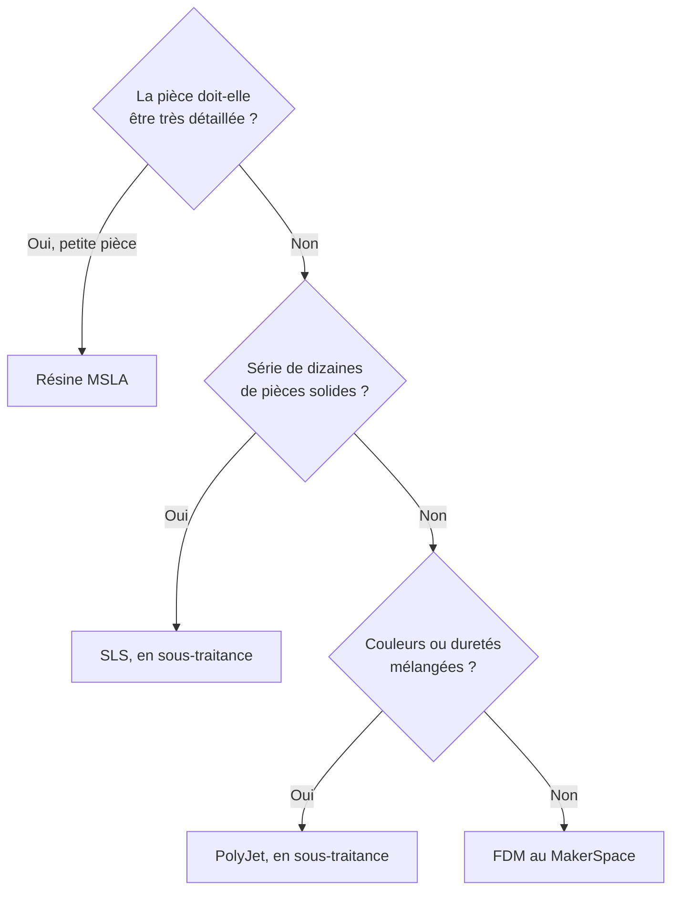



## Trois grandes familles

Toutes les imprimantes 3D construisent un objet couche par couche, mais elles ne le font pas avec la même matière ni avec la même source d'énergie. Trois familles couvrent l'essentiel des usages :

| | Fil fondu (FDM) | Résine (SLA, DLP, MSLA) | Poudre (SLS) |
|---|---|---|---|
| **Matière** | Filament thermoplastique | Résine photosensible liquide | Poudre fine (polymère, métal) |
| **Solidifiée par** | Fusion puis refroidissement | Lumière UV | Laser (frittage ou fusion) |
| **Pour** | Prototypes, pièces fonctionnelles | Détails fins, bijoux, dentaire | Pièces industrielles, petites séries |
| **Atout** | Abordable, simple, sûr | Précision, surface lisse | Pas de supports, pièces solides |
| **Limite** | Couches visibles, pièce anisotrope | Résine toxique, post-traitement | Machines coûteuses, dépoudrage |

La norme ISO/ASTM 52900 range les procédés en sept catégories : extrusion de matière (le FDM), photopolymérisation en cuve (la résine), fusion sur lit de poudre (SLS, DMLS), projection de liant (Binder Jetting), projection de matière (PolyJet), dépôt sous énergie concentrée (DED, pour réparer ou recharger des pièces métalliques) et stratification de feuilles. Les trois premières représentent l'immense majorité des machines que vous croiserez.

Aucune technologie n'est universelle : chacune a ses avantages, ses limites et ses façons d'échouer. On choisit le procédé selon la pièce, pas l'inverse.

## Le dépôt de fil fondu (FDM / FFF)

### Principe

Un filament thermoplastique, le plus souvent de **1,75 mm** de diamètre (parfois 2,85 mm), est poussé dans une **buse chauffée** où il fond. La tête dépose un cordon de plastique fondu qui suit le contour et le remplissage de chaque couche, puis le plateau descend (ou la tête monte) d'une hauteur de couche et l'opération recommence.

- **Hauteur de couche** : de 0,05 à 0,3 mm avec une buse de 0,4 mm. Les couches restent visibles à l'œil nu.
- **Pièce anisotrope** : les cordons d'une même couche sont bien soudés entre eux, mais deux couches successives n'adhèrent que par une fine zone refondue. Une pièce FDM est donc nettement moins résistante dans la direction verticale (Z) que dans le plan de la couche. Cette propriété guide toute la conception (voir [Le workflow logiciel](/docs/concepts/3d-printing-workflow/#orienter-les-couches-selon-leffort)).
- **FDM ou FFF** : *Fused Deposition Modeling* est une marque déposée de Stratasys, qui a breveté le procédé en 1989. Le projet RepRap a popularisé le terme libre *Fused Filament Fabrication*. Les deux désignent la même chose.

C'est la technologie la plus répandue et la plus abordable, et celle de la plupart des imprimantes du MakerSpace.

### Les architectures de machine

Une imprimante FDM doit déplacer la buse par rapport au plateau selon trois axes. Il existe plusieurs façons de répartir ces mouvements.

| Architecture | Ce qui bouge | Atout | Limite | Au MakerSpace |
|---|---|---|---|---|
| Bed slinger | Plateau en Y, tête en X, portique en Z | Simple, économique | Inertie du plateau | [Artillery Sidewinder X2](/docs/references/machines/artillery_sidewinder_x2/), [Genius Pro](/docs/references/machines/artillery_genius/) |
| Cantilever | Tête sur un bras porté d'un seul côté | Compacte, légère | Flexion du bras | [Bambu Lab A1 Mini](/docs/references/machines/bambulab_a1_mini/) |
| CoreXY | Tête en X et Y, plateau en Z | Rapide, précise | Courroies à régler, plus chère | [Bambu Lab P1P](/docs/references/machines/bambulab_p1p/), [X1C](/docs/references/machines/bambulab_x1c/) |
| Delta | Trois bras articulés sur trois colonnes | Rapide, grande hauteur | Calibration délicate, plateau rond | |

#### Bed slinger

Les trois axes sont orthogonaux (cartésiens) et le **plateau se déplace en Y**. La conception est simple et peu coûteuse, ce qui en a fait le standard des imprimantes grand public (Prusa i3, Ender-3). Mais le plateau et la pièce en cours d'impression sont lourds : à chaque changement de direction, leur inertie limite les accélérations et peut faire osciller une pièce haute.



#### Cantilever

Variante cartésienne où la tête circule sur un **bras tenu d'un seul côté**. La structure est minimaliste, légère et compacte, idéale pour les petits formats. Sur un grand volume, le bras fléchit et vibre : c'est pourquoi cette architecture reste réservée aux petites machines.



#### CoreXY

Deux moteurs fixes entraînent **deux courroies croisées** qui déplacent ensemble la tête en X et en Y. Le plateau ne bouge qu'en Z, lentement. Comme seuls la tête et le chariot sont en mouvement rapide, les masses en mouvement sont faibles : la machine peut accélérer fort sans vibrer, ce qui explique la vitesse des imprimantes récentes.

Le déplacement de la tête se déduit des rotations $\Delta A$ et $\Delta B$ des deux moteurs (exprimées en longueur de courroie) :

$$\Delta X = \frac{\Delta A + \Delta B}{2} \qquad \Delta Y = \frac{\Delta A - \Delta B}{2}$$

Les deux moteurs tournent dans le même sens : la tête part en X. Ils tournent en sens opposés : elle part en Y. Pour un mouvement en diagonale, un seul moteur tourne.



En contrepartie, les deux courroies doivent avoir exactement la même tension, sinon la machine imprime des carrés en losange. Les machines CoreXY sont en général fermées, ce qui aide aussi pour les matériaux sensibles au refroidissement (ABS, ASA).



Pour aller plus loin : [la théorie du CoreXY](https://corexy.com/theory.html).

#### Delta

Trois chariots montent et descendent sur trois colonnes verticales, reliés à la tête par des bras articulés. La position de la tête résulte de la combinaison des trois hauteurs : le firmware calcule en permanence cette cinématique inverse. La tête, très légère, se déplace vite, et la machine peut être haute. En revanche, le plateau est rond, la zone utile se réduit vers le haut, et la moindre erreur de longueur de bras ou d'alignement des colonnes déforme toute la pièce : la calibration est délicate.



### L'ensemble d'extrusion

L'ensemble d'extrusion achemine le filament jusqu'à la buse et dose la matière déposée. Il comprend un **moteur pas à pas**, des **roues d'entraînement** qui saisissent le filament, et la **hotend** qui le fond.

#### Direct drive ou Bowden

- **Direct drive** : l'extrudeur est monté sur la tête, juste au-dessus de la hotend. Le filament parcourt quelques centimètres seulement entre les roues et la buse : le contrôle est précis, les rétractions courtes (de l'ordre de 0,5 à 2 mm), et les filaments souples (TPU) passent sans problème. La tête est en revanche plus lourde.
- **Bowden** : l'extrudeur est fixé sur le châssis et pousse le filament dans un tube PTFE jusqu'à la tête. La tête est légère et rapide, mais le tube introduit du jeu et de l'élasticité : les rétractions doivent être plus longues (souvent 4 à 6 mm) et un filament souple se tasse dans le tube au lieu d'avancer.

#### L'extrudeur

L'extrudeur pousse le filament dans la hotend et règle le **débit**. Les modèles simples ont une seule roue dentée motrice et un roulement presseur ; les extrudeurs à **double entraînement** pincent le filament entre deux roues motrices, ce qui limite le patinage. Beaucoup intègrent une **réduction** par engrenages (de l'ordre de 3:1) : le moteur fait plus de tours pour la même longueur de filament, d'où plus de couple et une meilleure résolution de dosage.



Un extrudeur performant évite les bourrages et garde un débit régulier, surtout avec les filaments exigeants comme le TPU.

#### La hotend

1. **Tube PTFE** : guide le filament jusqu'à la zone chaude.
2. **Dissipateur thermique** (radiateur) : évacue la chaleur qui remonte.
3. **Ventilateur** de hotend : refroidit le radiateur en permanence.
4. **Barrière thermique** (*heat break*) : tube étroit et peu conducteur qui sépare la zone froide de la zone chaude.
5. **Bloc de chauffe** : contient la **cartouche chauffante** et la **thermistance** qui mesure la température, de 180 à 260 °C selon le matériau, régulée par le firmware.
6. **Buse** : calibre le cordon de sortie.

Le filament doit rester solide jusqu'à la barrière thermique, puis fondre d'un coup dans le bloc. Si la chaleur remonte trop haut (*heat creep*), le filament ramollit dans la zone froide, gonfle et bouche la tête : c'est l'une des premières causes de bourrage, notamment avec le PLA dans une enceinte chaude.

Sur certaines hotends, le tube PTFE descend jusqu'à la buse. Le PTFE se dégrade au-delà d'environ 250 °C : ces hotends sont limitées aux matériaux courants. Les hotends *all-metal*, sans PTFE dans la zone chaude, sont nécessaires pour les filaments techniques (nylon, PC).

#### La buse

| Matériau | Pour | Limite |
|---|---|---|
| **Laiton** | Le standard : PLA, PETG, ABS, TPU | S'use vite avec les filaments chargés |
| **Acier trempé** | Filaments abrasifs (fibre de carbone, verre, métal, bois) | Conduit moins bien la chaleur |
| **Laiton plaqué** (nickel, cuivre) | Moins d'accroche du plastique, meilleure tenue | Plus chère |

Le **diamètre** fixe le compromis entre finesse et vitesse :

| Diamètre | Avantage | Limite |
|---|---|---|
| 0,2 mm | Détails fins | Impression lente, bouchage facile |
| **0,4 mm** | **Le standard : bon compromis** | |
| 0,6 à 1 mm | Grandes pièces, rapide, pièces plus solides | Moins de finesse |

Deux règles pratiques relient la buse aux réglages :

- la **largeur du cordon** vaut en général 100 à 120 % du diamètre de buse (environ 0,45 mm pour une buse de 0,4 mm) ;
- la **hauteur de couche** ne doit pas dépasser environ 75 % du diamètre de buse (0,3 mm pour une buse de 0,4 mm), sinon les couches adhèrent mal.

La vitesse maximale est limitée par le **débit volumique** que la hotend peut fondre :

$$Q = \text{largeur} \times \text{hauteur} \times \text{vitesse}$$

Un cordon de 0,45 × 0,2 mm à 100 mm/s demande $Q = 9\ \text{mm}^3/\text{s}$. Une hotend classique plafonne autour de 10 à 15 mm³/s ; au-delà, le filament n'a pas le temps de fondre et la pièce manque de matière (sous-extrusion). Les hotends dites *high flow*, au bloc de chauffe allongé, repoussent cette limite.

## La photopolymérisation en cuve (SLA, DLP, MSLA)

### Principe

Une **résine liquide photosensible** durcit quand elle reçoit de la lumière ultraviolette (le plus souvent à 405 nm). La résine contient des monomères et des **photo-initiateurs** : sous la lumière, ces derniers déclenchent une polymérisation qui transforme le liquide en solide, uniquement là où la lumière a frappé.

1. Plateforme d'impression
2. Tige trapézoïdale
3. Axe Z
4. Réservoir de résine (cuve)
5. Photopolymère (résine liquide)
6. Moteur pas à pas
7. Objet imprimé

Sur les imprimantes de bureau, l'impression se fait **à l'envers** (*bottom-up*) :

1. La plateforme descend dans la cuve et laisse une fine couche de résine entre l'objet et le fond, un film transparent (FEP).
2. La lumière, envoyée par-dessous, solidifie la forme de la couche.
3. La plateforme remonte pour **décoller** la couche du film, puis redescend pour la couche suivante.

Ce décollement exerce une force de pelage importante. Elle explique trois règles propres à la résine : la pièce est presque toujours inclinée sur ses supports pour réduire la surface de chaque couche, une pièce creuse doit être **évidée et percée** (sinon elle forme une ventouse avec le fond de la cuve et la résine reste piégée à l'intérieur), et la première couche est surexposée pour bien coller à la plateforme.

**Atouts** : des couches de 0,01 à 0,05 mm presque invisibles, une surface lisse, des détails impossibles en FDM. **Limites** : un petit volume d'impression, des pièces souvent plus cassantes, et une résine toxique qui impose des précautions.

### Laser, DLP ou MSLA

Les trois procédés diffèrent par la façon d'éclairer chaque couche :

| Procédé | Source de lumière | Temps par couche | Résolution XY |
|---|---|---|---|
| SLA laser | Laser UV guidé par deux miroirs (galvanomètres) | Proportionnel à la surface à tracer | Finesse du point laser |
| DLP | Projecteur numérique (matrice de micro-miroirs) | Constant | Résolution du projecteur |
| MSLA | Matrice de LED UV derrière un écran LCD qui sert de masque | Constant | Taille des pixels de l'écran |

En **SLA laser**, le point lumineux « dessine » chaque couche : la précision est très élevée, mais une plateforme pleine de pièces prend plus de temps qu'une seule.

En **DLP**, un projecteur expose toute la couche d'un coup : le temps par couche ne dépend plus du nombre de pièces, mais la résolution est celle du projecteur, étalée sur toute la surface.

En **MSLA**, l'écran LCD ne laisse passer la lumière qu'à travers les pixels de la couche. C'est la technologie la moins chère et aujourd'hui la plus répandue. La résolution XY est la taille d'un pixel : sur la [Phrozen Sonic Mighty 4K](/docs/references/machines/phrozen_mighty_4k/) du MakerSpace, environ 3840 pixels sur 200 mm, soit à peu près 52 µm. L'écran LCD est un consommable : les UV le dégradent au fil des heures d'impression.

### Post-traitement et sécurité

Une pièce qui sort de l'imprimante est couverte de résine liquide et n'est pas complètement polymérisée.

1. **Laver** la pièce dans l'alcool isopropylique (IPA) pour retirer la résine non durcie.
2. **Retirer les supports**, de préférence avant le durcissement, quand la pièce est encore un peu souple.
3. **Durcir** la pièce sous UV pour achever la polymérisation et atteindre ses propriétés mécaniques finales.

La résine liquide est irritante et **sensibilisante** : les réactions cutanées peuvent apparaître après des expositions répétées, même sans gêne au départ. Les gants nitrile sont donc obligatoires dès qu'on touche la résine ou une pièce non durcie, et la zone doit être ventilée. L'IPA est inflammable. La résine liquide ne va jamais à l'évier : les restes et les papiers souillés se durcissent aux UV avant d'être jetés.

Au MakerSpace, la résine est un module de sécurité de niveau 2, en sessions accompagnées : voir le [module Résine](/workshops/certification-securite/modules/resine/) et la [station de lavage et polymérisation UV](/docs/references/machines/station-lavage-polymerisation-uv/).

## La fusion sur lit de poudre (SLS, DMLS)

### Le frittage laser (SLS)

1. Un rouleau ou une racle étale une fine couche de poudre (environ 0,1 mm) sur le plateau.
2. Un laser balaie la section de la couche et fritte la poudre : les grains fondent en surface et se soudent entre eux.
3. Le plateau descend d'une couche, une nouvelle couche de poudre est étalée, et on recommence.

La chambre est chauffée juste sous la température de fusion du polymère (le plus souvent du **nylon PA12**) : le laser n'apporte que le complément d'énergie, ce qui limite les déformations. La **poudre non frittée soutient la pièce** : aucun support n'est nécessaire, et l'on peut empiler des dizaines de pièces dans tout le volume de la chambre (*nesting*). C'est ce qui rend le SLS rentable pour les petites séries.

En fin d'impression, le bloc refroidit lentement, puis chaque pièce est extraite et **dépoudrée**. La poudre non frittée est tamisée et réutilisée, mélangée à une part de poudre neuve car elle vieillit à chaque cycle de chauffe.



Les pièces SLS sont solides, presque isotropes, avec une surface légèrement granuleuse. Les machines restent chères (plusieurs milliers d'euros pour les plus petites) et réservées à l'industrie : automobile, aéronautique, médical. La technologie *Multi Jet Fusion* de HP vise le même usage avec un procédé voisin : un agent liquide projeté sur la poudre, puis une lampe infrarouge qui fond la couche entière.

### Les métaux (DMLS, SLM)

Le même principe s'applique aux poudres métalliques (acier, titane, aluminium) avec un laser beaucoup plus puissant qui fond complètement le métal, sous atmosphère inerte (argon) pour éviter l'oxydation. Contrairement au SLS polymère, les pièces métalliques ont besoin de **supports** : ils les ancrent au plateau et évacuent la chaleur pour limiter les déformations. Les supports se retirent ensuite par usinage.

## Les autres procédés

### Binder Jetting

Une tête d'impression, comparable à celle d'une imprimante jet d'encre, dépose un **liant liquide** sur une couche de poudre (métal, sable, céramique). Contrairement au SLS, la poudre n'est pas fondue mais **collée**. Le procédé est rapide, car toute la couche est traitée d'un passage de tête, et ne demande pas de supports. La pièce « verte » qui sort de la machine est fragile : elle est ensuite frittée au four (avec un retrait d'environ 20 % à anticiper dans le modèle) ou infiltrée par un autre matériau. Le Binder Jetting sable sert aussi à fabriquer des moules de fonderie.

### PolyJet

Le PolyJet (projection de matière) projette des **gouttelettes de résine photopolymère**, durcies aussitôt par une lampe UV qui suit la tête. Les couches descendent jusqu'à 16 µm. Comme plusieurs têtes travaillent en parallèle, une même pièce peut mélanger **plusieurs couleurs et plusieurs duretés** (rigide et souple), avec un matériau de support soluble. Le procédé est idéal pour des prototypes réalistes et des maquettes médicales, mais les machines et les résines sont très coûteuses.

## Choisir une technologie

| Besoin | Technologie conseillée |
|---|---|
| Une figurine de 3 cm très détaillée | Résine (MSLA) |
| Un support de capteur fixé sur un châssis | Fil fondu (PETG) |
| 50 engrenages en nylon pour une petite série | Frittage (SLS) |
| Une maquette multicolore réaliste pour un salon | PolyJet |

## Les matériaux

### Les familles de matériaux

| Technologie | Matière | Exemples |
|---|---|---|
| FDM | Filaments thermoplastiques | PLA, PETG, TPU, ABS, ASA, nylon |
| SLA, DLP, MSLA | Résines photopolymères | Standard, ABS-like, flexibles, haute température, calcinables (bijouterie) |
| SLS, Binder Jetting, DMLS | Poudres | Nylon PA12, métaux, sable, céramiques |
| PolyJet | Photopolymères | Multimatériaux, couleurs |



La suite de cette page se concentre sur les **filaments**, ceux des imprimantes FDM du MakerSpace.

### Comprendre un filament : la température de transition vitreuse

Un thermoplastique ne fond pas d'un coup : au-dessus de sa **température de transition vitreuse** ($T_g$), il passe de l'état rigide à un état caoutchouteux. C'est elle qui fixe la température maximale d'usage d'une pièce, bien plus que la température d'impression. Une pièce en PLA ($T_g \approx 60\ °\text{C}$) se déforme sur une plage arrière de voiture en été ; une pièce en PETG ($T_g \approx 80\ °\text{C}$) ou en ABS ($T_g \approx 105\ °\text{C}$) tient.

Un matériau qui rétracte beaucoup en refroidissant (ABS, ASA, nylon) a tendance à **gauchir** (*warping*) : les premières couches, déjà froides, se contractent et tirent sur les coins, qui se décollent du plateau. Un plateau chauffé et une enceinte fermée réduisent l'écart de température et donc ce phénomène.

### Les filaments courants

| Filament | Buse | Plateau | Atouts | Limites |
|---|---|---|---|---|
| **PLA** | 190-220 °C | 50-60 °C | Facile, peu de déformation, rigide | Fragile aux chocs, ramollit vers 60 °C |
| **PETG** | 220-250 °C | 70-85 °C | Résistant, peu cassant, tient l'humidité et les produits chimiques | Fils (*stringing*), colle trop fort à certains plateaux |
| **TPU** | 200-250 °C | 30-60 °C | Souple, élastique, très résistant à l'usure | Lent, demande un extrudeur direct drive |
| **ABS** | 220-250 °C | 90-110 °C | Résiste aux chocs et à la chaleur, se ponce et se colle | Warping, vapeurs : enceinte fermée et ventilation |
| **PVA** | 180-210 °C | 45-60 °C | Support soluble dans l'eau | Très sensible à l'humidité |



- **PLA** (acide polylactique) : biosourcé, compostable seulement en conditions industrielles. Le matériau par défaut pour débuter, pour les prototypes et les objets décoratifs.
- **PETG** : le choix dès que la pièce doit travailler (supports, boîtiers, pièces de robot). Il demande un peu plus de réglages : rétraction et refroidissement modéré contre les fils.
- **TPU** : joints, semelles, amortisseurs, pare-chocs. On l'imprime lentement pour que le filament souple ne flambe pas entre les roues de l'extrudeur et la buse.
- **ABS** : le plastique des briques LEGO. Robuste et facile à poncer ou à lisser aux vapeurs d'acétone, mais il émet des vapeurs (styrène) et gauchit sans enceinte fermée.
- **PVA** : en double extrusion, il sert de support soluble pour des géométries impossibles à supporter autrement.





### Les filaments techniques

| Filament | Usage | Exigences |
|---|---|---|
| **ASA** | Un ABS qui résiste aux UV : pièces d'extérieur | Comme l'ABS : enceinte fermée, ventilation |
| **Nylon** (polyamide, PA) | Engrenages, pièces mécaniques, glissement | Très hygroscopique : séchage obligatoire, hotend all-metal |
| **PC** (polycarbonate) | Très résistant aux chocs et à la chaleur | 260-300 °C, enceinte chaude |
| **PP** (polypropylène) | Souple, résiste aux produits chimiques, charnières | N'adhère presque à rien : plateau spécifique |
| **HIPS** | Support pour l'ABS, soluble dans le limonène | Enceinte fermée |
| **Composites** | PLA, PETG ou nylon chargés de fibres de carbone, de verre, de bois ou de métal | Abrasifs : buse en acier trempé |
| **PEEK, PEI** (Ultem) | Hautes performances : aéronautique, médical | Buse vers 360-400 °C, chambre chauffée : imprimantes industrielles |

### Stocker et sécher les filaments

La plupart des filaments absorbent l'humidité de l'air (ils sont **hygroscopiques**). À l'impression, l'eau contenue se vaporise dans la buse : on entend des crépitements, la surface devient rugueuse et bulleuse, la pièce est plus fragile et les fils se multiplient. Le nylon, le PVA et le TPU y sont très sensibles, le PETG un peu moins, le PLA peu.

Les bobines se stockent dans un sac ou une boîte étanche avec du dessiccant. Une bobine humide se sèche quelques heures dans un séchoir à filament, à une température adaptée au matériau et toujours inférieure à sa $T_g$. Voir aussi [Résoudre les problèmes de qualité d'impression](/docs/how-to-guides/3d-printing-troubleshooting/#filament-humide-mauvaises-surfaces-bruits-de-crépitement-bourrage).

## Pour aller plus loin

- [Les bases de l'impression 3D (Prusa Research)](/docs/references/others/bases-de-limpression-prusa/), dont sont tirés plusieurs schémas de cette page
- [Le workflow logiciel](/docs/concepts/3d-printing-workflow/) : du modèle 3D au G-code
- [Règles de conception et conseils](/docs/how-to-guides/3d-printing-design-rules/)
- [Impression 3D avec OrcaSlicer](/docs/tutorials/production/imprimer-une-piece/)
- [La théorie du CoreXY](https://corexy.com/theory.html)

---

Schémas des procédés : « Les bases de l'impression 3D », Prusa Research. Autres illustrations reprises du support de cours Fabrication additive du MakerSpace ; sources détaillées à compléter.
{: .is-size-7 .has-text-grey }
