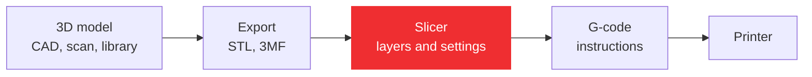



## From file to part

A 3D printer does not understand a 3D model: it executes a list of movement and heating instructions. In between, a chain of software turns a shape into toolpaths.




The **slicer** is the pivot of the chain: it decides how the material will be laid down. Two people printing the same file with different settings get two different parts, in quality, strength and time.

## Getting a 3D model

| Route | Tool | Good for | Limit |
|---|---|---|---|
| Download | Printables, Thingiverse, Cults, GrabCAD | An object already designed | Rarely at your dimensions |
| Scan | 3D scanner, photogrammetry | Copying an existing object | Mesh needs cleaning up |
| Model | Blender | Organic shapes | Imprecise for mechanical parts |
| Design (CAD) | Onshape, Fusion, SolidWorks, FreeCAD | Dimensioned technical parts | Learning curve |
| Code | OpenSCAD | Parametric parts | Programming |
| Generate (AI) | Rodin | Quick concept | Model needs reworking |

For a project part, which must assemble with others and respect dimensions, **CAD** is almost always the right route.

### Downloading a model


- **[Printables](https://www.printables.com/)**: Prusa's platform, suitable for all machines.
- **[Thingiverse](https://www.thingiverse.com/)**: one of the largest communities of free models.
- **[Cults](https://cults3d.com/)**: free and paid models, design-oriented.
- **[GrabCAD](https://grabcad.com/)**: engineering models and industrial components, often in STEP.
- **[YouMagine](https://www.youmagine.com/)**: an open-source platform.

A downloaded model remains the work of its author. Most are published under a **Creative Commons** licence: check whether it allows modification (no ND clause) and commercial use (no NC clause), and always credit the author.

### Scanning an object



A 3D scanner captures the shape of a real object as a point cloud, then as a mesh. Three techniques coexist: **structured light** (a projected pattern deforms over the object), **laser** (a line sweeps the surface) and **photogrammetry** (software reconstructs the volume from dozens of photos taken from every angle).

Scanning is valuable for reverse engineering (copying a broken part, matching an existing shape) and for made-to-measure work (orthoses, prostheses). Its limits:

- limited accuracy on consumer scanners, not enough for technical parts;
- difficult surfaces: transparent, reflective, very dark or featureless (they are dulled with a spray);
- a mesh that is always imperfect: holes, noise, missing areas to repair;
- a mesh is not a dimensioned part: for a mechanical part, the part is often redrawn in CAD using the scan as a guide.

### Modelling or designing: mesh versus solid

Two families of software produce a 3D model, with two different representations.



- **Polygon modelling** (Blender, ZBrush): the object is a **surface made of facets** that you sculpt freely. Ideal for organic shapes (characters, sculptures), but there are no dimensions: getting a hole of exactly 8 mm or changing a thickness afterwards is laborious.
- **Parametric CAD** (Onshape, Fusion, SolidWorks, FreeCAD, Catia): the object is an **exact solid** built through a series of operations (constrained sketch, extrusion, hole, fillet...). Every dimension is a parameter: change it, and the whole part rebuilds by following the **feature tree**. It is the tool for technical parts and assemblies.




Onshape and Fusion are free for students, FreeCAD is open source; SolidWorks, Catia, Creo, Inventor and Siemens NX are the industry standards. To learn: the [CAD workshop](/workshops/cao/) and [Installing Onshape](/docs/tutorials/software/onshape/onshape-installation/).

### Modelling with code: OpenSCAD

OpenSCAD describes a part with a **script**: basic shapes (cube, cylinder, sphere) combined with boolean operations (union, difference, intersection). This is constructive solid geometry (CSG).

```text
largeur = 30;
difference() {
  cube([largeur, 20, 10]);
  translate([largeur/2, 10, -1])
    cylinder(d = 8, h = 12);
}
```

This script creates a 30 × 20 × 10 mm block with an 8 mm hole through its centre. Changing `largeur` (the width) regenerates the part, and the hole stays centred. The approach is ideal for repetitive or parametric parts (enclosures of variable size, gears), and the text file can be versioned with Git. It is poorly suited to organic shapes.



### Generating with AI


Tools such as Rodin generate a 3D model from a text or an image, in a few minutes and with no modelling skills. The result is fine for a concept or a decorative object, but the details are often imperfect, and the mesh has no dimensions and almost always needs reworking. Quality depends a great deal on how precise the description is.

## Exporting

### Export formats

| Format | Contains | Use |
|---|---|---|
| **STL** | Geometry only, as triangles | The most universal |
| **OBJ** | Geometry, colours, textures | Multicolour models |
| **3MF** | Geometry, units, colours, materials, print settings | Complete project, modern format |
| **STEP** | Exact geometry (CAD solid) | Exchange between CAD programs |

### STL and its pitfalls

STL describes the surface of the part as a set of **triangles**. On export, the CAD software therefore approximates curved surfaces: a cylinder becomes a prism with many facets. If the export tolerance is too coarse, the facets show on the printed part; too fine, and the file becomes huge for nothing. The export settings (deviation, angle) are set in the CAD software.

Three classic pitfalls:

- **no units**: an STL does not say whether its numbers are millimetres or inches. A part that arrives 25.4 times too small in the slicer was exported in inches;
- **non-watertight mesh**: holes or flipped faces prevent the slicer from knowing what is "inside". Slicers repair small defects, not big ones;
- **no parameters left**: an STL is a frozen shape. To modify the part, always go back to the CAD file, never to the STL.

### 3MF

**3MF** (*3D Manufacturing Format*) is an archive that contains the geometry with its **units**, the colours, the materials and even the **print settings** (orientation, layer height, supports). It is an open standard backed by the 3MF Consortium (Microsoft, Autodesk, Stratasys, Ultimaker...), adopted by Cura, PrusaSlicer, OrcaSlicer and Bambu Studio. A 3MF file saved from the slicer lets you recover the exact print project: it is the format to prefer.

## Slicing: the slicer

### What the slicer does


The slicer converts a 3D model (STL, 3MF, sometimes STEP) into **G-code**:

1. it **cuts** the model with horizontal planes spaced one layer height apart;
2. for each layer, it computes the **outlines** of the cross-section, then the **perimeters** (walls), the **solid layers** on top and bottom, and the **infill** of the inside;
3. it adds **supports** under overhangs and **adhesion** aids (brim, raft);
4. it orders all these toolpaths, sets the speeds, temperatures, fan and retractions, and writes everything as G-code;
5. it **estimates** the print time and the amount of filament.

The **layer-by-layer preview** is the most useful tool in the slicer: before printing, it shows a forgotten overhang, a detail too fine that disappears or a bridge that is too long.

### Which slicer?

| Slicer | Publisher | For |
|---|---|---|
| **OrcaSlicer** | Community (fork of Bambu Studio) | Multi-brand, open source |
| Bambu Studio | Bambu Lab | Bambu Lab printers |
| PrusaSlicer | Prusa Research | Multi-brand, open source |
| Cura | UltiMaker | Multi-brand, many plugins |
| ChiTuBox, Lychee | | Resin printers |

Three of them share a common ancestor: Slic3r gave rise to PrusaSlicer, of which Bambu Studio is a fork, of which OrcaSlicer is itself a fork. Their interfaces therefore look very much alike; Cura has its own lineage. At the MakerSpace, the tutorials use **OrcaSlicer**: see [3D printing with OrcaSlicer](/docs/tutorials/production/imprimer-une-piece/).









From top to bottom: OrcaSlicer, Bambu Studio, PrusaSlicer and Cura.

### The odd one out: FullControl



[FullControl](https://fullcontrol.xyz) turns the logic around: there is no 3D model to slice any more. You describe **the nozzle toolpaths directly** by programming (in Python or in an online configurator), and FullControl writes the G-code. This makes it possible to create structures that cannot be obtained with a conventional slicer: lattices, mathematical objects, walls made of a single wavy bead, lightweight structures for research.

## The basic settings


The settings serve three goals, often contradictory: **quality** (accuracy, finish), **efficiency** (time and material) and **reliability** (the part stays on the bed to the end). The profiles provided by the printer and filament manufacturers are a good starting point; adjust only one parameter at a time.

### Temperatures



- **Nozzle**: every filament manufacturer gives a range (from 190 to 250 °C depending on the material). Too cold, the layers bond poorly and the part breaks between two layers; too hot, the filament oozes, strings, and details sag.
- **Bed**: from 50 to 110 °C depending on the filament. It keeps the first layer stuck down and limits warping.

The faster you print, the hotter you need to go: the filament spends less time in the nozzle. A **temperature tower**, which prints each level at a different temperature, lets you choose the best value for a given spool.

### Layer height


Print time is roughly inversely proportional to layer height: going from 0.2 to 0.1 mm doubles the number of layers and almost doubles the time. **0.2 mm** suits most parts with a 0.4 mm nozzle.

Layers create a **stair-step effect** on gentle slopes and rounded tops, all the more visible as the layer gets thicker. A vertical surface, on the other hand, looks the same whatever the layer height. Hence the value of **variable layer height**, offered by recent slicers: fine on curves, thick on straight walls.

The layer height must not exceed about 75% of the nozzle diameter, and the first layer is often a little thicker so that it sticks well.

### Walls and solid layers

$$\text{wall thickness} = \text{number of perimeters} \times \text{bead width}$$

With a 0.4 mm nozzle, a bead is about 0.45 mm wide: three perimeters give a wall of about 1.35 mm. A wall drawn in CAD with a thickness that is not a multiple of the bead width leaves a gap or an infill bead in the middle.



**Solid layers** close the part on top and bottom. You generally need 3 to 5, that is, about 0.8 to 1 mm of thickness: below that, the infill shows through the top surface.



### Infill


The inside of an FDM part is not solid: an **infill** of 10 to 20% is enough for most parts. The strength of a part comes mainly from its **walls**: to reinforce it, adding one or two perimeters is often more effective and quicker than doubling the infill. The pattern matters too: grid and lines are fast, while **gyroid** and honeycomb spread loads better in every direction.

### Supports



Every layer must rest on the previous one. An **overhang** of up to about 45° from the vertical prints by itself, because each bead rests halfway on the previous one; beyond that, **supports** are needed, temporary structures removed after printing. They cost time and material, and leave marks on the supported face.

Slicers offer conventional supports (a grid under the overhang) and **tree** supports, which only touch the part where needed and are easier to remove. The distance between the support and the part (about one layer height) sets the trade-off between a clean face and a support that is easy to remove.

### Bed adhesion



- **Skirt**: a line drawn around the part, without touching it. It primes the nozzle and shows whether the bed is properly set.
- **Brim**: a few beads attached to the foot of the part, which widen the contact surface. For small, thin or tall parts.
- **Raft**: a complete base under the part, against the warping of ABS or for an imperfect bed. The bottom face keeps a rough surface from it.
- **Ears**: discs at the corners only, where warping starts.

The first layer is the most important of the whole print: a clean bed (degreased with alcohol), properly levelled and at the right temperature solves most adhesion failures. See [The part does not stick](/docs/how-to-guides/3d-printing-troubleshooting/#bed-adhesion-the-part-does-not-stick).

### Bridges and cooling



A **bridge** is a bead stretched through the air between two supports. It holds if the plastic sets before it sags: the slicer slows down and pushes the **fan** to maximum on bridges. Cooling depends on the material: PLA likes strong cooling, which sets details and overhangs; ABS and ASA need gentle cooling, otherwise the layers delaminate.

## Designing for printing

A well-designed part prints without complicated settings. The following rules are decided in the CAD software, not in the slicer. They are detailed, with the dimensions to respect, in [Design rules and tips](/docs/how-to-guides/3d-printing-design-rules/).

### Avoiding supports



A right-angle overhang needs a support; a **45° chamfer** in the same place prints by itself. A fillet, on the other hand, starts almost horizontal and needs a support: under an overhang, prefer a chamfer. See [Overhangs](/docs/how-to-guides/3d-printing-design-rules/#overhangs).

### Choosing the face that sits on the bed



The face against the bed is the smoothest and flattest of the part; a face printed on supports is uneven. So lay flat the face that must look good or serve as a reference, and design the part with a large flat face whenever possible.

### Orienting the layers to suit the load



An FDM part breaks between two layers (see [anisotropy](/docs/concepts/3d-printing-technologies/#principle)). For a bracket whose vertical leg is loaded, the version standing on its edge (left) is much stronger: each layer contains the whole L profile, and the corner cannot delaminate. Laid flat (right), the leg breaks off flush with the base. Orient the part so that the main load does not try to pull the layers apart.

### Splitting the model



A shape that cannot be laid flat (a sphere, an arched part) can be split into pieces that each have a large flat face, then assembled by gluing, interlocking or screwing. Each piece prints without supports and with a better surface.

### Allowing clearance in assemblies



A printed part is never exactly to size: the bead spreads slightly, and the material shrinks as it cools. Two parts drawn at the same dimension therefore do not fit together. Allow a **clearance** of about 0.15 to 0.3 mm depending on the fit you want, to be validated with a test part on your machine and filament.

The **seam**, the point where each layer starts and ends, forms a small bump. Inside a hole, it gets in the way of the fit: a notch drawn in the hole makes room for it. See [Clearance](/docs/how-to-guides/3d-printing-design-rules/#clearance) and [Why a manufactured part is never exactly to size](/docs/concepts/tolerances-fabrication/).

### Orienting holes



A hole with a horizontal axis (through a vertical wall) has its top overhanging: it sags and comes out oval. A hole with a vertical axis (in a horizontal face) comes out nicely round. When the hole must stay horizontal, give it a **teardrop shape**: the point at the top prints without support. The shape of the RepRap logo is a nod to this. Holes also often come out slightly smaller than intended: for a shaft or a screw, enlarge them slightly or drill them out. See [Horizontal holes](/docs/how-to-guides/3d-printing-design-rules/#holes-horizontal).

### Details finer than the nozzle



The nozzle cannot draw a line thinner than its bead, about 0.45 mm for a 0.4 mm nozzle. Embossed text, a rib or a wall thinner than that disappear or print badly. Draw details at least as wide as the bead, and walls in multiples of its width. See [Detail size](/docs/how-to-guides/3d-printing-design-rules/#detail-size).

## G-code

### The language of the machine

**G-code** is the language of numerically controlled machines, born in the 1950s for milling machines and later standardised (ISO 6983). Each line is a command: a letter and a number, followed by parameters.

```gcode
M140 S60          ; bed to 60 °C, without waiting
M104 S215         ; nozzle to 215 °C, without waiting
M190 S60          ; wait for the bed to reach 60 °C
M109 S215         ; wait for the nozzle to reach 215 °C
G28               ; home all axes
G90               ; absolute coordinates
M83               ; relative extrusion
G1 Z0.2 F1500     ; move down to 0.2 mm
G1 X10 Y20 E0.8 F1800 ; move to X10 Y20 while extruding 0.8 mm of filament
M106 S255         ; part cooling fan at full speed
```

| Command | Role |
|---|---|
| `G0`, `G1` | Move, without or with extrusion (`E`), at speed `F` in mm/min |
| `G28` | Return to origin (*homing*) |
| `G90`, `G91` | Absolute or relative coordinates |
| `M82`, `M83` | Absolute or relative extrusion |
| `M104`, `M109` | Nozzle temperature: set, or set and wait |
| `M140`, `M190` | Bed temperature: set, or set and wait |
| `M106`, `M107` | Part cooling fan: on (`S0` to `S255`), off |

`G` letters drive movements, `M` letters the functions of the machine. G-code is interpreted by the printer's **firmware** (Marlin, Klipper, or the manufacturers' own firmware), and each firmware adds its own commands.

### Reading a G-code file




A G-code file has hundreds of thousands of lines, almost all of them `G1`. The slicer adds **comments** (after `;`) that structure the file: layer change, Z height, layer number out of the total, type of toolpath. The **start G-code**, at the beginning of the file, heats the machine, homes and levels it, then draws a purge line; the **end G-code** switches off the heaters and moves the head out of the way.

### Why understand it?

- **Troubleshoot**: find in the file the cause of a defect (a temperature, a speed, an unexpected toolpath).
- **Optimise**: adjust a command to gain quality or speed.
- **Customise**: modify the start G-code (purge, calibration), insert a pause at a given height to change colour or drop a nut into the part.
- **Go further**: generate your own toolpaths, as with FullControl.

## Going further

- [Printing technologies](/docs/concepts/3d-printing-technologies/)
- [3D printing with OrcaSlicer](/docs/tutorials/production/imprimer-une-piece/)
- [Design rules and tips](/docs/how-to-guides/3d-printing-design-rules/)
- [Solving print quality problems](/docs/how-to-guides/3d-printing-troubleshooting/)
- [The basics of 3D printing (Prusa Research)](/docs/references/others/bases-de-limpression-prusa/)
- [FullControl](https://fullcontrol.xyz)

---

Illustrations taken from the MakerSpace Additive manufacturing course material (screenshots of slicers, software and websites); detailed sources to be completed.
{: .is-size-7 .has-text-grey }
