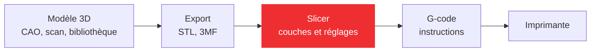



## Du fichier à la pièce

Une imprimante 3D ne comprend pas un modèle 3D : elle exécute une liste d'instructions de déplacement et de chauffe. Entre les deux, une chaîne de logiciels transforme une forme en trajets.




Le **slicer** est le pivot de la chaîne : c'est lui qui décide comment la matière sera déposée. Deux personnes qui impriment le même fichier avec des réglages différents obtiennent deux pièces différentes, en qualité, en solidité et en temps.

## Obtenir un modèle 3D

| Voie | Outil | Pour | Limite |
|---|---|---|---|
| Télécharger | Printables, Thingiverse, Cults, GrabCAD | Objet déjà conçu | Rarement à votre cote |
| Scanner | Scanner 3D, photogrammétrie | Copier un objet existant | Maillage à retoucher |
| Modéliser | Blender | Formes organiques | Imprécis en mécanique |
| Concevoir (CAO) | Onshape, Fusion, SolidWorks, FreeCAD | Pièces techniques cotées | Apprentissage |
| Coder | OpenSCAD | Pièces paramétriques | Programmation |
| Générer (IA) | Rodin | Concept rapide | Modèle à retravailler |

Pour une pièce de projet, qui doit s'assembler avec d'autres et respecter des cotes, la **CAO** est presque toujours la bonne voie.

### Télécharger un modèle


- **[Printables](https://www.printables.com/)** : la plateforme de Prusa, valable pour toutes les machines.
- **[Thingiverse](https://www.thingiverse.com/)** : l'une des plus grandes communautés de modèles gratuits.
- **[Cults](https://cults3d.com/)** : modèles gratuits et payants, orientés design.
- **[GrabCAD](https://grabcad.com/)** : modèles d'ingénierie et composants industriels, souvent en STEP.
- **[YouMagine](https://www.youmagine.com/)** : plateforme open source.

Un modèle téléchargé reste l'œuvre de son auteur. La plupart sont publiés sous licence **Creative Commons** : vérifiez si elle autorise la modification (pas de mention ND) et l'usage commercial (pas de mention NC), et citez toujours l'auteur.

### Scanner un objet



Un scanner 3D capture la forme d'un objet réel sous forme d'un nuage de points, puis d'un maillage. Trois techniques coexistent : la **lumière structurée** (un motif projeté se déforme sur l'objet), le **laser** (une ligne balaie la surface) et la **photogrammétrie** (un logiciel reconstruit le volume à partir de dizaines de photos prises sous tous les angles).

Le scan est précieux en rétro-conception (copier une pièce cassée, épouser une forme existante) et pour le sur-mesure (orthèses, prothèses). Ses limites :

- une précision limitée sur les scanners grand public, insuffisante pour des pièces techniques ;
- des surfaces difficiles : transparentes, réfléchissantes, très sombres ou sans relief (on les matifie avec un spray) ;
- un maillage toujours imparfait : trous, bruit, zones manquantes à reprendre ;
- un maillage n'est pas une pièce cotée : pour une pièce mécanique, on redessine souvent la pièce en CAO en s'appuyant sur le scan.

### Modéliser ou concevoir : maillage contre solide

Deux familles de logiciels produisent un modèle 3D, avec deux représentations différentes.



- **Modélisation polygonale** (Blender, ZBrush) : l'objet est une **surface faite de facettes** que l'on sculpte librement. Idéal pour les formes organiques (personnages, sculptures), mais il n'y a pas de cotes : obtenir un trou de 8 mm exactement ou modifier une épaisseur après coup est laborieux.
- **CAO paramétrique** (Onshape, Fusion, SolidWorks, FreeCAD, Catia) : l'objet est un **solide exact** construit par une suite d'opérations (esquisse contrainte, extrusion, perçage, congé...). Chaque cote est un paramètre : on la modifie, et toute la pièce se reconstruit en suivant l'**arbre de construction**. C'est l'outil des pièces techniques et des assemblages.




Onshape et Fusion sont gratuits pour les étudiants, FreeCAD est libre ; SolidWorks, Catia, Creo, Inventor et Siemens NX sont les références industrielles. Pour apprendre : l'[atelier CAO](/workshops/cao/) et [Installer Onshape](/docs/tutorials/software/onshape/onshape-installation/).

### Modéliser par le code : OpenSCAD

OpenSCAD décrit une pièce par un **script** : des formes de base (cube, cylindre, sphère) combinées par des opérations booléennes (union, différence, intersection). C'est la géométrie de construction de solides (CSG).

```text
largeur = 30;
difference() {
  cube([largeur, 20, 10]);
  translate([largeur/2, 10, -1])
    cylinder(d = 8, h = 12);
}
```

Ce script crée un bloc de 30 × 20 × 10 mm percé d'un trou de 8 mm en son centre. Changer `largeur` régénère la pièce, et le trou reste centré. L'approche est idéale pour les pièces répétitives ou paramétriques (boîtiers à dimensions variables, engrenages), et le fichier texte se versionne avec Git. Elle est peu adaptée aux formes organiques.



### Générer par IA


Des outils comme Rodin génèrent un modèle 3D à partir d'un texte ou d'une image, en quelques minutes et sans compétence de modélisation. Le résultat convient pour un concept ou un objet décoratif, mais les détails sont souvent imparfaits, le maillage n'est pas coté et doit presque toujours être retravaillé. La qualité dépend beaucoup de la précision de la description.

## Exporter

### Les formats d'export

| Format | Contient | Usage |
|---|---|---|
| **STL** | La géométrie seule, en triangles | Le plus universel |
| **OBJ** | Géométrie, couleurs, textures | Modèles multicolores |
| **3MF** | Géométrie, unités, couleurs, matériaux, réglages d'impression | Projet complet, format moderne |
| **STEP** | Géométrie exacte (solide CAO) | Échange entre logiciels de CAO |

### Le STL et ses pièges

Le STL décrit la surface de la pièce comme un ensemble de **triangles**. À l'export, le logiciel de CAO approxime donc les surfaces courbes : un cylindre devient un prisme à nombreuses facettes. Si la tolérance d'export est trop grossière, les facettes se voient sur la pièce imprimée ; trop fine, le fichier devient énorme pour rien. Les réglages d'export (déviation, angle) se règlent dans le logiciel de CAO.

Trois pièges classiques :

- **pas d'unités** : un STL ne dit pas si ses nombres sont des millimètres ou des pouces. Une pièce qui arrive 25,4 fois trop petite dans le slicer a été exportée en pouces ;
- **maillage non étanche** : des trous ou des faces retournées empêchent le slicer de savoir ce qui est « dedans ». Les slicers réparent les petits défauts, pas les gros ;
- **plus aucun paramètre** : le STL est une forme figée. Pour modifier la pièce, on repart toujours du fichier de CAO, jamais du STL.

### Le 3MF

Le **3MF** (*3D Manufacturing Format*) est une archive qui contient la géométrie avec ses **unités**, les couleurs, les matériaux et même les **réglages d'impression** (orientation, hauteur de couche, supports). C'est un standard ouvert porté par le 3MF Consortium (Microsoft, Autodesk, Stratasys, Ultimaker...), adopté par Cura, PrusaSlicer, OrcaSlicer et Bambu Studio. Un fichier 3MF enregistré depuis le slicer permet de retrouver exactement le projet d'impression : c'est le format à préférer.

## Trancher : le slicer

### Ce que fait le slicer


Le slicer convertit un modèle 3D (STL, 3MF, parfois STEP) en **G-code** :

1. il **coupe** le modèle par des plans horizontaux espacés d'une hauteur de couche ;
2. pour chaque couche, il calcule les **contours** de la section, puis les **périmètres** (parois), les **couches pleines** du dessus et du dessous, et le **remplissage** de l'intérieur ;
3. il ajoute les **supports** sous les surplombs et l'aide à l'**adhérence** (bordure, radeau) ;
4. il ordonne tous ces trajets, fixe les vitesses, les températures, la ventilation et les rétractions, et écrit le tout en G-code ;
5. il **estime** le temps d'impression et la quantité de filament.

L'**aperçu couche par couche** est l'outil le plus utile du slicer : on y voit, avant d'imprimer, un surplomb oublié, un détail trop fin qui disparaît ou un pont trop long.

### Quel slicer ?

| Slicer | Éditeur | Pour |
|---|---|---|
| **OrcaSlicer** | Communauté (fork de Bambu Studio) | Multimarque, open source |
| Bambu Studio | Bambu Lab | Imprimantes Bambu Lab |
| PrusaSlicer | Prusa Research | Multimarque, open source |
| Cura | UltiMaker | Multimarque, nombreux plugins |
| ChiTuBox, Lychee | | Imprimantes résine |

Trois d'entre eux ont un ancêtre commun : Slic3r a donné PrusaSlicer, dont Bambu Studio est un fork, dont OrcaSlicer est lui-même un fork. Leurs interfaces se ressemblent donc beaucoup ; Cura a sa propre lignée. Au MakerSpace, les tutoriels utilisent **OrcaSlicer** : voir [Impression 3D avec OrcaSlicer](/docs/tutorials/production/imprimer-une-piece/).









De haut en bas : OrcaSlicer, Bambu Studio, PrusaSlicer et Cura.

### L'anomalie : FullControl



[FullControl](https://fullcontrol.xyz) renverse la logique : il n'y a plus de modèle 3D à trancher. On décrit **directement les trajets de la buse** par programmation (en Python ou dans un configurateur en ligne), et FullControl écrit le G-code. On peut ainsi créer des structures impossibles à obtenir avec un slicer classique : treillis, objets mathématiques, parois d'un seul cordon ondulé, structures légères pour la recherche.

## Les réglages de base


Les réglages servent trois objectifs, souvent contradictoires : la **qualité** (précision, finition), l'**efficacité** (temps et matière) et la **fiabilité** (la pièce tient sur le plateau jusqu'au bout). Les profils fournis par le fabricant de l'imprimante et du filament sont un bon point de départ ; on n'ajuste qu'un paramètre à la fois.

### Les températures



- **Buse** : chaque fabricant de filament indique une plage (de 190 à 250 °C selon la matière). Trop froid, les couches adhèrent mal et la pièce casse entre deux couches ; trop chaud, le filament coule, fait des fils et les détails s'affaissent.
- **Plateau** : de 50 à 110 °C selon le filament. Il maintient la première couche collée et limite le gauchissement.

Plus on imprime vite, plus il faut chauffer : le filament passe moins de temps dans la buse. Une **tour de température**, qui imprime chaque étage à une température différente, permet de choisir la meilleure valeur pour une bobine donnée.

### La hauteur de couche


Le temps d'impression est à peu près inversement proportionnel à la hauteur de couche : passer de 0,2 à 0,1 mm double le nombre de couches et presque le temps. **0,2 mm** convient à la plupart des pièces avec une buse de 0,4 mm.

Les couches créent un **effet d'escalier** sur les pentes douces et les dessus arrondis, d'autant plus visible que la couche est épaisse. Une surface verticale, elle, a le même aspect quelle que soit la hauteur de couche. D'où l'intérêt de la **hauteur de couche variable**, proposée par les slicers récents : fine sur les courbes, épaisse sur les parois droites.

La hauteur de couche ne doit pas dépasser environ 75 % du diamètre de buse, et la première couche est souvent un peu plus épaisse pour bien coller.

### Parois et couches pleines

$$\text{épaisseur de paroi} = \text{nombre de périmètres} \times \text{largeur du cordon}$$

Avec une buse de 0,4 mm, un cordon fait environ 0,45 mm : trois périmètres donnent une paroi d'environ 1,35 mm. Une paroi dessinée en CAO avec une épaisseur qui n'est pas un multiple de la largeur du cordon laisse un vide ou un cordon de remplissage au milieu.



Les **couches pleines** ferment la pièce dessus et dessous. Il en faut en général 3 à 5, soit environ 0,8 à 1 mm d'épaisseur : en dessous, le remplissage se devine à travers la surface du dessus.



### Le remplissage


L'intérieur d'une pièce FDM n'est pas plein : un **remplissage** de 10 à 20 % suffit pour la plupart des pièces. La solidité d'une pièce vient surtout de ses **parois** : pour la renforcer, ajouter un ou deux périmètres est souvent plus efficace et plus rapide que doubler le remplissage. Le motif compte aussi : la grille et les lignes sont rapides, le **gyroïde** et le nid d'abeille répartissent mieux les efforts dans toutes les directions.

### Les supports



Chaque couche doit reposer sur la précédente. Un **surplomb** jusqu'à environ 45° par rapport à la verticale s'imprime seul, car chaque cordon s'appuie à moitié sur le précédent ; au-delà, il faut des **supports**, structures temporaires retirées après impression. Ils coûtent du temps et de la matière, et laissent des traces sur la face supportée.

Les slicers proposent des supports classiques (grille sous le surplomb) et des supports **arborescents** (*tree*), qui ne touchent la pièce qu'aux points nécessaires et se retirent plus facilement. La distance entre le support et la pièce (de l'ordre d'une hauteur de couche) règle le compromis entre une face propre et un support facile à enlever.

### L'adhérence au plateau



- **Jupe** (*skirt*) : une ligne tracée autour de la pièce, sans la toucher. Elle amorce la buse et montre si le plateau est bien réglé.
- **Bordure** (*brim*) : quelques cordons collés au pied de la pièce, qui élargissent la surface de contact. Pour les pièces petites, fines ou hautes.
- **Radeau** (*raft*) : une base complète sous la pièce, contre le gauchissement de l'ABS ou pour un plateau imparfait. La face du dessous en garde une surface rugueuse.
- **Oreilles** : des disques aux seuls coins, là où le gauchissement commence.

La première couche est la plus importante de toute l'impression : un plateau propre (dégraissé à l'alcool), bien nivelé et à la bonne température règle la plupart des décollements. Voir [La pièce ne colle pas](/docs/how-to-guides/3d-printing-troubleshooting/#adhésion-au-plateau-la-pièce-ne-colle-pas).

### Ponts et refroidissement



Un **pont** est un cordon tiré dans le vide entre deux appuis. Il tient si le plastique se fige avant de s'affaisser : le slicer ralentit et pousse le **ventilateur** au maximum sur les ponts. Le refroidissement dépend du matériau : le PLA aime un refroidissement fort, qui fige les détails et les surplombs ; l'ABS et l'ASA demandent un refroidissement faible, sinon les couches se décollent.

## Concevoir pour l'impression

Une pièce bien dessinée s'imprime sans réglage compliqué. Les règles suivantes se décident dans le logiciel de CAO, pas dans le slicer. Elles sont détaillées, avec les cotes à respecter, dans [Règles de conception et conseils](/docs/how-to-guides/3d-printing-design-rules/).

### Éviter les supports



Un surplomb à angle droit demande un support ; un **chanfrein à 45°** à la même place s'imprime seul. Un congé, lui, commence presque à l'horizontale et demande un support : sous un surplomb, on préfère le chanfrein. Voir [Porte-à-faux](/docs/how-to-guides/3d-printing-design-rules/#porte-à-faux).

### Choisir la face posée sur le plateau



La face posée contre le plateau est la plus lisse et la plus plane de la pièce ; une face imprimée sur des supports est irrégulière. On pose donc à plat la face qui doit être belle ou servir de référence, et l'on conçoit la pièce avec une grande face plane quand c'est possible.

### Orienter les couches selon l'effort



Une pièce FDM casse entre deux couches (voir [l'anisotropie](/docs/concepts/3d-printing-technologies/#principe)). Pour une équerre dont on charge l'aile verticale, la version posée sur la tranche (à gauche) est bien plus solide : chaque couche contient tout le profil en L, et l'angle ne peut pas se décoller. Posée à plat (à droite), l'aile casse au ras de la base. On oriente la pièce pour que l'effort principal ne cherche pas à séparer les couches.

### Découper le modèle



Une forme impossible à poser à plat (une sphère, une pièce en arche) peut être découpée en parties qui ont chacune une grande face plane, puis assemblées par collage, emboîtement ou vissage. Chaque partie s'imprime sans support et avec une meilleure surface.

### Prévoir du jeu dans les assemblages



Une pièce imprimée n'est jamais exactement à la cote : le cordon déborde légèrement, la matière se rétracte en refroidissant. Deux pièces dessinées à la même cote ne s'emboîtent donc pas. On prévoit un **jeu**, de l'ordre de 0,15 à 0,3 mm selon l'ajustement voulu, à valider par une pièce de test sur sa machine et son filament.

La **couture**, le point où chaque couche commence et finit, forme une petite bosse. À l'intérieur d'un trou, elle gêne l'emboîtement : une encoche dessinée dans le trou l'accueille. Voir [Jeu](/docs/how-to-guides/3d-printing-design-rules/#jeu) et [Pourquoi une pièce fabriquée n'est jamais exactement à la cote](/docs/concepts/tolerances-fabrication/).

### Orienter les trous



Un trou dont l'axe est horizontal (percé dans une paroi verticale) a son sommet en surplomb : il s'affaisse et sort ovale. Un trou dont l'axe est vertical (dans une face horizontale) sort bien rond. Quand le trou doit rester horizontal, on lui donne une **forme de goutte d'eau** : la pointe en haut s'imprime sans support. La forme du logo RepRap en est un clin d'œil. Les trous sortent aussi souvent un peu plus petits que prévu : pour un axe ou une vis, on les agrandit légèrement ou on les reprend au foret. Voir [Trous horizontaux](/docs/how-to-guides/3d-printing-design-rules/#trous-horizontaux).

### Les détails plus fins que la buse



La buse ne peut pas tracer un trait plus fin que son cordon, environ 0,45 mm pour une buse de 0,4 mm. Un texte en relief, une nervure ou une paroi plus fins disparaissent ou s'impriment mal. On dessine les détails au moins aussi larges que le cordon, et les parois en multiples de sa largeur. Voir [Taille des détails](/docs/how-to-guides/3d-printing-design-rules/#taille-des-détails).

## Le G-code

### Le langage de la machine

Le **G-code** est le langage des machines à commande numérique, né dans les années 1950 pour les fraiseuses et standardisé ensuite (ISO 6983). Chaque ligne est une commande : une lettre et un numéro, suivis de paramètres.

```gcode
M140 S60          ; plateau à 60 °C, sans attendre
M104 S215         ; buse à 215 °C, sans attendre
M190 S60          ; attendre que le plateau soit à 60 °C
M109 S215         ; attendre que la buse soit à 215 °C
G28               ; retour à l'origine de tous les axes
G90               ; coordonnées absolues
M83               ; extrusion relative
G1 Z0.2 F1500     ; descendre à 0,2 mm
G1 X10 Y20 E0.8 F1800 ; aller en X10 Y20 en extrudant 0,8 mm de filament
M106 S255         ; ventilateur de pièce à fond
```

| Commande | Rôle |
|---|---|
| `G0`, `G1` | Déplacement, sans ou avec extrusion (`E`), à la vitesse `F` en mm/min |
| `G28` | Retour à l'origine (*homing*) |
| `G90`, `G91` | Coordonnées absolues ou relatives |
| `M82`, `M83` | Extrusion absolue ou relative |
| `M104`, `M109` | Température de buse : régler, ou régler et attendre |
| `M140`, `M190` | Température du plateau : régler, ou régler et attendre |
| `M106`, `M107` | Ventilateur de pièce : allumer (`S0` à `S255`), éteindre |

Les lettres `G` pilotent les mouvements, les lettres `M` les fonctions de la machine. Le G-code est interprété par le **firmware** de l'imprimante (Marlin, Klipper, ou les firmwares des fabricants), et chaque firmware ajoute ses propres commandes.

### Lire un fichier G-code




Un fichier G-code compte des centaines de milliers de lignes, presque toutes des `G1`. Le slicer y ajoute des **commentaires** (après `;`) qui structurent le fichier : changement de couche, hauteur Z, numéro de couche sur le total, type de trajet. Le **G-code de démarrage**, au début du fichier, chauffe la machine, fait l'origine et le nivellement, puis trace une ligne de purge ; le **G-code de fin** éteint les chauffes et dégage la tête.

### Pourquoi le comprendre ?

- **Dépanner** : retrouver dans le fichier la cause d'un défaut (une température, une vitesse, un trajet inattendu).
- **Optimiser** : ajuster une commande pour gagner en qualité ou en vitesse.
- **Personnaliser** : modifier le G-code de démarrage (purge, calibration), insérer une pause à une hauteur donnée pour changer de couleur ou placer un écrou dans la pièce.
- **Aller plus loin** : générer ses trajets soi-même, comme avec FullControl.

## Pour aller plus loin

- [Les technologies d'impression](/docs/concepts/3d-printing-technologies/)
- [Impression 3D avec OrcaSlicer](/docs/tutorials/production/imprimer-une-piece/)
- [Règles de conception et conseils](/docs/how-to-guides/3d-printing-design-rules/)
- [Résoudre les problèmes de qualité d'impression](/docs/how-to-guides/3d-printing-troubleshooting/)
- [Les bases de l'impression 3D (Prusa Research)](/docs/references/others/bases-de-limpression-prusa/)
- [FullControl](https://fullcontrol.xyz)

---

Illustrations reprises du support de cours Fabrication additive du MakerSpace (captures de slicers, de logiciels et de sites) ; sources détaillées à compléter.
{: .is-size-7 .has-text-grey }
