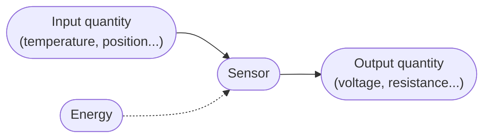
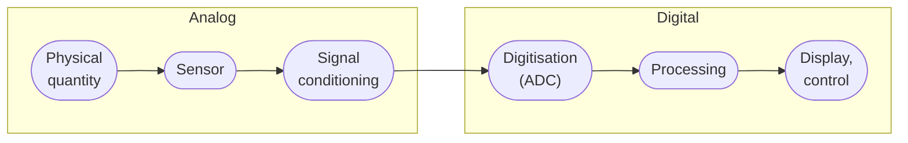

## Perceiving the physical world

An automatic system, whether a production line, a car, a connected object or a game console, must **know its environment** in order to react: a temperature, a position, a distance, a press. That is the job of **sensors**.

**By the end of this concept, you will be able to:**

- define a sensor and its main characteristics;
- describe a measurement chain, from the physical phenomenon to the number processed by a program;
- tell apart the types of signals and the families of sensors (active, passive);
- read a sensor with a microcontroller, according to the type of signal it delivers.

## What is a sensor?

A **sensor** turns a physical quantity (the **input** quantity, or *measurand*) into another quantity (the **output** quantity) that represents it and can be used to measure or to control. Most often, the output is **electrical**: a voltage, a current, a resistance, or directly a digital value.

A few sensors you have already come across:

- the **joystick** of a game controller: two potentiometers whose resistance depends on the position of the stick;
- the **photoresistor** of an automatic light: its resistance drops as the light increases;
- the **accelerometer** of a phone: it detects the orientation of the screen;
- the **button**: the simplest sensor of all, which only knows two states.

The output is not always electrical: a needle pressure gauge or a pneumatic sensor produce a displacement or a pressure. But to be read by a microcontroller, the information must end up in electrical form.

## The characteristics of a sensor

The *datasheet* of a sensor gives its characteristics. The most important ones:

| Characteristic | Definition | Example |
|---|---|---|
| **Measuring range** | The extreme values the sensor can measure | -55 °C to 150 °C |
| **Sensitivity** | The change in the output for a change in the input | 10 mV per °C for the LM35 temperature sensor |
| **Resolution** | The smallest change in the input the sensor can distinguish | 0.1 °C |
| **Accuracy** | The ability to give a measurement close to the true value | ± 0.5 °C |
| **Response time** | The time the output takes to follow a change in the input | 1 s to reach the new value |

Sensitivity takes you from the output to the measured quantity. For the LM35, a voltage of 250 mV corresponds to:

$$T = \frac{250\ \text{mV}}{10\ \text{mV/°C}} = 25\ \text{°C}$$

A measurement is never exact: it always comes with an **uncertainty**. We write, for example, $T = 25 \pm 0.5$ °C. The notions of precision, accuracy and uncertainty, and the common measurement errors, are covered in the concept [Precision, accuracy and good measuring practice](/docs/concepts/precision-justesse-mesure/).

## The measurement chain

Between the physical phenomenon and the number a program displays or uses, the information goes through several stages:

1. The **sensor** converts the physical quantity into an electrical signal.
2. **Signal conditioning** adapts this signal: amplifying a signal that is too weak, filtering out disturbances, converting a resistance into a voltage.
3. **Digitisation**, by an analog-to-digital converter (**ADC**), measures the voltage at regular intervals and turns it into a number.
4. **Processing**, by a microcontroller or a computer, makes use of these numbers: calculation, logging, display, decision.

More and more sensors integrate the first three stages in a single package: the **DS18B20** temperature sensor or the **BME280** temperature, humidity and pressure sensor deliver a digital value directly, which the microcontroller reads over a communication bus: 1-Wire for the DS18B20, I2C or SPI for the BME280.

## Types of signals

A sensor can deliver two broad families of signals.

An **analog** signal can take an **infinite number of values** within a range. Depending on the case, we are interested in:

- its **value** at a given moment, for a slowly varying signal: a temperature, a level;
- its **shape** over time: a heartbeat, an impact;
- its **frequency content**: the voice, a sonar.

A **digital** signal takes only a **finite number of values**:

- **on/off**: two states only, like a button or a limit switch;
- **pulse train**: each pulse signals an event, like a wheel encoder that sends a known number of pulses per revolution;
- **digital value**: a number sent over a bus (I2C, SPI, 1-Wire...), representing an analog quantity digitised by the sensor itself.

## Active and passive sensors

Depending on the physical phenomenon used, there are two families.

### Active sensors

An **active** sensor works like a **generator**: it directly converts the energy of the measured quantity (heat, motion, light) into electrical energy, with no external supply for the measurement itself.

| Physical effect | Principle | Measured quantity | Output |
|---|---|---|---|
| **Thermoelectric** | Two different metals joined together, with their junctions at different temperatures, produce a voltage | Temperature (thermocouple) | Voltage |
| **Piezoelectric** | Some crystals (quartz) become electrically charged when deformed | Force, pressure, acceleration | Electric charge |
| **Induction** | A magnet moving near a coil induces a voltage in it | Speed | Voltage |
| **Photovoltaic** | Light striking a semiconductor junction produces a voltage | Illuminance | Voltage |
| **Photoemission** | Light knocks electrons out of a material | Illuminance | Current |

### Passive sensors

A **passive** sensor is a component in which an electrical characteristic (resistance, capacitance, inductance) **varies** with the measured quantity. It produces nothing by itself: it must be **powered** to measure that variation.

| Measured quantity | Characteristic that varies | Example sensor |
|---|---|---|
| Position | Resistance | Potentiometer (the joystick) |
| Temperature | Resistance | Thermistor, Pt100 platinum probe |
| Light | Resistance | Photoresistor (LDR) |
| Strain, force | Resistance | Strain gauge |
| Distance, humidity | Capacitance | Capacitive sensor |
| Position of a metal part | Inductance | Inductive sensor |

Some sensors do not fit in either box. The **Hall effect** sensor, for example, measures a magnetic field (the position of a magnet, a current): it needs a power supply, but delivers a voltage directly.

## Reading a sensor with a microcontroller

How you read a sensor depends on the signal it delivers:

| Sensor signal | Example | How the microcontroller reads it |
|---|---|---|
| On/off | Button, limit switch | A digital input: `digitalRead()` |
| Analog voltage | Joystick, LM35 | The analog-to-digital converter: `analogRead()` |
| Variable resistance | Photoresistor, thermistor | A **voltage divider**, then `analogRead()` |
| Pulses | Wheel encoder | Counting edges, with an interrupt |
| Digital value | DS18B20 (1-Wire), BME280 (I2C) | A communication bus, through a library |

A **resistive** sensor does not deliver a voltage: it is placed in a **voltage divider**: the sensor (of resistance $R_c$) between 3.3 V and the analog input, and a fixed resistor $R$ between that input and GND. The voltage on the input then depends on $R_c$:

$$V_{measured} = 3.3\ \text{V} \times \frac{R}{R + R_c}$$

When the light increases, the resistance of a photoresistor drops, and $V_{measured}$ rises: the ADC converts it into a number between 0 and 4095. Analog readings are covered in the concept [ADC & PWM](/workshops/microcontroleur/concepts/adc-pwm/), and digital buses in [Communication buses](/workshops/microcontroleur/concepts/bus-communication/).



## Quick quiz

**1. A temperature sensor delivers 10 mV per °C. It outputs 320 mV. What is the temperature?**

Show the answer
320 / 10 = 32 °C.

**2. Is a photoresistor an active or a passive sensor?**

Show the answer
Passive: its resistance varies with light, but it produces no voltage. It must be powered, for example in a voltage divider.

**3. How does a microcontroller read a sensor that delivers a digital value directly?**

Show the answer
Over a communication bus (I2C, SPI, 1-Wire...), usually with a library provided for that sensor.

## Summary

- A **sensor** turns a physical quantity into a usable quantity, most often an electrical one.
- Its characteristics (measuring range, sensitivity, resolution, accuracy, response time) are read on its **datasheet**.
- A **measurement chain** links sensor, conditioning, digitisation and processing; many modern sensors integrate everything and deliver a digital value.
- A signal is **analog** (an infinite number of values) or **digital** (on/off, pulses, a value on a bus).
- An **active** sensor produces its own signal; a **passive** sensor has a characteristic that varies, and must be powered.
- A microcontroller reads a sensor with `digitalRead()`, `analogRead()` (with a voltage divider for a resistive sensor), interrupts, or a bus.

## Going further

- [Precision, accuracy and good measuring practice](/docs/concepts/precision-justesse-mesure/): errors, uncertainties and good measuring habits.
- [ADC & PWM](/workshops/microcontroleur/concepts/adc-pwm/): converting a voltage into a number with a microcontroller.
- [Communication buses](/workshops/microcontroleur/concepts/bus-communication/): reading a digital sensor over I2C, SPI or 1-Wire, and choosing its I2C address.
- [Acquisition d'une grandeur physique](https://www.les-electroniciens.com/sites/default/files/cours/capteurs.pdf), a course by Christian Bissières (in French), which was the starting point for this page.
