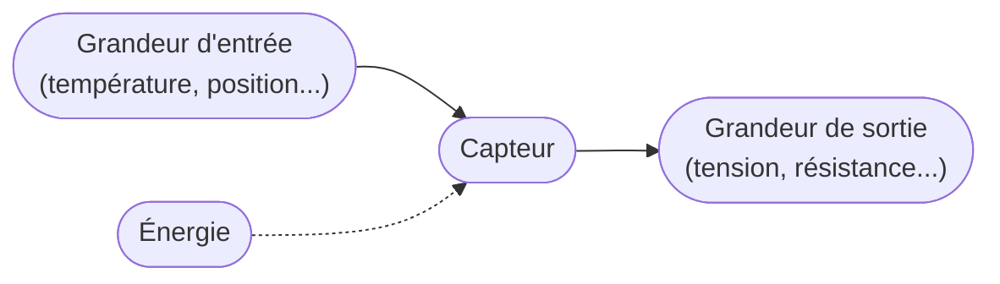
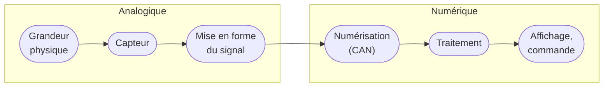

## Percevoir le monde physique

Un système automatique, qu'il s'agisse d'une ligne de production, d'une voiture, d'un objet connecté ou d'une console de jeu, doit **connaître son environnement** pour réagir : une température, une position, une distance, un appui. C'est le rôle des **capteurs**.

**À la fin de ce concept, tu sauras :**

- définir un capteur et ses principales caractéristiques ;
- décrire une chaîne de mesure, du phénomène physique au nombre traité par un programme ;
- distinguer les types de signaux et les familles de capteurs (actifs, passifs) ;
- lire un capteur avec un microcontrôleur, selon le type de signal qu'il délivre.

## Qu'est-ce qu'un capteur ?

Un **capteur** transforme une grandeur physique (la grandeur **d'entrée**, ou *mesurande*) en une autre grandeur (la grandeur **de sortie**), qui la représente et peut être exploitée pour mesurer ou commander. Le plus souvent, la sortie est **électrique** : une tension, un courant, une résistance, ou directement une valeur numérique.

Quelques capteurs que tu as déjà croisés :

- le **joystick** d'une manette : deux potentiomètres, dont la résistance dépend de la position du stick ;
- la **photorésistance** d'un éclairage automatique : sa résistance baisse quand la lumière augmente ;
- l'**accéléromètre** d'un téléphone : il détecte l'orientation de l'écran ;
- le **bouton** : le plus simple des capteurs, qui ne connaît que deux états.

La sortie n'est pas toujours électrique : un manomètre à aiguille ou un capteur pneumatique produisent un déplacement ou une pression. Mais pour être lue par un microcontrôleur, l'information doit finir sous forme électrique.

## Les caractéristiques d'un capteur

La fiche technique (*datasheet*) d'un capteur donne ses caractéristiques. Les plus importantes :

| Caractéristique | Définition | Exemple |
|---|---|---|
| **Étendue de mesure** | Les valeurs extrêmes que le capteur sait mesurer | -55 °C à 150 °C |
| **Sensibilité** | La variation de la sortie pour une variation de l'entrée | 10 mV par °C pour le capteur de température LM35 |
| **Résolution** | La plus petite variation de l'entrée que le capteur sait distinguer | 0,1 °C |
| **Précision** | L'aptitude à donner une mesure proche de la valeur vraie | ± 0,5 °C |
| **Temps de réponse** | Le temps que met la sortie à suivre un changement de l'entrée | 1 s pour atteindre la nouvelle valeur |

Avec la sensibilité, on passe de la sortie à la grandeur mesurée. Pour le LM35, une tension de 250 mV correspond à :

$$T = \frac{250\ \text{mV}}{10\ \text{mV/°C}} = 25\ \text{°C}$$

Une mesure n'est jamais exacte : elle s'accompagne toujours d'une **incertitude**. On écrit par exemple $T = 25 \pm 0{,}5$ °C. Les notions de précision, de justesse, d'incertitude et les erreurs de mesure courantes sont détaillées dans le concept [Précision, justesse et bonnes pratiques de mesure](/docs/concepts/precision-justesse-mesure/).

## La chaîne de mesure

Entre le phénomène physique et le nombre qu'affiche ou qu'utilise un programme, l'information traverse plusieurs étages :

1. Le **capteur** convertit la grandeur physique en signal électrique.
2. La **mise en forme** (ou *conditionnement*) adapte ce signal : amplification d'un signal trop faible, filtrage des perturbations, conversion d'une résistance en tension.
3. La **numérisation**, par un convertisseur analogique-numérique (**CAN**, ou *ADC* en anglais), mesure la tension à intervalles réguliers et la transforme en nombre.
4. Le **traitement**, par un microcontrôleur ou un ordinateur, exploite ces nombres : calcul, enregistrement, affichage, décision.

De plus en plus de capteurs intègrent les trois premiers étages dans un seul boîtier : le capteur de température **DS18B20** ou le capteur de température, d'humidité et de pression **BME280** délivrent directement une valeur numérique, que le microcontrôleur lit sur un bus de communication : le DS18B20 en 1-Wire, le BME280 en I2C ou en SPI.

## Les types de signaux

Un capteur peut délivrer deux grandes familles de signaux.

Un signal **analogique** peut prendre une **infinité de valeurs** dans un intervalle. On s'intéresse selon les cas :

- à sa **valeur** à un instant donné, pour un signal qui varie lentement : une température, un niveau ;
- à sa **forme** dans le temps : un battement cardiaque, un choc ;
- à son **contenu en fréquences** : la voix, un sonar.

Un signal **numérique** ne prend qu'un **nombre fini de valeurs** :

- **tout ou rien** (TOR) : deux états seulement, comme un bouton ou un interrupteur de fin de course ;
- **train d'impulsions** : chaque impulsion signale un événement, comme un codeur de roue qui envoie un nombre connu d'impulsions par tour ;
- **valeur numérique** : un nombre transmis sur un bus (I2C, SPI, 1-Wire...), image d'une grandeur analogique numérisée par le capteur lui-même.

## Capteurs actifs et capteurs passifs

Selon le phénomène physique utilisé, on distingue deux familles.

### Les capteurs actifs

Un capteur **actif** fonctionne comme un **générateur** : il convertit directement l'énergie de la grandeur mesurée (chaleur, mouvement, lumière) en énergie électrique, sans alimentation extérieure pour la mesure elle-même.

| Effet physique | Principe | Grandeur mesurée | Sortie |
|---|---|---|---|
| **Thermoélectrique** | Deux métaux différents soudés, dont les jonctions sont à des températures différentes, produisent une tension | Température (thermocouple) | Tension |
| **Piézoélectrique** | Certains cristaux (le quartz) se chargent électriquement quand on les déforme | Force, pression, accélération | Charge électrique |
| **Induction** | Un aimant qui bouge près d'une bobine y induit une tension | Vitesse | Tension |
| **Photovoltaïque** | La lumière qui frappe une jonction de semi-conducteurs produit une tension | Éclairement | Tension |
| **Photoémission** | La lumière arrache des électrons à un matériau | Éclairement | Courant |

### Les capteurs passifs

Un capteur **passif** est un composant dont une caractéristique électrique (résistance, capacité, inductance) **varie** avec la grandeur mesurée. Il ne produit rien par lui-même : il faut l'**alimenter** pour mesurer cette variation.

| Grandeur mesurée | Caractéristique qui varie | Exemple de capteur |
|---|---|---|
| Position | Résistance | Potentiomètre (le joystick) |
| Température | Résistance | Thermistance, sonde platine Pt100 |
| Lumière | Résistance | Photorésistance (LDR) |
| Déformation, force | Résistance | Jauge de contrainte |
| Distance, humidité | Capacité | Capteur capacitif |
| Position d'une pièce métallique | Inductance | Capteur inductif |

Certains capteurs ne rentrent pas dans ces deux cases. Le capteur à **effet Hall**, par exemple, mesure un champ magnétique (la position d'un aimant, un courant) : il a besoin d'une alimentation, mais délivre directement une tension.

## Lire un capteur avec un microcontrôleur

La façon de lire un capteur dépend du signal qu'il délivre :

| Signal du capteur | Exemple | Lecture par le microcontrôleur |
|---|---|---|
| Tout ou rien | Bouton, fin de course | Une entrée numérique : `digitalRead()` |
| Tension analogique | Joystick, LM35 | Le convertisseur analogique-numérique : `analogRead()` |
| Résistance variable | Photorésistance, thermistance | Un **pont diviseur**, puis `analogRead()` |
| Impulsions | Codeur de roue | Compter les fronts, par interruption |
| Valeur numérique | DS18B20 (1-Wire), BME280 (I2C) | Un bus de communication, via une bibliothèque |

Un capteur **résistif** ne délivre pas de tension : on le place dans un **pont diviseur** : le capteur (de résistance $R_c$) entre le 3,3 V et l'entrée analogique, une résistance fixe $R$ entre cette entrée et GND. La tension sur l'entrée dépend alors de $R_c$ :

$$V_{mesure} = 3{,}3\ \text{V} \times \frac{R}{R + R_c}$$

Quand la lumière augmente, la résistance d'une photorésistance baisse, et $V_{mesure}$ monte : l'ADC la convertit en un nombre entre 0 et 4095. Les lectures analogiques sont détaillées dans le concept [ADC & PWM](/workshops/microcontroleur/concepts/adc-pwm/), et les bus numériques dans [Les bus de communication](/workshops/microcontroleur/concepts/bus-communication/).



## Quiz express

**1. Un capteur de température délivre 10 mV par °C. Il sort 320 mV. Quelle est la température ?**

Voir la réponse
320 / 10 = 32 °C.

**2. Une photorésistance est-elle un capteur actif ou passif ?**

Voir la réponse
Passif : sa résistance varie avec la lumière, mais elle ne produit aucune tension. Il faut l'alimenter, par exemple dans un pont diviseur.

**3. Comment un microcontrôleur lit-il un capteur qui délivre directement une valeur numérique ?**

Voir la réponse
Par un bus de communication (I2C, SPI, 1-Wire...), en général avec une bibliothèque fournie pour ce capteur.

## Résumé

- Un **capteur** transforme une grandeur physique en une grandeur exploitable, le plus souvent électrique.
- Ses caractéristiques (étendue de mesure, sensibilité, résolution, précision, temps de réponse) se lisent sur sa **datasheet**.
- Une **chaîne de mesure** enchaîne capteur, mise en forme, numérisation et traitement ; beaucoup de capteurs modernes intègrent tout et délivrent une valeur numérique.
- Un signal est **analogique** (infinité de valeurs) ou **numérique** (tout ou rien, impulsions, valeur sur un bus).
- Un capteur **actif** produit lui-même son signal ; un capteur **passif** voit une caractéristique varier, et doit être alimenté.
- Un microcontrôleur lit un capteur avec `digitalRead()`, `analogRead()` (avec un pont diviseur pour un capteur résistif), des interruptions, ou un bus.

## Pour aller plus loin

- [Précision, justesse et bonnes pratiques de mesure](/docs/concepts/precision-justesse-mesure/) : erreurs, incertitudes et bons gestes de mesure.
- [ADC & PWM](/workshops/microcontroleur/concepts/adc-pwm/) : convertir une tension en nombre avec un microcontrôleur.
- [Les bus de communication](/workshops/microcontroleur/concepts/bus-communication/) : lire un capteur numérique en I2C, en SPI ou en 1-Wire, et choisir son adresse I2C.
- [Acquisition d'une grandeur physique](https://www.les-electroniciens.com/sites/default/files/cours/capteurs.pdf), cours de Christian Bissières, qui a servi de point de départ à cette page.
