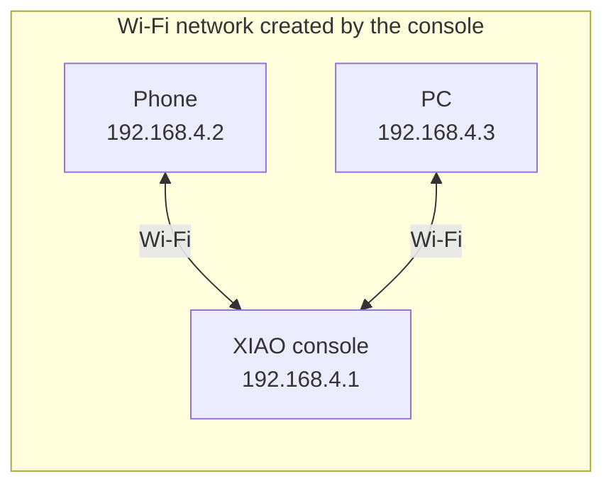
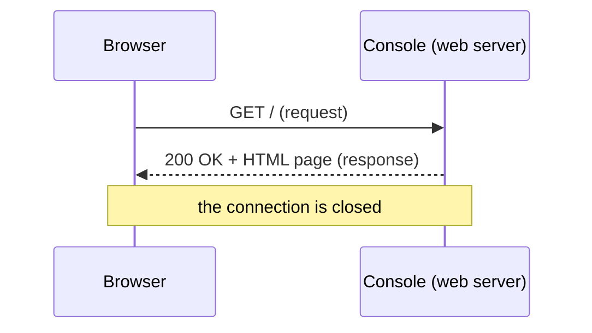
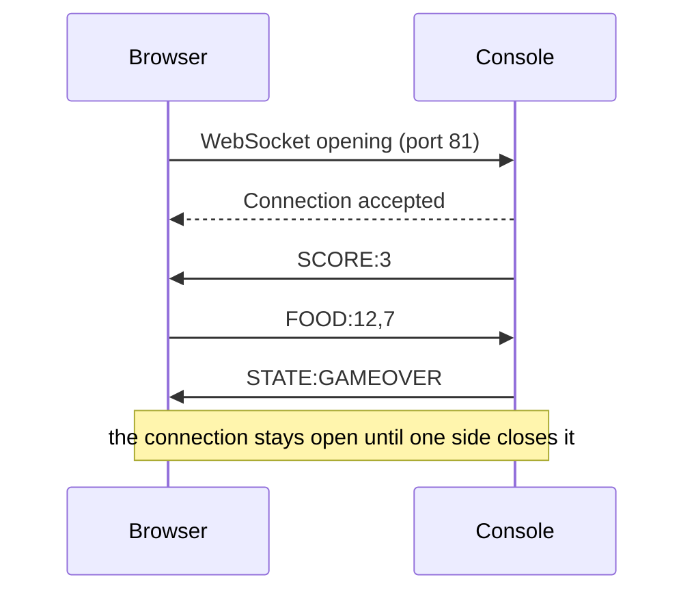
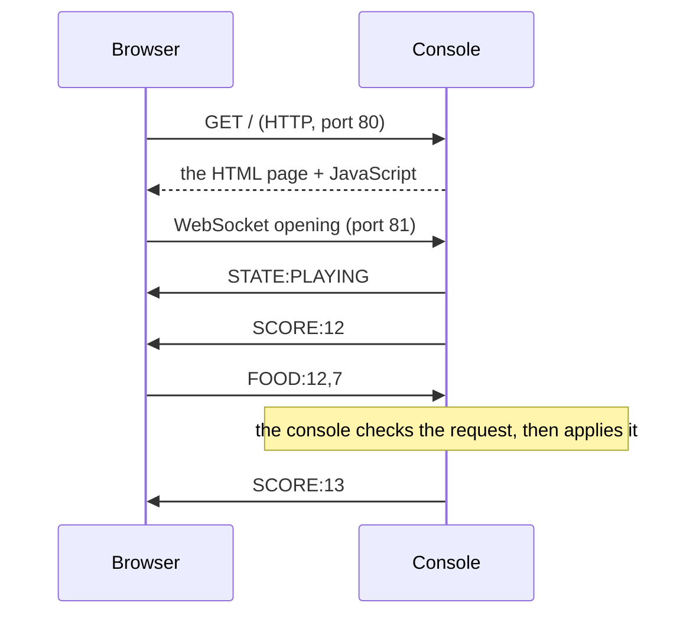
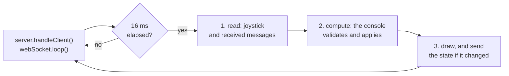
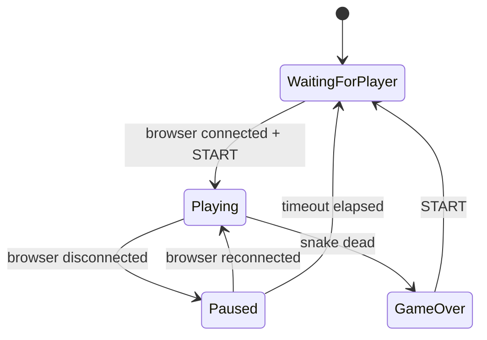

## Leaving the board

Until now, the console only talked to its own peripherals: buttons, joystick, display. [Communication buses](/workshops/microcontroleur/concepts/bus-communication/) connect components that sit a few centimetres apart. For a second player to interact from their phone, the scale has to change: go through **Wi-Fi**, and speak the language of browsers.

**By the end of this concept, you will be able to:**

- explain the difference between a Wi-Fi access point and a station;
- describe what an IP address, a port and an HTTP request are;
- explain why HTTP is not enough for a game, and what a WebSocket brings;
- design a small message protocol and handle a player disconnecting.

## Wi-Fi: access point or station

The ESP32-S3 has a built-in 2.4 GHz Wi-Fi radio. It works in two modes:

| Mode | Role of the ESP32 | Example | Advantage | Limit |
|---|---|---|---|---|
| **Station** (STA) | Joins an existing network, like a phone | The home router | Internet access | Depends on the network (password, captive portal, blocked ports) |
| **Access point** (AP) | Creates its **own** network | A phone hotspot | Works anywhere, with no infrastructure | No Internet, about ten devices at most |

For a game console that must work in the classroom as well as in a demo, the **access point** is the safest choice: the console creates the `Snake-Team3` network, the player's phone connects to it, and nothing depends on the school network (often blocked for this kind of use).





## Addresses and ports

On a network, every device has an **IP address** (four numbers, for example `192.168.4.1`). In access point mode, the ESP32 always takes the address `192.168.4.1` and hands out the following ones to the devices that join it.

A single device can run several services: each one listens on a **port** (a number from 0 to 65535). By convention, a web server listens on port **80**. The full address of a service is therefore written `192.168.4.1:80`, and the browser adds the `:80` by itself.

The classic analogy: the IP address is the address of a building, the port is the flat number.


## HTTP: asking for a page

When you type `http://192.168.4.1/` into a browser, it sends an **HTTP request** to the console, which sends back a **response**: the code of the web page (HTML, CSS, JavaScript). The page is displayed, and the connection ends.



HTTP always works in this direction: **the browser asks, the server answers**. The server can never take the initiative.

### Why HTTP is not enough for a game

In a game, the console must tell the browser **as soon as** something happens: the snake has eaten, the game is lost. With HTTP alone, the browser would have to ask "anything new?" several times a second (this is called *polling*): each request opens a connection, sends headers of several hundred bytes, and the answer arrives at best on the next round of questions. It is slow and costly, and the console mostly answers "nothing new".

## WebSocket: a line open in both directions

A **WebSocket** starts like an HTTP request, then the connection **stays open**. After that, either side can send a message at any time, without waiting to be asked: it is a **bidirectional**, **real-time** channel, like a serial link, but over Wi-Fi.



In the workshop, the console runs **two servers**:

| Server | Port | Role |
|---|---|---|
| Web server (HTTP) | 80 | Sends the player's page, once, when it is opened |
| WebSocket server | 81 | Exchanges the game messages throughout the game |

The JavaScript of the page opens the WebSocket as soon as it is loaded: `new WebSocket("ws://192.168.4.1:81/")`.

## Designing your protocol

A WebSocket carries messages, but says nothing about **their content**: it is up to you to define a **protocol**, that is, the possible messages, their format and their meaning. It is the same approach as for UART (`8N1` format), one level up.

The simplest option is a short text format, `TYPE:values`:



| Direction | Message | Meaning of the message |
|---|---|---|
| Console → browser | `STATE:PLAYING` | The game phase has changed |
| Console → browser | `SCORE:12` | New score |
| Browser → console | `FOOD:12,7` | The web player asks for an apple in cell (12, 7) |

A few rules avoid most problems:

- **The console is the referee.** It holds the game state and applies the rules. The browser **proposes** ("I want to put an apple here"), the console **decides** (refusing if the cell is occupied) and then informs. That way, the two sides can never disagree.
- **Short, infrequent messages.** Sending the full state 60 times a second would saturate the link. Send a message when something **changes**, or at a limited rate (10 per second is more than enough for a display).
- **Validate everything that comes in.** A malformed message, a cell outside the grid: the console must ignore them, never crash. The browser is an input like any other, only less reliable.
- **Write the protocol before the code**, in a table like the one above, and keep it up to date in the project documentation.



## The network in the game loop

The web server and the WebSocket server need to be given control regularly to process what comes in. Their service functions are therefore called **on every pass of `loop()`**, outside the frame rate:

```cpp
void loop() {
    server.handleClient();   // HTTP: serves the page if someone requests it
    webSocket.loop();        // WebSocket: receives messages, manages connections

    // ... then the usual game loop, paced by millis()
}
```



The rule seen in [From hardware to software](/workshops/microcontroleur/concepts/du-materiel-au-logiciel/) has never been more true: **no `delay()`**. During a blocking wait, messages pile up, the browser thinks the console is frozen, and the connection ends up dropping.

Received messages arrive through a **callback**: a function you write, which the library calls on every event (connection, disconnection, message). As with an interrupt, do the minimum in it: store the command received, which the game loop will process on its next pass.

## The connection is part of the game

A player can close their browser, walk out of Wi-Fi range or have their phone go to sleep. The game must **plan for it** instead of suffering it, and that is a job for the [state machine](/workshops/microcontroleur/concepts/machine-etats-finis/):



The "browser disconnected" event is a transition like any other. What it triggers (pause, game continued against the computer, end of game) is a design choice, to be decided and documented.

## Quick quiz

**1. Why create an access point rather than join the school Wi-Fi?**

<details><summary>Show the answer</summary>The access point works anywhere, without depending on an outside network that is often filtered (captive portal, devices isolated from one another, blocked ports).</details>

**2. Why is HTTP alone poorly suited to a real-time game?**

<details><summary>Show the answer</summary>The server cannot take the initiative: the browser has to keep asking whether there is anything new, which is slow and costly.</details>

**3. The browser sends `FOOD:40,2` while the grid is 24 × 30 cells. What should the console do?**

<details><summary>Show the answer</summary>Ignore the message (and possibly reply with an error): the console is the referee and validates everything that comes in; it never crashes on an invalid input.</details>

## Going further

- [ESP32, Wi-Fi and WebSocket: control from a browser](/docs/tutorials/electronics/esp32-wifi-websocket/): putting it into practice step by step
- [Finite state machine (FSM)](/workshops/microcontroleur/concepts/machine-etats-finis/): integrating the network states into the game

## Summary

- In **access point** mode, the ESP32 creates its own network (`192.168.4.1`): ideal for a standalone console.
- An **IP address** identifies a device, a **port** a service on that device (80 for the web).
- **HTTP**: the browser asks, the server answers, the connection closes. Perfect for sending the page, not for a game.
- **WebSocket**: a connection that stays open, where either side can send a message at any time.
- A short **protocol** written in advance, a **referee** console that validates everything, messages sent **when something changes**.
- The network is serviced on every pass of `loop()`, **without `delay()`**, and disconnection is a transition of the FSM.
