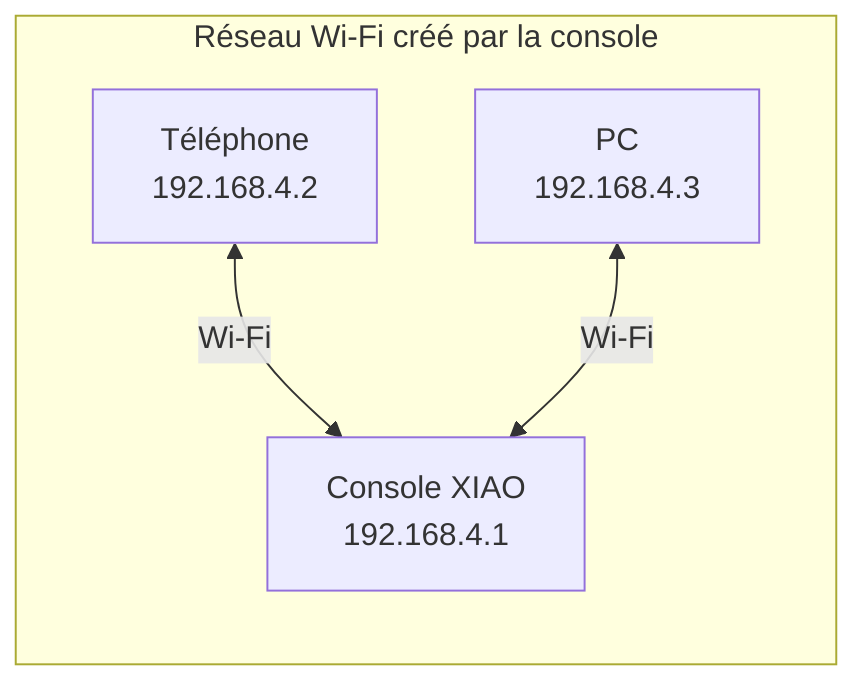
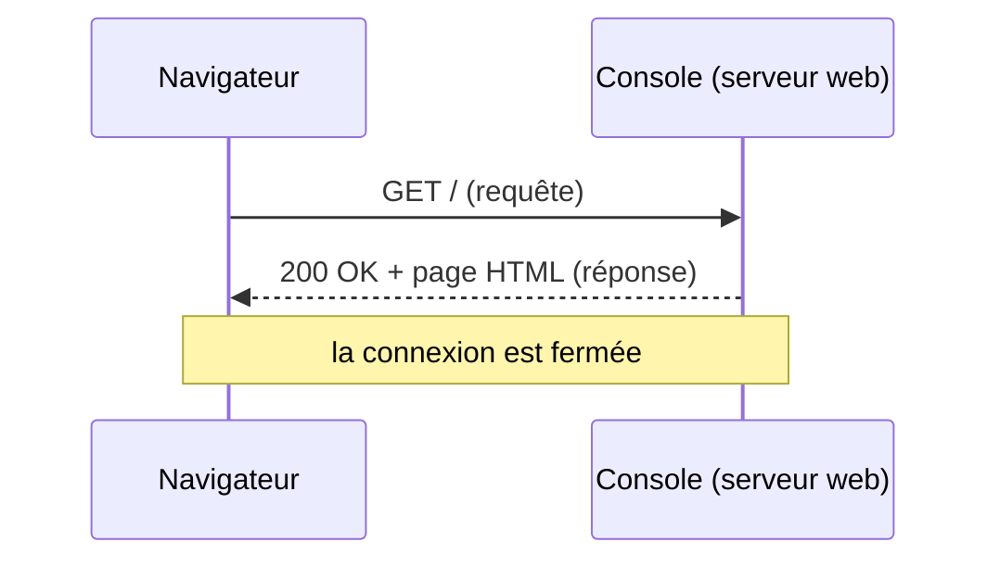
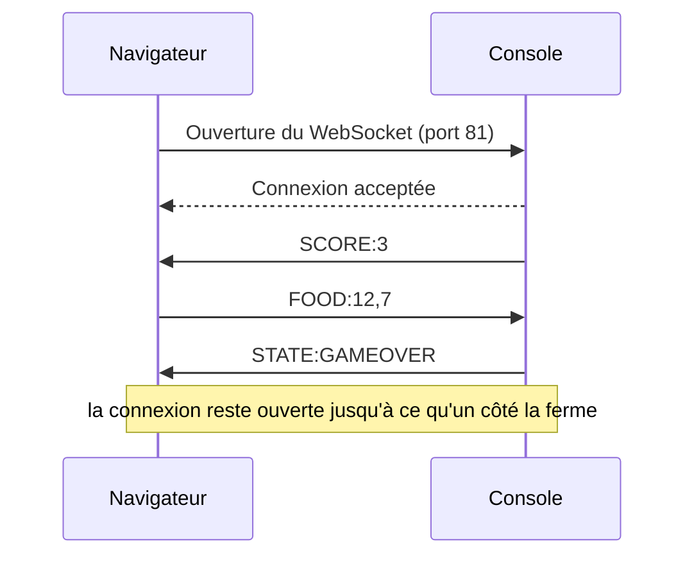
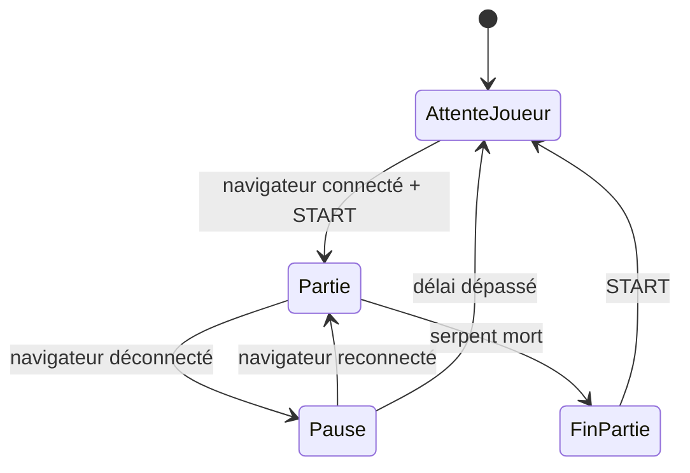

## Sortir de la carte

Jusqu'ici, la console ne parlait qu'à ses propres périphériques : boutons, joystick, écran. Les [bus de communication](/workshops/microcontroleur/concepts/bus-communication/) relient des composants posés à quelques centimètres les uns des autres. Pour qu'un deuxième joueur interagisse depuis son téléphone, il faut changer d'échelle : passer par le **Wi-Fi**, et parler la langue des navigateurs.

**À la fin de ce concept, tu sauras :**

- expliquer la différence entre un point d'accès et une station Wi-Fi ;
- décrire ce qu'est une adresse IP, un port, une requête HTTP ;
- expliquer pourquoi HTTP ne suffit pas pour un jeu, et ce qu'apporte un WebSocket ;
- concevoir un petit protocole de messages et gérer la déconnexion d'un joueur.

## Le Wi-Fi : point d'accès ou station

L'ESP32-S3 intègre une radio Wi-Fi 2,4 GHz. Elle fonctionne dans deux modes :

| Mode | Rôle de l'ESP32 | Exemple | Avantage | Limite |
|---|---|---|---|---|
| **Station** (STA) | Rejoint un réseau existant, comme un téléphone | La box de la maison | Accès à Internet | Dépend du réseau (mot de passe, portail captif, ports bloqués) |
| **Point d'accès** (AP) | Crée son **propre** réseau | Un partage de connexion | Fonctionne partout, sans infrastructure | Pas d'Internet, une dizaine d'appareils au plus |

Pour une console de jeu qui doit marcher en salle de TD comme en démonstration, le **point d'accès** est le choix le plus sûr : la console crée le réseau `Snake-Binome3`, le téléphone du joueur s'y connecte, et rien ne dépend du réseau de l'établissement (souvent bloqué pour ce genre d'usage).





## Adresses et ports

Sur un réseau, chaque appareil a une **adresse IP** (quatre nombres, par exemple `192.168.4.1`). En mode point d'accès, l'ESP32 prend toujours l'adresse `192.168.4.1` et distribue les suivantes aux appareils qui le rejoignent.

Un même appareil peut faire tourner plusieurs services : chacun écoute sur un **port** (un numéro de 0 à 65535). Par convention, un serveur web écoute sur le port **80**. L'adresse complète d'un service s'écrit donc `192.168.4.1:80`, et le navigateur ajoute le `:80` tout seul.

L'analogie classique : l'adresse IP est l'adresse d'un immeuble, le port est le numéro de l'appartement.

## HTTP : demander une page

Quand tu tapes `http://192.168.4.1/` dans un navigateur, il envoie une **requête HTTP** à la console, qui renvoie une **réponse** : le code de la page web (HTML, CSS, JavaScript). La page s'affiche, et la connexion se termine.



HTTP fonctionne toujours dans ce sens : **le navigateur demande, le serveur répond**. Le serveur ne peut jamais prendre l'initiative.

### Pourquoi HTTP ne suffit pas pour un jeu

Dans un jeu, la console doit prévenir le navigateur **dès que** quelque chose se passe : le serpent a mangé, la partie est perdue. Avec HTTP seul, le navigateur devrait redemander « du nouveau ? » plusieurs fois par seconde (on parle de *polling*) : chaque requête ouvre une connexion, envoie des en-têtes de plusieurs centaines d'octets, et la réponse arrive au mieux au prochain tour de questions. C'est lent, coûteux, et la console répond surtout « rien de neuf ».

## WebSocket : une ligne ouverte dans les deux sens

Un **WebSocket** commence comme une requête HTTP, puis la connexion **reste ouverte**. Ensuite, chacun des deux côtés peut envoyer un message à tout moment, sans attendre d'être interrogé : c'est un canal **bidirectionnel** et **temps réel**, comme une liaison série, mais à travers le Wi-Fi.



Dans l'atelier, la console fait tourner **deux serveurs** :

| Serveur | Port | Rôle |
|---|---|---|
| Serveur web (HTTP) | 80 | Envoie la page du joueur, une seule fois, à l'ouverture |
| Serveur WebSocket | 81 | Échange les messages du jeu pendant toute la partie |

Le JavaScript de la page ouvre le WebSocket dès qu'elle est chargée : `new WebSocket("ws://192.168.4.1:81/")`.

## Concevoir son protocole

Un WebSocket transporte des messages, mais ne dit rien de **leur contenu** : c'est à toi de définir un **protocole**, c'est-à-dire les messages possibles, leur format et leur sens. C'est la même démarche que pour l'UART (format `8N1`), un cran au-dessus.

Le plus simple est un format texte court, `TYPE:valeurs` :

| Sens | Message | Sens du message |
|---|---|---|
| Console → navigateur | `STATE:PLAYING` | La phase de jeu a changé |
| Console → navigateur | `SCORE:12` | Nouveau score |
| Navigateur → console | `FOOD:12,7` | Le joueur web demande une pomme en case (12, 7) |

Quelques règles évitent la plupart des problèmes :

- **La console est l'arbitre.** C'est elle qui détient l'état du jeu et applique les règles. Le navigateur **propose** (« je veux poser une pomme ici »), la console **décide** (refus si la case est occupée) puis informe. Ainsi, les deux côtés ne peuvent jamais être en désaccord.
- **Des messages courts et peu fréquents.** Envoyer l'état complet 60 fois par seconde saturerait la liaison. On envoie un message quand quelque chose **change**, ou à cadence limitée (10 par seconde suffit largement pour un affichage).
- **Valider tout ce qui arrive.** Un message mal formé, une case hors de la grille : la console doit les ignorer, jamais planter. Le navigateur est une entrée comme une autre, en moins fiable.
- **Écrire le protocole avant le code**, dans un tableau comme celui ci-dessus, et le garder à jour dans la documentation du projet.



## Le réseau dans la game loop

Le serveur web et le serveur WebSocket ont besoin qu'on leur donne la main régulièrement pour traiter ce qui arrive. On appelle donc leurs fonctions de service **à chaque tour de `loop()`**, en dehors de la cadence des images :

```cpp
void loop() {
    server.handleClient();   // HTTP : sert la page si quelqu'un la demande
    webSocket.loop();        // WebSocket : reçoit les messages, gère les connexions

    // ... puis la game loop habituelle, cadencée par millis()
}
```

La règle vue dans [Du matériel au logiciel](/workshops/microcontroleur/concepts/du-materiel-au-logiciel/) n'a jamais été aussi vraie : **aucun `delay()`**. Pendant une attente bloquante, les messages s'accumulent, le navigateur croit la console figée, et la connexion finit par tomber.

Les messages reçus arrivent par une **fonction de rappel** (*callback*) : une fonction que tu écris, que la bibliothèque appelle à chaque événement (connexion, déconnexion, message). Comme pour une interruption, on y fait le minimum : mémoriser la commande reçue, que la game loop traitera à son prochain tour.

## La connexion fait partie du jeu

Un joueur peut fermer son navigateur, sortir de la portée du Wi-Fi ou voir son téléphone se mettre en veille. Le jeu doit le **prévoir** au lieu de le subir, et c'est un travail pour la [machine à états](/workshops/microcontroleur/concepts/machine-etats-finis/) :



L'événement « navigateur déconnecté » est une transition comme une autre. Ce qu'elle déclenche (pause, partie continuée contre l'ordinateur, fin de partie) est un choix de conception, à décider et à documenter.

## Quiz express

**1. Pourquoi créer un point d'accès plutôt que rejoindre le Wi-Fi de l'école ?**

<details><summary>Voir la réponse</summary>Le point d'accès fonctionne partout, sans dépendre d'un réseau extérieur souvent filtré (portail captif, appareils isolés les uns des autres, ports bloqués).</details>

**2. Pourquoi HTTP seul est-il mal adapté à un jeu en temps réel ?**

<details><summary>Voir la réponse</summary>Le serveur ne peut pas prendre l'initiative : le navigateur doit redemander sans cesse s'il y a du nouveau, ce qui est lent et coûteux.</details>

**3. Le navigateur envoie `FOOD:40,2` alors que la grille fait 24 × 30 cases. Que doit faire la console ?**

<details><summary>Voir la réponse</summary>Ignorer le message (et éventuellement répondre une erreur) : la console est l'arbitre et valide tout ce qui arrive, elle ne plante jamais sur une entrée invalide.</details>

## Pour aller plus loin

- [ESP32, Wi-Fi et WebSocket : piloter depuis un navigateur](/docs/tutorials/electronics/esp32-wifi-websocket/) : la mise en pratique pas à pas
- [Machine à états finis (FSM)](/workshops/microcontroleur/concepts/machine-etats-finis/) : intégrer les états réseau au jeu

## Résumé

- En mode **point d'accès**, l'ESP32 crée son propre réseau (`192.168.4.1`) : idéal pour une console autonome.
- Une **adresse IP** désigne un appareil, un **port** un service sur cet appareil (80 pour le web).
- **HTTP** : le navigateur demande, le serveur répond, la connexion se ferme. Parfait pour envoyer la page, pas pour un jeu.
- **WebSocket** : une connexion qui reste ouverte, où chacun peut envoyer un message à tout moment.
- Un **protocole** court et écrit à l'avance, une console **arbitre** qui valide tout, des messages envoyés **quand ça change**.
- Le réseau se sert à chaque tour de `loop()`, **sans `delay()`**, et la déconnexion est une transition de la FSM.
