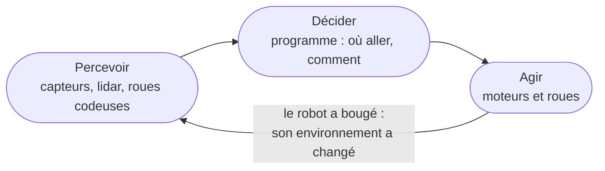

## Un robot qui se déplace

Un **robot mobile** est un robot capable de se déplacer dans son environnement. C'est ce qui le distingue d'un bras robotique d'usine, fixé au sol, qui ne fait que bouger ses articulations. Un robot aspirateur, un chariot autonome d'entrepôt, un rover martien ou un robot de compétition sont des robots mobiles.

Ce parcours s'intéresse aux robots mobiles **à roues**, les plus répandus : ils sont simples à fabriquer, efficaces sur un sol plat et faciles à commander.

**À la fin de ce concept, tu sauras :**

- décrire la boucle qui fait fonctionner tout robot mobile ;
- reconnaître les principaux types de roues et ce qu'elles permettent ;
- distinguer les architectures de robots à roues, avec leurs avantages et leurs limites ;
- expliquer pourquoi le robot différentiel est le choix le plus courant.

## Percevoir, décider, agir

Quelle que soit sa forme, un robot mobile répète sans arrêt la même boucle :

- **Percevoir** : les [capteurs](/docs/concepts/capteurs/) mesurent l'environnement (distance à un obstacle, ligne au sol) et l'état du robot lui-même (de combien les roues ont tourné).
- **Décider** : le programme, sur le microcontrôleur, choisit quoi faire à partir de ces mesures.
- **Agir** : les moteurs font tourner les roues, et le robot se déplace.

Ce concept porte sur la partie **Agir** : comment des roues, selon leur type et leur disposition, font bouger un robot. Les capteurs et la décision viennent dans la suite du parcours.

## Les types de roues

Toutes les roues ne se valent pas. Le type de roue décide des mouvements que le robot pourra faire.

| Type | Description | Rôle habituel |
|---|---|---|
| **Roue fixe** | Son axe est fixé au châssis. Elle roule vers l'avant et l'arrière, mais ne peut pas glisser sur le côté. | Roue motrice |
| **Roue directrice** | Elle pivote autour d'un axe vertical pour changer de direction. | Direction d'une voiture |
| **Roue folle** | Elle pivote librement autour d'un axe décalé, et s'aligne seule sur le mouvement (comme une roulette de chariot de supermarché). | Appui |
| **Bille porteuse** | Une bille qui roule dans toutes les directions. | Appui |
| **Roue omnidirectionnelle** | Une roue garnie de petits galets perpendiculaires : elle pousse dans un sens et glisse librement dans l'autre. | Motrice d'un robot omnidirectionnel |
| **Roue mecanum** | Une roue garnie de galets inclinés à 45° : elle pousse en biais. | Motrice d'un robot omnidirectionnel |

On combine aussi une roue et deux moteurs dans un **module swerve** : un moteur fait tourner la roue, l'autre l'oriente dans n'importe quelle direction.

### Pourquoi une roue fixe ne glisse pas sur le côté

Une roue fixe peut seulement **rouler** : elle ne peut pas se déplacer perpendiculairement à son plan sans déraper. C'est une bonne chose (le robot ne part pas en crabe tout seul), mais c'est aussi une **contrainte** : un robot à roues fixes ne peut pas aller directement sur le côté.

C'est l'expérience du créneau : une voiture ne peut pas se déplacer latéralement pour se garer, elle doit faire une série de manœuvres en avançant et en reculant. On dit qu'elle est **non holonome**.

Un robot **holonome**, au contraire, peut se déplacer dans n'importe quelle direction du plan, quelle que soit son orientation, et tourner en même temps. Pour cela, il lui faut des roues capables de glisser sur le côté (omnidirectionnelles, mecanum) ou de s'orienter dans toutes les directions (swerve).

## Les architectures de robots à roues

Une **architecture** (on dit aussi *base* ou *châssis*), c'est le choix du nombre de roues, de leur type et de leur disposition. Les schémas ci-dessous sont vus de dessus, l'avant du robot vers le haut ; les roues motrices sont en rouge.

### Robot différentiel

Deux roues motrices **indépendantes**, sur le même axe, et un ou deux appuis (billes ou roues folles) pour l'équilibre. Le robot dirige son mouvement en faisant varier la vitesse de chaque roue :

| Roue gauche | Roue droite | Mouvement |
|---|---|---|
| Avance | Avance, même vitesse | Ligne droite |
| Avance | Avance, plus vite | Virage à gauche |
| Recule | Avance, même vitesse | Rotation sur place |

- **Avantages** : deux moteurs seulement, mécanique très simple, rotation sur place possible.
- **Limites** : non holonome (pas de déplacement latéral) ; aller droit demande que les deux roues tournent exactement à la même vitesse.
- **Exemples** : robots aspirateurs, la plupart des robots de compétition étudiante, Thymio.

**À toi de jouer** : règle la vitesse de chaque roue, ou choisis un mouvement. Observe le **centre instantané de rotation** (CIR, point rouge) : c'est le point autour duquel le robot tourne. Que devient-il quand les deux roues vont à la même vitesse ? Quand elles tournent en sens opposés ?



### Tricycle

Une roue avant à la fois **motrice et directrice**, et deux roues arrière libres.

- **Avantages** : un seul moteur de traction, direction simple.
- **Limites** : non holonome, moins stable en virage serré (trois points d'appui seulement). Il ne tourne sur place que si la roue avant peut braquer presque à 90° : il pivote alors autour du milieu de l'essieu arrière.
- **Exemples** : certains chariots élévateurs et chariots autonomes d'usine.

**À toi de jouer** : braque la roue avant et regarde le CIR, toujours sur l'axe des roues arrière. Que se passe-t-il au braquage maximal ?



### Type voiture (Ackermann)

Quatre roues : deux roues **motrices** (souvent à l'arrière) et deux roues **directrices** (à l'avant). Dans un virage, la roue intérieure doit braquer plus que la roue extérieure, sinon l'une des deux dérape. La géométrie d'**Ackermann** règle ce détail : les axes des quatre roues se coupent en un même point, le **centre instantané de rotation** (CIR), autour duquel tout le véhicule tourne à cet instant.

- **Avantages** : très stable à grande vitesse, bien adapté à l'extérieur.
- **Limites** : non holonome, ne tourne pas sur place, grand rayon de braquage, manœuvres difficiles en espace réduit.
- **Exemples** : voitures, voitures autonomes, robots de course à l'échelle 1/10.

**À toi de jouer** : braque les roues avant. Observe que la roue intérieure braque plus que l'extérieure, et que les quatre roues pointent toutes vers le même CIR.



### Omnidirectionnel à roues omni

Trois (ou quatre) roues omnidirectionnelles motrices, disposées autour du robot. Chaque roue pousse dans sa direction et laisse glisser dans l'autre : en combinant les vitesses des trois moteurs, le robot part dans n'importe quelle direction.

- **Avantages** : holonome, très manœuvrable.
- **Limites** : trois moteurs ou plus, commande plus complexe (chaque déplacement demande un calcul sur toutes les roues), adhérence faible : les galets glissent facilement.
- **Exemples** : robots de football de la RoboCup, plateformes de recherche.

**À toi de jouer** : ici, tu ne commandes plus les roues mais le **mouvement voulu** (avancer, aller sur le côté, tourner) ; le simulateur calcule la vitesse de chaque roue, comme le ferait le programme du robot. Essaie « En crabe », puis « Tourner en se déplaçant ».



### Omnidirectionnel à roues mecanum

Quatre roues mecanum, disposées comme sur une voiture, chacune avec son moteur. Les galets inclinés à 45° produisent une poussée en biais ; selon le sens de rotation de chaque roue, ces poussées s'additionnent ou s'annulent. Le robot peut ainsi avancer, aller **en crabe** (sur le côté) ou tourner sur place.

- **Avantages** : holonome, avec une forme de voiture classique.
- **Limites** : quatre moteurs, roues coûteuses, glissement important (donc mesure du déplacement par les roues motrices imprécise), sensible aux sols irréguliers.
- **Exemples** : chariots industriels pour charges lourdes, robots de compétition lycéenne (FTC).

**À toi de jouer** : compare le sens de rotation des quatre roues pour « Avancer » et pour « En crabe ».



### Swerve

Quatre **modules swerve**, un dans chaque coin. Chaque module a deux moteurs : un pour faire tourner la roue, un pour l'orienter. Toutes les roues pouvant pointer dans n'importe quelle direction, le robot se déplace où il veut, tout en tournant sur lui-même s'il le faut.

- **Avantages** : holonome, avec de vraies roues adhérentes : rapide, précis et puissant.
- **Limites** : huit moteurs, mécanique complexe et coûteuse, commande la plus difficile de toutes.
- **Exemples** : robots de compétition FRC (FIRST Robotics Competition), où il s'est imposé.

**À toi de jouer** : choisis « Tourner en se déplaçant » et observe chaque module s'orienter dans sa propre direction.



### Comparaison

| Architecture | Moteurs | Tourne sur place | Va sur le côté | Complexité |
|---|---|---|---|---|
| Différentielle | 2 | Oui | Non | Faible |
| Tricycle | 1 ou 2 | Si braquage à 90° | Non | Faible |
| Voiture (Ackermann) | 2 (traction + direction) | Non | Non | Moyenne |
| Omni (3 roues) | 3 | Oui | Oui | Moyenne |
| Mecanum | 4 | Oui | Oui | Moyenne |
| Swerve | 8 | Oui | Oui | Élevée |

Il n'y a pas de « meilleure » architecture : tout dépend du terrain, de la précision attendue, du budget et du temps disponible pour la mise au point.

## Le robot différentiel, le choix le plus courant

Pour un robot qui évolue sur une table de jeu plate, comme ceux de la **Coupe de France de robotique**, l'architecture différentielle l'emporte presque toujours :

- elle demande **deux moteurs** seulement, donc une électronique et un budget réduits ;
- le robot **tourne sur place**, ce qui suffit largement pour se placer où l'on veut : tourner, avancer, tourner de nouveau ;
- son mouvement **se calcule facilement** à partir de la rotation des deux roues, ce qui permet au robot de savoir où il est.

C'est le robot qui sert de fil conducteur à ce parcours :

| Élément | Rôle | Partie de la boucle |
|---|---|---|
| **Deux roues motrices** | Faire avancer et tourner le robot | Agir |
| **Moteurs pas à pas** | Faire tourner chaque roue d'un angle précis | Agir |
| **Billes porteuses** | Assurer l'équilibre, sans gêner les rotations | (support) |
| **Roues codeuses libres** | Mesurer le déplacement réel du robot, sans être entraînées par les moteurs | Percevoir |
| **Lidar** | Mesurer les distances tout autour du robot (obstacles, bordures du terrain) | Percevoir |
| **Carte de commande** (microcontrôleur) | Lire les capteurs, décider et commander les moteurs | Décider |

Pourquoi des roues codeuses **séparées** des roues motrices ? Une roue motrice peut patiner ou glisser, et un moteur pas à pas peut perdre des pas : compter ce que les moteurs ont fait ne dit pas forcément ce que le robot a vraiment parcouru. Une roue libre, fine et toujours plaquée au sol, mesure le déplacement réel. Ce sera l'objet de la page sur l'odométrie.



## À retenir

- Un robot mobile répète la boucle **percevoir, décider, agir**.
- Le **type de roue** fixe les mouvements possibles : une roue fixe ne glisse pas sur le côté, une roue omni ou mecanum le peut.
- Un robot qui ne peut pas aller directement sur le côté est **non holonome** (différentiel, tricycle, voiture) ; un robot qui peut se déplacer dans toutes les directions est **holonome** (omni, mecanum, swerve).
- Le robot **différentiel** est le plus courant : deux moteurs, rotation sur place, mouvement facile à calculer.

## Pour aller plus loin

- [Coupe de France de robotique](https://www.coupederobotique.fr/) : le règlement et les vidéos des matchs, pour voir de nombreux robots différentiels en action.
- [Calculateur de motorisation d'un robot](/ressources/tools/general/calculateur-moteur-robot/)
- [Les capteurs](/docs/concepts/capteurs/)
