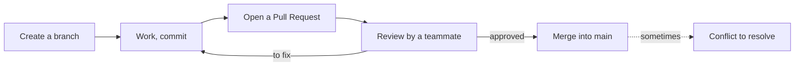

## Context



This guide combines two related skills: proposing your work through a
**Pull Request** so that it is reviewed before reaching the main
branch, and resolving a **Git conflict**, which happens most
often precisely when merging a Pull Request.

## Prerequisites

- Be comfortable with the basic stage / commit / push cycle: see
  [Git, GitHub Desktop and VSCode](/workshops/methodologie-de-projet/tutorials/git-github-desktop-vscode/).

## Procedure

### 1. Why not push directly to `main`

Working directly on the main branch (`main`) works as long as
you are alone. With several people, it quickly leads to conflicts and to
unreviewed code that breaks what used to work. A **Pull Request** (PR) proposes your
changes, makes them visible before they reach `main`, and
gives someone else the chance to review them.



### 2. Create a branch



### 3. Open the Pull Request



### 4. Review a teammate's work





### 5. Merge



### 6. If a conflict appears

A conflict happens when two people have modified **the same lines**
of the same file, on different branches. Git can automatically
merge changes on different lines. On the
same lines, it cannot guess which one to keep, and asks you.



It usually appears during a `git pull`, a merge, or when trying
to merge a Pull Request. Git shows a message such as
`CONFLICT (content): Merge conflict in <file>`, and the file concerned
contains special markers:

```text
<<<<<<< HEAD
Your version of the conflicting lines
=======
The version from the other branch
>>>>>>> branch-name
```









## Why conflicts happen less often than you might think

Small, frequent commits, rather than huge commits piled up
over days, greatly reduce the frequency and size of
conflicts: see [Git, GitHub Desktop and VSCode](/workshops/methodologie-de-projet/tutorials/git-github-desktop-vscode/).
Working on separate branches per building block of the project (see
[Building and organising your team](/workshops/methodologie-de-projet/concepts/constituer-organiser-equipe/))
also helps, since the same files are then modified by fewer
people in parallel.

## Troubleshooting

| Symptom | Likely cause | Solution |
|---|---|---|
| "Merge" button greyed out | A reviewer requested changes that are not resolved yet | Fix them, push again to the same branch; the PR updates automatically |
| Nobody ever reviews the PRs | No reviewer assigned, or no team habit established | Always assign a reviewer, decided at the sync meeting |
| The file still contains `<<<<<<<` after the commit | Markers forgotten, not removed before committing | Reopen the file, delete the remaining markers, commit again |
| Conflict on almost every file | The two branches have diverged too far | Do more frequent `pull`s/merges in future to stay close to `main` |
| Afraid of losing work while resolving | Understandable, but Git keeps the history | Both versions stay visible in the commit history; nothing is lost for good |

## Exercise

On your project, make a PR for your next small change:
create a branch, commit, open the PR, ask a teammate to
review it before merging. If a conflict comes up on that occasion (or
cause one on purpose with a partner, with nothing really at stake, to
practise), resolve it by following the procedure above.
