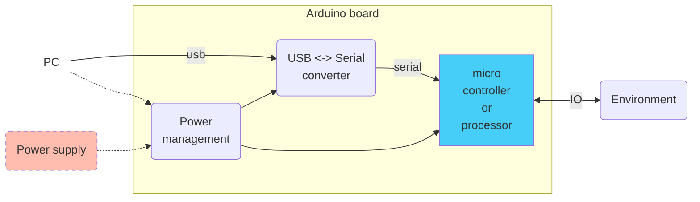
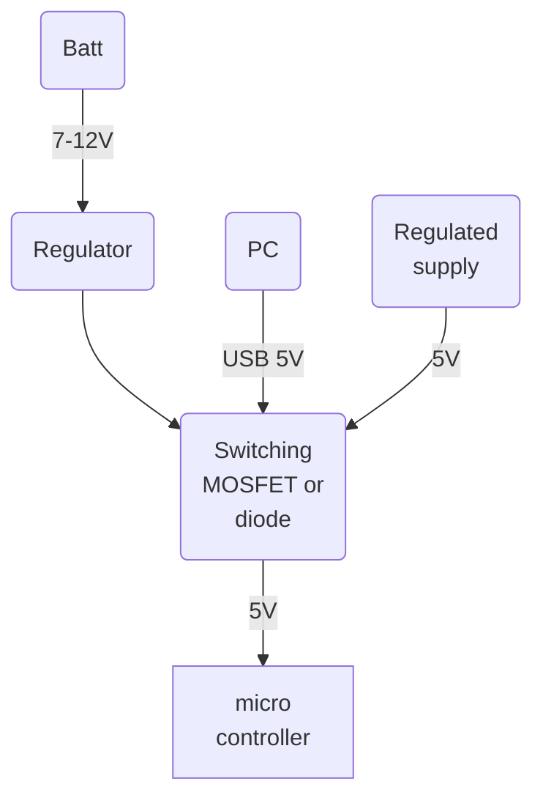
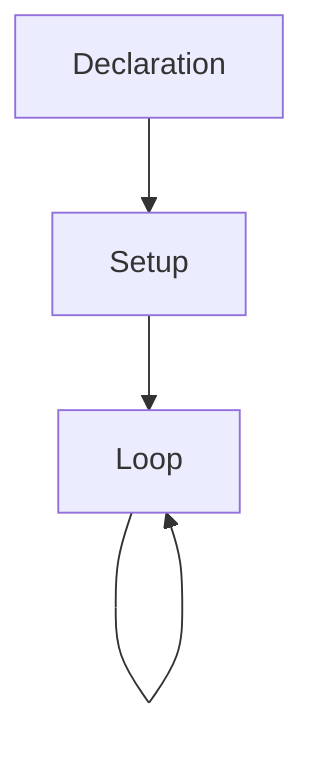

## 1 - Introduction

When people talk about Arduino, they may actually mean **four distinct things** that are nonetheless **closely linked**:

- The physical boards developed by the Arduino company
- The Arduino framework
- The Arduino IDE software
- The Arduino community

More broadly, the name also refers to the [Arduino](https://www.arduino.cc/) brand, which designs and sells open-source physical prototyping boards and the associated software.

## 2 - The boards

### 2.1 - History

The first Arduino board developed, and still the most popular today, is the Arduino UNO.

It was created in the 2000s by Massimo Banzi, David Cuartielles, Tom Igoe, Gianluca Martino, David Mellis and Nicholas Zambetti at the Interaction Design Institute Ivrea, in Italy, as part of a student project.

At the time, the tools for developing embedded projects were not accessible, both in price (several hundred euros) and in approachability, especially for people whose fields were far from technical. Mastering and using these components took a lot of time and learning, and greatly slowed down the creative process for these young students.

  
*First Arduino board model*

The **Wiring** board (the ancestor of the Arduino UNO) was the first creation of the group of students, in 2003. The goal was to create a simple, very low-cost board that a community of beginners could use as easily as possible. For programming, they based their code interface on the [Processing](https://processing.org) development environment, created in 2001 by MIT students.

  
*Processing / Arduino IDE comparison*

Aiming to make the platform ever cheaper and more accessible, a team of students and teachers ended up designing the very first Arduino in 2005. Fully open source, the Arduino had the advantage of being cross-platform and of being continuously improved by its community of users.

---

### 2.2 - Principles

All Arduino boards work on much the same principle and are built around a central component: the microcontroller.



#### a. The microcontroller

The heart of the board. This is the component that is programmed and that executes the sequence of instructions needed to interface the inputs and outputs with the environment.

Depending on the board, there are different types of μC; you can find a non-exhaustive list on the [Arduino page on Wikipedia](https://en.wikipedia.org/wiki/Arduino).

Computing and input/output capabilities differ from one μC to another. You therefore need to be careful when choosing the board and its operating conditions.

#### b. The USB to serial converter

To simplify the link between the microcontroller and the computer, and to limit the need for extra external adapters, a component converts between a USB port and the serial port of the microcontroller. This allows two things:

- Programming the component directly over USB. The microcontroller comes preprogrammed with a bootloader that allows this kind of programming
- A serial interface between the PC and the microcontroller, the board being detected as a serial interface by a PC.





#### c. Power management

Depending on the board, there is a power conversion or power management stage. Because the components must operate at precise voltage levels (typically 5 V or 3.3 V), the voltage has to be converted between the power input and the components.

Since boards can be powered from the upload port (USB) or from an external supply, a conversion is often necessary. Remember that a PC's USB port can, in most cases, deliver 5 V at 500 mA maximum.

On the simplest boards, there is no power management at all. It is up to the user to provide suitable supply voltages.

Traditionally, though, this kind of arrangement is found on 5 V Arduino boards:







#### d. Inputs and outputs

Every Arduino board has input/output peripherals. How they are managed and what they can do depends on the board chosen. You therefore need to read the datasheets of the boards you use to know exactly what they are capable of.

On an Arduino UNO, the architecture is as follows:


- **USB:** Programming and serial link
- **Power (7 V-12 V):** External power source
- **A:**
  - Digital inputs/outputs
  - PWM outputs
  - Serial communication bus
- **B:**
  - Digital inputs/outputs
  - Analog inputs
  - I2C communication bus
- **C:**
  - 5 V and 3.3 V
  - GND
- **D:** External reset

## 3 - The Arduino framework

### 3.1 - Definitions

*Adapted from ["Framework - Wikipédia"](https://fr.wikipedia.org/wiki/Framework)*

---

In computer programming, a framework [...] is a coherent set of structural software components used to create the foundations and the outline of all or part of a piece of software (its architecture). A framework differs from a simple software library mainly in:

- its generic, weakly specialised nature, unlike some libraries; a framework may thus be made up of several libraries, each specialised in one area. A framework may nevertheless be specialised for a particular language, a specific platform or a particular domain: data communication, data mapping, and so on;

- the working structure it imposes by its very construction, guiding the software architecture and even leading the developer to follow certain design patterns; the libraries that make it up are then organised according to the same paradigm.

Frameworks are therefore designed and used to shape the architecture of application software, web applications, middleware and software components. Frameworks are acquired by software developers, then built into application software released on the market; they are consequently rarely bought and installed separately by an end user.

---

In our case, the Arduino framework is a particular framework that makes it simple to program the hardware features of the microcontrollers, or microprocessors, used on compatible boards.

This framework is based on C++ and improves the user experience when programming the boards.

**It is therefore important to note and remember the following points:**

- The framework is only a software layer that simplifies programming
- The framework can be bypassed with low-level commands to control the microcontroller hardware more finely.
- The C/C++ language used, its structures and its possibilities remain unchanged, insofar as they suit an embedded environment.
- The framework can be used outside the Arduino IDE software
- The framework can be used on boards other than those produced by Arduino

### 3.2 - Arduino specifics

You can find all the features of the Arduino framework in the online [reference documentation](https://www.arduino.cc/reference/en/).

This documentation gives you access to all the features provided by the framework, sorted into 3 categories:

- Structures
- Variables
- Functions

These features are available without adding any extra library. Be careful, though: depending on the type of board and microcontroller, some features may be limited.

In addition, the structure of a program written with the Arduino framework differs from a standard C program structure. The classic structure of a C program is as follows:

``` c++
/* Declarations */
#include <lib.h>

/* Program body */
int main
{
    ...
    return 0;
}
```

For a microcontroller program, the structure is as follows:

``` c++
/* Declarations */
#include <lib.h>

/* Program body */
int main
{
    ...
    /* infinite loop */
    while(1)
    {
        ...
    }
}
```

Because the µC runs its embedded program in a loop for as long as it is powered, an infinite loop is added, for example with the `while(1)` statement.

The Arduino framework uses exactly the same principle, but with a dedicated structure.

``` c++
/* Declarations */
#include <Arduino.h>

/* program init */
void setup()
{
    ...
}
/* infinite loop */
void loop()
{ 
    ...
}
```

The `void setup()` and `void loop()` functions are already declared and are required for the main program to compile.

- `void setup()`: program initialisation, run once when the µC resets
- `void loop()`: infinite loop, the main program







## 4 - Development environment

### 4.1 - Arduino IDE

The Arduino IDE is the development environment dedicated to Arduino and compatible boards. This very basic environment is inherited from [Processing](https://processing.org); it lets you write C programs with the Arduino framework, then compile and upload them to a compatible board.

The software is cross-platform and open source. It can be downloaded from the Arduino website. [Download link](https://www.arduino.cc/en/software).

On 15 September 2022, the Arduino company released a stable version of its new Arduino IDE: [Arduino IDE 2.0](https://docs.arduino.cc/software/ide-v2). You can download it from the link below:

[Download Arduino IDE 2.0](https://www.arduino.cc/en/software)

To continue with the installation of the IDE, follow the link below:

[Arduino IDE tutorial](../../softs/arduino-ide-v2)

### 4.2 - PlatformIO

PlatformIO is an alternative to the Arduino IDE for developing connected objects or, more generally, microcontroller code. PlatformIO is not a code editor: it is a set of tools (toolchains) delivered as a plugin for Microsoft's Visual Studio Code (or VSCode) and GitHub's Atom (also Microsoft!).

Since Atom's development is losing momentum, we recommend VSCode. VSCode is a lightweight, free code editor for Windows, macOS and Linux. It can be used for development projects on almost any platform.

[Download VSCode](https://code.visualstudio.com)

VSCode has the advantage of fitting perfectly into a wide range of development projects and of being fully customisable through extensions.

[VSCode - PlatformIO tutorial](../../softs/platformio)

---

## Sources

- [Arduino Education](https://arduino.education/?page_id=27)
- [Wikipedia - Arduino](https://en.wikipedia.org/wiki/Arduino)
- [Arduino history - eni](https://www.editions-eni.fr/open/mediabook.aspx?idR=a81a087b555eea0aad94df95ee8febf4)
