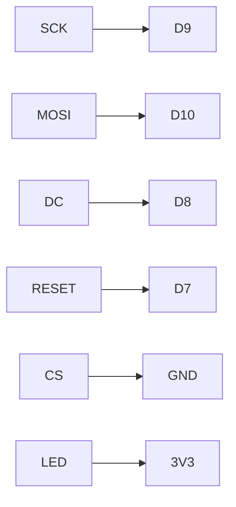

## SPI display and game loop

This tutorial adds a **display** to a XIAO ESP32S3 setup that already has a joystick, wired and calibrated as in the tutorial [The kit modules](/workshops/microcontroleur/tutorials/entrees-boutons-joystick/) (from which it reuses the `calibrateJoystick()` and `normalizeJoystick()` functions). By the end, a paddle follows the joystick and a ball bounces off the edges of the screen: the first visual building blocks of a game.

### Additional workshop wiring

| Signal | XIAO pin | Role |
|---|---|---|
| SCK | D9 (GPIO8) | SPI clock |
| MOSI | D10 (GPIO9) | Data, CPU → display |
| DC | D8 (GPIO7) | Command / data switch |
| RESET | D7 (GPIO44) | Hardware reset of the display |
| CS | GND | Display permanently selected |
| LED (backlight) | 3V3 | Backlight always on |
| VCC / GND | 3V3 / GND | Display power |



This is the wiring of the project PCB. It saves two pins: **CS** is tied to GND, because the display is the only device on the SPI bus and can therefore stay selected permanently; the **backlight** is connected straight to 3V3. With the buttons, the joystick and the I2C connector, all 11 pins of the XIAO are thus in use.







```ini
[env:seeed_xiao_esp32s3]
platform = espressif32
board = seeed_xiao_esp32s3
framework = arduino
monitor_speed = 115200
lib_deps =
    adafruit/Adafruit ST7735 and ST7789 Library@^1.11.0
```

Then add the display pinout and its dimensions at the end of `include/config.h`. Portrait mode is used: the screen is 240 pixels wide and 320 high.

```cpp
// ST7789 240x320 TFT display (connector J1)
constexpr int PIN_TFT_RESET = D7;
constexpr int PIN_TFT_DC    = D8;   // Data/Command: 0 = command, 1 = data
constexpr int PIN_TFT_SCK   = D9;   // SPI clock
constexpr int PIN_TFT_MOSI  = D10;  // SPI data (microcontroller -> display)
constexpr int PIN_TFT_CS    = -1;   // CS is tied to GND on the board: the display
                                    // is always selected (-1 = no pin)

constexpr uint32_t TFT_SPI_FREQUENCY = 40000000;  // 40 MHz

// Rotation 0 = portrait, 2 = portrait rotated by 180 degrees
constexpr int SCREEN_ROTATION = 2;
constexpr int SCREEN_WIDTH    = 240;
constexpr int SCREEN_HEIGHT   = 320;
```



```cpp
#include <Arduino.h>
#include <SPI.h>
#include <Adafruit_GFX.h>
#include <Adafruit_ST7789.h>

#include "config.h"

Adafruit_ST7789 tft(&SPI, PIN_TFT_CS, PIN_TFT_DC, PIN_TFT_RESET);

void setup() {
    // SPI pins of the PCB (no MISO: the display sends nothing back)
    SPI.begin(PIN_TFT_SCK, -1, PIN_TFT_MOSI, PIN_TFT_CS);

    tft.init(SCREEN_WIDTH, SCREEN_HEIGHT, SPI_MODE3);
    tft.setSPISpeed(TFT_SPI_FREQUENCY);
    tft.setRotation(SCREEN_ROTATION);
    tft.fillScreen(ST77XX_BLACK);

    tft.setTextSize(4);                 // 6 x 8 pixel font, multiplied by 4
    tft.setTextColor(ST77XX_WHITE);
    tft.setCursor(72, 40);              // (240 - 4 letters x 6 x 4) / 2 = 72: centred
    tft.print("PONG");

    tft.drawRect(20, 120, 200, 60, ST77XX_WHITE);   // rectangle (outline)
    tft.fillCircle(120, 250, 20, ST77XX_YELLOW);    // disc (filled)
}

void loop() {}
```







{% include step-tuto.html
greyBackground=true
title="Step 3: The non-blocking game loop"
content="A game advances **frame by frame**. We want one frame every 16 ms (about 60 frames per second), and on every frame the same three actions: **read** the controls, **compute** the new position of the objects, **draw** the result.

`delay(16)` would block the whole board during the wait. Instead, compare `millis()` with the time of the last frame: as long as 16 ms have not elapsed, `loop()` returns immediately without doing anything."
%}

Add the duration of a frame to `include/config.h`:

```cpp
constexpr uint32_t FRAME_TIME_MS = 16;  // Duration of one frame: ~60 frames/s
```

Then give `src/main.cpp` its final structure:

```cpp
void update(float joystickX) {
    // 2. Compute the new frame (steps 4 and 5)
}

void draw() {
    // 3. Draw it (steps 4 and 5)
}

void loop() {
    static uint32_t lastFrameMs = 0;   // static: keeps its value from one pass to the next
    uint32_t nowMs = millis();
    if (nowMs - lastFrameMs < FRAME_TIME_MS) {
        return;
    }
    lastFrameMs = nowMs;

    float joystickX = normalizeJoystick(analogRead(PIN_JOYSTICK_X), joystickCenterX);  // 1. Read
    update(joystickX);                 // 2. Compute
    draw();                            // 3. Draw
}
```

Do not forget to call `calibrateJoystick()` in `setup()` (the joystick must not be touched during calibration). You can remove the text and shapes from step 2.

This **read → compute → draw** structure is the framework for everything that follows: a complete game, such as [Pong on the console](/workshops/microcontroleur/tutorials/collisions-fsm-pong/), only adds to `update()` and `draw()`.

{% include step-tuto.html
greyBackground=true
title="Step 4: A paddle that follows the joystick"
content="Player 1's paddle is at the bottom of the screen. It is not placed where the joystick points: it moves **at a speed proportional** to the tilt. `normalizeJoystick()` already returns a value between -1 and +1: just multiply it by a maximum speed, in pixels per frame.

The position is a `float`: at half tilt, the paddle moves 2.5 pixels per frame, and the half pixels add up instead of being lost. It is only converted to `int` at drawing time.

For display, **erase the old paddle before drawing the new one**, and only if it has moved: without erasing, it would leave a white trail; without the test, useless pixels would be sent on every frame."
%}

```cpp
// include/config.h
constexpr int   PADDLE_WIDTH     = 40;
constexpr int   PADDLE_HEIGHT    = 6;
constexpr int   PADDLE_MARGIN    = 10;    // Distance between the paddle and the edge
constexpr float PADDLE_MAX_SPEED = 5.0f;  // In pixels per frame
```

```cpp
// src/main.cpp
constexpr int PADDLE_Y = SCREEN_HEIGHT - PADDLE_MARGIN - PADDLE_HEIGHT;

float paddleX = (SCREEN_WIDTH - PADDLE_WIDTH) / 2.0f;  // computed position
int   drawnPaddleX = (int)paddleX;                     // displayed position

void update(float joystickX) {
    paddleX += joystickX * PADDLE_MAX_SPEED;
    paddleX = constrain(paddleX, 0.0f, (float)(SCREEN_WIDTH - PADDLE_WIDTH));
}

void draw() {
    int x = (int)paddleX;
    if (x != drawnPaddleX) {
        tft.fillRect(drawnPaddleX, PADDLE_Y, PADDLE_WIDTH, PADDLE_HEIGHT, ST77XX_BLACK);  // erase
        tft.fillRect(x, PADDLE_Y, PADDLE_WIDTH, PADDLE_HEIGHT, ST77XX_WHITE);             // draw
        drawnPaddleX = x;
    }
}
```

Also draw the paddle once at the end of `setup()`, after the `fillScreen`: `draw()` only redraws it if it moves.





{% include step-tuto.html
greyBackground=true
title="Step 5: A bouncing ball"
content="The ball is a 6-pixel square, located by its top left corner `(ballX, ballY)` and by its **velocity** `(ballVX, ballVY)` in pixels per frame. On every frame, the velocity is added to the position.

When the ball goes past an edge, reverse the velocity component concerned **and put the ball back against the edge**. Without this, a ball that has overshot by 2 pixels could still be outside on the next frame: its velocity would be reversed a second time and it would stay stuck to the edge."
%}

```cpp
// include/config.h
constexpr int BALL_SIZE = 6;
```

```cpp
// src/main.cpp
float ballX  = (SCREEN_WIDTH - BALL_SIZE) / 2.0f;
float ballY  = (SCREEN_HEIGHT - BALL_SIZE) / 2.0f;
float ballVX = 2.0f;  // pixels per frame
float ballVY = 3.0f;

int drawnBallX = (int)ballX;
int drawnBallY = (int)ballY;

void moveBall() {
    ballX += ballVX;
    ballY += ballVY;

    if (ballX < 0) {
        ballX = 0;
        ballVX = -ballVX;
    } else if (ballX + BALL_SIZE > SCREEN_WIDTH) {
        ballX = SCREEN_WIDTH - BALL_SIZE;
        ballVX = -ballVX;
    }

    if (ballY < 0) {
        ballY = 0;
        ballVY = -ballVY;
    } else if (ballY + BALL_SIZE > SCREEN_HEIGHT) {
        ballY = SCREEN_HEIGHT - BALL_SIZE;
        ballVY = -ballVY;
    }
}

void drawBall() {
    int x = (int)ballX;
    int y = (int)ballY;
    if (x == drawnBallX && y == drawnBallY) {
        return;
    }
    tft.fillRect(drawnBallX, drawnBallY, BALL_SIZE, BALL_SIZE, ST77XX_BLACK);  // erase
    tft.fillRect(x, y, BALL_SIZE, BALL_SIZE, ST77XX_WHITE);                    // draw
    drawnBallX = x;
    drawnBallY = y;
}
```

Call `moveBall()` at the end of `update()`, and `drawBall()` at the end of `draw()`.



## Expected result

The project contains `include/config.h` and a `src/main.cpp` organised as a game loop: the paddle follows the joystick at the bottom of the screen, and a ball bounces off all four edges.

Two flaws remain visible, on purpose:

- the ball goes through the paddle instead of bouncing off it (the **collision** is missing);
- as it passes, it erases part of the paddle (erasing does not take into account what is underneath).


