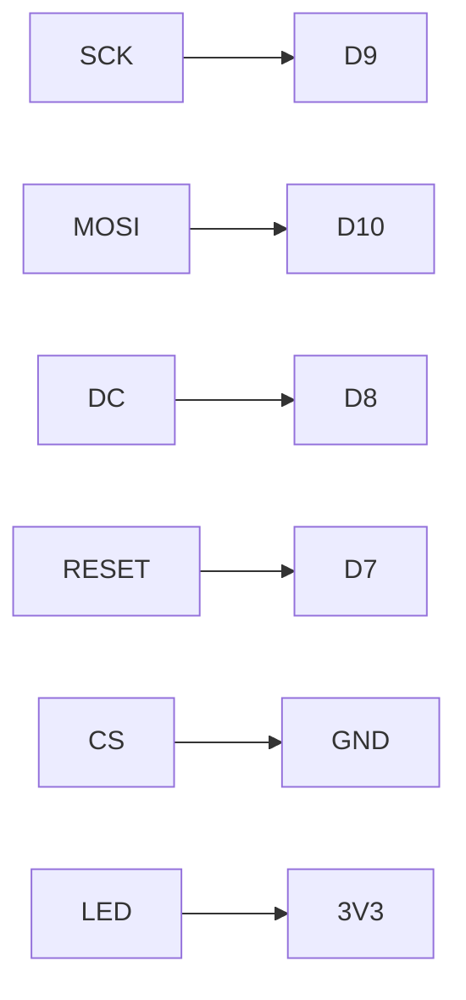

## Écran SPI et game loop

Ce tutoriel ajoute la dernière brique matérielle du montage : l'**écran**. Le câblage des boutons et du joystick posé au tutoriel [Boutons, joystick et moniteur série](/workshops/microcontroleur/tutorials/entrees-boutons-joystick/) ne bouge pas, et son module `input` sert tel quel. À la fin, la raquette du joueur 1 suit le joystick et une balle rebondit sur les bords de l'écran : les premières briques visuelles du Pong.

### Câblage additionnel de l'atelier

| Signal | Broche XIAO | Rôle |
|---|---|---|
| SCK | D9 (GPIO8) | Horloge SPI |
| MOSI | D10 (GPIO9) | Données CPU → écran |
| DC | D8 (GPIO7) | Bascule commande / donnée |
| RESET | D7 (GPIO44) | Reset matériel de l'écran |
| CS | GND | Écran sélectionné en permanence |
| LED (rétroéclairage) | 3V3 | Rétroéclairage toujours allumé |
| VCC / GND | 3V3 / GND | Alimentation de l'écran |



C'est le câblage du PCB du projet. Il économise deux broches : le **CS** est relié à GND, car l'écran est le seul composant du bus SPI et peut donc rester sélectionné en permanence ; le **rétroéclairage** est branché directement sur 3V3. Avec les boutons, le joystick et le connecteur I2C, les 11 broches de la XIAO sont ainsi toutes utilisées.







```ini
[env:seeed_xiao_esp32s3]
platform = espressif32
board = seeed_xiao_esp32s3
framework = arduino
monitor_speed = 115200
lib_deps =
    adafruit/Adafruit ST7735 and ST7789 Library@^1.11.0
```

Ajoute ensuite à la fin de `include/config.h` le brochage de l'écran et ses dimensions. Le mode portrait est retenu : l'écran mesure 240 pixels de large et 320 de haut.

```cpp
// Ecran TFT ST7789 240x320 (connecteur J1)
constexpr int PIN_TFT_RESET = D7;
constexpr int PIN_TFT_DC    = D8;   // Data/Command : 0 = commande, 1 = donnée
constexpr int PIN_TFT_SCK   = D9;   // Horloge SPI
constexpr int PIN_TFT_MOSI  = D10;  // Données SPI (microcontrôleur -> écran)
constexpr int PIN_TFT_CS    = -1;   // CS est relié à GND sur la carte : l'écran
                                    // est toujours sélectionné (-1 = pas de broche)

constexpr uint32_t TFT_SPI_FREQUENCY = 40000000;  // 40 MHz

// Rotation 0 = portrait, 2 = portrait retourné de 180 degrés
constexpr int SCREEN_ROTATION = 2;
constexpr int SCREEN_WIDTH    = 240;
constexpr int SCREEN_HEIGHT   = 320;
```



```cpp
#include <Arduino.h>
#include <SPI.h>
#include <Adafruit_GFX.h>
#include <Adafruit_ST7789.h>

#include "config.h"

Adafruit_ST7789 tft(&SPI, PIN_TFT_CS, PIN_TFT_DC, PIN_TFT_RESET);

void setup() {
    // Broches SPI du PCB (pas de MISO : l'écran ne renvoie rien)
    SPI.begin(PIN_TFT_SCK, -1, PIN_TFT_MOSI, PIN_TFT_CS);

    tft.init(SCREEN_WIDTH, SCREEN_HEIGHT, SPI_MODE3);
    tft.setSPISpeed(TFT_SPI_FREQUENCY);
    tft.setRotation(SCREEN_ROTATION);
    tft.fillScreen(ST77XX_BLACK);

    tft.setTextSize(4);                 // police de 6 x 8 pixels, multipliée par 4
    tft.setTextColor(ST77XX_WHITE);
    tft.setCursor(72, 40);              // (240 - 4 lettres x 6 x 4) / 2 = 72 : centré
    tft.print("PONG");

    tft.drawRect(20, 120, 200, 60, ST77XX_WHITE);   // rectangle (contour)
    tft.fillCircle(120, 250, 20, ST77XX_YELLOW);    // disque (plein)
}

void loop() {}
```







{% include step-tuto.html
greyBackground=true
title="Étape 3 : La game loop non bloquante"
content="Un jeu avance **image par image**. On veut une image toutes les 16 ms (environ 60 images par seconde), et à chaque image toujours les trois mêmes actions : **lire** les commandes, **calculer** la nouvelle position des objets, **afficher** le résultat.

`delay(16)` bloquerait toute la carte pendant l'attente. On compare plutôt `millis()` à l'instant de la dernière image : tant que 16 ms ne sont pas écoulées, `loop()` repart aussitôt sans rien faire."
%}

Ajoute la durée d'une image dans `include/config.h` :

```cpp
constexpr uint32_t FRAME_TIME_MS = 16;  // Durée d'une image : ~60 images/s
```

Puis donne à `src/main.cpp` sa structure définitive :

```cpp
#include "input.h"

void update(const InputState& input) {
    // 2. Calculer la nouvelle image (étapes 4 et 5)
}

void draw() {
    // 3. L'afficher (étapes 4 et 5)
}

void loop() {
    static uint32_t lastFrameMs = 0;   // static : garde sa valeur d'un tour à l'autre
    uint32_t nowMs = millis();
    if (nowMs - lastFrameMs < FRAME_TIME_MS) {
        return;
    }
    lastFrameMs = nowMs;

    InputState input = inputRead();    // 1. Lire les commandes
    update(input);                     // 2. Calculer
    draw();                            // 3. Afficher
}
```

N'oublie pas d'appeler `inputBegin()` au début de `setup()`, avant l'initialisation de l'écran (le joystick ne doit pas être touché pendant sa calibration). Tu peux retirer le texte et les formes de l'étape 2.

Cette structure **lire → calculer → afficher** est la charpente de toute la suite : le tutoriel [Collisions, score et machine à états](/workshops/microcontroleur/tutorials/collisions-fsm-pong/) et le projet Snake ne feront qu'enrichir `update()` et `draw()`.

{% include step-tuto.html
greyBackground=true
title="Étape 4 : Une raquette qui suit le joystick"
content="La raquette du joueur 1 est en bas de l'écran. Elle n'est pas placée à l'endroit où pointe le joystick : elle se déplace **à une vitesse proportionnelle** à son inclinaison. `inputRead()` renvoie déjà une valeur entre -1 et +1 : il suffit de la multiplier par une vitesse maximale, en pixels par image.

La position est un `float` : à mi-course, la raquette avance de 2,5 pixels par image, et les demi-pixels s'accumulent au lieu d'être perdus. On ne convertit en `int` qu'au moment de dessiner.

Pour l'affichage, on **efface l'ancienne raquette avant de dessiner la nouvelle**, et seulement si elle a bougé : sans effacement, elle laisserait une traînée blanche ; sans le test, on enverrait des pixels inutiles à chaque image."
%}

```cpp
// include/config.h
constexpr int   PADDLE_WIDTH     = 40;
constexpr int   PADDLE_HEIGHT    = 6;
constexpr int   PADDLE_MARGIN    = 10;    // Distance entre la raquette et le bord
constexpr float PADDLE_MAX_SPEED = 5.0f;  // En pixels par image
```

```cpp
// src/main.cpp
constexpr int PADDLE_Y = SCREEN_HEIGHT - PADDLE_MARGIN - PADDLE_HEIGHT;

float paddleX = (SCREEN_WIDTH - PADDLE_WIDTH) / 2.0f;  // position calculée
int   drawnPaddleX = (int)paddleX;                     // position affichée

void update(const InputState& input) {
    paddleX += input.joystickX * PADDLE_MAX_SPEED;
    paddleX = constrain(paddleX, 0.0f, (float)(SCREEN_WIDTH - PADDLE_WIDTH));
}

void draw() {
    int x = (int)paddleX;
    if (x != drawnPaddleX) {
        tft.fillRect(drawnPaddleX, PADDLE_Y, PADDLE_WIDTH, PADDLE_HEIGHT, ST77XX_BLACK);  // effacer
        tft.fillRect(x, PADDLE_Y, PADDLE_WIDTH, PADDLE_HEIGHT, ST77XX_WHITE);             // dessiner
        drawnPaddleX = x;
    }
}
```

Dessine aussi la raquette une première fois à la fin de `setup()`, après le `fillScreen` : `draw()` ne la redessine que si elle bouge.





{% include step-tuto.html
greyBackground=true
title="Étape 5 : Une balle qui rebondit"
content="La balle est un carré de 6 pixels, repéré par son coin supérieur gauche `(ballX, ballY)` et par sa **vitesse** `(ballVX, ballVY)` en pixels par image. À chaque image, la vitesse s'ajoute à la position.

Quand la balle dépasse un bord, on inverse la composante de vitesse concernée **et on la replace contre le bord**. Sans ce replacement, une balle qui a dépassé de 2 pixels pourrait encore être dehors à l'image suivante : sa vitesse s'inverserait une deuxième fois et elle resterait collée au bord."
%}

```cpp
// include/config.h
constexpr int BALL_SIZE = 6;
```

```cpp
// src/main.cpp
float ballX  = (SCREEN_WIDTH - BALL_SIZE) / 2.0f;
float ballY  = (SCREEN_HEIGHT - BALL_SIZE) / 2.0f;
float ballVX = 2.0f;  // pixels par image
float ballVY = 3.0f;

int drawnBallX = (int)ballX;
int drawnBallY = (int)ballY;

void moveBall() {
    ballX += ballVX;
    ballY += ballVY;

    if (ballX < 0) {
        ballX = 0;
        ballVX = -ballVX;
    } else if (ballX + BALL_SIZE > SCREEN_WIDTH) {
        ballX = SCREEN_WIDTH - BALL_SIZE;
        ballVX = -ballVX;
    }

    if (ballY < 0) {
        ballY = 0;
        ballVY = -ballVY;
    } else if (ballY + BALL_SIZE > SCREEN_HEIGHT) {
        ballY = SCREEN_HEIGHT - BALL_SIZE;
        ballVY = -ballVY;
    }
}

void drawBall() {
    int x = (int)ballX;
    int y = (int)ballY;
    if (x == drawnBallX && y == drawnBallY) {
        return;
    }
    tft.fillRect(drawnBallX, drawnBallY, BALL_SIZE, BALL_SIZE, ST77XX_BLACK);  // effacer
    tft.fillRect(x, y, BALL_SIZE, BALL_SIZE, ST77XX_WHITE);                    // dessiner
    drawnBallX = x;
    drawnBallY = y;
}
```

Appelle `moveBall()` à la fin de `update()`, et `drawBall()` à la fin de `draw()`.



## Résultat attendu

Le projet contient `include/config.h`, `include/input.h`, `src/input.cpp` et un `src/main.cpp` organisé en game loop : la raquette du joueur 1 suit le joystick en bas de l'écran, et une balle rebondit sur les quatre bords.

Deux défauts restent visibles, volontairement :

- la balle traverse la raquette au lieu de rebondir dessus (il manque la **collision**) ;
- en passant, elle efface une partie de la raquette (l'effacement ne tient pas compte de ce qu'il y a dessous).


