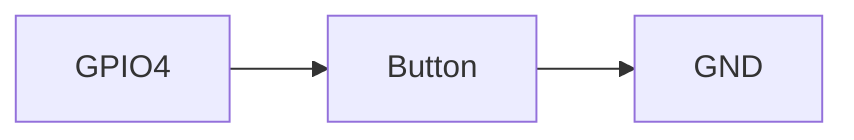
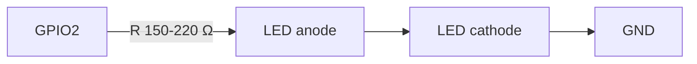
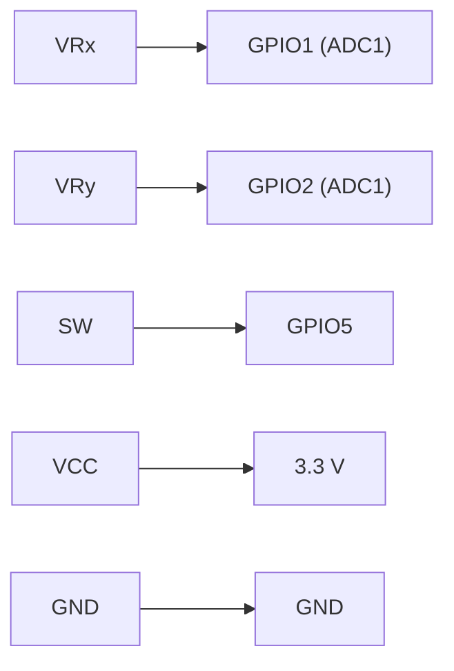

## Goal

A **GPIO** (*General Purpose Input/Output*) pin can be configured in software as an input or an output. It is the basic building block of any electronics project with a microcontroller: before driving a motor or showing something on a display, you need to know how to read and write these pins.

This tutorial goes through the three most common uses, from the simplest to the most complex, each step building on the previous one:

1. Reading an **external button** - a digital input (`0` or `1`).
2. Driving an **LED** - a digital output.
3. Reading an **analog joystick** - an analog input converted into a number by the ADC.

By the end, you will have a small complete circuit that combines all three: a button, an LED and a joystick, read and driven at the same time.

### Digital vs analog, at a glance

| | Digital | Analog |
|---|---|---|
| Possible values | 2 (`LOW` / `HIGH`) | continuous (0 to 3.3 V) |
| Arduino functions | `pinMode`, `digitalRead`, `digitalWrite` | `analogRead` (`analogWrite`/`ledcWrite` to write) |
| Example in this tutorial | button, LED | joystick |



## What you need

- An ESP32-compatible board (Arduino framework)
- A USB-C or micro-USB data cable (not charge-only)
- A push button
- An LED + a series resistor (150 to 220 Ω)
- A 2-axis analog joystick module with a built-in button
- A breadboard and jumper wires

## Creating the PlatformIO project



```ini
; generated platformio.ini
[env:esp32dev]
platform = espressif32
board = esp32dev
framework = arduino
monitor_speed = 115200
```



## Reading an external button (digital input)





```cpp
#define BTN_PIN 4

void setup() {
  Serial.begin(115200);
  pinMode(BTN_PIN, INPUT_PULLUP);
}

void loop() {
  bool pressed = digitalRead(BTN_PIN) == LOW;
  Serial.println(pressed ? "Button pressed" : "Button released");
  delay(100);
}
```



### Why not an external resistor?

There are three modes for a pin configured as an input:

| Mode | Behaviour at rest | Wiring |
|---|---|---|
| `INPUT` | floating (undetermined value) | not recommended without an external resistor |
| `INPUT_PULLUP` | HIGH (pulled to 3.3 V internally) | button to GND |
| `INPUT_PULLDOWN` | LOW (pulled to GND internally) | button to 3.3 V |

`INPUT_PULLUP` is the most widely used because it avoids any extra component and any resistor to solder.



## Driving an LED (digital output)





```cpp
#define LED_PIN 2

void setup() {
  pinMode(LED_PIN, OUTPUT);
}

void loop() {
  digitalWrite(LED_PIN, HIGH); // LED on (3.3 V)
  delay(500);
  digitalWrite(LED_PIN, LOW);  // LED off (0 V)
  delay(500);
}
```



### Calculating the series resistor

For a typical red LED (forward voltage $V_f \approx 2\ V$) carrying a current $I = 10\ mA$:

$$R = \frac{V_{supply} - V_f}{I} = \frac{3.3 - 2}{0.01} = 130\ \Omega$$

Round up to the nearest standard value: **150 Ω**.

### Combining button and LED

```cpp
#define BTN_PIN 4
#define LED_PIN 2

void setup() {
  pinMode(BTN_PIN, INPUT_PULLUP);
  pinMode(LED_PIN, OUTPUT);
}

void loop() {
  bool pressed = digitalRead(BTN_PIN) == LOW;
  digitalWrite(LED_PIN, pressed ? HIGH : LOW);
}
```



## Reading an analog joystick (ADC)

An analog joystick contains two potentiometers (X and Y axes) and a button. Unlike the button at the start, its axes do not return a simple `0`/`1` but a **continuous value**, converted into a number by the ESP32's **analog-to-digital converter (ADC)**.

The ESP32's ADC has a resolution of **12 bits**, which gives $2^{12} = 4096$ possible values:

| Measured voltage | ADC value |
|---|---|
| 0 V | 0 |
| 1.65 V | ≈ 2048 |
| 3.3 V | 4095 |





```cpp
#define JOY_X   1
#define JOY_Y   2
#define JOY_BTN 5

void setup() {
  Serial.begin(115200);
  pinMode(JOY_BTN, INPUT_PULLUP);
  // JOY_X and JOY_Y do not need pinMode: analogRead() configures them.
}

void loop() {
  int x = analogRead(JOY_X);   // 0 to 4095 (12-bit ADC)
  int y = analogRead(JOY_Y);   // 0 to 4095
  bool pressed = digitalRead(JOY_BTN) == LOW;

  Serial.printf("x=%d y=%d btn=%d\n", x, y, pressed);
  delay(100);
}
```



### Detecting a direction

The centre of the joystick is never exactly at the mid value: a **dead zone** is needed to avoid false positives when the stick is released.

```cpp
enum Direction { CENTER, UP, DOWN, LEFT, RIGHT };

Direction readDirection() {
  int x = analogRead(JOY_X);
  int y = analogRead(JOY_Y);

  const int LOW_THRESHOLD  = 1500;
  const int HIGH_THRESHOLD = 2500;

  if (x < LOW_THRESHOLD)  return LEFT;
  if (x > HIGH_THRESHOLD) return RIGHT;
  if (y < LOW_THRESHOLD)  return DOWN;
  if (y > HIGH_THRESHOLD) return UP;
  return CENTER;
}
```



## Putting it all together

Now assemble the button, the LED and the joystick in a single program: the LED turns on when the external button is pressed, and turns off when the joystick button is pressed.

```cpp
#define BTN_PIN 4
#define LED_PIN 2
#define JOY_X   1
#define JOY_Y   2
#define JOY_BTN 5

enum Direction { CENTER, UP, DOWN, LEFT, RIGHT };

Direction readDirection() {
  int x = analogRead(JOY_X);
  int y = analogRead(JOY_Y);

  const int LOW_THRESHOLD  = 1500;
  const int HIGH_THRESHOLD = 2500;

  if (x < LOW_THRESHOLD)  return LEFT;
  if (x > HIGH_THRESHOLD) return RIGHT;
  if (y < LOW_THRESHOLD)  return DOWN;
  if (y > HIGH_THRESHOLD) return UP;
  return CENTER;
}

const char* directionName(Direction d) {
  switch (d) {
    case UP:     return "UP";
    case DOWN:   return "DOWN";
    case LEFT:   return "LEFT";
    case RIGHT:  return "RIGHT";
    default:     return "CENTER";
  }
}

void setup() {
  Serial.begin(115200);
  pinMode(BTN_PIN, INPUT_PULLUP);
  pinMode(LED_PIN, OUTPUT);
  pinMode(JOY_BTN, INPUT_PULLUP);
}

void loop() {
  if (digitalRead(BTN_PIN) == LOW) {
    digitalWrite(LED_PIN, HIGH);
  }
  if (digitalRead(JOY_BTN) == LOW) {
    digitalWrite(LED_PIN, LOW);
  }

  Serial.println(directionName(readDirection()));
  delay(100);
}
```

## Expected result

The serial monitor (115200 baud) should continuously print the direction detected on the joystick. Pressing the external button turns the LED on; pressing the joystick button turns it off. Each building block (button, LED, joystick) works independently of the other two - this decoupling is what lets you combine them without conflict.

## Going further

- Add a clean **software debounce** (with a `millis()` timestamp) instead of the `delay()` used here, so that the `loop()` function is never blocked.
- Use `map()` to convert the joystick's `0-4095` values into a `0-100` percentage or a `0-180` angle.
- Concept [GPIO & the digital world](/workshops/microcontroleur/concepts/gpio-monde-numerique/) - logic levels, pull-up/pull-down, LED resistor calculation in detail.
- Concept [ADC & PWM](/workshops/microcontroleur/concepts/adc-pwm/) - ADC resolution, sampling, PWM output.
- Tutorial [Servo motors](/docs/tutorials/electronics/servomotor/) to drive a PWM output after this tutorial.
- Tutorial [Serial port with the Arduino IDE](/docs/tutorials/electronics/arduino-port-serie/) to go further in reading and plotting data.
