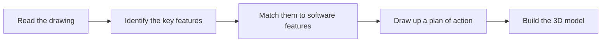



## The different types of technical drawings

**Technical drawing**, or engineering drawing, is a graphical language. There are different types, each with its own uses and specific rules, and not all of them are covered here.

### The assembly drawing

An **assembly drawing** is a document showing all the elements that make up a technical object. The assembly drawing of an object shows **how the elements are assembled together.** It often comes with a **parts list** (bill of materials), a document listing every element of the object shown on the assembly drawing. These elements are identified by a number on the drawing, and each has a designation, information about its characteristics, and so on.

### The detail drawing

A **detail drawing**, for its part, represents a **single part** or a portion of an object projected onto a plane with all its details, such as dimensions in **standardised dimensioning** and machined features.

The **detail drawing** is a very important tool for engineers and for industry in general. If you want to have your part produced or inspected, this is the document you will have to send. You will sometimes need your STEP file, but the drawing is the authoritative document. You really should think of it as a **universal language of communication** between the various players in the technical world. It gives a graphical representation of a technical product, and it is standardised. It can have **legal value**, serve as a **construction plan** and much more; you must be able to understand it and **extract the important information from it**.







## What does a detail drawing look like, and what information does it contain?

The purpose of a detail drawing is to **describe a part completely using as few views as possible**. Sometimes a **perspective view** is added to help understanding, and a **section view** for internal details. There is also a **title block** (a framed box) with information on the history and manufacture of the part.

Depending on what is needed, the drawing may also contain:

* Dimensions
* Tolerances
* Surface finish
* Specific operations (holes, tapped holes and so on)
* ...

### Title block

A **title block** is a reserved area, often at the bottom of the page of a technical drawing. It acts as the **identity card of a detail drawing** and gives all the essential information: the origin of the drawing, the company, the author, the scale, the title, the date, the format, the name of the part, the materials, the operations, the tolerances and so on.

### The different types of lines and their functions

| | Types of lines and their meaning | Representation |
|---|---|---|
| **Continuous line** | thick, for visible edges and outlines |-----------|
| **Dashed line** | thin, for hidden edges and outlines |- - - - -|
| **Chain line** | for axes of revolution and planes of symmetry |-.-.-.-.-|

When two lines overlap, only the continuous line remains visible.

### The basic rules of projection

A detail drawing aims to define a part completely and unambiguously using **orthographic projections**, which are governed by international standards (e.g. ISO 128 and ISO 5456-2).
The same method is thus applied to every part, which makes a drawing easier to read.





Then, following the European convention, each view is projected onto the wall behind the object.

Once all the faces have been projected, unfolding the cube like a net around the front view gives the standard placement of the views. The different projections gathered in one drawing all correspond to one another. All the views are rarely shown on a detail drawing: 3 views are generally enough to define an object. The aim is maximum definition and clarity in describing the shapes and dimensions of the part.


The **European** standard (first-angle projection, method E, used in France) and the **American** one (third-angle projection, method A) do not place the views in the same position. Before reading a drawing, always look for the **projection symbol in the title block**.

| | **European method (E)** | **American method (A)** |
|---|:---:|:---:|
|**Symbol** | {: width="150"} | {: width="150"} |
| **Top view** | below the front view | above the front view |
|**Left view** | to the right of the front view | to the left of the front view |
|**Right view** | to the left of the front view | to the right of the front view |




### Cut views and sections

The cut view is a commonly used mode of representation. It shows internal details of the system that are hard to show in an outside view. The cut view of our example part is thus of little or no use, since there are no volumes hidden from an outside view. It is shown here as an example.





In the **main view** you find:

* The cutting plane, marked by a chain line thickened at its ends
* The name of the cut, given by two identical letters
* The viewing direction, shown by arrows

In the **cut view** the following must appear:

* The reference to the cutting plane
* The hatching showing the material that is cut

## Going from a drawing to a model

All roads lead to Rome, but one of them is shorter than the others, or more convenient if you have to rework your parts later (which happens *very often*). There is no magic method that works for every part, but some **reflexes and good practices** will help you from here on.

### Think before opening the software

Recognise symmetries, repetitions and axes of rotation. Match them to features of the software (mirror, linear/circular pattern, revolve and so on) and think about a logical order before starting. Centre the part on the origin to make your life easier. Think like a sculptor: large volumes first, small details afterwards.

Try to use as few features as possible, while keeping the file maintainable. Example: it is sometimes simpler to add one more operation for holes, when you rework the file, than to save a feature. You have to find a happy medium, and you will get there with practice.



## Worked example: practice part no. 1

### Identifying the geometric elements and the matching features

The first practice part is fairly simple, but it still lets us detail the **process** you should apply before moving to the modelling software. Start by trying to spot the key features of the part:

* **Symmetry**: One about the front plane, but of little use here apart from the holes
* **Axis of rotation**: None here
* **Pattern**: 4 holes of 10 mm, linear pattern or mirror about the front plane
* **"Rounded corners" or "diagonals"**: fillets or chamfers, here 2 chamfers of 20 mm for the corners of the base, no fillets
* **Other**: slotted holes, the slot tool seen in the model of the first laser part

### Plan of action

Set the order of the main steps to carry out:

* Sketch of the base and extrusion
* Extrusion for the vertical portion: work on the left face to create the sketch.
* Material removal for the horizontal shoulder
* Holes: slot tool for the slotted holes, linear pattern or mirrors for the 4 holes of 10 mm.
* 20 mm chamfers on the two corners.

### Building it











## Making a drawing

To create a drawing, right-click the part, then "Create drawing of ...".
You can choose the ISO A4 template and the "suggested views" option to begin with.







Once that is done, you can right-click your "drawing" tab and export it as a PDF.
