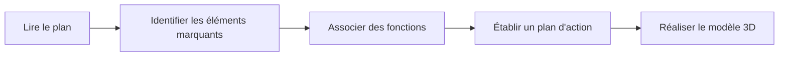



## Les différents types de dessins techniques

Le **dessin technique**, ou dessin industriel, est un langage graphique. Il en existe différents types qui ont chacun leurs usages et leurs règles spécifiques et ils ne seront pas tous abordés ici.

### Le dessin d'ensemble

Un **dessin d'ensemble** est un document sur lequel est représenté l'ensemble des éléments qui constituent un objet technique. Le dessin d'ensemble d'un objet permet de comprendre **comment les éléments sont assemblés entre eux.** Il est souvent accompagné d'une **nomenclature** qui est un document dressant la liste complète de tous les éléments de l'objet représenté sur le plan d'ensemble. Ces éléments sont repérés par un numéro sur le dessin technique et ont chacun une désignation, des informations sur leurs caractéristiques, etc.

### Le dessin de définition

Un **dessin de définition** représente quant à lui une **pièce unique** ou une partie d'objet projetée sur un plan avec tous ses détails comme les dimensions en **cotations normalisées** et les usinages.

Le **dessin de définition** est un outil très important pour l'ingénieur et l'industrie de manière générale. Si vous voulez produire votre pièce ou la faire contrôler, c'est ce document que vous devrez envoyer. Vous aurez parfois besoin de votre fichier STEP, mais c'est le plan qui fait foi. Il faut vraiment le considérer comme un **langage de communication universel** entre différents acteurs du monde technique. C'est lui qui donne une représentation graphique d'un produit technique, et il est normalisé. Il peut avoir une **valeur juridique**, servir de **plan de construction** et bien d'autres, vous devez pouvoir le comprendre et **en extraire les informations importantes**.







## Comment se présente un dessin de définition, et quelles informations peut-on y retrouver ?

Le but du dessin de définition est de **décrire complètement une pièce en utilisant un minimum de vues**. Parfois on rajoute une **perspective** pour aider la compréhension, et une **vue en coupe** pour des détails intérieurs. On retrouve également un **cartouche** (encadré) avec des informations sur l'historique et la fabrication de cette pièce.

Sur le dessin, on peut également retrouver certaines informations en fonction des besoins :

* Dimensions
* Tolérances
* État de surface
* Opérations spécifiques (perçages, taraudages, etc.)
* ...

### Cartouche

Un **cartouche** est une section réservée souvent en bas de page d'un dessin technique. On peut dire qu'il agit comme la **carte d'identité d'un dessin de définition** et indique toutes les informations essentielles : l'origine du dessin, l'entreprise, l'auteur, l'échelle, le titre, la date, le format, le nom de la pièce, les matériaux, les opérations, les tolérances, etc.

### Les différents types de traits et leurs fonctions

| | Types de traits et leur signification | Représentation |
|---|---|---|
| **Trait continu** | épais, pour les arêtes et contours visibles |-----------|
| **Trait pointillé** | fin, pour les arêtes et contours cachés |- - - - -|
| **Trait mixte** | pour les axes de révolution et plans de symétrie |-.-.-.-.-|

Lorsque deux traits sont superposés, le trait continu reste le seul visible.

### Les règles de base pour la projection

Un dessin de définition a pour but de définir complètement et sans ambiguïté une pièce à l'aide de **projections orthogonales** qui sont régies par des normes internationales (ex : normes ISO 128 et ISO 5456-2).
Ainsi, la même méthode est appliquée pour chaque pièce et vous permet de lire un plan plus facilement.





Ensuite, si on suit la convention européenne, chaque vue est projetée sur la paroi située derrière l'objet.

Une fois que l'on a projeté toutes les faces, si on déplie le cube comme un patron selon la vue de face, on obtient le placement des vues standard. Les différentes projections regroupées dans un même dessin se correspondent toutes entre elles. On affiche rarement toutes les vues sur un dessin de définition : en général 3 vues suffisent pour définir un objet. On cherche le maximum de définition et de clarté pour décrire les formes et les dimensions de la pièce.


Les normes **européenne** (méthode E, utilisée en France) et **américaine** (méthode A) ne placent pas les vues au même endroit. Avant de lire un plan, repérez toujours le **symbole de projection dans le cartouche**.

| | **Méthode européenne (E)** | **Méthode américaine (A)** |
|---|:---:|:---:|
|**Symbole** | {: width="150"} | {: width="150"} |
| **Vue de dessus** | sous la vue de face | au-dessus de la vue de face |
|**Vue de gauche** | à droite de la vue de face | à gauche de la vue de face |
|**Vue de droite** | à gauche de la vue de face | à droite de la vue de face |




### Vues en coupe et sections

La coupe est un mode de représentation couramment utilisé. Elle permet de représenter des détails internes au système difficilement représentables en vue extérieure. La vue en coupe sur notre pièce d'exemple est ainsi peu ou pas utile puisqu'il n'existe pas de volumes non visibles depuis une vue extérieure. Elle est représentée ici à titre d'exemple.





Dans la **vue principale** on retrouve :

* Le plan de coupe repéré par un trait mixte renforcé aux extrémités
* Le nom de la coupe repéré par deux lettres identiques
* La direction d'observation repérée par des flèches

Dans la **vue coupée** doivent apparaître :

* La référence au plan de coupe
* Les hachures indiquant la matière coupée

## Passer d'un plan à la modélisation

Tous les chemins mènent à Rome, mais il en existe un plus court que les autres, ou plus pratique si vous avez à retoucher vos pièces ultérieurement (ce qui arrive *très souvent*). Il n'y a pas de méthode magique valable pour toutes les pièces, néanmoins certains **réflexes et bonnes pratiques** vous aideront pour la suite.

### Réfléchir avant de passer au logiciel

Reconnaître les symétries, les répétitions, les axes de rotation. Associer des fonctions du logiciel (miroir, répétition linéaire/circulaire, révolution, etc.) et réfléchir à un ordre logique avant de passer à la réalisation. Centrer la pièce vis-à-vis du repère d'origine pour se simplifier la vie. Penser comme une sculpture : les gros volumes d'abord, les petits détails ensuite.

Essayer d'avoir un minimum de fonctions, tout en gardant un fichier maintenable. Exemple : il est parfois plus simple de faire une opération supplémentaire pour des perçages quand vous retouchez le fichier plutôt que d'économiser une fonction. Il faut trouver un juste milieu, et c'est avec de la pratique que vous y arriverez.



## Cas pratique : exemple de la pièce d'entraînement n°1

### Identification des éléments géométriques et fonctions associées

La première pièce d'entraînement est relativement simple, mais elle permet tout de même de détailler le **processus** que vous devriez appliquer avant le passage au logiciel de modélisation. On commence par essayer de repérer les éléments marquants de la pièce :

* **Symétrie** : Une sur le plan de face, mais peu utile dans notre cas à part pour les perçages
* **Axe de rotation** : Aucun ici
* **Répétition de motif** : 4 perçages de 10 mm, répétition linéaire ou miroir selon le plan de face
* **"Arrondis" ou "Diagonales"** : congés ou chanfreins, ici 2 chanfreins de 20 mm pour les coins de la base, pas de congés
* **Autre** : trous oblongs, outil de rainure vu sur le modèle de la première pièce au laser

### Plan d'action

On définit l'ordre des grandes étapes que l'on va réaliser :

* Esquisse de la base et extrusion
* Extrusion pour la partie verticale : se placer sur la face gauche pour créer l'esquisse.
* Enlèvement de matière pour l'épaulement horizontal
* Perçages : outil rainure pour les perçages oblongs, répétition linéaire ou symétries pour les 4 perçages de 10 mm.
* Chanfreins de 20 mm sur les deux coins.

### Réalisation











## Faire une mise en plan

Pour créer une mise en plan, faites un clic droit sur la pièce, puis "Créer le dessin de ...".
Vous pouvez choisir le modèle ISO A4 et l'option "vues suggérées" pour commencer.







Une fois cela fait, vous pouvez faire un clic droit sur votre onglet "drawing" et l'exporter au format PDF.
