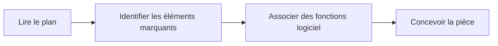



## Le dessin de définition

### Qu'est-ce qu'un dessin de définition ?

Le **dessin de définition** est un outil très important pour l'ingénieur et l'industrie de manière générale. Si vous voulez produire votre pièce ou la faire contrôler, c'est ce document que vous devrez envoyer et non pas votre fichier CAO. Il faut vraiment le considérer comme un **langage de communication universel** entre différents acteurs du monde technique. C'est lui qui donne une représentation graphique d'un produit technique, et il est normalisé. Il peut avoir une **valeur juridique**, servir de **plan de construction** et bien d'autre, vous devez pouvoir le comprendre et **en extraire les informations importantes**.



### Comment se présente un dessin de définition, et quelles informations peut-on y retrouver ?

### Quelles informations peut-on retrouver sur ce document ?

Méthode de fabrication, dimensions et tolérances, état de surface, opérations spécifiques, description des perçages/taraudages, cartouche avec diverses informations (entreprise, concepteur, version, contrôle qualité, matériaux, ...)

### Les règles de base

blabla





Une fois que l'on a projeté toutes les faces, si on dépli le cube comme un patron selon la vue de face,on obtient le placement des vues standard (!! les normes européennes et américaines ne sont pas les mêmes !!). Les différentes projetions regroupées dans un même dessin se correspondent toutes entre elles. On affiche rarement toutes les vues sur un dessin de définition : en général 3 vues suffisent pour définir un objet. On cherche le maximum de définition et de clarté pour décrire les formes et les dimensions de la pièce.

### Les différents types de traits et leurs fonctions

| | Types de traits et leur signification  |
|---|---|---|
| **Trait continu** | épais, pour les arêtes et contours visibles |-----------|
| **Trait pointillé** | fin, pour les arêtes et contours cachés  |- - - - -|
| **Trait mixte** | pour les axes de révolution et plans de symétrie |-.-.-.-.-|

Lorsque deux traits sont superposés, le trait continu reste le seul visible.

### Vues en coupes et sections

La coupe est un mode de représentation couramment utilisé. Elle
permet de représenter des détails internes au système difficilement
représentables en vue extérieure.





Dans la **vue principale** on retrouve :
- Le plan de coupe repéré par un trait mixte renforcé aux extrémités
- Le nom de la coupe repéré par un couple de lettre
- La direction d'observation repérée par des flèches

Dans la **vue coupée** doivent apparaître:
- La référence au plan de coupe
- Les hachures indiquant la matière coupée

## Passer d'un plan à la modélisation

Tous les chemins mènent à Rome, mais il en existe un plus court que les autre, ou plus pratique si vous avez à retoucher vos pièces ultérieurement (ce qui arrive *très souvent*). Il n'y a pas de méthode magique valable pour toutes les pièces, néanmoins certains **réflexes et bonnes pratiques** vous aideront pour la suite.

### Réfléchir avant de passer au logiciel

Reconnaitre les symétries, les répétitions, les axes de rotations. Associer des fonctions logiciels (mirroir, répétition linéaire/circulaire, révolution,..) et réfléchir à un ordre logique avant de passer à la réalisation. Centrer la pièce vis à vis du repère d'origine pour se simplifier la vie.

### Et si vous n'avez pas de plan ?

Lors de vos projets, vous aurez besoin de créer vos propres pièces et vous n'aurez en général pas de plan existant. Le workflow reste cependant plus ou moins le même et les réflexes que vous aurez acquis sur les pièces d'entrainement vous serons utiles.

## Cas pratique: exemple de la pièce d'entrainement n°1

### Identification des éléments géométriques

Symétrie, répétition des perçages











## Faire une mise en plan


