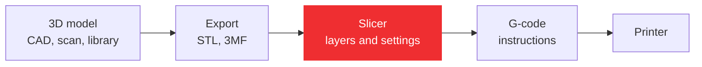

## On the agenda

1. From file to part
2. Getting a 3D model
3. Exporting
4. Slicing: the slicer
5. The basic settings
6. Designing for printing
7. G-code

<aside class="notes" markdown="1">
The written version of the course is the concept page "The software workflow".
</aside>

---

## From file to part



{: .img-sm}

The slicer is the pivot: it translates a shape into paths the machine knows how to follow.
{: .caption}

[From file to part](/docs/concepts/3d-printing-workflow/#from-file-to-part){: .doc-link}

---

<!-- .slide: class="slide-section" -->

## Getting a 3D model

Download, scan, model, design

---

## Six ways of getting a model

| Route | Tool | For | Limit |
|---|---|---|---|
| Download | Printables, Thingiverse | An object already designed | Rarely to your dimensions |
| Scan | 3D scanner | Copying an existing object | Clean-up needed |
| Model | Blender | Organic shapes | Imprecise |
| CAD | Onshape, Fusion | Technical parts | Learning curve |
| Code | OpenSCAD | Parametric parts | Programming |
| Generate (AI) | Rodin | Quick concept | Model to rework |
{: .table-dense}

For a project part, CAD is almost always the right route.
{: .caption}

[Getting a 3D model](/docs/concepts/3d-printing-workflow/#getting-a-3d-model){: .doc-link} [CAD workshop](/workshops/cao/){: .doc-link}

---

## Online libraries

<div class="columns" markdown="1">
<div markdown="1">

- **[Printables](https://www.printables.com/)**: Prusa
- **[Thingiverse](https://www.thingiverse.com/)**: the largest
- **[Cults](https://cults3d.com/)**: free and paid
- **[GrabCAD](https://grabcad.com/)**: engineering
- **[YouMagine](https://www.youmagine.com/)**: open source

</div>
<div markdown="1">

{: .img-md}

</div>
</div>

Check the licence before reusing or modifying a model, and credit its author.
{: .caption}

---

## Scanning an object

<div class="columns" markdown="1">
<div markdown="1">

{: .img-md}

</div>
<div markdown="1">

- Captures the shape of a real object
- Useful for reverse engineering
- Fails on transparent, shiny or dark surfaces
- The resulting mesh always needs clean-up

</div>
</div>

[Scanning an object](/docs/concepts/3d-printing-workflow/#scanning-an-object){: .doc-link}

---

## The limits of scanning

<div class="columns" markdown="1">
<div markdown="1">

{: .img-md}

</div>
<div markdown="1">

- Limited accuracy on consumer devices
- Transparent, shiny or dark surfaces
- Holes and defects to repair
- Expensive professional scanners

</div>
</div>

[Scanning an object](/docs/concepts/3d-printing-workflow/#scanning-an-object){: .doc-link}

---

## Modelling or designing?

<div class="columns" markdown="1">
<div markdown="1">

{: .img-md}

**Modelling** (Blender): you sculpt free shapes, without dimensions
{: .caption}

</div>
<div markdown="1">

{: .img-md}

**Parametric CAD** (Fusion, Onshape): each shape is defined by editable dimensions and constraints
{: .caption}

</div>
</div>

[Modelling or designing](/docs/concepts/3d-printing-workflow/#modelling-or-designing-mesh-versus-solid){: .doc-link} [Installing Onshape](/docs/tutorials/software/onshape/onshape-installation/){: .doc-link}

---

## Modelling: Blender

<div class="columns" markdown="1">
<div markdown="1">

{: .img-md}

</div>
<div markdown="1">

- Organic shapes: characters, sculptures
- STL or OBJ export
- Free and open source
- Demanding interface, imprecise for mechanics

</div>
</div>

[Modelling or designing](/docs/concepts/3d-printing-workflow/#modelling-or-designing-mesh-versus-solid){: .doc-link}

---

## Designing: parametric CAD

<div class="columns" markdown="1">
<div markdown="1">

{: .img-md}

</div>
<div markdown="1">

- Editable dimensions and constraints
- Change one dimension, the part follows
- The industry standard
- Takes time to master, sometimes costly

</div>
</div>

[Modelling or designing](/docs/concepts/3d-printing-workflow/#modelling-or-designing-mesh-versus-solid){: .doc-link}

---

## CAD software

<div class="columns is-3" markdown="1">
<div markdown="1">

{: .img-md}

</div>
<div markdown="1">

{: .img-md}

</div>
<div markdown="1">

{: .img-md}

</div>
</div>

Onshape and Fusion (free for students), FreeCAD (open source), SolidWorks, Catia, Creo, Inventor, Siemens NX...
{: .caption}

[CAD workshop](/workshops/cao/){: .doc-link} [Modelling or designing](/docs/concepts/3d-printing-workflow/#modelling-or-designing-mesh-versus-solid){: .doc-link}

---

## Modelling with code: OpenSCAD

<div class="columns" markdown="1">
<div markdown="1">

```text
width = 30;
difference() {
  cube([width, 20, 10]);
  translate([width/2, 10, -1])
    cylinder(d = 8, h = 12);
}
```

</div>
<div markdown="1">

{: .img-md}

</div>
</div>

Changing a variable regenerates the part: ideal for repetitive or parametric parts, poorly suited to organic shapes.
{: .caption}

[Modelling with code](/docs/concepts/3d-printing-workflow/#modelling-with-code-openscad){: .doc-link}

---

## OpenSCAD: code on the left, part on the right

{: .img-md}

Free, lightweight software: each shape is a line of code, each dimension a variable.
{: .caption}

---

## Generating with AI: Rodin

{: .img-md}

A model from a text or an image: quick for a concept, but imperfect details and a model to rework.
{: .caption}

[Generating with AI](/docs/concepts/3d-printing-workflow/#generating-with-ai){: .doc-link}

---

<!-- .slide: class="slide-section" -->

## Exporting

The file that goes from the design software to the slicer

---

## Export formats

| Format | Contains | Use |
|---|---|---|
| **STL** | Geometry only, as triangles | The most universal |
| **OBJ** | Geometry, colours, textures | Multicolour models |
| **3MF** | Geometry, colours, materials, settings | Complete project |
{: .table-dense}

Prefer **3MF**: a single compact file, which keeps the print settings and moves from one program to another without loss.
{: .caption}

[Export formats](/docs/concepts/3d-printing-workflow/#export-formats){: .doc-link} [3MF](/docs/concepts/3d-printing-workflow/#mf){: .doc-link}

---

<!-- .slide: class="slide-section" -->

## Slicing: the slicer

From the 3D model to machine instructions

---

## The role of the slicer

<div class="columns" markdown="1">
<div markdown="1">

{: .img-md}

</div>
<div markdown="1">

1. It **loads** the model (STL, 3MF)
2. It **cuts** it into horizontal layers
3. It **generates** the paths and the settings: the G-code

</div>
</div>

[What the slicer does](/docs/concepts/3d-printing-workflow/#what-the-slicer-does){: .doc-link}

---

## Which slicer?

| Slicer | Publisher | For |
|---|---|---|
| **OrcaSlicer** | Community (fork of Bambu Studio) | Multi-brand, open source |
| Bambu Studio | Bambu Lab | Bambu Lab printers |
| PrusaSlicer | Prusa Research | Multi-brand, open source |
| Cura | UltiMaker | Multi-brand, many plugins |
| ChiTuBox, Lychee | | Resin printers |
{: .table-dense}

At the MakerSpace, the tutorials use OrcaSlicer.
{: .caption}

[3D printing with OrcaSlicer](/docs/tutorials/production/imprimer-une-piece/){: .doc-link} [Which slicer?](/docs/concepts/3d-printing-workflow/#which-slicer){: .doc-link}

---

## OrcaSlicer

<div class="columns" markdown="1">
<div markdown="1">

{: .img-md}

</div>
<div markdown="1">

{: .img-md}

</div>
</div>

Open-source fork of Bambu Studio: multi-brand, active community, frequent new features.
{: .caption}

[Which slicer?](/docs/concepts/3d-printing-workflow/#which-slicer){: .doc-link} [3D printing with OrcaSlicer](/docs/tutorials/production/imprimer-une-piece/){: .doc-link}

---

## Bambu Studio

<div class="columns" markdown="1">
<div markdown="1">

{: .img-md}

</div>
<div markdown="1">

{: .img-md}

</div>
</div>

Designed for Bambu Lab printers: advanced handling of colours and materials.
{: .caption}

[Which slicer?](/docs/concepts/3d-printing-workflow/#which-slicer){: .doc-link}

---

## PrusaSlicer

<div class="columns" markdown="1">
<div markdown="1">

{: .img-md}

</div>
<div markdown="1">

{: .img-md}

</div>
</div>

Open source, derived from Slic3r, optimised for Prusa but compatible with other brands.
{: .caption}

[Which slicer?](/docs/concepts/3d-printing-workflow/#which-slicer){: .doc-link}

---

## Cura

<div class="columns" markdown="1">
<div markdown="1">

{: .img-md}

</div>
<div markdown="1">

{: .img-md}

</div>
</div>

Free and open source, many plugins; can be resource-hungry.
{: .caption}

[Which slicer?](/docs/concepts/3d-printing-workflow/#which-slicer){: .doc-link}

---

## The odd one out: FullControl

<div class="columns" markdown="1">
<div markdown="1">

{: .img-md}

</div>
<div markdown="1">

{: .img-md}

</div>
</div>

No 3D model: you describe the nozzle paths directly, by programming. For lattices, mathematical objects, research.
{: .caption}

[fullcontrol.xyz](https://fullcontrol.xyz){: .doc-link}

---

<!-- .slide: class="slide-section" -->

## The basic settings

Quality, strength, time: it all happens here

---

## Why adjust the settings?

<div class="columns" markdown="1">
<div markdown="1">

{: .img-md}

</div>
<div markdown="1">

- **Quality**: precision, strength, finish
- **Efficiency**: time and material
- **Adhesion**: the part holds onto the bed

</div>
</div>

[The basic settings](/docs/concepts/3d-printing-workflow/#the-basic-settings){: .doc-link}

---

## Temperatures

<div class="columns" markdown="1">
<div markdown="1">

{: .img-md}

</div>
<div markdown="1">

{: .img-md}

</div>
</div>

Start from the manufacturer's range, then refine with a temperature tower.
{: .caption}

[Temperatures](/docs/concepts/3d-printing-workflow/#temperatures){: .doc-link}

<aside class="notes" markdown="1">
Orders of magnitude: nozzle between 190 and 250 °C, bed between 60 and 100 °C depending on the filament. The graph shows that you need to heat more when printing faster. The tower prints each storey at a different temperature: you keep the best-looking one.
</aside>

---

## Layer height

{: .img-md}

Layers twice as thin: about twice as much time. 0.2 mm suits most parts.
{: .caption}

[Layer height](/docs/concepts/3d-printing-workflow/#layer-height){: .doc-link}

<aside class="notes" markdown="1">
Some slicers adapt the height by area: thin on curves, thick on straight walls.
</aside>

---

## Walls and solid layers

$$\text{wall thickness} = \text{number of perimeters} \times \text{bead width}$$

- With a 0.4 mm nozzle, a bead is about **0.45 mm** wide
- **3 to 5 solid layers** top and bottom; more layers, more strength

Three perimeters: what wall thickness?
{: .caption}

About 3 × 0.45 = **1.35 mm**. Draw your walls in multiples of the bead width.
{: .fragment .fade-up}

[Walls and solid layers](/docs/concepts/3d-printing-workflow/#walls-and-solid-layers){: .doc-link}

---

## Walls and solid layers in the slicer

<div class="columns" markdown="1">

{: .img-sm}

{: .img-sm}

{: .img-sm}

{: .img-sm}

</div>

---

## Infill


{: .img-md}

10 to 20% is usually enough. For a stronger part, adding walls often helps more than increasing the infill.
{: .caption}

[Infill](/docs/concepts/3d-printing-workflow/#infill){: .doc-link}

---

## Supports

<div class="columns" markdown="1">
<div markdown="1">

{: .img-md}

</div>
<div markdown="1">

{: .img-md}

</div>
</div>

Temporary structures under overhangs, to be removed after printing: they cost time and material, and leave marks.
{: .caption}

[Supports](/docs/concepts/3d-printing-workflow/#supports){: .doc-link}

---

## Bed adhesion

<div class="columns is-3" markdown="1">
<div markdown="1">

{: .img-md}

**Brim**: small or thin parts
{: .caption}

</div>
<div markdown="1">

{: .img-md}

**Raft**: against warping
{: .caption}

</div>
<div markdown="1">

{: .img-md}

**Ears**: at the corners
{: .caption}

</div>
</div>

[Bed adhesion](/docs/concepts/3d-printing-workflow/#bed-adhesion){: .doc-link} [The part does not stick](/docs/how-to-guides/3d-printing-troubleshooting/#bed-adhesion-the-part-does-not-stick){: .doc-link}

---

## Bridges and cooling

<div class="columns is-3" markdown="1">
<div markdown="1">

{: .img-md}

</div>
<div markdown="1">

{: .img-md}

</div>
<div markdown="1">

{: .img-md}

</div>
</div>

A bridge is drawn through the air between two supports: the fan must freeze it at once.
{: .caption}

[Bridges and cooling](/docs/concepts/3d-printing-workflow/#bridges-and-cooling){: .doc-link}

---

<!-- .slide: class="slide-section" -->

## Designing for printing

A well-drawn part prints without complicated settings

---

## Avoiding supports

<div class="columns" markdown="1">
<div markdown="1">

{: .img-md}

</div>
<div markdown="1">

{: .img-md}

</div>
</div>

The printer deposits nothing in mid-air. A 45° chamfer replaces a right-angle overhang and removes the support.
{: .caption}

[Avoiding supports](/docs/concepts/3d-printing-workflow/#avoiding-supports){: .doc-link} [Overhangs](/docs/how-to-guides/3d-printing-design-rules/#overhangs){: .doc-link}

---

## Choosing the face that sits on the bed

<div class="columns" markdown="1">
<div markdown="1">

{: .img-md}

Against the bed: smooth and even
{: .caption}

</div>
<div markdown="1">

{: .img-md}

On supports: uneven
{: .caption}

</div>
</div>

Put on the bed the face that has to look good or be flat.
{: .caption}

[Choosing the face that sits on the bed](/docs/concepts/3d-printing-workflow/#choosing-the-face-that-sits-on-the-bed){: .doc-link}

---

## Orienting the layers to suit the load

<div class="columns" markdown="1">
<div markdown="1">

{: .img-md}

</div>
<div markdown="1">

{: .img-md}

</div>
</div>

A part breaks between two layers: the load must not try to pull them apart.
{: .caption}

[Orienting the layers to suit the load](/docs/concepts/3d-printing-workflow/#orienting-the-layers-to-suit-the-load){: .doc-link}

<aside class="notes" markdown="1">
Ask the room which of the two brackets holds up better if you press on the vertical leg. The one standing on its edge (left): each layer contains the whole L profile, so the corner cannot delaminate. Lying flat (right), the vertical leg breaks flush with the base, between two layers.
</aside>

---

## Splitting the model

<div class="columns" markdown="1">
<div markdown="1">

{: .img-md}

In one piece: supports and a damaged surface
{: .caption}

</div>
<div markdown="1">

{: .img-md}

In two halves laid flat, then assembled
{: .caption}

</div>
</div>

[Splitting the model](/docs/concepts/3d-printing-workflow/#splitting-the-model){: .doc-link}

---

## Allowing clearance in assemblies

<div class="columns" markdown="1">
<div markdown="1">

{: .img-md}

</div>
<div markdown="1">

{: .img-md}

</div>
</div>

About 0.15 mm of clearance for a 10 mm rod, to be confirmed by a test on your machine.
{: .caption}

[Allowing clearance in assemblies](/docs/concepts/3d-printing-workflow/#allowing-clearance-in-assemblies){: .doc-link} [Clearance](/docs/how-to-guides/3d-printing-design-rules/#clearance){: .doc-link} [Manufacturing tolerances](/docs/concepts/tolerances-fabrication/){: .doc-link}

<aside class="notes" markdown="1">
Left: the seam (the point where each layer starts and ends) forms a bump inside the hole and gets in the way of the fit. Right: a small notch drawn in the hole takes this seam. The clearance depends on the machine and the filament: print a test piece before the final part.
</aside>

---

## Orienting holes

<div class="columns is-3" markdown="1">
<div markdown="1">

{: .img-md}

Vertical wall: the top sags
{: .caption}

</div>
<div markdown="1">

{: .img-md}

Horizontal face: nice and round
{: .caption}

</div>
<div markdown="1">

{: .img-md}

Otherwise: the teardrop
{: .caption}

</div>
</div>

[Orienting holes](/docs/concepts/3d-printing-workflow/#orienting-holes){: .doc-link} [Horizontal holes](/docs/how-to-guides/3d-printing-design-rules/#holes-horizontal){: .doc-link}

<aside class="notes" markdown="1">
If the hole has to stay in a vertical wall, draw it as a teardrop: the point at the top prints without support.
</aside>

---

## Details finer than the nozzle

<div class="columns" markdown="1">
<div markdown="1">

{: .img-md}

</div>
<div markdown="1">

{: .img-md}

</div>
</div>

The slicer fills each stroke with beads about 0.45 mm wide (0.4 mm nozzle): draw strokes at least that wide, ideally a multiple of that width.
{: .caption}

[Details finer than the nozzle](/docs/concepts/3d-printing-workflow/#details-finer-than-the-nozzle){: .doc-link} [Detail size](/docs/how-to-guides/3d-printing-design-rules/#detail-size){: .doc-link}

---

<!-- .slide: class="slide-section" -->

## G-code

The language of the machine

---

## Reading G-code

```gcode
M140 S60          ; bed at 60 °C
M104 S215         ; nozzle at 215 °C
G28               ; home all axes
G1 Z0.2 F1500     ; move down to 0.2 mm
G1 X10 Y20 E0.8   ; move to X10 Y20 while extruding
```

- One command per line: **G** for movements, **M** for the machine (temperatures, fan)
- Born in the 1950s for numerically controlled machines

[G-code](/docs/concepts/3d-printing-workflow/#g-code){: .doc-link}

---

## G-code next to the preview

<div class="columns" markdown="1">
<div markdown="1">

{: .img-md}

</div>
<div markdown="1">

{: .img-md}

</div>
</div>

Each line of the file corresponds to a path visible in the slicer preview.
{: .caption}

---

## Why understand it?

- **Troubleshoot**: find the cause of a defect in the file
- **Optimise**: adjust a command to gain quality or speed
- **Customise**: write a start-up routine (purge, calibration)
- **Go further**: generate your own paths, as with FullControl

[Why understand G-code?](/docs/concepts/3d-printing-workflow/#why-understand-it){: .doc-link}

---

## A G-code file, layer by layer

{: .img-md}

`G1` lines: paths while extruding (`E`). The comments (`;`) mark the layer change: here the 27th of 54, at Z = 5.4 mm.
{: .caption}

---

## Key takeaways

- 3D model, **3MF** export, slicer, **G-code**, printer
- For a project part: **CAD**
- Temperatures, layers, walls, infill, supports, adhesion: six basic settings
- A well-designed part (orientation, chamfers, clearance) prints without support

[3D printing with OrcaSlicer](/docs/tutorials/production/imprimer-une-piece/){: .doc-link} [Design rules](/docs/how-to-guides/3d-printing-design-rules/){: .doc-link} [Solving print problems](/docs/how-to-guides/3d-printing-troubleshooting/){: .doc-link}
