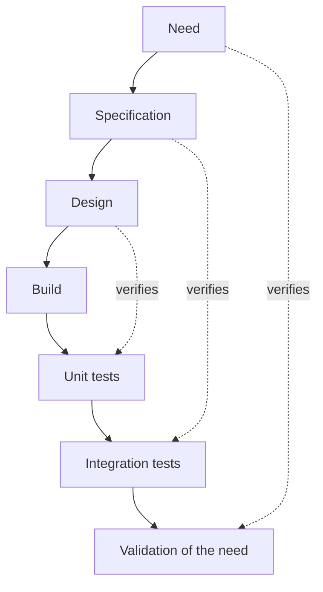
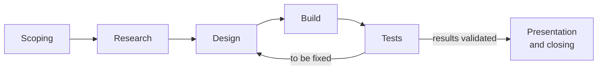

## Before you start

How do you get from an idea to a prototype that works and that others can pick up? This workshop guides you through each stage: scoping the need, looking for solutions, designing, building, testing and presenting your work. This page gives an overview so that you understand how these stages follow one another and can place yourself in your project.

## A reference model: the V-model

You may already have come across the **V-model** in your engineering classes. Its principle is simple: each design stage has a matching verification stage. First you specify the need and the way to meet it, then you build the system. The tests then check that what was built matches what was planned, up to validating the answer to the initial need.



## The stages of your project

At the MakerSpace, we will follow the stages below. They give you a common thread, with steps back when necessary: if a test reveals a problem, you go back to the design to fix what does not work.

- **Scoping**: define the need and write the specification (see [Defining your need and your specification](/workshops/methodologie-de-projet/concepts/definir-son-besoin/)).
- **Research**: look at what already exists and check that the options considered are technically feasible before committing.
- **Design**: compare the technical solutions and run trials on prototypes to refine your choices.
- **Build**: manufacture the parts, prepare the circuit board, write the code and assemble everything.
- **Tests**: check that each element, then the whole, meets the success criteria set during scoping.
- **Presentation and closing**: present your work with a poster and a video, complete the documentation and prepare for another team to pick up the project.



## Throughout the project

At each stage, you will also need to keep three habits:

- **Documenting**: note your choices, your trials and your results as you go, while they are still fresh in your mind.
- **Organising teamwork**: share out the tasks and check in regularly to know where everyone is at and discuss the difficulties encountered.
- **Following the calendar**: set yourselves deadlines and take into account ordering or manufacturing lead times, such as the wait for a 3D print.

We will come back to each of these points in the workshop. They help you move forward together and leave a trace of your work that is clear enough for another team to understand it and carry it on.

## Exercise

Take a few minutes as a team to take stock of your project:

1. Find your position on the "The stages of your project" diagram. Which stage are you at today?
2. Of the three habits above, which do you find hardest to keep? Choose one concrete action to put in place this week.
