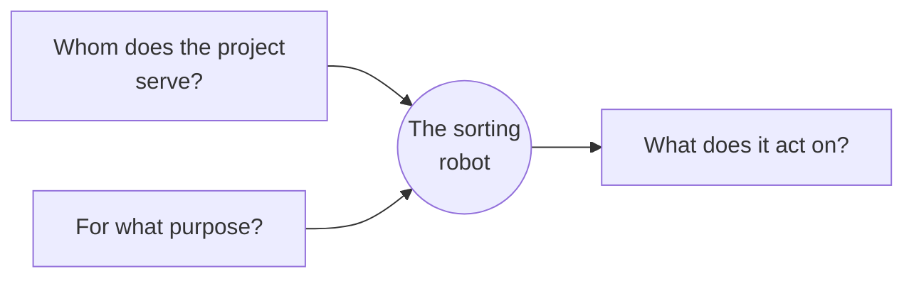
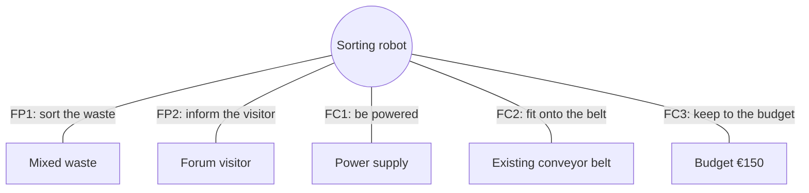

## The "we'll see as we go" trap

On a project, the urge to start soldering, printing or coding is
strong: it is often why people sign up to the MakerSpace. But starting
without having set out the need is the best way to make the same choices
three times over, to discover a blocking constraint in week 6, or to
deliver a prototype that no longer answers the original question at all.



A specification does not need to be long or formal. It just has to
answer five questions clearly, **before** the first line of code
or the first printed part.

## The five questions to ask yourself

Ask yourself these questions in this order; it is the natural line of reasoning:
why → what → for whom → within what limits → how we check.
They are exactly the five sections of the template further down, in the same
order: what you answer here, you copy into it as it is.

- **Context**: why does this project exist? What problem was observed,
  what opportunity?
- **Objectives**: what must the project achieve in concrete terms,
  stated in a verifiable way (not wishful thinking)?
- **Target audience**: who will use or see this project? A jury,
  visitors to the Forum des Sciences, a future year group that will pick up
  the work?
- **Constraints**: time available, budget, equipment accessible at the
  MakerSpace, the team's real skills (not those you hope
  to acquire along the way).
- **Success criteria**: how will you know, at the end, that the project has
  reached its objective? If the answer is fuzzy, so is the objective.

## Vague objective vs precise objective: an example

The "Objectives" section is the one most often lacking: the
difference between a poorly scoped objective and a well scoped one shows
immediately when you read it.



**Objective**: "Make a robot that sorts waste."

**What is missing**: what volume of waste, which categories, what
budget, what deadline, what level of reliability is expected. With this statement,
the team cannot know whether it has finished, or whether it is still on
track halfway through.





**Objective**: "Design a robot able to sort 3 categories of waste
(plastic, glass, metal) placed on a 1 m conveyor belt, for a
demonstration at the Forum des Sciences on 15 May. Maximum budget €150, time
frame of 8 weeks, target rate of correct sorting: 80% minimum over 20 trials."

**What this allows**: the team can share out the work, know whether a
technical choice fits the budget, and check objectively at the end
whether the objective has been reached.





## A simple template to reuse

You do not need to invent a format. This template fits in the
`docs/objectifs.md` page of your repo, which organises it in three sections:
**Contexte** (context), **Problème et public cible** (problem and target audience: the "Objectives" and
"Target audience" headings below), and **Cahier des charges** (specification: the
"Constraints" and "Success criteria" headings, in the form of a table of
functions, see below). Fill it in as a team at the very first project
meeting.

```markdown
## Context

<Why this project exists. What problem was observed, what opportunity.>

## Objectives

<What the project must achieve, stated in a verifiable way.>

## Target audience

<Who uses or assesses the result.>

## Constraints

- Time frame:
- Budget:
- Equipment / machines available:
- Skills of the team:

## Success criteria

<How we know, objectively, that it is a success.>
```



### Filled-in example

Here is what the template looks like once filled in, for the sorting robot
project used as an example on this page:

```markdown
## Context

The Forum des Sciences in Amiens wants an educational activity about
waste sorting for its May edition. There is currently no mechanical
sorting demonstration in the programme.

## Objectives

Design a robot able to sort 3 categories of waste (plastic,
glass, metal) placed on a 1 m conveyor belt, for a public
demonstration on 15 May.

## Target audience

The visitors (families, school groups) and the activity team of the Forum des
Sciences, who must be able to run the robot without us being there
on the day.

## Constraints

- Time frame: 8 weeks
- Budget: €150 maximum
- Equipment / machines available: 3D printer, laser cutter, Arduino
- Skills of the team: basic electronics, no experience in
  camera vision

## Success criteria

Rate of correct sorting ≥ 80% over 20 trials, robot running without
technical supervision during the demonstration, total cost ≤ €150.
```

Notice that "Context" and "Objectives" do not say the same thing: the
first explains *why* the project exists, the second says *what has to be
delivered*. If you do not know what to write in "Objectives", reread your
"Context": the objective is often the direct answer to the problem raised.

To fill in the "Objectives" and "Success criteria" sections without staying
at the level of vague intentions, there are a few structured methods.
They are detailed just below. They are not only for filling in
a document: they produce a concrete aid that you will reuse
later in the project to compare and justify real technical
choices.

## Going further: the functional specification

The template above is enough for the vast majority of MakerSpace
projects. If your project is more ambitious, or if your academic
supervisor expects a more formal engineering approach, **functional
analysis** (standard NF EN 16271) gives three simple tools to firm up
the need before designing.



### The "horned beast" diagram: stating the need in one sentence

This diagram (*bête à cornes* in French) forces you to answer three questions
about the project, to arrive at a statement of the need in one clear sentence.



For the sorting robot example: *"The sorting robot serves the
visitors to the Forum des Sciences, by acting on mixed waste, for
the purpose of demonstrating reliable automatic sorting."*

### The octopus diagram: listing the functions to provide

It places the product at the centre and brings out the elements of its
environment (users, other objects, physical constraints). Each
link becomes a function to provide:

- **FP** (*fonction principale*, main function): what the product must do
- **FC** (*fonction contrainte*, constraint function): what it must adapt to



Each function listed here can then become a concrete success
criterion in your template.

### The table of functions: making each function measurable

For each function identified in the octopus diagram, you specify an
**assessment criterion** (how it is measured), an expected **level**
(the target value), and a **flexibility** (possible room for negotiation:
F0 = imposed, non-negotiable; F1 = hardly negotiable; F2 = negotiable;
F3 = a wish, not essential).

| Function | Assessment criterion | Expected level | Flexibility |
|---|---|---|---|
| FP1: sort the waste | Rate of correct sorting | ≥ 80% over 20 trials | F1 |
| FP2: inform the visitor | Readability of the explanatory panel | Readable at 2 m | F2 |
| FC1: be powered | Type of power supply | 220 V mains or battery ≥ 4 h | F0 |
| FC2: fit onto the belt | Width compatible with the belt | ≤ 1 m | F0 |
| FC3: keep to the budget | Total cost of the project | ≤ €150 | F0 |

| Function | Assessment criterion | Expected level | Flexibility |
|---|---|---|---|
| FP1: ... | ... | ... | F0/F1/F2/F3 |
| FC1: ... | ... | ... | F0/F1/F2/F3 |


It is this table, more than the diagrams themselves, that becomes directly
reusable: each row can be copied as it is into the
"Success criteria" of the template seen above. It is also the table that
the **Cahier des charges** section of `docs/objectifs.md` contains, with this same
sorting robot example to be replaced by your functions.

### The FAST diagram: moving from functions to solutions

FAST starts from a function (e.g. "sort the waste") and breaks it down into
technical sub-functions, down to the concrete solutions considered. We do
not detail it here: it mostly belongs later in the project, when
comparing and justifying technical choices. See
[Recording your technical choices](/workshops/methodologie-de-projet/concepts/tracer-choix-techniques/).

## This specification is not set in stone

A project evolves: an unforeseen hardware constraint, a component out
of stock, an idea that turns out to be better along the way. The
specification can change, but it must change **consciously and in
writing**, not silently in one person's head. Each
revision is documented in the same place, with the date and the reason for the
change.

This is the direct link with the rest of the workshop: this scoping document is
the first piece of documentation that will live throughout the project,
not only at the end.

## Exercise

On your own project, as a team and out loud:

1. Fill in the `docs/objectifs.md` page of your repo: the five headings
   of the template (Context, Objectives, Target audience, Constraints, Success
   criteria) fit in its three sections.
2. Reread your "Success criteria": can they be verified by someone
   outside the team, or only understood by you?
3. If your project is ambitious or your supervisor asks for it, quickly draw
   a horned beast diagram and an octopus diagram in 15-20 minutes.
