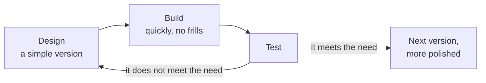

## The trap of the version that is perfect first time

Faced with a technical problem, the natural reflex is to want to design
the final solution straight away, clean and polished. The risk: spending
three weeks on a detailed CAD design before discovering, at the first
test, that a basic assumption was wrong, and having to redo everything.

A prototype has only one job: to answer a precise question
("does this mechanism hold the load?", "is this sensor accurate
enough?"). It does not need to be good-looking, robust or final.

## Rough V1 vs perfect V1



**Approach**: design a complete sorting mechanism in CAD, with all
the tolerances, the final fixings and the final look, before printing
anything.

**Result**: three weeks gone, and at the first test, the chosen sensor
does not tell glass from plastic well under the real lighting:
a good part of the mechanical design has to be reviewed on top of the
choice of sensor.





**Approach**: print a minimal mount in one afternoon, just enough to
hold the sensor and test under the real lighting of the Forum des Sciences.

**Result**: the sensor's accuracy problem is discovered the same day,
before any time has been invested in the complete mechanical design.
The final mechanism can be designed already knowing the right sensor.





## A failed test is not a failed project



## Knowing when to stop iterating

Iterating endlessly is not the answer either: at some point, you have to
move on to the next version and head towards the final presentation. Two
markers to decide:

- Are the **success criteria** of your specification met?
  If so, there is no point in polishing further.
- Is your **schedule milestone** approaching? A prototype that meets 90%
  of the need, delivered on time, is better than a perfect prototype
  delivered late.

## Exercise

On your project, as a team:

1. Identify the technical question that worries you most today.
2. Design the fastest possible prototype (a few hours, not
   several days) that answers only that question, nothing more.
3. Test it and note the result in your logbook, whether it
   works or not.
