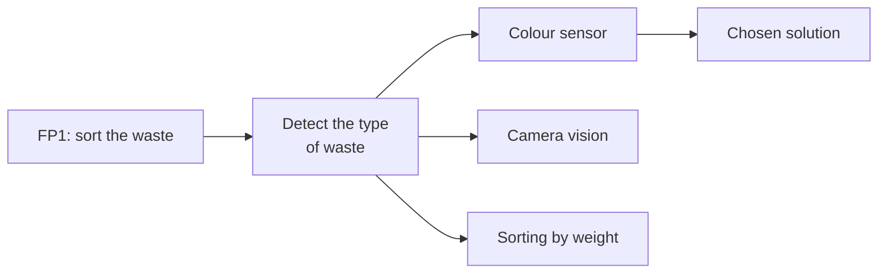

## Why record a choice, not just make it

A team that chooses a component, an architecture or a method without
noting why exposes itself to two problems: the same debate can come back
later ("why didn't we take the other sensor, again?"), and nobody
outside the decision (a new member, a supervisor, a future
year group) can understand the logic of the project by reading it.

## From functions to solutions: the FAST diagram

This is the moment announced in
[Defining your need](/workshops/methodologie-de-projet/concepts/definir-son-besoin/):
the FAST diagram starts from a function of the specification and explores
the possible technical solutions to fulfil it.



This is not a theoretical exercise: it follows directly from the
feasibility pre-study seen in
[Researching existing solutions](/workshops/methodologie-de-projet/concepts/rechercher-existant-faisabilite/):
the quick test of the colour sensor, in this example, fed into this choice.

## A simple format for documenting a trade-off

No need for a complex document. For each choice that matters, four
questions are enough:

```markdown
## Choice: colour sensor rather than camera vision

**Context**: the robot must tell apart 3 categories of waste under
the real lighting of the Forum des Sciences.

**Options considered**: colour sensor (TCS3200), camera vision
with image recognition, sorting by weight.

**Choice made and why**: colour sensor; the pre-study showed
sufficient accuracy under the real lighting, for a cost and a
complexity far below those of camera vision.

**Compromises accepted**: less accurate than a camera on very dirty
or faded waste, acceptable for a demonstration, to be reviewed if the
project is picked up for real use.
```



## Where it lives

This format fits in the **Choix techniques** (technical choices) section of
the `docs/etudes.md` page of your repo, after the comparison table of the
research into existing solutions. The two complement each other: one compares
external solutions, the other documents the final choice and why. If you have
many choices to document, make one sub-page per choice (add
`has_children: true` to the header of `etudes.md` and `parent: Études et
choix techniques` to each sub-page).

## Exercise

On your project, as a team:

1. Identify a technical choice that has already been made but never written
   down in black and white (it almost always happens).
2. Write it up with the format above, as a team: it is also an opportunity
   to check that everyone agrees on the reason for the choice.
