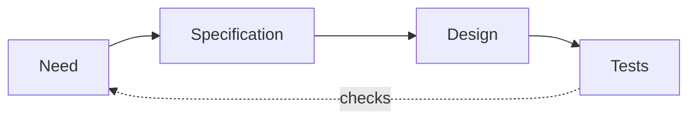

<!-- .slide: class="slide-section" data-background-color="#ef2e31" -->

## Part 1

Text that comes to life

---

## Fragments

Each element appears at the next key press, with its own effect:

- {: .fragment} Simple appearance
- {: .fragment .fade-up} Rising from the bottom
- {: .fragment .fade-left} Coming in from the left
- {: .fragment .grow} An element that grows
- {: .fragment .highlight-red} Highlighted in red
- {: .fragment .fade-in-then-semi-out} Visible, then faded

---

## Changing your mind live

You document your project the night before the deadline as you go.

The <code>strike</code> and <code>highlight-red</code> classes go on a simple <code>&lt;span&gt;</code>.

---

<!-- .slide: class="slide-center" -->

Document.

As you go.

---

<!-- .slide: class="slide-center" -->

1

repo per team, from the first commit to the final presentation
{: .fragment .fade-up}

---

<!-- .slide: class="slide-section" data-background-color="#09090b" -->

## Part 2

Auto-Animate: the elements move on their own

---

<!-- .slide: data-auto-animate -->

## A project, step by step

  
Scoping

---

<!-- .slide: data-auto-animate -->

## A project, step by step

  
Scoping

  →
  
Research

  →
  
Design

---

<!-- .slide: data-auto-animate -->

## A project, step by step

  
Scoping

  →
  
Research

  →
  
Design

  →
  
Build

  →
  
Tests

  →
  
Presentation

The blocks that carry the same `data-id` from one slide to the next are animated: position, size, colour.
{: .caption}

---

<!-- .slide: data-auto-animate class="slide-center" -->

<h2 data-id="doc-title" style="font-size: 3.4em; border: none;">Document</h2>

---

<!-- .slide: data-auto-animate -->

<h2 data-id="doc-title">Document</h2>

- One logbook per person
- The technical choices and their reasons
- The source files in the repo

The title slid into place: same `data-id`, different sizes.
{: .caption}

---

## Code, line by line

<pre><code class="language-cpp" data-trim data-line-numbers="1|3-5|7-12|8-9|10-11">
const int LED = 13;

void setup() {
  pinMode(LED, OUTPUT);
}

void loop() {
  digitalWrite(LED, HIGH);
  delay(500);
  digitalWrite(LED, LOW);
  delay(500);
}
</code></pre>

Each press on → highlights the next block (`data-line-numbers`).
{: .caption}

---

<!-- .slide: class="slide-section" data-background-gradient="radial-gradient(circle at 30% 30%, #ef2e31 0%, #7f1214 45%, #09090b 100%)" -->

## Part 3

Full-screen backgrounds

---

<!-- .slide: class="has-dark-background slide-section" data-background-image="/workshops/methodologie-de-projet/tutorials/documenter-carte-electronique/hero.jpg" data-background-color="#09090b" data-background-opacity="0.4" -->

## A photo as background

`data-background-image`, with an adjustable opacity to keep the text readable.

Photo: Otto robot circuit board, MakerSpace UniLaSalle Amiens.
{: .caption}

---

<!-- .slide: class="has-dark-background" data-background-image="/workshops/methodologie-de-projet/tutorials/creer-repo-template/hero.jpg" data-background-color="#09090b" data-background-opacity="0.25" data-background-transition="zoom" -->

## Code as a backdrop

- The background has its own transition (`data-background-transition`)
- The text keeps its own

Photo: "a computer screen with a bunch of code on it" by Chris Ried, via [Unsplash](https://unsplash.com/photos/ieic5Tq8YMk), under the [Unsplash licence](https://unsplash.com/license).
{: .caption}

---

<!-- .slide: data-background-iframe="/workshops/methodologie-de-projet/" data-background-interactive -->

A web page as background: the course page, live. Click, scroll.

---

<!-- .slide: class="slide-section" data-background-color="#ef2e31" -->

## Part 4

Navigating differently

---

## Slides in depth

This slide has sub-slides: go down with **↓**.

Handy for tucking away details you only show if you have time.
{: .caption}

<!-- .down -->

## Detail 1: a diagram

<!-- .down -->

## Detail 2: a formula

Ohm's law, rendered by KaTeX:

$$U = R \times I$$

$$P = U \times I = R \times I^2$$
{: .fragment .fade-up}

---

## Stacked images

  
  
  

Changes, commit, push: the screenshots are stacked in the same place (`r-stack`).
{: .caption}

---

<!-- .slide: data-transition="zoom" class="slide-center" -->

## A zoom transition

For a single slide, with `data-transition="zoom"`.

<aside class="notes" markdown="1">
Speaker notes: they only appear in the presenter view (**S** key), with the next slide and a timer.
</aside>

---

## On the keyboard, during the session

| Key | Effect |
|---|---|
| **→**, **Space** | Next slide or fragment |
| **↓** | Sub-slide |
| **Esc** or **O** | Overview of the whole deck |
| **S** | Presenter view (notes, timer) |
| **F** | Full screen |
| **B** or **.** | Black screen (to regain attention) |
| **Alt + click** | Zoom on an area of the slide |
| **G** | Go to a slide by its number |

And in the URL: `?view=scroll` to read the deck like a page, `?print-pdf` to export it.
{: .caption}

---

<!-- .slide: class="has-dark-background slide-center" data-background-gradient="linear-gradient(135deg, #09090b 0%, #3f0d0e 55%, #ef2e31 100%)" -->

Your turn.

A Markdown file, `layout: slides`, and off you go.
