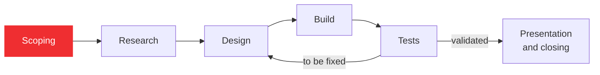

## On the agenda

1. What can go wrong
2. How you will be assessed
3. How a project unfolds
4. Defining your need
5. Documenting as you go

<aside class="notes" markdown="1">
Outline: 30 min without a PC (parts 1 to 4, up to the individual activity), then 1 h with a PC.
</aside>

---

<!-- .slide: class="slide-section" -->

## What can go wrong

Starting from your experience

---

## Activity: your worst project memories

<p class="activity-meta"><span><i class="fas fa-users"></i>Whole class</span><span><i class="far fa-clock"></i>5 min</span><span><i class="fas fa-pen"></i>No PC</span></p>

### What has already gone wrong in a group project?

- One answer per person, out loud or on a scrap of paper
- We group them on the board by family

<aside class="notes" markdown="1">
Group the answers into the families of the next slide, then reveal it.
</aside>

---

## What we almost always find

- **A fuzzy need**: everyone had a different idea of the result
{: .fragment}
- **A fuzzy organisation**: nobody knew who was doing what
{: .fragment}
- **An uneven workload, and no trace**: someone did everything, someone did nothing, and nothing to show it if there is a problem
{: .fragment}
- **Time**: everything was done in the last week
{: .fragment}
- **Memory**: "why did we choose that, again?"
{: .fragment}
- **The technical side**: a problem discovered too late
{: .fragment}

Each of these families has its answer in this course.
{: .fragment .caption}

---

<!-- .slide: class="slide-section" -->

## How you will be assessed

Assessment grid and expectations

---

## What counts

<div class="columns" markdown="1">
<div markdown="1">

<p class="big-number">60%</p>

**Individual**: your logbook and your contributions to the project repo

</div>
<div markdown="1">

<p class="big-number">40%</p>

**Group**: the scoping, the organisation and the readability of the documentation

</div>
</div>

We assess the **project management**, on the state of your repo at the end of the course. The technical side is assessed in the project.
{: .caption}

---

## The details

| Individual (60%) | Group (40%) |
|---|---|
| Logbook: one entry **per session** | Measurable need and specification |
| Logbook: what was done, **why**, what next | Roles, issues and milestones up to date |
| Regular commits from **your** account | Important choices justified |
| Issues and reviews for others | Readable README and pages, template cleaned up |

The full grid is on the [Course assessment](/workshops/methodologie-de-projet/evaluation/) page: **↓** to see it.
{: .caption}

<!-- .down -->

## The Course assessment page

<iframe class="page-preview" data-src="/workshops/methodologie-de-projet/evaluation/#what-is-assessed" title="Course assessment page"></iframe>

Always online: `doc.makerspace-amiens.fr/en/workshops/methodologie-de-projet/evaluation/`
{: .caption}

---

<!-- .slide: class="slide-section" -->

## How a project unfolds

The main stages, and where you are

---

## The stages of a project



**You are here: at scoping.** Going back is normal: a failed test sends you back to design. **↓**: the reference model.

[The life cycle of a project](/workshops/methodologie-de-projet/concepts/cycle-de-vie-projet/){: .doc-link}

<!-- .down -->

## The reference model: the V-model

<div class="v-model"><svg viewBox="0 0 1088 365" role="img" aria-label="V-model: need, specification and design on the left, build at the bottom, unit tests, integration tests and validation of the need on the right"><defs><marker id="v-arrow" viewBox="0 0 10 10" refX="9" refY="5" markerWidth="7" markerHeight="7" orient="auto-start-reverse"><path d="M0 0 L10 5 L0 10 z"/></marker></defs><line class="v-flow" x1="130.0" y1="69" x2="245.0" y2="110" marker-end="url(#v-arrow)"/><line class="v-flow" x1="245.0" y1="164" x2="360.0" y2="205" marker-end="url(#v-arrow)"/><line class="v-flow" x1="360.0" y1="259" x2="499.0" y2="300" marker-end="url(#v-arrow)"/><line class="v-flow" x1="589.0" y1="300" x2="728.0" y2="259" marker-end="url(#v-arrow)"/><line class="v-flow" x1="728.0" y1="205" x2="843.0" y2="164" marker-end="url(#v-arrow)"/><line class="v-flow" x1="843.0" y1="110" x2="958.0" y2="69" marker-end="url(#v-arrow)"/><line class="v-verify" x1="252" y1="42.0" x2="836" y2="42.0"/><text class="v-label" x="544.0" y="32.0">verifies</text><line class="v-verify" x1="367" y1="137.0" x2="721" y2="137.0"/><text class="v-label" x="544.0" y="127.0">verifies</text><line class="v-verify" x1="482" y1="232.0" x2="606" y2="232.0"/><text class="v-label" x="544.0" y="222.0">verifies</text><rect class="v-box" x="20" y="15" width="220" height="54" rx="10"/><text x="130.0" y="42.0">Need</text><rect class="v-box" x="135" y="110" width="220" height="54" rx="10"/><text x="245.0" y="137.0">Specification</text><rect class="v-box" x="250" y="205" width="220" height="54" rx="10"/><text x="360.0" y="232.0">Design</text><rect class="v-box v-check" x="848" y="15" width="220" height="54" rx="10"/><text x="958.0" y="42.0">Validation of the need</text><rect class="v-box v-check" x="733" y="110" width="220" height="54" rx="10"/><text x="843.0" y="137.0">Integration tests</text><rect class="v-box v-check" x="618" y="205" width="220" height="54" rx="10"/><text x="728.0" y="232.0">Unit tests</text><rect class="v-box v-make" x="434" y="300" width="220" height="54" rx="10"/><text x="544.0" y="327.0">Build</text></svg></div>

Each design stage (left) has a matching verification stage (right). In a short project, we keep the idea: **plan at design time how you will verify**.
{: .caption}

[The V-model](/workshops/methodologie-de-projet/concepts/cycle-de-vie-projet/#a-reference-model-the-v-model){: .doc-link}

---

## What the method brings

- **Scoping**: knowing what you must achieve before choosing how
- **Getting organised**: roles, milestones, a team check-in at every session
- **Keeping a trace**: being able to explain, pick up and present your work

The technical side moves the project forward, the method stops it from stalling.
{: .caption}

---

<!-- .slide: class="slide-section" -->

## Defining your need

Saying what, before saying how

---

## Three questions before any solution

1. **For whom?** Who will use the result, and in what conditions?
2. **What for?** What problem does the project solve?
3. **How will we know it is a success?** With criteria that can be checked

We talk about the **what**, not the **how**: "a stepper motor" is a solution, not a need.
{: .caption}

[Defining your need and your specification](/workshops/methodologie-de-projet/concepts/definir-son-besoin/){: .doc-link}

---

## A criterion can be measured

| Fuzzy | Measurable |
|---|---|
| "fast" | in under 2 minutes |
| "light" | under 500 g |
| "easy to use" | a stranger starts it alone in under 30 s |
| "reliable" | 20 trials out of 20 without intervention |

The question to ask yourself: **how would we check it, in practice?**
{: .caption}

[Defining your need and your specification](/workshops/methodologie-de-projet/concepts/definir-son-besoin/){: .doc-link}

---

## Activity: the need of your project

<p class="activity-meta"><span><i class="fas fa-user"></i>Individual</span><span><i class="far fa-clock"></i>7 min</span><span><i class="fas fa-pen"></i>Paper or PC</span></p>

For **your** project, in one or two sentences each:

1. **For whom?** Who will use the result, and in what conditions?
2. **What for?** What problem does the project solve?
3. **How will we know it is a success?** Write **two criteria**, each with its **numerical level** ("in under 2 minutes" ≠ "fast")

Keep your notes: you will need them later.
{: .caption}

<aside class="notes" markdown="1">
End of the part without a PC. The PCs arrive during or just after this activity.
</aside>

---

## Activity: you explain, the other rephrases

<p class="activity-meta"><span><i class="fas fa-user-friends"></i>Pair from different projects</span><span><i class="far fa-clock"></i>2 × 4 min</span></p>

1. Present the need of your project in **1 minute**
2. Your partner **rephrases** it in one sentence
3. If their rephrasing is wrong, it is not they who misunderstood: **your need is not clear yet**. Fix it.
4. Swap roles

Someone outside the project is exactly the reader of your documentation.
{: .caption}

---

## Correction: Machine That Draws

- **For whom?** The visitors to the Projects Day and the jury, then the team that will pick up the machine
- **What for?** Automatically producing a drawing on paper from a file, without intervention during the drawing
- **How will we know it is a success?** See the criteria, next slides
{: .fragment}

We mention neither motors, nor Arduino, nor CAD: those are solutions.
{: .fragment .caption}

---

## Correction: the main functions

What the machine must **do**:

| Function | Criterion | Expected level | Flexibility |
|---|---|---|---|
| FP1: draw a drawing | Error on a 10 cm square | ≤ 1 mm per side | F1 |
| FP2: cover a sheet | Format of the drawing area | A4 at least | F1 |
| FP3: draw unaided | Intervention during a drawing | none | F0 |
| FP4: be shown to the public | Duration of a demo drawing | ≤ 5 min | F2 |
{: .table-dense}

Example values: it is up to your team to set them, then write them in `objectifs.md`.
{: .caption}

---

## Correction: the constraints

| Constraint | Criterion | Expected level | Flex. |
|---|---|---|---|
| FC1: use the base supplied | Fixing onto the drilled plate | no extra drilling | F0 |
| FC2: use the kit supplied | Components outside the kit | justified and approved | F1 |
| FC3: make it at the MakerSpace | Processes | machines and tools on site | F1 |
| FC4: keep to the calendar | Proof of Concept | working at the end of S1 | F0 |
| FC5: safety of the public | Moving parts | no pinching possible | F0 |
{: .table-dense}

Kit supplied: motors and control electronics. F0: imperative, F3: negotiable.
{: .caption}

[Defining your need and your specification](/workshops/methodologie-de-projet/concepts/definir-son-besoin/){: .doc-link}

---

## A base, not a model to copy

<p class="activity-meta"><span><i class="fas fa-exclamation-triangle"></i>Warning</span></p>

- These tables are the **bare minimum**, not the expected answer
- Functions and constraints are deliberately missing: **it is up to you to complete them**
- It is a **contract** with your team and your client: set levels that are **logical and achievable**, and justify them
- Your specification **will evolve**: note what changes and why

[Defining your need and your specification](/workshops/methodologie-de-projet/concepts/definir-son-besoin/){: .doc-link}

---

<!-- .slide: class="slide-section" -->

## Documenting as you go

Including during the methodology sessions

---

## Why now, and not at the end

- **In three weeks**, you will have forgotten why you made this choice
- **The team that picks up** your project will only have what is written
- **The presentation and the report** are built from these traces
- **60% of the assessment** rests on your logbook and your contributions

Writing for 10 minutes at each session costs less than reconstructing a semester the day before the submission.
{: .caption}

[Documenting as you go](/workshops/methodologie-de-projet/concepts/documenter-au-fil-de-leau/){: .doc-link}

---

## Your team's repo

Each team already has its repo, created from the template:

```text
docs/
├── objectifs.md              the need and the specification
├── equipe.md                 the members and the roles
├── etudes.md                 existing solutions and feasibility
├── conception/               mechanics, electronics, code
├── fabrication/              the manufacturing steps
├── tests.md                  the trials and their results
└── journal/
    ├── _modele-seance.md     the template for an entry
    └── etudiant-1/           your logbook (can be renamed with your first name)
```

[Creating your repo from the template](/workshops/methodologie-de-projet/tutorials/creer-repo-template/){: .doc-link} [Customising the template](/workshops/methodologie-de-projet/tutorials/personnaliser-template/){: .doc-link}

---

## A logbook entry

One file per session, named with the date: `2026-10-05.md`

```markdown
## Done

Methodology session: need of the project rephrased with a partner.

## Why

My first version talked about motors: that was a solution, not a need.

## Still to do

- Reread the need with the team and write it in objectifs.md
```

[Keeping a logbook](/workshops/methodologie-de-projet/tutorials/journal-de-bord/){: .doc-link}

---

## Photos and videos: at every session

- **Photograph everything**: assembly, failed trial, whiteboard, before and after a change
- **Film the trials**: 10 seconds of video are worth a long paragraph
- **Frame vertically**: a portrait photo fits better in a documentation page
- **Store and name**: `docs/assets/images/`, with a name that says what is shown (`essai-stylo-servo.jpg`, not `IMG_4521.jpg`)

A photo taken at the time cannot be retaken: once it is dismantled, it is too late.
{: .caption}

[Documenting assembly and build](/workshops/methodologie-de-projet/tutorials/documenter-assemblage-montage/){: .doc-link}

---

## Screenshots and screen recordings

| Action | Windows | macOS | Linux (GNOME) |
|---|---|---|---|
| Capture an area | <kbd>Win</kbd> <kbd>Shift</kbd> <kbd>S</kbd> | <kbd>Cmd</kbd> <kbd>Shift</kbd> <kbd>4</kbd> | <kbd>PrtSc</kbd> |
| Record the screen | <kbd>Win</kbd> <kbd>Alt</kbd> <kbd>R</kbd> | <kbd>Cmd</kbd> <kbd>Shift</kbd> <kbd>5</kbd> | <kbd>Ctrl</kbd> <kbd>Shift</kbd> <kbd>Alt</kbd> <kbd>R</kbd> |

**On Windows, [ShareX](https://getsharex.com/)** (free and open source) does it all in one shortcut: area capture, video or GIF of the screen, arrows and annotations, direct copy to the clipboard.

For an animation, prefer a short MP4 video to a GIF: far lighter for the same duration.
{: .caption}

---

## Watch the file sizes

<div class="columns" markdown="1">
<div markdown="1">

<p class="big-number">2 MB</p>

**per photo, at most.** Aim for 500 kB: 1600 pixels wide is enough for a web page.

</div>
<div markdown="1">

<p class="big-number">25 MB</p>

**per video, at most.** Short, in 720p: it stays in the repo, with the rest of the project.

</div>
</div>

A page must load fast, even on a phone. The repo **checks the weight of each file** at every push (**Actions** tab): an overrun shows straight away, and at marking time too.
{: .caption}

[The rules for the repo's files](/workshops/methodologie-de-projet/tutorials/personnaliser-template/#the-rules-for-the-repos-files){: .doc-link}

---

## Tip: AI for formatting

<p class="activity-meta"><span><i class="fas fa-lightbulb"></i>Tip</span></p>

- **Dictate** at the end of the session (voice note, 2 minutes), or take rough notes
- Then ask for **reformatting**, not writing:

```text
Here are my rough session notes. Format them in three parts:
Done, Why, Still to do. Do not add any information.
```

**Reread everything**: AI can get things wrong or misread your notes. It is your logbook that is assessed.
{: .caption}

---

## Activity: your first logbook entry

<p class="activity-meta"><span><i class="fas fa-user"></i>Individual</span><span><i class="far fa-clock"></i>20 min</span><span><i class="fas fa-laptop"></i>On a PC</span></p>

1. Open your team's repo and get the latest changes (**Pull**)
2. Copy `docs/journal/_modele-seance.md` into **your** folder, rename it with today's date
3. Describe this session: what you did, the need you reworked, what remains to be done
4. **Commit** with a clear message, then **Push**

[Keeping a logbook](/workshops/methodologie-de-projet/tutorials/journal-de-bord/){: .doc-link} [Git, GitHub Desktop and VSCode](/workshops/methodologie-de-projet/tutorials/git-github-desktop-vscode/){: .doc-link}

---

## Activity: peer review

<p class="activity-meta"><span><i class="fas fa-user-friends"></i>Pair from different projects</span><span><i class="far fa-clock"></i>7 min</span><span><i class="fab fa-github"></i>On GitHub</span></p>

1. Open your partner's entry **on GitHub**
2. Without asking them any question: do you understand what they did, and **why**?
3. Give them **one** thing to clarify
4. They correct, commit and push

---

## Before the next session

<p class="activity-meta"><span><i class="fas fa-users"></i>With your project team</span></p>

1. Pool your needs in `objectifs.md` (**Problème et public cible**: problem and target audience)
2. Share out the roles in `equipe.md` (**lead and backup**)
3. Start **researching existing solutions** and note your sources in `etudes.md`: we come back to it next session
4. One logbook entry **at every session**, project and methodology alike

[Building and organising your team](/workshops/methodologie-de-projet/concepts/constituer-organiser-equipe/){: .doc-link} [Defining your need](/workshops/methodologie-de-projet/concepts/definir-son-besoin/){: .doc-link} [Researching existing solutions](/workshops/methodologie-de-projet/concepts/rechercher-existant-faisabilite/){: .doc-link}
