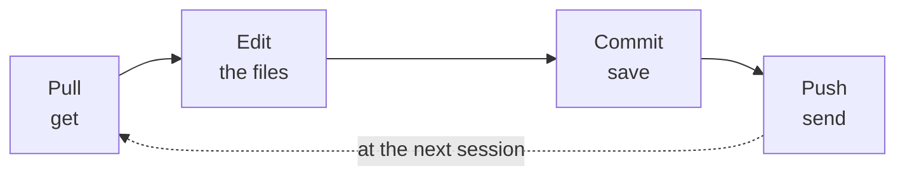
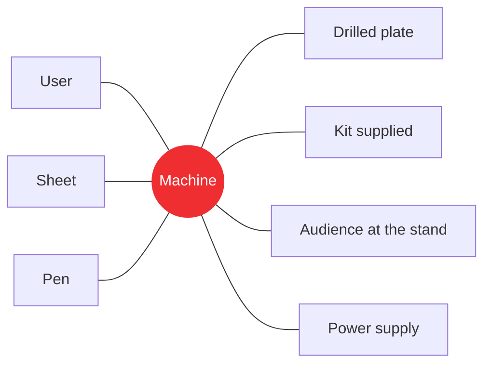

## On the agenda

1. Git and GitHub: taking stock
2. Where are you at?
3. The complete specification
4. Researching existing solutions
5. Keeping a trace

<aside class="notes" markdown="1">
Outline (1 h 30, with a PC): Git and GitHub 20 min (10 min of recap, 10 min for the full cycle and questions), back to the assignment 5 min, specification 23 min, existing solutions 30 min, logbook and assignment 12 min.
</aside>

---

<!-- .slide: class="slide-section" -->

## Git and GitHub: taking stock

The right reflexes, and your questions

---

## The basic cycle

| Step | GitHub Desktop | VS Code |
|---|---|---|
| Get | **Fetch origin**, then **Pull origin** | **Sync** |
| Save | Tick the files, message, **Commit to main** | **+** on the files, message, **Commit** |
| Send | **Push origin** | **Sync Changes** |
{: .table-dense}

[Git, GitHub Desktop and VSCode](/workshops/methodologie-de-projet/tutorials/git-github-desktop-vscode/){: .doc-link}

---

## The right reflexes

- **Pull when you arrive**, before touching anything
- **Commit often**, with a message that says what changes: "Add FC3 to the specification", not "edit"
- **Push when you leave**: work left on your PC does not exist for the team
- **Check on GitHub** that it arrived, then on the published site (**Actions** tab green)
- **Avoid several people editing the same file at the same time**: share out the pages

---

## The most frequent problems

| Symptom | Likely cause | Solution |
|---|---|---|
| Push rejected | Someone pushed before you | **Pull**, then **Push** again |
| Conflict | Two people changed the same line | Keep the right version in the file, **Commit**, **Push** |
| The site does not update | The build failed, often because of the front matter | **Actions** tab, read the error of the red run |
| Commit button greyed out | No message, or no file ticked | Check both |
| An image does not display | Wrong path, or capitals: `Photo.JPG` ≠ `photo.jpg` | Lower-case name, path checked |
{: .table-dense}

[Resolving a Git conflict](/docs/how-to-guides/pull-requests-et-conflits-git/){: .doc-link} [Publishing your site with GitHub Pages](/workshops/methodologie-de-projet/tutorials/publier-son-site/){: .doc-link}

---

## Activity: the full cycle

<i class="fas fa-user"></i>Individual<i class="far fa-clock"></i>10 min<i class="fas fa-laptop"></i>On a PC

1. **Pull** on your team's repo
2. Complete your logbook entry for session 1 (a clarification, a photo, a typo fixed)
3. **Commit** with a clear message, then **Push**
4. Check on GitHub, then on the **published site**

Stuck at a step? Raise your hand: now is the time to sort it out, not the day before the submission.
{: .caption}

---

## Activity: where are you at?

<i class="fas fa-user-friends"></i>Pair from different projects<i class="far fa-clock"></i>5 min<i class="fab fa-github"></i>On GitHub

Open **your** team's repo and show your partner:

1. `objectifs.md`: read the need **without explaining it**. Does your partner understand it?
2. `equipe.md`: does each role have a lead **and** a backup?
3. Your logbook: an entry for session 1, and for each project session since?

Note what is missing: you will complete it during the session.
{: .caption}

---

<!-- .slide: class="slide-section" -->

## The complete specification

Everything the machine must do, and everything it must respect

---

## Reminder: functions and constraints

| | Main function (FP) | Constraint function (FC) |
|---|---|---|
| **Answers** | What must the machine **do**? | What must it **adapt to**? |
| **Example** | Draw a drawing | Use the drilled plate supplied |
| **Criterion** | Error on a 10 cm square | Extra drilling |
| **Level** | ≤ 1 mm per side | none |

Each row also has a **flexibility**: from F0 (imperative) to F3 (negotiable).
{: .caption}

[The table of functions](/workshops/methodologie-de-projet/concepts/definir-son-besoin/#the-table-of-functions-making-each-function-measurable){: .doc-link}

---

## Finding the missing functions

For each element around it: **what must the machine do with it, or respect because of it?** Each answer is one more function.
{: .caption}

[The octopus diagram](/workshops/methodologie-de-projet/concepts/definir-son-besoin/#the-octopus-diagram-listing-the-functions-to-provide){: .doc-link}

---

## And for setting the levels?

- **Measure**: the size of the sheet, the room on a table, the travel of a servo
- **Look at what exists**: what other machines really achieve
- **Start from the constraints**: the calendar and the kit supplied limit what is realistic
- **Own the flexibility**: an uncertain level can be F2, to be reviewed after the first trials

A level made up "to fill the box" is useless: you must be able to say where it comes from.
{: .caption}

---

## Activity: complete your specification

<i class="fas fa-user"></i>Individual<i class="far fa-clock"></i>15 min<i class="fas fa-laptop"></i>On a PC

1. **Pull** first of all: your teammates are editing the same file
2. In `objectifs.md`, add **at least two** functions or constraints, with criterion, level and flexibility
3. For each level, be able to say **where it comes from**
4. **Commit** and **Push** straight away, to limit conflicts

If the Push is rejected, do a Pull then try again: Git merges by itself as long as you have not changed the same line.
{: .caption}

[Git, GitHub Desktop and VSCode](/workshops/methodologie-de-projet/tutorials/git-github-desktop-vscode/){: .doc-link}

---

<!-- .slide: class="slide-section" -->

## Researching existing solutions

Not reinventing, and learning from others' mistakes

---

## Why research before designing

- **Save time**: someone has surely already solved part of your problem
- **Set realistic levels**: what other machines really achieve
- **Avoid the traps**: the problems others ran into are often documented
- **Justify your choices**: "we compared three solutions" is better than "it was the first idea"

Last year, fewer than half of the Machine That Draws teams documented their research into existing solutions.
{: .caption}

[Researching existing solutions and studying feasibility](/workshops/methodologie-de-projet/concepts/rechercher-existant-faisabilite/){: .doc-link}

---

## Where to look

- **Projects from previous years**: repos and documentation on [makerspace-amiens.fr/makerspace-projects](https://makerspace-amiens.fr/makerspace-projects/)
- **Online projects**: Hackaday, Instructables, GitHub, Printables
- **Commercial products**: their data sheets give performance levels
- **Videos**: to see a machine working, and its flaws

Also look for **what did not work**: a documented failure saves you from repeating it.
{: .caption}

---

## Search by subsystem too

Do not look only for "machines that draw": break your machine down into functions, and look for **who has already solved each one**.

| Subsystem | Where to find ideas |
|---|---|
| Moving a tool in X and Y | 3D printers, CNC mills, laser cutters |
| Lifting and lowering the pen | Servo motors, solenoids, cams |
| Holding the sheet flat | Clips, magnets, repositionable tape, vacuum bed |
| Fixing onto the drilled plate | Construction sets with holes, profiles |
| Turning an image into a path | Vectorisation software, G-code generation |
{: .table-dense}

We will take up this approach again next session, to **choose the technical solutions** for each subsystem.
{: .caption}

[Researching existing solutions and studying feasibility](/workshops/methodologie-de-projet/concepts/rechercher-existant-faisabilite/){: .doc-link}

---

## What to keep: one record per solution

| Solution studied | Source | Advantages | Drawbacks | What we take from it |
|---|---|---|---|---|
| Name of the machine or project | Clickable link | What works well | What causes problems | What we keep, test or **rule out, and why** |

The last column is the most important: it is the one that links what exists to **your** project.
{: .caption}

[How to present your research](/workshops/methodologie-de-projet/concepts/rechercher-existant-faisabilite/#how-to-present-it){: .doc-link}

---

## A real excerpt: what is missing?

> **Core XY system**: a sophisticated variation of Cartesian machines, using two motors to move the drawing head along the X and Y axes simultaneously.
>
> **Advantages**: allows faster and smoother movement, while reducing vibrations.
>
> **Drawbacks**:

- **No source**: where does this information come from?
{: .fragment}
- **Empty drawbacks**: the analysis stops halfway
{: .fragment}
- **No decision**: is it kept or ruled out, and why?
{: .fragment}

Excerpt from one of last year's Machine That Draws repos, anonymised and translated.
{: .caption}

---

## Example: three solutions studied

| Solution studied | Source | Advantages | Drawbacks | What we take from it |
|---|---|---|---|---|
| AxiDraw | [axidraw.com](https://axidraw.com/) | Precise, A4 area | Commercial product | Pen lowered by its own weight: to reuse |
| Polargraph | [GitHub](https://github.com/euphy/polargraph) | Large area, two motors | Vertical surface | Ruled out: incompatible with FC1 |
| Machine That Draws 2025-26, group 08 | [Repo](https://github.com/Makerspace-Amiens-2025-26/MachineThatDraws-Groupe08) | Arduino, CNC Shield and GRBL: it worked | Motors that vibrated (badly set drivers) | To test first |
{: .table-dense}

Each row ends with a **decision** linked to the specification.
{: .caption}

---

## Activity: your record of existing solutions

<i class="fas fa-user"></i>Individual<i class="far fa-clock"></i>20 min<i class="fas fa-laptop"></i>On a PC

1. **Pull**, then open `etudes.md`, section **Recherche de l'existant**
2. Add **two rows** to the table: another **machine that draws** (one of last year's projects, for example), and a solution found elsewhere for **one part** of your machine (lifting the pen, holding the sheet…)
3. Fill in **all** the columns, with a clickable source
4. **Commit** and **Push**
5. Your partner reviews: does the source open? Do they understand what you take from it?

Between teammates: one row per solution, and a Pull just before writing.
{: .caption}

---

<!-- .slide: class="slide-section" -->

## Keeping a trace

The logbook, at every session

---

## Activity: the logbook for this session

<i class="fas fa-user"></i>Individual<i class="far fa-clock"></i>7 min<i class="fas fa-laptop"></i>On a PC

A new dated entry in your folder:

- **Done**: the functions added to the specification, the solutions studied
- **Why**: where your levels come from, why you rule out a solution
- **Still to do**: what the team still has to settle

A screenshot of your table or of the machine studied makes the entry more telling.
{: .caption}

[Keeping a logbook](/workshops/methodologie-de-projet/tutorials/journal-de-bord/){: .doc-link}

---

## Before the next session

<i class="fas fa-users"></i>With your project team

1. Reread the specification together and **agree** on the levels
2. Pool the existing solutions and list the **main parts** of your machine
3. One logbook entry **at every session**, project and methodology alike

Next session: breaking the machine down into subsystems, and organising the work with a GitHub Project.
{: .caption}

[Researching existing solutions and studying feasibility](/workshops/methodologie-de-projet/concepts/rechercher-existant-faisabilite/){: .doc-link} [Managing your project with GitHub](/workshops/methodologie-de-projet/tutorials/gerer-projet-github/){: .doc-link}
