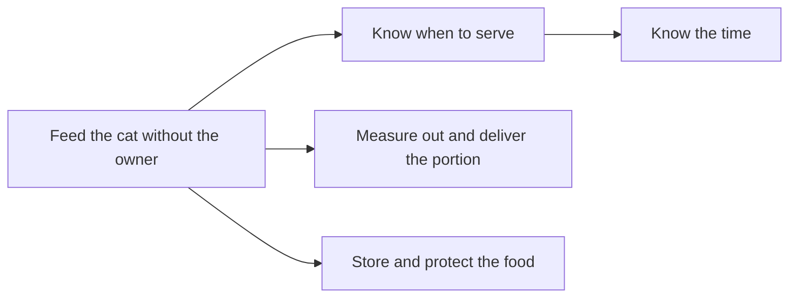
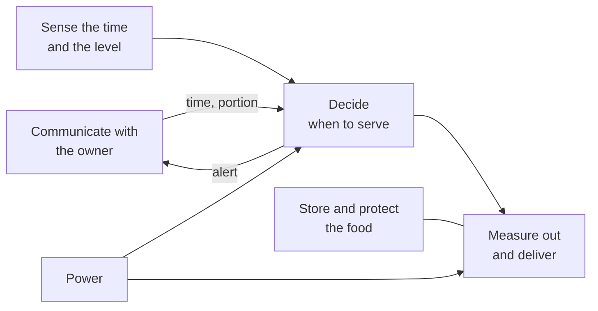

## On the agenda

1. Function or solution?
2. Breaking the machine down
3. The interfaces and the specification
4. Keeping a trace

<aside class="notes" markdown="1">
Outline (1 h 30): back to the assignment 5 min, function or solution 12 min, method and dispenser example 13 min, breakdown of their machine 30 min, interfaces and specification 12 min, logbook and assignment 13 min. That leaves 5 min of margin.

Observation from the first session: the students could not get away from technical solutions ("an Arduino, two motors") to imagine a breakdown. The whole session aims at this reflex: saying what the machine must do before choosing how it does it.
</aside>

---

## Where are you at?

- The specification: have the levels been **approved by the whole team**?
- Existing solutions: does `etudes.md` contain solutions **with their sources**?

Not finished yet? **That is not a blocker.** Today's breakdown will precisely bring out functions to add to the specification: a project moves forward in loops, not as a waterfall.
{: .caption}

[The life cycle of a project](/workshops/methodologie-de-projet/concepts/cycle-de-vie-projet/){: .doc-link}

---

<!-- .slide: class="slide-section" -->

## Function or solution?

What the product must do, before how it does it

---

## Imagine a cat food dispenser

<i class="fas fa-users"></i>Whole room<i class="far fa-clock"></i>2 min

It feeds the cat by itself, at a set time, and warns when the tank is empty.

You have to design and build it: what do you put inside?
{: .highlight-red}

<aside class="notes" markdown="1">
The question is deliberately slanted towards "building" to bring out components: "an Arduino, a motor, an auger, a screen". Start the timer (click the badge or press T), then note the answers on the board, without commenting on or correcting them. Suggest nothing: the wording is generally enough. Only if the room dries up, prompt orally without giving an answer: "In practice, what do you buy?" The next slide turns these answers on their head.
</aside>

---

## What you have just done

A **breakdown into components**. It works, and it is concrete. But:

- You missed the **real subject**: what the machine must do
- The cat helping itself? The power cut? Forgotten
- Each component is **already a choice**, made without comparing anything
- You feel you are going fast, but you are **prisoners of your choices**

To choose is to give something up: you may as well know what.
{: .highlight-red}

<aside class="notes" markdown="1">
If they protest that the question steered them: yes, on purpose. But it is also the reflex of almost every team at the start of a project, without anyone pushing them. Adapt the second bullet to what they really forgot on the board. Example of a prison: changing the motor means redoing the mount, the code and the power supply.
</aside>

<!-- .down -->

## To choose is to give something up: where it comes from

> "The necessity of choosing was always unbearable to me; to choose seemed to me not so much to select as to reject what I did not select."

André Gide, *Les Nourritures terrestres* (*The Fruits of the Earth*, 1897)
{: .caption}

The short French saying "choisir, c'est renoncer" is the version of this idea that everyday language has kept.

<aside class="notes" markdown="1">
Gide tells how he could not manage to choose, because choosing mostly meant rejecting everything else. The short saying is not word for word in the text: it is a summary that has passed into everyday language.
</aside>

<!-- .down -->

## What it means

- **The reality of choice**: selecting one option (a job, a place to live, a person) mechanically forces you to set aside all the other possibilities
- **The vertigo of loss**: this saying often causes anxiety, a feeling of grief for the "parallel lives" you could have lived
- **The trap of not choosing**: refusing to choose for fear of giving something up often means enduring a choice by default, which scatters energy and creates mental fatigue

<!-- .down -->

## Changing perspective

- **Giving up in order to move forward**: seeing what you give up not as an amputation or a failure, but as actively opening a path chosen with full awareness
- **Leaving the fantasy behind**: the ideal option that only exists in the imagination costs nothing, but reality asks you to commit in order to take charge of your own life

In a project, the mechanics are the same.
{: .caption}

<aside class="notes" markdown="1">
Come back to the project with your own concrete examples. The idea: choosing is necessary, but knowing what you set aside. Hence the order of the sessions: functions today, comparison of solutions in session 4.
</aside>

---

## What is it for?

Answers we often hear, and the question to ask for each one.

| Component | What it is for |
|---|---|
| Motor and auger | Measure out and deliver the portion |
| Arduino | Decide when to serve |
| Clock module | Know what time it is |
| Ultrasonic sensor | Measure the level of the tank |
| Screen and buttons | Communicate with the owner |
| 3D printed container | Store and protect the food |
{: .table-dense}

<aside class="notes" markdown="1">
The components on the slide are typical answers, not those of the room: compare them with what is noted on the board ("which ones did you give?") and deal orally with the components on the board that are missing from the list. Have the room answer before revealing each function. Insist: the answer always starts with a verb.
</aside>

---

## Thinking in functions

A **function**: **a verb and an object**, never a component.

**FAST** diagram: to the right "**how?**", to the left "**why?**"
{: .caption}

[From functions to solutions: the FAST diagram](/workshops/methodologie-de-projet/concepts/tracer-choix-techniques/#from-functions-to-solutions-the-fast-diagram){: .doc-link}

<aside class="notes" markdown="1">
Read the diagram in both directions. How do you feed the cat without the owner? By knowing when to serve, by measuring out the portion, by storing the food. Why know the time? To know when to serve. Each box of the breakdown will be one of these functions. Today we stop at functions: the solutions will come in session 4, at the end of the branches.
</aside>

---

<!-- .slide: class="slide-section" -->

## Breaking the machine down

One big problem is several small problems

---

## Why break it down

- **Share out the work**: one subsystem, one lead
- **Look for solutions** part by part, not for the whole machine at once
- **Test separately**: you validate the doser before having the rest
- **Document clearly**: one page per subsystem in `conception/`

The template already provides for it: `conception/index.md` starts with the **overall architecture**, and the roles in `equipe.md` can follow this breakdown.
{: .caption}

[Building and organising your team](/workshops/methodologie-de-projet/concepts/constituer-organiser-equipe/){: .doc-link}

---

## How to break it down

1. **Tell the story of its use**: from switching on to the end, one sentence per step
2. **Underline the verbs**: each one is a function
3. **Group** what works together: 4 to 7 blocks, not 20
4. **Draw the links**: what powers, controls or carries what

No need for a finished specification: you only need to know **what the machine must do**. Three blocks often forgotten: the **power supply**, what **carries** the machine, and the way the **user** controls it.
{: .caption}

---

## The dispenser scenario

1. The owner **sets** the time and the portion on a small screen
2. At 8 am, the machine **knows it is time** and **decides** to serve
3. It **drops** the food from the tank and **measures out** the portion
4. The food **arrives** in the bowl, without falling beside it
5. Tank almost empty: it **warns** the owner
6. The cat must **not be able to help itself**

The scenario fits in six sentences, and no component appears in it.
{: .caption}

<aside class="notes" markdown="1">
Same machine as earlier, but this time we start from the use. Read the scenario without the bold first, on the board if possible, and have the room find the verbs. Sentence 6 shows a function that would not have been found by thinking in components: protecting the tank.
</aside>

---

## The block diagram of the dispenser

Six blocks, and still **no component**: hatch or auger, clock or Wi-Fi, that is the work of session 4.
{: .caption}

---

## Activity: break your machine down

<i class="fas fa-users"></i>By team if possible<i class="far fa-clock"></i>30 min<i class="fas fa-pen"></i>Paper or PC

1. Write the **use scenario**: 5 to 8 sentences, from switching on to the end
2. Underline the **verbs**
3. Group into **4 to 7 blocks**: one verb and one object per box
4. Draw the **block diagram**: one arrow per link

Several members of the same team in the room? Work together. A component name in a box: what is it for?
{: .caption}

<aside class="notes" markdown="1">
Walk around the room and hunt down components in the boxes: this is where the session is won or lost. No shared correction, the machines are too different: the correction is done group by group.
</aside>

---

<!-- .slide: class="slide-section" -->

## The interfaces and the specification

Where the blocks touch

---

## One arrow, one interface

Each arrow of your diagram is a place where **two blocks must agree**. In the dispenser:

- **It attaches**: the outlet of the tank must fit onto the doser
- **It plugs in**: the power supply must provide the voltage the doser expects
- **It is exchanged**: the dialogue must send the time and the portion in a form the decision block understands

If two people each design a block without talking to each other, this is where it breaks on assembly day. So each interface has **a lead**.
{: .caption}

---

## What the breakdown says about your specification

- **A block with no function** in the specification: a forgotten function, to add with its criterion and its level
- **A function with no block**: a block forgotten in your diagram
- Example: "Store and protect the food" becomes "the cat does not open the tank"

The breakdown is a **V0**: it will move with the specification, and that is normal.
{: .caption}

[Defining your need](/workshops/methodologie-de-projet/concepts/definir-son-besoin/){: .doc-link}

---

<!-- .slide: class="slide-section" -->

## Keeping a trace

The logbook, at every session

---

## Activity: the logbook for this session

<i class="fas fa-user"></i>Individual<i class="far fa-clock"></i>8 min<i class="fas fa-laptop"></i>On a PC

- **Done**: your use scenario and your block diagram
- **Why**: the groupings chosen, the interfaces spotted
- **Still to do**: the functions to add to the specification, what the team has to settle

Add a photo or a screenshot of your diagram: it is the basis of the overall architecture.
{: .caption}

[Keeping a logbook](/workshops/methodologie-de-projet/tutorials/journal-de-bord/){: .doc-link}

---

## Before the next session

<i class="fas fa-users"></i>With your project team

1. Pool your breakdowns in `conception/index.md`, section **Architecture globale** (overall architecture)
2. Complete `objectifs.md` with the **functions** that the breakdown brought out
3. In `equipe.md`, one **lead** per subsystem and per interface
4. For your subsystem, **two existing solutions** in `etudes.md`

Next session: choosing the solutions for each subsystem, and organising the work on GitHub.
{: .caption}

[Researching existing solutions](/workshops/methodologie-de-projet/concepts/rechercher-existant-faisabilite/){: .doc-link} [Communicating as a team](/workshops/methodologie-de-projet/concepts/communiquer-en-equipe/){: .doc-link}
