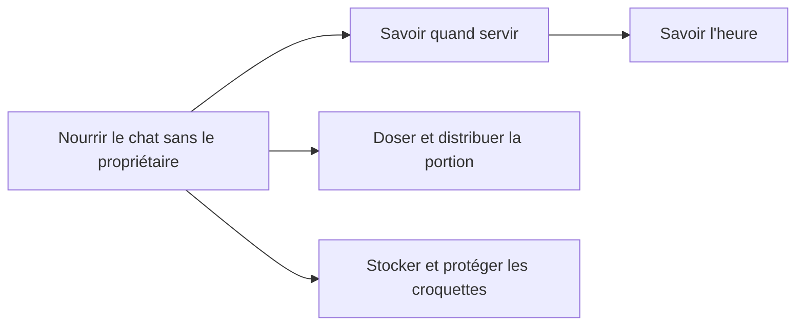
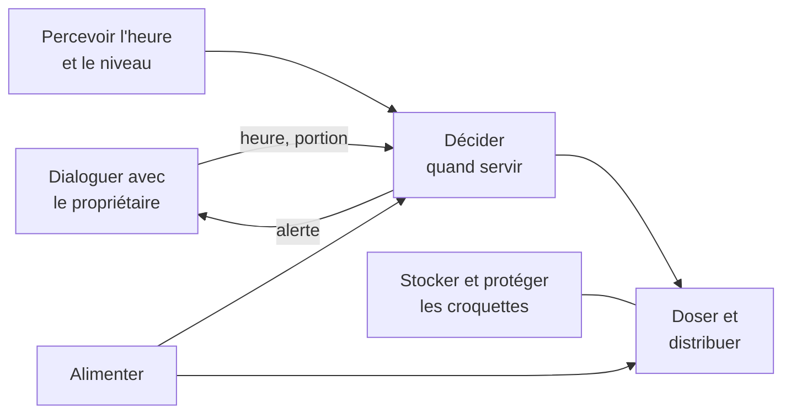

## Au programme

1. Fonction ou solution ?
2. Découper la machine
3. Les interfaces et le cahier des charges
4. Garder la trace

<aside class="notes" markdown="1">
Déroulé (1 h 30) : retour sur la consigne 5 min, fonction ou solution 12 min, méthode et exemple du distributeur 13 min, découpage de leur machine 30 min, interfaces et cahier des charges 12 min, journal et consigne 13 min. Il reste 5 min de marge.

Constat de la première séance : les étudiants n'arrivaient pas à sortir des solutions techniques (« un Arduino, deux moteurs ») pour imaginer un découpage. Toute la séance vise ce réflexe : dire ce que la machine doit faire avant de choisir comment elle le fait.
</aside>

---

## Où en êtes-vous ?

- Le cahier des charges : les niveaux sont-ils **validés par toute l'équipe** ?
- L'existant : `etudes.md` contient-il des solutions **avec leurs sources** ?

Pas encore fini ? **Ce n'est pas bloquant.** Le découpage d'aujourd'hui va justement faire apparaître des fonctions à ajouter au cahier des charges : un projet avance en boucle, pas en cascade.
{: .caption}

[Cycle de vie d'un projet](/workshops/methodologie-de-projet/concepts/cycle-de-vie-projet/){: .doc-link}

---

<!-- .slide: class="slide-section" -->

## Fonction ou solution ?

Ce que doit faire le produit, avant comment il le fait

---

## Imaginez un distributeur de croquettes

<i class="fas fa-users"></i>Toute la salle<i class="far fa-clock"></i>2 min

Il sert le chat tout seul, à heure fixe, et prévient quand le réservoir est vide.

Vous devez le concevoir et le fabriquer : qu'est-ce que vous mettez dedans&nbsp;?
{: .highlight-red}

<aside class="notes" markdown="1">
La question est volontairement orientée « fabrication » pour faire sortir des composants : « un Arduino, un moteur, une vis sans fin, un écran ». Lancer le chrono (clic sur la pastille ou touche T), puis noter les réponses au tableau, sans les commenter ni les corriger. Ne rien suggérer : la formulation suffit en général. Seulement si la salle sèche, relancer à l'oral sans donner de réponse : « Concrètement, vous achetez quoi ? » La slide suivante prend ces réponses à contre-pied.
</aside>

---

## Ce que vous venez de faire

Un **découpage en composants**. Ça marche, et c'est concret. Mais :

- Vous êtes passés à côté du **vrai sujet** : ce que la machine doit faire
- Le chat qui se sert tout seul ? La coupure de courant ? Oubliés
- Chaque composant est **déjà un choix**, fait sans rien comparer
- Vous avez l'impression d'aller vite, mais vous êtes **prisonniers de vos choix**

Choisir, c'est renoncer : autant savoir à quoi.
{: .highlight-red}

<aside class="notes" markdown="1">
S'ils protestent que la question les orientait : oui, exprès. Mais c'est aussi le réflexe de presque toutes les équipes en début de projet, sans que personne ne les pousse. Adapter la deuxième puce à ce qu'ils ont réellement oublié au tableau. Exemple de prison : changer de moteur, c'est refaire le support, le code et l'alimentation.
</aside>

<!-- .down -->

## Choisir, c'est renoncer : d'où ça vient

> « La nécessité de l'option me fut toujours intolérable ; choisir m'apparaissait non tant élire, que repousser ce que je n'élisais pas. »

André Gide, *Les Nourritures terrestres* (1897)
{: .caption}

La formule courte « choisir, c'est renoncer » est la version que la langue courante a retenue de cette idée.

<aside class="notes" markdown="1">
Gide raconte qu'il n'arrivait pas à choisir, parce que choisir revenait surtout à rejeter tout le reste. La formule courte n'est pas mot pour mot dans le texte : c'est un résumé passé dans le langage courant.
</aside>

<!-- .down -->

## Ce que ça veut dire

- **La réalité du choix** : sélectionner une option (un métier, un lieu de vie, une personne) oblige mécaniquement à écarter toutes les autres possibilités
- **Le vertige de la perte** : cet adage provoque souvent une angoisse, un sentiment de deuil face aux « vies parallèles » qu'on aurait pu vivre
- **Le piège du non-choix** : refuser de choisir par peur de renoncer revient souvent à subir un choix par défaut, ce qui disperse l'énergie et crée une fatigue mentale

<!-- .down -->

## Changer de perspective

- **Renoncer pour avancer** : voir le renoncement non pas comme une amputation ou un échec, mais comme l'ouverture active vers un chemin choisi en conscience
- **Sortir du fantasme** : l'option idéale qui n'existe que dans l'imaginaire ne coûte rien, mais la réalité demande de s'engager pour devenir acteur de sa propre vie

Dans un projet, c'est la même mécanique.
{: .caption}

<aside class="notes" markdown="1">
Revenir au projet avec vos propres exemples concrets. L'idée : choisir est nécessaire, mais en sachant ce qu'on écarte. D'où l'ordre de la séance : fonctions aujourd'hui, comparaison des solutions en séance 4.
</aside>

---

## À quoi ça sert ?

Des réponses qu'on entend souvent, et la question à poser pour chacune.

| Composant | À quoi ça sert |
|---|---|
| Moteur et vis sans fin | Doser et distribuer la portion |
| Arduino | Décider quand servir |
| Module horloge | Savoir quelle heure il est |
| Capteur à ultrasons | Mesurer le niveau du réservoir |
| Écran et boutons | Dialoguer avec le propriétaire |
| Bac imprimé en 3D | Stocker et protéger les croquettes |
{: .table-dense}

<aside class="notes" markdown="1">
Les composants de la slide sont des réponses typiques, pas celles de la salle : les comparer avec ce qui est noté au tableau (« lesquelles avez-vous données ? ») et traiter à l'oral les composants du tableau absents de la liste. Faire répondre la salle avant de révéler chaque fonction. Insister : la réponse commence toujours par un verbe.
</aside>

---

## Penser en fonctions

Une **fonction** : **un verbe et un complément**, jamais un composant.

Diagramme **FAST** : vers la droite « **comment ?** », vers la gauche « **pourquoi ?** »
{: .caption}

[Des fonctions aux solutions : le diagramme FAST](/workshops/methodologie-de-projet/concepts/tracer-choix-techniques/#des-fonctions-aux-solutions--le-diagramme-fast){: .doc-link}

<aside class="notes" markdown="1">
Lire le diagramme dans les deux sens. Comment nourrir le chat sans le propriétaire ? En sachant quand servir, en dosant la portion, en stockant les croquettes. Pourquoi savoir l'heure ? Pour savoir quand servir. Chaque boîte du découpage sera une de ces fonctions. Aujourd'hui on s'arrête aux fonctions : les solutions viendront en séance 4, au bout des branches.
</aside>

---

<!-- .slide: class="slide-section" -->

## Découper la machine

Un gros problème, c'est plusieurs petits problèmes

---

## Pourquoi découper

- **Répartir le travail** : un sous-système, un responsable
- **Chercher des solutions** partie par partie, pas pour toute la machine d'un coup
- **Tester séparément** : on valide le doseur avant d'avoir le reste
- **Documenter clairement** : une page par sous-système dans `conception/`

Le template le prévoit déjà : `conception/index.md` commence par l'**architecture globale**, et les rôles de `equipe.md` peuvent suivre ce découpage.
{: .caption}

[Constituer et organiser son équipe](/workshops/methodologie-de-projet/concepts/constituer-organiser-equipe/){: .doc-link}

---

## Comment découper

1. **Racontez l'usage** : de la mise en marche à la fin, une phrase par étape
2. **Soulignez les verbes** : chacun est une fonction
3. **Regroupez** ce qui travaille ensemble : 4 à 7 blocs, pas 20
4. **Tracez les liens** : qui alimente, commande ou porte quoi

Pas besoin d'un cahier des charges fini : il suffit de savoir **ce que la machine doit faire**. Trois blocs qu'on oublie souvent : l'**alimentation**, ce qui **porte** la machine, et la façon dont l'**utilisateur** la commande.
{: .caption}

---

## Le scénario du distributeur

1. Le propriétaire **règle** l'heure et la portion sur un petit écran
2. À 8 h, la machine **sait qu'il est l'heure** et **décide** de servir
3. Elle **fait tomber** les croquettes du réservoir et **dose** la portion
4. Les croquettes **arrivent** dans la gamelle, sans tomber à côté
5. Réservoir presque vide : elle **prévient** le propriétaire
6. Le chat ne doit **pas pouvoir se servir** tout seul

Le scénario tient en six phrases, et aucun composant n'y apparaît.
{: .caption}

<aside class="notes" markdown="1">
Même machine que tout à l'heure, mais cette fois on part de l'usage. Lire le scénario sans le gras d'abord, si possible au tableau, et faire trouver les verbes par la salle. La phrase 6 montre une fonction qu'on n'aurait pas trouvée en pensant composants : protéger le réservoir.
</aside>

---

## Le schéma bloc du distributeur

Six blocs, et toujours **aucun composant** : trappe ou vis sans fin, horloge ou wifi, c'est le travail de la séance 4.
{: .caption}

---

## Activité : découpez votre machine

<i class="fas fa-users"></i>Par équipe si possible<i class="far fa-clock"></i>30 min<i class="fas fa-pen"></i>Papier ou PC

1. Écrivez le **scénario d'usage** : 5 à 8 phrases, de la mise en marche à la fin
2. Soulignez les **verbes**
3. Regroupez en **4 à 7 blocs** : un verbe et un complément par boîte
4. Dessinez le **schéma bloc** : une flèche par lien

Plusieurs membres de la même équipe dans la salle ? Travaillez ensemble. Un nom de composant dans une boîte : à quoi sert-il ?
{: .caption}

<aside class="notes" markdown="1">
Passer dans les rangs et traquer les composants dans les boîtes : c'est là que se joue la séance. Pas de correction commune, les machines sont trop différentes : la correction se fait groupe par groupe.
</aside>

---

<!-- .slide: class="slide-section" -->

## Les interfaces et le cahier des charges

Là où les blocs se touchent

---

## Une flèche, une interface

Chaque flèche de votre schéma est un endroit où **deux blocs doivent s'accorder**. Dans le distributeur :

- **Ça se fixe** : la sortie du réservoir doit s'emboîter sur le doseur
- **Ça se branche** : l'alimentation doit fournir la tension que le doseur attend
- **Ça s'échange** : le dialogue doit envoyer l'heure et la portion sous une forme que la décision comprend

Si deux personnes conçoivent chacune un bloc sans se parler, c'est là que ça casse le jour du montage. Chaque interface a donc **un responsable**.
{: .caption}

---

## Ce que le découpage dit de votre cahier des charges

- **Un bloc sans fonction** dans le cahier des charges : une fonction oubliée, à ajouter avec son critère et son niveau
- **Une fonction sans bloc** : un bloc oublié dans votre schéma
- Exemple : « Stocker et protéger les croquettes » devient « le chat n'ouvre pas le réservoir »

Le découpage est une **V0** : il bougera avec le cahier des charges, et c'est normal.
{: .caption}

[Définir son besoin](/workshops/methodologie-de-projet/concepts/definir-son-besoin/){: .doc-link}

---

<!-- .slide: class="slide-section" -->

## Garder la trace

Le journal, à chaque séance

---

## Activité : le journal de la séance

<i class="fas fa-user"></i>Individuel<i class="far fa-clock"></i>8 min<i class="fas fa-laptop"></i>Sur PC

- **Fait** : votre scénario d'usage et votre schéma bloc
- **Pourquoi** : les regroupements choisis, les interfaces repérées
- **Reste à faire** : les fonctions à ajouter au cahier des charges, ce que l'équipe doit trancher

Ajoutez une photo ou une capture de votre schéma : c'est la base de l'architecture globale.
{: .caption}

[Tenir un journal de bord](/workshops/methodologie-de-projet/tutorials/journal-de-bord/){: .doc-link}

---

## D'ici la prochaine séance

<i class="fas fa-users"></i>Avec votre équipe projet

1. Mettez en commun vos découpages dans `conception/index.md`, section **Architecture globale**
2. Complétez `objectifs.md` avec les **fonctions** que le découpage a fait apparaître
3. Dans `equipe.md`, un **responsable** par sous-système et par interface
4. Pour votre sous-système, **deux solutions existantes** dans `etudes.md`

La prochaine séance : choisir les solutions de chaque sous-système, et organiser le travail sur GitHub.
{: .caption}

[Rechercher l'existant](/workshops/methodologie-de-projet/concepts/rechercher-existant-faisabilite/){: .doc-link} [Communiquer en équipe](/workshops/methodologie-de-projet/concepts/communiquer-en-equipe/){: .doc-link}
