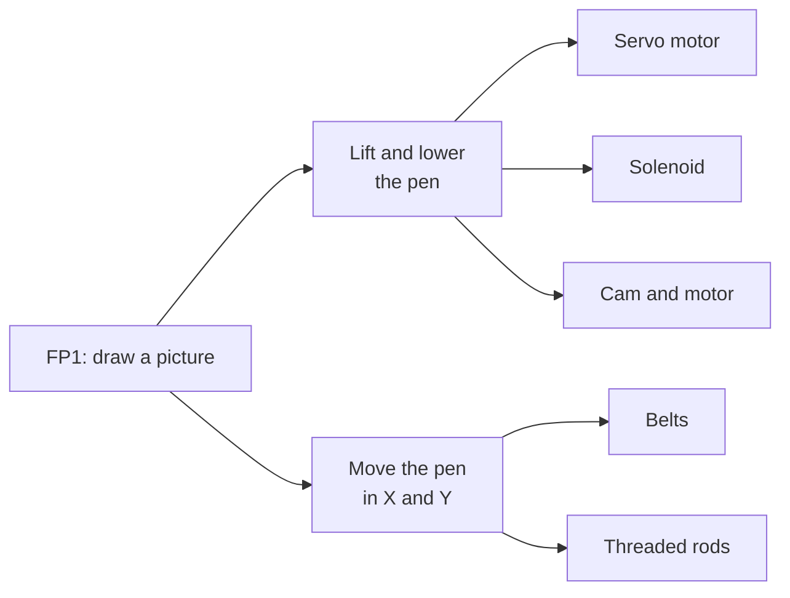

## On the agenda

1. Choosing a solution per subsystem
2. Recording your choices
3. Getting organised with GitHub
4. Keeping a trace

<aside class="notes" markdown="1">
Outline (1 h 30, with a PC): back to the assignment 5 min, choosing 22 min, recording 20 min, GitHub organisation 30 min, logbook and assignment 13 min.

The GitHub part (issues, milestones, Project) comes from session 3, now devoted to the breakdown alone: without subsystems, there are no labels or board per subsystem.
</aside>

---

## Where are you at?

- `conception/index.md`: is the **overall architecture** written, with its diagram?
- `objectifs.md`: are the functions revealed by the breakdown in it?
- `equipe.md`: does each subsystem have a **person in charge**?

Last session's breakdown is today's starting point: we choose **subsystem by subsystem**.
{: .caption}

---

<!-- .slide: class="slide-section" -->

## Choosing a solution

A reasoned decision, not the first idea

---

## From the function to the possible solutions



**FAST** diagram: at least **two options** per subsystem, otherwise it is not a choice.
{: .caption}

[The FAST diagram](/workshops/methodologie-de-projet/concepts/tracer-choix-techniques/#from-functions-to-solutions-the-fast-diagram){: .doc-link}

---

## Comparing with the criteria of the specification

| Criterion | Servo motor | Solenoid | Cam and motor |
|---|---|---|---|
| Driven by the planned electronics | ✅ GRBL-Servo | ⚠️ output to adapt | ⚠️ one more motor |
| Gentle pen landing (line quality) | ✅ adjustable | ❌ harsh landing | ✅ |
| Feasible before the POC (FC4) | ✅ | ⚠️ power supply to add | ❌ part to design |
| **Decision** | **Chosen** | Rejected | Rejected |
{: .table-dense}

The criteria come from the **specification**, not from anyone's taste. Example for the pen holder, to adapt to your machine.
{: .caption}

---

## And when in doubt: a quick test

- **Only test what raises doubts**: the pen holder alone, not the whole machine
- **Print or cut just the interface**: the part that touches the motor, not the whole piece
- **Decide in advance** what will validate the option: "20 lifts without a miss"
- **Write down the result**, even a failure: it is an argument for the choice

The rough v1 that works beats the perfect v1 that does not exist yet.
{: .caption}

[Prototyping and iterating](/workshops/methodologie-de-projet/concepts/prototyper-iterer/){: .doc-link}

---

## Activity: compare the options for your subsystem

<p class="activity-meta"><span><i class="fas fa-user"></i>Individual</span><span><i class="far fa-clock"></i>15 min</span><span><i class="fas fa-laptop"></i>On a PC</span></p>

For **the subsystem you are in charge of**:

1. List **two or three options** (go back to your research into existing solutions)
2. Choose **three criteria** from the specification
3. Build the comparison table
4. Conclude: **a decision**, or **the quick test** that will settle it

Keep this table: it is used right away to write up your choice.
{: .caption}

---

<!-- .slide: class="slide-section" -->

## Recording your choices

So as not to have the same debate again in three weeks

---

## Four questions per choice

**Context**: what problem had to be solved, under what constraint?
{: .fragment}

**Options considered**: the solutions compared
{: .fragment}

**Choice made and why**: the decision and its **technical arguments** (tests, specification)
{: .fragment}

**Trade-offs accepted**: what is lost, knowingly
{: .fragment}

Keep this format for choices that are **costly to undo**: central component, architecture, manufacturing process.
{: .caption .fragment}

[A simple format for documenting a trade-off](/workshops/methodologie-de-projet/concepts/tracer-choix-techniques/#a-simple-format-for-documenting-a-trade-off){: .doc-link}

---

## Example: the pen holder

```markdown
### Choice: servo motor to lift the pen

**Context:** the pen must lift between two lines, without any
intervention during drawing (FP3).

**Options considered:** servo motor, solenoid, cam and motor.

**Choice made and why:** servo motor. It is driven with
GRBL-Servo, already used last year (group 08), and it lowers the
pen gently. To be validated: 20 lifts without a miss.

**Trade-offs accepted:** slower than a solenoid, acceptable
for a demonstration.
```

---

## Activity: write up your choice

<p class="activity-meta"><span><i class="fas fa-user"></i>Individual</span><span><i class="far fa-clock"></i>10 min</span><span><i class="fas fa-laptop"></i>On a PC</span></p>

1. **Pull**, then open `etudes.md`, section **Choix techniques** (technical choices)
2. Add **your** choice under a `### Choix : …` heading, with the four questions
3. Paste your comparison table just below
4. **Commit** and **Push**

Then, in a **pair from different projects** (4 min): does your partner understand **why**, without asking you anything?
{: .caption}

---

<!-- .slide: class="slide-section" -->

## Getting organised with GitHub

Who does what, by when

---

## The vocabulary

| Word | It is… | Example |
|---|---|---|
| **Issue** | A task, a bug or a question to settle | "Test lifting the pen with a servo" |
| **Assignee** | The person who takes care of it | You |
| **Label** | A tag for sorting | `porte-stylo`, `logiciel` |
| **Milestone** | A dated milestone grouping issues | "Working POC", end of S1 |
| **Project** | The board showing issues by progress | To do, In progress, Done |
{: .table-dense}

Optional in the template, but **assessed** in this course.
{: .caption}

[Managing your project with GitHub](/workshops/methodologie-de-projet/tutorials/gerer-projet-github/){: .doc-link}

---

## An issue that can really be handled

<div class="columns" markdown="1">
<div markdown="1">

**❌ Vague**

**Title**: Motor problem

**Description**: (empty)

</div>
<div markdown="1">

**✅ Usable**

**Title**: The stepper motor does not turn with the A4988 driver

**Description**: the motor stays stuck, the driver heats up. Wiring checked. Lead: current setting. **Done when** the motor does 10 turns without stalling.

</div>
</div>

A precise title, the context, and **how you know it is done**.
{: .caption}

---

## One board per subsystem

| To do | In progress | Done |
|---|---|---|
| `porte-stylo` Test lifting with a servo | `déplacement-xy` Compare belt and threaded rod | `structure` Measure the hole spacing of the plate |
| `logiciel` Generate a square in G-code | `électronique` Set the drivers' current | |
| `feuille` Try holding with magnets | | |

**One label per subsystem** (those of your breakdown), **one person** per issue, and a board that **reflects reality**: a card "In progress" for three weeks is something to discuss as a team.
{: .caption}

---

## Milestones: dates, not intentions

- A **milestone** is a dated stage: you know what must be finished by that date
- Each issue is attached to a milestone, and GitHub shows the **percentage done**
- Examples: "Architecture validated", "First line drawn", "Working POC" (end of S1)
- In the repo: **Issues** tab, **Milestones** button, then **New milestone**

A milestone that slips is not a fault: it is information, to be written in the logbook with its reason.
{: .caption}

[Managing time and milestones](/workshops/methodologie-de-projet/concepts/gerer-temps-jalons/){: .doc-link}

---

## Activity: your first issues

<p class="activity-meta"><span><i class="fas fa-user"></i>Individual</span><span><i class="far fa-clock"></i>20 min</span><span><i class="fab fa-github"></i>On GitHub</span></p>

1. **Projects**: create the team's board if it does not exist (**New project**, **Board**)
2. **Issues**, then **Labels**: create your subsystem's label if needed
3. Create **three issues** (the quick test, the design page…): precise title, **done when**, label, assigned to you
4. Add them to the Project, then have your partner review one issue

[Managing your project with GitHub](/workshops/methodologie-de-projet/tutorials/gerer-projet-github/){: .doc-link}

---

<!-- .slide: class="slide-section" -->

## Keeping a trace

The logbook, at every session

---

## Activity: the session's logbook

<p class="activity-meta"><span><i class="fas fa-user"></i>Individual</span><span><i class="far fa-clock"></i>8 min</span><span><i class="fas fa-laptop"></i>On a PC</span></p>

- **Done**: the options compared, the choice written up, your first issues
- **Why**: the criteria that tipped the decision
- **Still to do**: the quick test to run, the design page to create

[Keeping a logbook](/workshops/methodologie-de-projet/tutorials/journal-de-bord/){: .doc-link}

---

## Your subsystem's page

In `conception/`, duplicate one of the template's example pages and rename it after your subsystem:

| Section | What goes in it |
|---|---|
| **Rôle** (role) | What it is for, which functions of the specification it fulfils |
| **Conception** (design) | The choice made (link to `etudes.md`), drawings or diagrams, **iterations**: what did not work and what changed |
| **Fabrication** (manufacturing) | Process, settings, source files in `project/` |

Photos of every version, even failed ones: they are the trace of the iterations.
{: .caption}

[Documenting a mechanical system](/workshops/methodologie-de-projet/tutorials/documenter-systeme-mecanique/){: .doc-link} [Documenting a circuit board](/workshops/methodologie-de-projet/tutorials/documenter-carte-electronique/){: .doc-link} [Documenting your code](/workshops/methodologie-de-projet/tutorials/documenter-code-firmware/){: .doc-link}

---

## Before the next session

<p class="activity-meta"><span><i class="fas fa-users"></i>With your project team</span></p>

1. Reread the choices together: does the team **agree on the reasons**?
2. Create the **page for each subsystem** in `conception/` (at least the Rôle section)
3. Create the **milestones**, including the end-of-S1 POC, and review the **board** at every project session
4. Go through the [assessment grid](/workshops/methodologie-de-projet/evaluation/): what is missing?

Next session: cross-review of your repos, with the assessment grid.
{: .caption}

[Recording your technical choices](/workshops/methodologie-de-projet/concepts/tracer-choix-techniques/){: .doc-link} [Closing checklist](/workshops/methodologie-de-projet/tutorials/checklist-cloture-projet/){: .doc-link}
