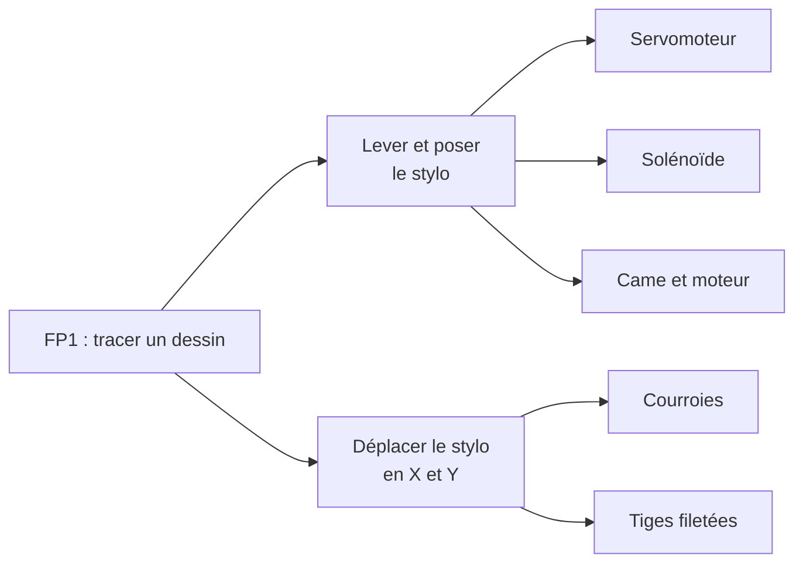

## Au programme

1. Choisir une solution par sous-système
2. Tracer ses choix
3. S'organiser avec GitHub
4. Garder la trace

<aside class="notes" markdown="1">
Déroulé (1 h 30, avec PC) : retour sur la consigne 5 min, choisir 22 min, tracer 20 min, organisation GitHub 30 min, journal et consigne 13 min.

La partie GitHub (issues, jalons, Project) vient de la séance 3, désormais consacrée au seul découpage : sans sous-systèmes, pas d'étiquettes ni de tableau par sous-système.
</aside>

---

## Où en êtes-vous ?

- `conception/index.md` : l'**architecture globale** est-elle écrite, avec son schéma ?
- `objectifs.md` : les fonctions révélées par le découpage y sont-elles ?
- `equipe.md` : chaque sous-système a-t-il un **responsable** ?

Le découpage de la dernière séance est le point de départ d'aujourd'hui : on choisit **sous-système par sous-système**.
{: .caption}

---

<!-- .slide: class="slide-section" -->

## Choisir une solution

Une décision argumentée, pas la première idée

---

## De la fonction aux solutions possibles



Diagramme **FAST** : au moins **deux options** par sous-système, sinon ce n'est pas un choix.
{: .caption}

[Le diagramme FAST](/workshops/methodologie-de-projet/concepts/tracer-choix-techniques/#des-fonctions-aux-solutions--le-diagramme-fast){: .doc-link}

---

## Comparer avec les critères du cahier des charges

| Critère | Servomoteur | Solénoïde | Came et moteur |
|---|---|---|---|
| Piloté par l'électronique prévue | ✅ GRBL-Servo | ⚠️ sortie à adapter | ⚠️ un moteur de plus |
| Pose douce du stylo (qualité du trait) | ✅ réglable | ❌ pose brutale | ✅ |
| Réalisable avant le POC (FC4) | ✅ | ⚠️ alimentation à ajouter | ❌ pièce à concevoir |
| **Décision** | **Retenu** | Écarté | Écarté |
{: .table-dense}

Les critères viennent du **cahier des charges**, pas du goût de chacun. Exemple pour le porte-stylo, à adapter à votre machine.
{: .caption}

---

## Et quand on hésite : un test rapide

- **Testez seulement ce qui fait douter** : le porte-stylo seul, pas toute la machine
- **Imprimez ou découpez juste l'interface** : la partie qui touche le moteur, pas la pièce entière
- **Décidez à l'avance** ce qui validera l'option : « 20 levées sans raté »
- **Notez le résultat**, même raté : c'est un argument pour le choix

La v1 brute qui fonctionne bat la v1 parfaite qui n'existe pas encore.
{: .caption}

[Prototyper et itérer](/workshops/methodologie-de-projet/concepts/prototyper-iterer/){: .doc-link}

---

## Activité : comparez les options de votre sous-système

<p class="activity-meta"><span><i class="fas fa-user"></i>Individuel</span><span><i class="far fa-clock"></i>15 min</span><span><i class="fas fa-laptop"></i>Sur PC</span></p>

Pour **le sous-système dont vous êtes responsable** :

1. Listez **deux ou trois options** (reprenez votre recherche de l'existant)
2. Choisissez **trois critères** dans le cahier des charges
3. Faites le tableau de comparaison
4. Concluez : **une décision**, ou **le test rapide** qui permettra de trancher

Gardez ce tableau : il sert tout de suite à rédiger votre choix.
{: .caption}

---

<!-- .slide: class="slide-section" -->

## Tracer ses choix

Pour ne pas refaire le même débat dans trois semaines

---

## Quatre questions par choix

**Contexte** : quel problème fallait-il résoudre, avec quelle contrainte ?
{: .fragment}

**Options envisagées** : les solutions comparées
{: .fragment}

**Choix retenu et pourquoi** : la décision et ses **arguments techniques** (tests, cahier des charges)
{: .fragment}

**Compromis acceptés** : ce qu'on perd, en connaissance de cause
{: .fragment}

Réservez ce format aux choix **coûteux à défaire** : composant central, architecture, procédé de fabrication.
{: .caption .fragment}

[Un format simple pour documenter un arbitrage](/workshops/methodologie-de-projet/concepts/tracer-choix-techniques/#un-format-simple-pour-documenter-un-arbitrage){: .doc-link}

---

## Exemple : le porte-stylo

```markdown
### Choix : servomoteur pour lever le stylo

**Contexte :** le stylo doit se lever entre deux traits, sans
intervention pendant le tracé (FP3).

**Options envisagées :** servomoteur, solénoïde, came et moteur.

**Choix retenu et pourquoi :** servomoteur. Il se pilote avec
GRBL-Servo, déjà utilisé l'an dernier (groupe 08), et il pose le
stylo en douceur. À valider : 20 levées sans raté.

**Compromis acceptés :** plus lent qu'un solénoïde, acceptable
pour une démonstration.
```

---

## Activité : rédigez votre choix

<p class="activity-meta"><span><i class="fas fa-user"></i>Individuel</span><span><i class="far fa-clock"></i>10 min</span><span><i class="fas fa-laptop"></i>Sur PC</span></p>

1. **Pull**, puis ouvrez `etudes.md`, section **Choix techniques**
2. Ajoutez **votre** choix sous un titre `### Choix : …`, avec les quatre questions
3. Collez votre tableau de comparaison juste en dessous
4. **Commit** et **Push**

Puis, en **binôme de projets différents** (4 min) : votre binôme comprend-il **pourquoi**, sans vous poser de question ?
{: .caption}

---

<!-- .slide: class="slide-section" -->

## S'organiser avec GitHub

Qui fait quoi, pour quand

---

## Le vocabulaire

| Mot | C'est… | Exemple |
|---|---|---|
| **Issue** | Une tâche, un bug ou une question à trancher | « Tester la levée du stylo par servo » |
| **Assignee** | La personne qui s'en charge | Vous |
| **Label** | Une étiquette pour trier | `porte-stylo`, `logiciel` |
| **Milestone** | Un jalon daté qui regroupe des issues | « POC fonctionnel », fin du S1 |
| **Project** | Le tableau qui affiche les issues par avancement | À faire, En cours, Terminé |
{: .table-dense}

Optionnel dans le template, mais **évalué** dans ce cours.
{: .caption}

[Gérer son projet avec GitHub](/workshops/methodologie-de-projet/tutorials/gerer-projet-github/){: .doc-link}

---

## Une issue qu'on peut vraiment traiter

<div class="columns" markdown="1">
<div markdown="1">

**❌ Vague**

**Titre** : Problème moteur

**Description** : (vide)

</div>
<div markdown="1">

**✅ Exploitable**

**Titre** : Le moteur pas à pas ne tourne pas avec le driver A4988

**Description** : le moteur reste bloqué, le driver chauffe. Câblage vérifié. Piste : réglage du courant. **Fini quand** le moteur fait 10 tours sans décrocher.

</div>
</div>

Un titre précis, le contexte, et **comment on sait que c'est fini**.
{: .caption}

---

## Un tableau par sous-système

| À faire | En cours | Terminé |
|---|---|---|
| `porte-stylo` Tester la levée par servo | `déplacement-xy` Comparer courroie et tige filetée | `structure` Relever l'entraxe des trous de la plaque |
| `logiciel` Générer un carré en G-code | `électronique` Régler le courant des drivers | |
| `feuille` Essayer le maintien par aimants | | |

Une **étiquette par sous-système** (ceux de votre découpage), **une personne** par issue, et un tableau qui **reflète la réalité** : une carte « En cours » depuis trois semaines, ça se discute en équipe.
{: .caption}

---

## Les jalons : des dates, pas des intentions

- Un **jalon** (milestone) est une étape datée : on sait ce qui doit être fini à cette date
- Chaque issue est rattachée à un jalon, et GitHub affiche le **pourcentage terminé**
- Exemples : « Architecture validée », « Premier trait tracé », « POC fonctionnel » (fin du S1)
- Dans le repo : onglet **Issues**, bouton **Milestones**, puis **New milestone**

Un jalon qui glisse n'est pas une faute : c'est une information, à écrire dans le journal avec sa raison.
{: .caption}

[Gérer le temps et les jalons](/workshops/methodologie-de-projet/concepts/gerer-temps-jalons/){: .doc-link}

---

## Activité : vos premières issues

<p class="activity-meta"><span><i class="fas fa-user"></i>Individuel</span><span><i class="far fa-clock"></i>20 min</span><span><i class="fab fa-github"></i>Sur GitHub</span></p>

1. **Projects** : créez le tableau de l'équipe s'il n'existe pas (**New project**, **Board**)
2. **Issues**, puis **Labels** : créez l'étiquette de votre sous-système si besoin
3. Créez **trois issues** (le test rapide, la page de conception…) : titre précis, **fini quand**, étiquette, assignée à vous
4. Ajoutez-les au Project, puis faites relire une issue à votre binôme

[Gérer son projet avec GitHub](/workshops/methodologie-de-projet/tutorials/gerer-projet-github/){: .doc-link}

---

<!-- .slide: class="slide-section" -->

## Garder la trace

Le journal, à chaque séance

---

## Activité : le journal de la séance

<p class="activity-meta"><span><i class="fas fa-user"></i>Individuel</span><span><i class="far fa-clock"></i>8 min</span><span><i class="fas fa-laptop"></i>Sur PC</span></p>

- **Fait** : les options comparées, le choix rédigé, vos premières issues
- **Pourquoi** : les critères qui ont fait pencher la décision
- **Reste à faire** : le test rapide à mener, la page de conception à créer

[Tenir un journal de bord](/workshops/methodologie-de-projet/tutorials/journal-de-bord/){: .doc-link}

---

## La page de votre sous-système

Dans `conception/`, dupliquez une page d'exemple du template et renommez-la avec votre sous-système :

| Section | Ce qu'on y met |
|---|---|
| **Rôle** | À quoi il sert, quelles fonctions du cahier des charges il assure |
| **Conception** | Le choix retenu (lien vers `etudes.md`), plans ou schémas, **itérations** : ce qui n'a pas marché et ce qui a changé |
| **Fabrication** | Procédé, réglages, fichiers sources dans `project/` |

Photos de chaque version, même ratée : c'est la trace des itérations.
{: .caption}

[Documenter un système mécanique](/workshops/methodologie-de-projet/tutorials/documenter-systeme-mecanique/){: .doc-link} [Documenter une carte électronique](/workshops/methodologie-de-projet/tutorials/documenter-carte-electronique/){: .doc-link} [Documenter son code](/workshops/methodologie-de-projet/tutorials/documenter-code-firmware/){: .doc-link}

---

## D'ici la prochaine séance

<p class="activity-meta"><span><i class="fas fa-users"></i>Avec votre équipe projet</span></p>

1. Relisez ensemble les choix : l'équipe est-elle **d'accord sur les raisons** ?
2. Créez la **page de chaque sous-système** dans `conception/` (au moins le Rôle)
3. Créez les **jalons**, dont le POC de fin de S1, et passez le **tableau** en revue à chaque séance de projet
4. Parcourez la [grille d'évaluation](/workshops/methodologie-de-projet/evaluation/) : que manque-t-il ?

La prochaine séance : revue croisée de vos repos, avec la grille d'évaluation.
{: .caption}

[Tracer ses choix techniques](/workshops/methodologie-de-projet/concepts/tracer-choix-techniques/){: .doc-link} [Checklist de clôture](/workshops/methodologie-de-projet/tutorials/checklist-cloture-projet/){: .doc-link}
