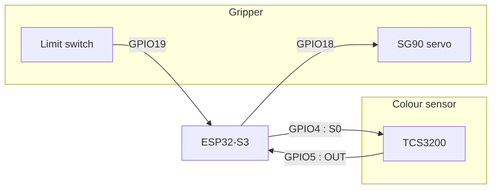



## What needs documenting

A well-documented circuit board answers four questions: what each
part of the circuit is for, exactly which components, how it is
wired, and why these choices. This last point ties in with
[Recording your technical choices](/workshops/methodologie-de-projet/concepts/tracer-choix-techniques/).

## Where to store the files

Two locations, two roles:

| Location | Content | Role |
|---|---|---|
| `project/ecad/<board-name>/` | The complete KiCad project (`.kicad_pro`, `.kicad_sch`, `.kicad_pcb`) | The **sources**: this is where you work |
| `docs/assets/kicad/` | A **copy** of the `.kicad_sch` and `.kicad_pcb` files | What the **site displays** |

The site only displays what is in the `docs/` folder. Copy your
files into `docs/assets/kicad/` again at each important change to the
board, otherwise the site shows an old version. Also complete the
`README.md` of `project/ecad/` (a table: board, folder, role).

## Displaying the schematic and the PCB

The `docs/conception/electronique/` folder contains the example page `carte-principale.md`. Copy it into the same folder, name the copy after your board (for example `carte-capteurs.md`), then change its `title` and its `nav_order`. Its `parent` ("Électronique") and its `grand_parent` ("Conception") stay the same. See [Customising your project template](/workshops/methodologie-de-projet/tutorials/personnaliser-template/) for how the menu works.




In your page, replace the two example lines. The path is given **from the `docs/` folder**:

```liquid

```

```liquid

```

Two options: `controles="full"` adds a sidebar with the list of components, and `hauteur="700px"` enlarges the display area (500 px by default).






## Fallback method: exporting an image

If your board was not made in KiCad, or if you want a fixed
figure (for a poster, for example), export an image. It is the method
that always works, without installing anything more.







The `.svg` file must be in `docs/assets/images/`. Then, in your page (here a page two folder levels deep, such as `docs/conception/electronique/carte-capteurs.md`):

```markdown

```

The number of `../` depends on the depth of the page: a page directly in `docs/` needs none (`assets/images/schema.svg`), a page in `docs/fabrication/` needs one (`../assets/images/schema.svg`).


## The bill of materials (BOM)

The bill of materials lists every component of the circuit. It is generated with KiCad,
not by hand.



Once the CSV is generated, reformat the useful columns as a Markdown table
to include it neatly in your page (exact part number, not just "a
resistor"). It is the table that the template's example page contains:

| Reference | Component | Value / exact part number | Quantity | Source |
|---|---|---|---|---|
| U1 | Microcontroller | ESP32-S3-DevKitC-1 | 1 | ... |
| R1-R4 | Resistor | 10kΩ, 1/4W | 4 | ... |
| D1 | Motor driver | A4988 | 1 | ... |


{% include message.html title="The raw CSV works too, but not just anywhere" message="If reformatting by hand takes too long, put the generated `.csv` file in `docs/assets/data/` and link to it directly (less pretty than a table, but always exact). Careful: the template's `.gitignore` ignores `.csv` and `.xml` files everywhere **except in `docs/`**. A bill of materials exported into `project/ecad/` will therefore not appear in GitHub Desktop and will never be sent to GitHub." status="is-warning" icon="fas fa-exclamation-triangle" %}

### Going further: interactive bill of materials with a KiCad plugin



The **[InteractiveHtmlBom](https://github.com/openscopeproject/InteractiveHtmlBom)** plugin
generates a standalone HTML file that displays the PCB **and** the bill of materials
side by side: click a row of the BOM, and the matching component
lights up on the board. Particularly useful for hand soldering
and for [Documenting assembly and build](/workshops/methodologie-de-projet/tutorials/documenter-assemblage-montage/).





Copy the generated `.html` file into `docs/assets/` (for example `docs/assets/nomenclature-interactive.html`), then link to it from your page:

```markdown
[See the interactive bill of materials](../../assets/nomenclature-interactive.html)
```


## The pinout (pin mapping)

The pinout says **which pin of the microcontroller is connected to what**. It is
the first question of anyone who picks up your board or your code, and
the place where the hardest bugs to find are born: a pin
changed on the schematic but not in the code, or the reverse.

It is documented in three layers, with one simple rule: **the code is the
reference**, and the documentation follows it.

| Layer | Where | Mandatory? |
|---|---|---|
| A `pins.h` file that gathers all the pins | In the firmware code | Yes |
| A pinout table | On the board's page (here) | Yes |
| A pinout diagram | On the board's page, below the table | No, but very readable |

### 1. In the code: a single `pins.h` file

All the pins are declared in a single file,
`include/pins.h` of the PlatformIO project (for example
`project/firmware/mon-robot/include/pins.h`), with a meaningful name and one
comment per line:

```cpp
// Pinout of the main board (ESP32-S3).
// Documented on the Carte principale page of the site: update it at the same time.
#pragma once

// Gripper
constexpr int PIN_SERVO_PINCE = 18;  // PWM output, SG90 servo powered at 5 V
constexpr int PIN_FIN_COURSE  = 19;  // input, internal pull-up, pressed = LOW

// TCS3200 colour sensor
constexpr int PIN_COULEUR_S0  = 4;   // output, choice of frequency scaling
constexpr int PIN_COULEUR_OUT = 5;   // input, frequency signal
```

The rest of the code **never** writes a pin number: it uses
`PIN_SERVO_PINCE`, never `18`. Changing a pin then means
editing a single line, and nobody forgets one at the bottom of another
file.

### 2. In the documentation: a table

On the board's page, a table mirrors `pins.h`. The **Name in the
code** column bridges the KiCad schematic and the firmware:

| Pin | Name in the code | Component | Subassembly | Note |
|---|---|---|---|---|
| GPIO18 | `PIN_SERVO_PINCE` | SG90 servo | Gripper | PWM output, servo powered at 5 V |
| GPIO19 | `PIN_FIN_COURSE` | Microswitch | Gripper | Input, internal pull-up, pressed = LOW |
| GPIO4 | `PIN_COULEUR_S0` | TCS3200 (S0) | Colour sensor | Output, frequency scaling |
| GPIO5 | `PIN_COULEUR_OUT` | TCS3200 (OUT) | Colour sensor | Input, frequency signal |
{{ snippet_brochage | markdownify }}


The **Note** column is the one most often forgotten, even though it
prevents the real mistakes: direction (input or output), pull resistor,
active level, voltage, pins to avoid at board start-up.

### 3. For readability: a pinout diagram

A Mermaid diagram, written as text like the rest of the documentation,
shows the pinout at a glance. The direction of the arrows indicates the inputs
(towards the board) and the outputs (from the board), and each `subgraph`
groups the components of one subassembly:

````markdown

````


For Mermaid syntax, see
[Documenting your code and firmware](/workshops/methodologie-de-projet/tutorials/documenter-code-firmware/).

{% include message.html title="Three places, one single truth" message="The KiCad schematic, `pins.h` and the table say the same thing in three ways: they contradict each other as soon as one is forgotten. Team rule: `pins.h` is the reference, and any change to a pin updates the table (and the Mermaid diagram if there is one) **in the same commit**. If the board itself changes, the KiCad schematic in `docs/assets/kicad/` is copied again at the same time." status="is-warning" icon="fas fa-exclamation-triangle" %}

## Photos of the real build

The schematic shows the intention, a photo shows the reality, which is often
different (wire colours, position of the components on a breadboard,
temporary fixes). Take these photos **at the time of assembly**, not
afterwards (see [Documenting as you go](/workshops/methodologie-de-projet/concepts/documenter-au-fil-de-leau/)).
A simple photo taken with a smartphone, placed in `docs/assets/images/`
(under **2 MB**: reduce its resolution if needed) and added with
``, is enough.

## Exercise

On your electronics: copy your KiCad files into
`docs/assets/kicad/` and display the schematic and the PCB on the page of your
board, generate your bill of materials from KiCad and include it (as a table or
as CSV), write the pinout table from your `pins.h` file
(create it if it does not exist yet), and add at least one photo of the
real build.

---

*Photo credit: circuit board of the Otto robot, MakerSpace UniLaSalle Amiens (see [Discover the Otto board!](/workshops/otto-mks/tutorials/discover-otto-pcb/)).*
{: .is-size-7 .has-text-grey }
