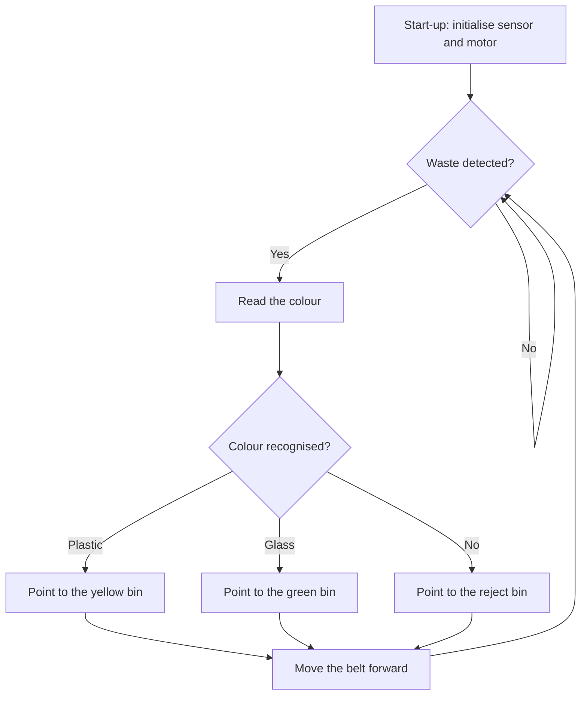
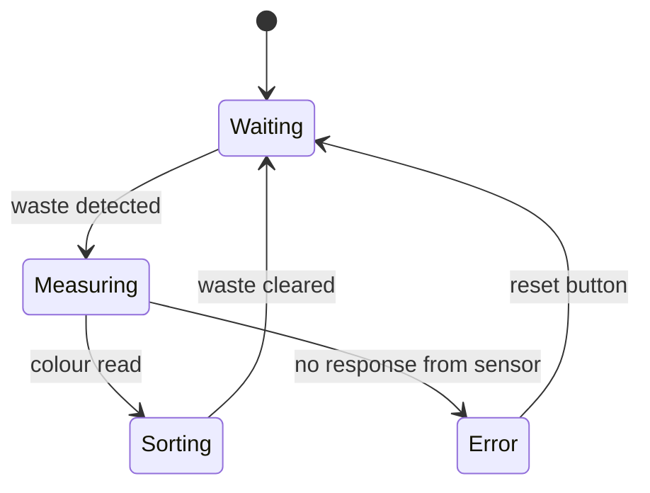
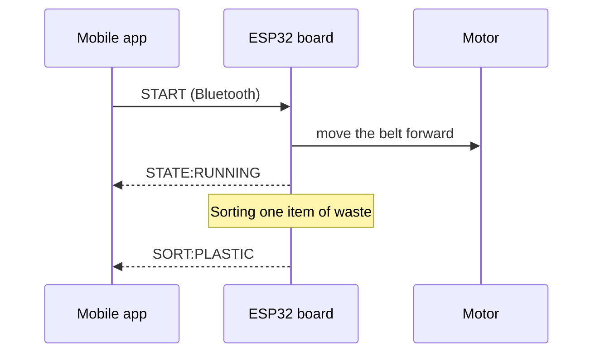

## Two levels of code documentation

- **The file/function level**: comments directly in the
  code, for whoever reads it line by line.
- **The project level**: a README or a page that explains the general
  architecture, before even opening a file.

Both are needed: one without the other always leaves a gap.

## Commenting usefully, not commenting a lot



```cpp
// increment i
i++;

// loop
for (int i = 0; i < 10; i++) {
  // do the calculation
  x = x + i;
}
```





```cpp
// Moving average over the last 10 sensor readings,
// to smooth out reading noise (see the pre-study, Études page of the site)
for (int i = 0; i < 10; i++) {
  sum = sum + readings[i];
}
```







## Where to document code in the template

The template provides three locations, one per type of information:

| Location | What goes there |
|---|---|
| `project/firmware/<project-name>/` | The firmware code itself, one folder per PlatformIO project |
| `project/firmware/README.md` | Target board, libraries, file organisation, how to build and upload |
| `docs/conception/firmware.md` | On the site: the architecture of the code (main loop, state machine), the environment |
| `docs/conception/software.md` and `project/software/` | The same for an application on a computer, a phone or a browser |

Delete the page and the folder that do not concern your project (no
software part? delete `software.md` and `project/software/`).

### Documenting by subassembly

A multidisciplinary project is broken down into **subassemblies**: the gripper and
the chassis of a robot, the measurement module and the display of a weather
station, the sensor and the interface of an assistive device... This is
already the breakdown followed by the template's **Conception** (design) page. The code benefits from
following the same breakdown: a reader interested in one subassembly should
find in one place its mechanics, its electronics **and** the code that
drives it. The example below uses the sorting robot of this workshop.

In practice:

- **In the code**, one module per subassembly in `lib/` (the main
  program `src/main.cpp` only calls them):

```text
firmware/mon-robot/
├── platformio.ini
├── include/
│   └── pins.h              all the pins, in one place
├── src/
│   └── main.cpp            main loop: calls the subassemblies
└── lib/
    ├── pince/              gripper: open, close, detect a gripped object
    ├── chassis/            move forward, turn, stop
    └── capteur_couleur/    colour sensor: read and calibrate
```

- **On the site**, `docs/conception/firmware.md` presents the overview
  (the main loop, what calls what), then each subassembly has its
  code part: either a sub-page of the firmware (`parent: Firmware`), or a
  "Code" section in the page of the subassembly itself (for example in
  `docs/conception/mecanique/pince.md`), if your team chose to
  break the design down by subassembly rather than by discipline.
- **In the team**, the lead of a subassembly (see
  [Building and organising your team](/workshops/methodologie-de-projet/concepts/constituer-organiser-equipe/))
  also documents the code of that subassembly: they are the one who knows why
  it is written that way.

Pin numbers are not written in any module: they are all
gathered in `include/pins.h`, and documented in a table on the board's
page. See the "The pinout" section of
[Documenting a circuit board](/workshops/methodologie-de-projet/tutorials/documenter-carte-electronique/).

For each subassembly, the code documentation answers the same four
questions: **what it does**, **what it uses** (pins, sensors,
libraries), **how the other parts call it** (the public functions
of the module) and **how to test it on its own**.

## Gripper code

**Role:** open and close the gripper, detect that an object is gripped.

**Uses:** SG90 servo motor on pin 18, limit microswitch
on pin 19.

**Functions called by the rest of the code** (`lib/pince/pince.h`):

- `pinceOuvrir()`: opens the gripper fully
- `pinceFermer()`: closes the gripper, stops as soon as the microswitch is pressed
- `pinceObjetSaisi()`: returns `true` if an object is held

**Testing it alone:** a small test program opens and closes the gripper in a
loop and prints the state of the microswitch on the serial monitor (115200 baud).



## Documenting the architecture

A page (`docs/conception/firmware.md`, or a `README.md` in the code
folder) that answers: how the code is organised into files/modules,
which libraries are used and why (link with
[Recording your technical choices](/workshops/methodologie-de-projet/concepts/tracer-choix-techniques/)),
and how to build and upload the whole thing.

The template's firmware is developed with **VSCode** and the
**PlatformIO** extension (see
[Installing VSCode](/docs/tutorials/software/vscode-platformio/installation-vscode/)
and [Installing PlatformIO](/docs/tutorials/software/vscode-platformio/installation-platformio/)).
A PlatformIO project is always organised like this:

```text
firmware/
└── mon-robot/
    ├── platformio.ini    board, framework, libraries
    ├── src/
    │   └── main.cpp      main program
    ├── include/          .h files
    └── lib/              libraries written by the team
```

## Firmware architecture

- `src/main.cpp`: main loop, reading the sensors and driving the motor
- `lib/capteur_couleur/`: reading and calibrating the TCS3200 sensor
- `lib/moteur/`: driving the stepper motor through the A4988 driver

## Libraries used

- `AccelStepper`: stepper motor management, chosen for its native support for acceleration (declared in `platformio.ini`)

## Building and uploading

1. In VSCode, open the `firmware/mon-robot/` folder (and not the root of the repo)
2. Plug in the board over USB
3. Bottom bar: ✓ to build, → to upload





## Showing code in the documentation

The documentation does not copy out the code: it shows **excerpts** of it
to explain a precise point. The basic syntax (inline code, code
blocks) is in [Markdown syntax](/workshops/methodologie-de-projet/tutorials/syntaxe-markdown/);
this section explains how to use it well.

### The right language for each block

The language given after the three backticks turns on syntax
highlighting. The ones a project most often needs:

| After the three backticks | What for |
|---|---|
| `cpp` | Arduino, ESP32, PlatformIO code (`.cpp`, `.ino`, `.h` files) |
| `python` | Scripts and applications |
| `bash` | Commands to type in a terminal |
| `ini` | The `platformio.ini` file |
| `yaml` | Configuration files (`_config.yml`) and the header of pages |
| `json` | Configuration files, messages exchanged between the board and an application |
| `html` | HTML tags, embedding a video |
| `markdown` | Showing Markdown, for example a documentation template |
| `text` | Folder trees, serial monitor output, anything that is not code |

### Choosing and introducing an excerpt

A code block in documentation does not have the same role as the code
file itself: it serves to **explain a precise point**.

- **An excerpt, not the whole file.** Ten to twenty lines that illustrate one
  idea. The complete code lives in `project/`: copying it in full into the
  documentation creates a duplicate, out of date at the next change.
- **Code that works.** Copy the excerpt from your file, do not
  retype it: a typo in the documentation is a bug for the
  reader.
- **The file before the block.** One sentence that says which file the
  excerpt comes from (`src/main.cpp`) and why you are showing it.
- **Visible cuts.** Mark what is omitted with a comment
  `// ...` (or `# ...` in Python).
- **One command per line, without the prompt.** Do not write the terminal's
  `$` in front: the reader can then copy the whole block. The command's
  response goes in a separate `text` block.

#### Example: a code excerpt in a documentation page

Here are these rules applied in a page of your site. The **Source** tab
shows what you write in the `.md` file, the **Result** tab what
the reader sees on the site.



````markdown
In `src/main.cpp`, the sensor reading is smoothed over 10 measurements:

```cpp
// ...
for (int i = 0; i < 10; i++) {
  sum += analogRead(PIN_SENSOR);
}
int average = sum / 10;
// ...
```

To preview the site, from the `docs/` folder:

```bash
bundle exec jekyll serve
```

The terminal then displays:

```text
Server address: http://127.0.0.1:4000/
Server running... press ctrl-c to stop.
```
````





In `src/main.cpp`, the sensor reading is smoothed over 10 measurements:

```cpp
// ...
for (int i = 0; i < 10; i++) {
  sum += analogRead(PIN_SENSOR);
}
int average = sum / 10;
// ...
```

To preview the site, from the `docs/` folder:

```bash
bundle exec jekyll serve
```

The terminal then displays:

```text
Server address: http://127.0.0.1:4000/
Server running... press ctrl-c to stop.
```





On your project's site, each code block displays a **Copy** button:
the reader gets the block in one click, hence the importance of it being exact
and without a prompt.

## Describing the algorithm with Mermaid

Before going into the files, a reader needs the **logic** of the
code: in what order things happen, what decisions are taken,
who talks to whom. A diagram shows it better than a hundred lines of code. Your
project's site can draw these diagrams with
[Mermaid](https://mermaid.js.org/): you write the diagram **as text**,
in a code block whose language is `mermaid`, and it is displayed as a
diagram.

The advantage of text: the diagram lives in the same repo as the code, can be changed
in two seconds when the code changes, and Git keeps its history. No
image file to regenerate.



Three types of diagram cover almost all the needs of a firmware.

### The flowchart: how the program runs

To show the steps and the decisions (the `if`s) of the main loop.
Each step is a rectangle `[...]`, each question a diamond `{...}`,
and the arrows `-->` carry the answer between `|...|`.

````markdown

````


### The state diagram: a state machine

Many firmwares are **state machines**: the system is
always in a single state (waiting, measuring, sorting...), and an event makes it
move to the next. The state diagram shows them directly, and it
translates almost line for line into a `switch` in the code.

````markdown

````


### The sequence diagram: exchanges between parts

When several elements communicate (the board and an application, two
boards with each other, a sensor over I2C), the sequence diagram shows
**who sends what to whom, and in what order**. It complements the
"Communication avec la carte" (communication with the board) section of the template's `software.md` page.

````markdown

````


### Which diagram for what?

| You want to show | Mermaid diagram | Keyword |
|---|---|---|
| The steps and the decisions of the main loop | Flowchart | `flowchart TD` |
| The states of the system and what makes it change state | State diagram | `stateDiagram-v2` |
| The messages exchanged between the board, an application, a sensor | Sequence diagram | `sequenceDiagram` |
| The modules of the code and what calls what (one per subassembly) | Left-to-right flowchart | `flowchart LR` |

A few tips:

- **One diagram per idea**, not one giant diagram of the whole program. On the
  site, put the overall diagram in `docs/conception/firmware.md` and one
  detailed diagram per subassembly in its own part.
- **Words, not code** in the boxes: "Read the colour", not
  `lireCouleur(PIN_S0, PIN_S1)`. The diagram explains, the code gives the detail.
- **Keep it up to date**: when the logic changes, edit the diagram in the
  same commit as the code.
- **Test your diagrams** in the [Mermaid online editor](https://mermaid.live/):
  it shows the result live and reports syntax errors.

The complete syntax is in the
[Mermaid documentation](https://mermaid.js.org/intro/). For the
presentation of code blocks in general, see
[Markdown syntax](/workshops/methodologie-de-projet/tutorials/syntaxe-markdown/).

## Exercise

1. Reread your code: delete the comments that repeat the obvious, and
   add some on the parts that made you think.
2. Complete `project/firmware/README.md` and write the
   `docs/conception/firmware.md` page with the architecture template,
   adding at least one well-introduced code excerpt (file named,
   language given, cuts marked with `// ...`).
3. Write the logic of your main loop in three or four sentences,
   then translate it into a flowchart (or a state diagram if your code
   is a state machine) on the `firmware.md` page.
4. For each subassembly, fill in the subassembly template.

---

*Photo credit: "Code, data, programming" via [picryl](https://picryl.com/media/code-data-programming-code-science-technology-792e76), under an open licence.*
{: .is-size-7 .has-text-grey }
