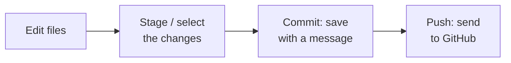

## What Git does, in one sentence

Git keeps a complete history of every change to your files, and
GitHub hosts a copy of that history online so that the whole
team works from the same base. The basic cycle, the one you will
repeat dozens of times a week:

- **Edit**: you edit files as usual, in VSCode or
  elsewhere: nothing specific to Git at this stage.
- **Stage**: you choose which modified files
  go into the next commit. Useful if you have worked on two
  different things at once: you can commit one without
  the other.
- **Commit**: a snapshot of these changes, with a message that
  explains what and why. The commit stays **on your computer**
  until the next push: nobody else can see it yet.
- **Push**: your commits are sent to GitHub, where the rest of the team
  can fetch them.
- **Fetch / Pull**: the reverse of push (getting the commits that
  others have sent to GitHub, so that you have them on your machine too).
  **Fetch** looks at what has changed without downloading anything yet, **Pull**
  downloads and applies the changes.



## With GitHub Desktop









## Directly from VSCode

VSCode includes the same functions without switching application: handy
if you already edit your code or your documentation in it. The cycle
is the same as in GitHub Desktop, just spread over four small
actions in the same panel. The screenshots show VSCode in French: the French
labels are given in brackets.











## Troubleshooting

| Symptom | Likely cause | Solution |
|---|---|---|
| "Push" fails with a rejection error | Someone else pushed before you, your local history is behind | Do **Fetch origin** then **Pull**, resolve any conflicts ([see the dedicated guide](/docs/how-to-guides/pull-requests-et-conflits-git/)), then push again |
| A file you do not want to track appears in Changes | Generated or temporary file not excluded | Add it to `.gitignore` |
| The Commit button stays greyed out | No commit message written, or no file staged | Check both |

## Going further

If you want a more leisurely explanation, in video, of the concepts seen
here (repository, branch, fork, pull request...):
[Git and GitHub for Poets](https://thecodingtrain.com/tracks/git-and-github-for-poets),
a series of 11 short videos by The Coding Train, very
accessible even with no technical vocabulary to start with.

## Exercise

Edit any file in your repo (for example, add a
line to `docs/objectifs.md`), then run the complete cycle: stage,
commit with a precise message, push. Check on GitHub.com that your
commit does appear in the history of the repo.
