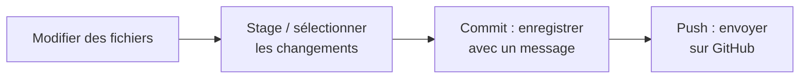

## Ce que fait Git, en une phrase

Git garde un historique complet de chaque modification de vos fichiers, et
GitHub héberge une copie de cet historique en ligne pour que toute
l'équipe travaille sur la même base. Le cycle de base, celui que vous
répéterez des dizaines de fois par semaine :



- **Cloner** : télécharger une copie de travail de votre repo sur votre
  ordinateur. Ce que vous voyez sur GitHub.com est la copie en ligne ;
  le clone est votre copie locale, synchronisée avec elle. Une seule fois
  par repo et par ordinateur.
- **Modifier** : vous éditez des fichiers normalement : rien de spécial à
  Git à ce stade.
- **Stage** (indexer) : vous choisissez quels fichiers modifiés vont dans
  le prochain commit. Utile si vous avez travaillé sur deux choses
  différentes en même temps : vous pouvez committer l'une sans l'autre.
- **Commit** (valider) : un instantané de ces modifications, avec un
  message qui explique quoi et pourquoi. Le commit reste **sur votre
  ordinateur** jusqu'au push suivant : personne d'autre ne le voit encore.
- **Push** : vos commits sont envoyés sur GitHub, où le reste de l'équipe
  peut les récupérer, et où GitHub Pages reconstruit votre site.
- **Pull** : l'inverse du push (récupérer les commits que les autres ont
  envoyés sur GitHub, pour les avoir aussi sur votre machine).



## Pourquoi tout faire dans VSCode

Vous pourriez utiliser un outil pour écrire, un autre pour Git, un
troisième pour lancer des commandes. VSCode réunit tout dans la même
fenêtre :

| Ce que vous faites | Où, dans VSCode |
|---|---|
| Écrire vos pages Markdown et votre code | L'éditeur |
| Voir le rendu d'une page Markdown | Aperçu : <kbd>Ctrl</kbd>+<kbd>Maj</kbd>+<kbd>V</kbd> |
| Cloner, committer, envoyer, récupérer | Le panneau **Contrôle de code source** |
| Lancer une commande (construire le site en local, téléverser un firmware...) | Le terminal intégré : menu **Terminal > Nouveau terminal** |

Un seul outil à apprendre, et vous voyez vos modifications au moment où
vous les committez. C'est la méthode de ce tutoriel.
[GitHub Desktop](#solution-de-secours--github-desktop) reste une solution
de secours, en fin de page.



## Étape 0 : Préparer Git (une seule fois par ordinateur)

VSCode s'appuie sur **Git**, qui doit être installé à part :

- **Windows** : installez [Git pour Windows](https://git-scm.com/downloads/win) en gardant les options par défaut. Si Git manque, le panneau **Contrôle de code source** de VSCode affiche d'ailleurs un bouton pour le télécharger.
- **macOS** : à la première commande Git, macOS propose d'installer les outils de développement : acceptez.
- **Linux** : `sudo apt install git` (Debian, Ubuntu).

Redémarrez VSCode après l'installation.


Git inscrit dans chaque commit le nom et l'adresse e-mail de son auteur. Tant qu'il ne les connaît pas, il refuse de committer.

Pour vérifier, ouvrez le terminal de VSCode (**Terminal > Nouveau terminal**) et tapez :

```bash
git config --global user.email
```

Si votre adresse s'affiche, Git est déjà réglé (par exemple par GitHub Desktop) : passez à l'étape suivante. Sinon, tapez ces deux lignes en remplaçant par vos informations :

```bash
git config --global user.name "Prénom Nom"
git config --global user.email "adresse@exemple.fr"
```

Mettez l'adresse e-mail de votre compte GitHub : vos commits apparaîtront sur votre profil.


## Étape 1 : Cloner votre repo depuis VSCode

Dans VSCode, fermez le dossier éventuellement ouvert (**Fichier > Fermer le dossier**), puis ouvrez le panneau **Contrôle de code source** (l'icône de branches dans la barre de gauche, ou <kbd>Ctrl</kbd>+<kbd>Maj</kbd>+<kbd>G</kbd>). Cliquez sur le bouton **Clone Repository** (il reste en anglais même dans un VSCode en français).

Une liste s'ouvre en haut de la fenêtre : choisissez **Cloner à partir de GitHub**. La première fois, VSCode vous demande de vous connecter à GitHub : acceptez, votre navigateur s'ouvre, autorisez VSCode avec votre compte GitHub, puis revenez dans VSCode.

La liste de vos repos s'affiche : choisissez le vôtre.


VSCode demande où enregistrer le repo. Choisissez un dossier que vous retrouverez facilement, par exemple un dossier `GitHub` dans vos Documents, qui rassemblera tous vos repos, puis cliquez sur **Sélectionner comme destination de dépôt**. VSCode y crée un sous-dossier au nom du repo.

Évitez les dossiers synchronisés (OneDrive, Google Drive, Dropbox) : ils se battent avec Git pour les mêmes fichiers.

À la fin du clonage, VSCode propose d'ouvrir le repo : cliquez sur **Ouvrir**.


VSCode demande si vous faites confiance aux auteurs des fichiers de ce dossier. C'est votre propre repo : répondez **Oui, je fais confiance aux auteurs**. Sinon, VSCode reste en **Mode restreint** (bandeau en bas à gauche) et désactive une partie de ses fonctions.

L'**Explorateur**, à gauche, affiche maintenant les fichiers de votre repo : les mêmes que sur GitHub.com.


## Étape 2 : Le cycle au quotidien

{% include message.html title="Toujours synchroniser avant de commencer" message="C'est **le** réflexe à prendre, à chaque séance, avant de toucher au moindre fichier. Si vous modifiez une ancienne version pendant qu'un coéquipier a envoyé la sienne, Git ne pourra pas fusionner tout seul : vous devrez régler des conflits à la main, et vous risquez d'écraser son travail. Une synchronisation au début, ça prend deux secondes ; un conflit, ça peut prendre une heure." status="is-danger" icon="fas fa-exclamation-triangle" %}













## Résolution de problèmes

| Symptôme | Cause probable | Solution |
|---|---|---|
| Pas de bouton **Clone Repository**, ou « Git introuvable » | Git n'est pas installé, ou VSCode n'a pas été redémarré | Étape 0, puis redémarrer VSCode |
| VSCode refuse de committer et parle de `user.name` | Git ne connaît pas votre nom ni votre e-mail | Les deux commandes `git config` de l'étape 0 |
| Votre repo n'apparaît pas dans la liste au clonage | Connecté avec un autre compte GitHub, ou repo d'une organisation | Vérifier le compte (icône de profil en bas à gauche). Sinon, copier l'adresse du repo (bouton vert **Code** sur GitHub.com) et la coller à la place de **Cloner à partir de GitHub** |
| L'envoi échoue avec une erreur de rejet | Quelqu'un a envoyé des commits avant vous, votre historique local est en retard | Synchroniser, régler les conflits éventuels ([voir le guide dédié](/docs/how-to-guides/pull-requests-et-conflits-git/)), puis renvoyer |
| L'envoi est refusé et le message parle de *private email address* | Votre compte GitHub masque votre adresse e-mail, et vos commits la contiennent | Sur GitHub, **Settings > Emails** : recopier l'adresse en `@users.noreply.github.com` dans `git config --global user.email` (étape 0), puis refaire le commit (menu `...` du panneau, **Validation > Annuler la dernière validation**). Ou décocher **Block command line pushes that expose my email** |
| Un fichier que vous ne voulez pas suivre apparaît dans **Changements** | Fichier généré ou temporaire non exclu | L'ajouter à `.gitignore` |
| Le bouton **Validation** reste grisé | Aucun message de commit écrit, ou aucun fichier modifié | Vérifier les deux |
| Bandeau **Mode restreint** en bas à gauche | Vous n'avez pas fait confiance au dossier | Cliquer sur le bandeau, puis **Faire confiance** |

## Solution de secours : GitHub Desktop

[GitHub Desktop](https://desktop.github.com) fait la même chose avec une
interface à boutons, et inclut Git (rien d'autre à installer). Gardez-le
pour les cas où VSCode vous bloque : Git impossible à installer sur la
machine, connexion à GitHub qui échoue, ou besoin de voir l'historique
autrement. Le repo cloné est le même : vous pouvez passer de l'un à
l'autre sans rien perdre.











## Pour aller plus loin

Si vous voulez une explication plus posée, en vidéo, des concepts vus
ici (dépôt, branche, fork, pull request...) :
[Git and GitHub for Poets](https://thecodingtrain.com/tracks/git-and-github-for-poets),
une série de 11 courtes vidéos par The Coding Train, en anglais mais très
accessible même sans vocabulaire technique de départ.

## Exercice

Clonez le repo de votre projet dans VSCode. Modifiez un fichier (par
exemple, ajoutez une ligne dans `docs/objectifs.md`), puis faites le cycle
complet : indexer, committer avec un message précis, synchroniser.
Vérifiez sur GitHub.com que votre commit apparaît dans l'historique du
repo.
Clonez le repo de votre portfolio dans VSCode. Ouvrez `about.md`,
remplacez la première phrase par une phrase qui vous présente, et
regardez le rendu avec l'aperçu (<kbd>Ctrl</kbd>+<kbd>Maj</kbd>+<kbd>V</kbd>).
Committez avec un message précis, synchronisez, puis vérifiez dans
l'onglet **Actions** de votre repo que le site se reconstruit, et que
votre phrase apparaît sur la page « Qui suis-je » de votre site.

