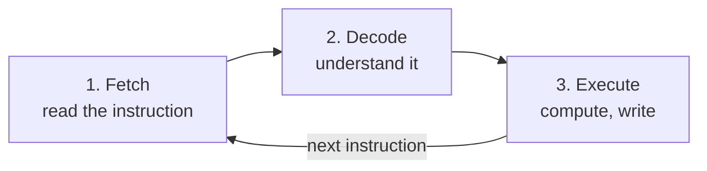
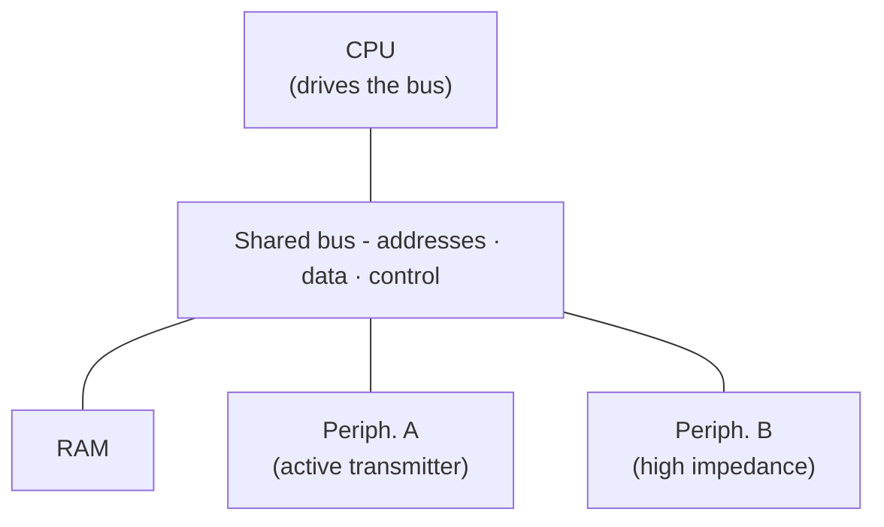

## Let's open the hood

If you have read [What is a microcontroller?](/workshops/microcontroleur/concepts/qu-est-ce-qu-un-microcontroleur/), you already know that a µC is a miniature computer that senses, decides and acts. Let's now see **how it is built inside**.

Technically, a **microcontroller** (µC) is an integrated circuit that brings together on a single chip:

- a **processor** (CPU) to execute the instructions,
- **memory** (Flash + RAM) to store the program and the data,
- **peripherals** (GPIO, ADC, UART, SPI…) to interact with the physical world.

Unlike a microprocessor on its own (which needs external memory and peripherals to work), the µC is a **System on Chip**: everything is integrated on the same **silicon** (the semiconductor material the chip is made of). A power supply and a clock are all it needs to run.

**By the end of this concept, you will know how to:**

- name the main blocks of a µC (CPU, memories, peripherals, bus);
- explain the role of the CPU, the ALU and the clock;
- understand registers, interrupts and bus sharing.

## The guiding block diagram

{% include step-tuto.html
greyBackground = true
content="
Keep this diagram in mind: it serves as a mental map for the whole course. Each of the following concepts ([GPIO](/workshops/microcontroleur/concepts/gpio-monde-numerique/), [ADC & PWM](/workshops/microcontroleur/concepts/adc-pwm/), [the buses](/workshops/microcontroleur/concepts/bus-communication/)…) details one of these building blocks.

| Block | Role | Software access |
|---|---|---|
| **CPU** | Executes the instructions one by one | - |
| **Flash** | Stores the program (persistent) | Read-only at run time |
| **RAM** | Variables, call stack (volatile) | Fast read/write |
| **Peripherals** | GPIO, ADC, UART, SPI, I2C, PWM… | Through **registers** |
| **Bus** | Connects CPU ↔ memories ↔ peripherals | Transparent for Arduino code |

"
image="functional-block-diagram.png" %}

## CPU: the conductor

The CPU runs a **fetch–decode–execute cycle** continuously:

1. **Fetch**: read the next instruction from Flash
2. **Decode**: decode it
3. **Execute**: execute it (calculation, memory access, register write)



This cycle is paced by the **clock**: the ESP32-S3 runs at **240 MHz**, i.e. 240 million cycles per second. An integer addition or multiplication takes one or two cycles, a `digitalWrite()` (which goes through several layers of the Arduino core before reaching the register) a few dozen, and establishing a Wi-Fi connection takes several hundred million.


The ESP32-S3 has **two** Xtensa LX7 **cores** (two almost independent computing units, able to work in parallel). Within Arduino-ESP32, the small FreeRTOS real-time kernel shares out the work: the main `setup()`/`loop()` code runs on core 1, and core 0 handles Wi-Fi in the background.

### What the CPU really does: compute or transfer

Deep down, a CPU can only do two things: **calculations** and **data transfers**. Every program, however complex, comes down to this combination: combining two numbers, or moving a byte from one cell to another.

Calculations are carried out by the **ALU** (*Arithmetic Logic Unit*), the mathematical heart of the CPU. It takes two numbers as input and produces:

- **arithmetic operations**: addition, subtraction, multiplication…
- **logic operations**: AND, OR, exclusive OR (XOR), bit shifts…

With each operation, the ALU also updates a few **status flags** that summarise the result without having to read it again: is it **zero**? **negative**? was there a **carry** or an **overflow**? These are the flags the CPU checks to decide what to do next: this is exactly what hides behind an `if (a > b)` in C: a subtraction, then reading a flag.

To work fast, the ALU does not fetch directly from RAM: it goes through a handful of **internal registers** of the CPU (not to be confused with the peripheral registers seen below), ultra-fast cells where the operands are placed for the duration of the calculation.

## The clock: pacing and saving energy

Nothing moves in a microcontroller without a clock: it sets the pace at which the CPU and the peripherals move from one step to the next, like a robotic production line where each station must be synchronised with the next one. Its source is usually an external **quartz crystal**: when a voltage is applied, it oscillates at an extremely stable frequency, on the same principle as in a quartz watch.

The higher the frequency, the more instructions per second the CPU executes, but the more energy it consumes and the more it heats up. That is why microcontrollers usually top out at a few hundred MHz, far from the ~5 GHz of a PC processor: they aim for battery life, not raw performance.



### Sleeping to last: sleep modes

In a battery-powered project, the microcontroller spends most of its time doing nothing useful. Rather than idling, it can **sleep**:

- **Light sleep**: the CPU is suspended but the RAM and the state are kept; wake-up is almost instant.
- **Deep sleep**: almost everything is off except a small domain (RTC); consumption drops to a few microamps, but the program **restarts** on wake-up (triggered by a timer, a pin…).

This is what allows a wireless sensor to last months, even years, on a single battery.

## Memories: Flash vs RAM

| | Flash | RAM (SRAM) |
|---|---|---|
| **Content** | Compiled program, constants | Variables, stack (memory of function calls) and heap (dynamic allocation) |
| **Persistence** | Yes (survives a reset) | No (lost at power-off) |
| **Speed** | Slower | Very fast |
| **Size (XIAO ESP32S3)** | 8 MB (external) | 512 KB internal + 8 MB external PSRAM |

```cpp
// In Flash (program + constants): on the ESP32, a const goes there by itself
const char msg[] = "Hello";

// In RAM (variable)
int counter = 0;
```


## Peripherals: the glossary

A microcontroller carries a collection of specialised circuits, each referred to by an acronym. Here are the most common ones:

| Acronym | Full name | Role |
|---|---|---|
| **GPIO** | General Purpose Input/Output | Digital pins configurable as input or output (see [GPIO & the digital world](/workshops/microcontroleur/concepts/gpio-monde-numerique/)) |
| **ADC** | Analog to Digital Converter | Converts an analog voltage into a digital value (see [ADC & PWM](/workshops/microcontroleur/concepts/adc-pwm/)) |
| **UART / I2C / SPI** | - | Serial communication buses (see [Communication buses](/workshops/microcontroleur/concepts/bus-communication/)) |
| **Timer** | Hardware counter | Paces periodic events or generates PWM, independently of the CPU |
| **DMA** | Direct Memory Access | Transfers data between memory and a peripheral without tying up the CPU |
| **RTC** | Real-Time Clock | Clock that keeps running in deep sleep, to wake the chip up at a precise time |
| **Watchdog** | Watchdog timer | Counter that restarts the microcontroller if the program hangs and forgets to reset it in time |



### Peripherals specific to each chip

The peripherals above (GPIO, ADC, timers, DMA…) are found on almost every microcontroller. But each chip family adds its own **specialised blocks**: they give it its personality and its favourite field, and set a "connected" µC apart from a "multimedia" or "low-cost" one.

| Specialised peripheral | Role | Example chips |
|---|---|---|
| **Wi-Fi / Bluetooth** | Built-in 2.4 GHz radio for wireless and IoT | ESP32, ESP32-S3 (the Raspberry Pi Pico W uses a separate radio chip) |
| **Camera interface** (DVP / LCD_CAM) | Capturing a video stream from an image sensor | ESP32-S3 (XIAO ESP32S3 Sense board), ESP32 (ESP32-CAM board) |
| **Hardware video codec** | Accelerated decoding/encoding (JPEG, H.264) | Application SoCs (ESP32-P4, i.MX…) |
| **Audio** (I2S, codec) | Digital sound input/output (microphone, speaker) | ESP32-S3, audio STM32 |
| **Native USB** (OTG) | Acting as a USB device or host | ESP32-S3, RP2040, STM32 |
| **Cryptographic accelerator** | Encryption wired in hardware (AES, SHA, RSA): fast and frugal | ESP32-S3, "crypto" STM32 |
| **AI / DSP accelerator** | Signal processing or neural network inference | ESP32-S3 (vector instructions), ESP32-P4 |
| **Capacitive touch sensor** | Detects touch on a conductive pad, without a mechanical button | ESP32, ESP32-S3 |



## The bus: the shared data highway

The CPU, the memories and the peripherals are not connected pairwise by dedicated wires: they share a **bus**, a bundle of common tracks that everyone is plugged into. There are usually three bundles:

- an **address bus**: the CPU puts on it the address of the cell it wants to read or write;
- a **data bus**: the value travels on it in one direction or the other;
- a **control bus**: a few signals that specify "I am reading" or "I am writing".

Since the line is shared, one absolute rule applies: **only one component is allowed to "talk" (impose a voltage) at a time**. If two peripherals pushed a value onto the data bus at the same time (one forcing a 0, the other a 1), the result would be a short circuit.

To avoid this, each component connects to the bus through **three-state outputs**: on top of 0 and 1, they have a [**high impedance**](https://en.wikipedia.org/wiki/High_impedance) state (*high-Z*) that electrically disconnects them from the line. At any moment, only one transmitter is active; all the others are in high impedance, listening. The address bus orchestrates this dance: the address sent by the CPU **selects** the only component allowed to answer.



### Harvard or Von Neumann?

Two broad families of architectures describe *how* the CPU accesses the program and the data:

- **Von Neumann**: instructions and data share the **same** memory and the same bus. Simple, but the CPU cannot read an instruction and a piece of data at the same moment.
- **Harvard**: instructions and data take **separate paths**, and can therefore be read in parallel: it is faster.

The ESP32-S3's Xtensa LX7 core follows a **modified Harvard** architecture: the instruction and data buses are separate, but the Flash is "mapped" into memory through a cache, which gives the programmer the illusion of a unified space. Above all, remember the idea: the **program** (Flash) and the **data** (RAM) live in separate spaces.

## Registers: the software/hardware interface

Each peripheral is controlled through **registers**: memory cells at fixed addresses. Writing to a register turns on an LED; reading a register returns the state of a button.

How does an address find the right cell? A circuit called an **address decoder** compares the address on the bus and only activates the matching cell; all the others stay in [**high impedance**](https://en.wikipedia.org/wiki/High_impedance). The mechanism is identical for a RAM cell and for a peripheral register: in the CPU's address space, writing a variable to memory and turning on an LED look very much alike: it is the same operation "put a value at this address".

Arduino abstracts all this: `digitalWrite(LED, HIGH)` writes to the right register without you having to know its address. But behind it, it is still a register access.

### Manipulating one bit of a register

A 32-bit register often drives 32 things at once: one bit per pin, one bit per option. To touch only the targeted bit, C provides the **bitwise** operators:

```cpp
reg |=  (1 << n);      // sets bit n to 1, without touching the others
reg &= ~(1 << n);      // sets bit n to 0
reg ^=  (1 << n);      // toggles bit n
if (reg & (1 << n))    // tests bit n
```

The first line combines three operations:

1. **The shift `1 << n`**: the value 1 (`00000001`) shifted *n* positions to the left. For *n* = 3: `00001000`. It is a **mask**: only the targeted bit is 1.
2. **The bitwise OR `|`**: 1 OR x gives 1, so the targeted bit becomes 1; 0 OR x gives x, so the others do not change.
3. **The assignment `|=`**: the shorthand for `reg = reg | (1 << n);`.

```text
reg            1010 0001
1 << 3         0000 1000   the mask
reg | mask     1010 1001   only bit 3 has changed
```


Bits are numbered **from right to left**, starting from 0. The other lines follow the same idea: `& ~mask` sets the bit to 0 (the `~` inverts the mask: `1111 0111`), `^ mask` toggles it, `& mask` tests it.

Under `digitalWrite()`, the ESP32-S3 uses registers made for this: `GPIO_OUT_W1TS_REG` (*write 1 to set*) sets to 1 only the bits written as 1, in **a single write**. A `|=` would have to read, modify and then rewrite the register: if an interrupt changes it in the meantime, its change is lost. The detail of each register, bit by bit, is in the [ESP32-S3 technical reference manual](https://www.espressif.com/sites/default/files/documentation/esp32-s3_technical_reference_manual_en.pdf).

## How a program runs

Before seeing how an event can "interrupt" the CPU, let's understand how a program runs **normally**.

An Arduino program fits in two functions:

- `setup()`: run **only once** at start-up, to prepare the hardware (pins, peripherals…);
- `loop()`: run **in an infinite loop**, as long as the board is powered.

```cpp
void setup() {
  // only once: initialisation
}

void loop() {
  // repeated endlessly: the heart of the program
}
```

The CPU executes these instructions **one after the other**, in order, at the pace of the clock (the *fetch–decode–execute* cycle seen above). This sequential flow is simple but rigid: the program only does one thing at a time and only "looks at" a button when it reaches the line that reads it.

This is precisely the limit that interrupts remove. (The full path from the code to the chip is detailed in [From hardware to software](/workshops/microcontroleur/concepts/du-materiel-au-logiciel/).)

## Interrupts: reacting without waiting

The CPU runs `loop()` continuously, but some events cannot wait for the next pass through the loop, for example a button pressed during a long routine. An **interrupt** briefly suspends normal execution to run a small dedicated function, then resumes exactly where it left off.


```cpp
volatile int pressCount = 0;  // volatile: modified outside the normal flow

void IRAM_ATTR onPress() {
  pressCount++;  // as short and fast as possible
}

void setup() {
  attachInterrupt(digitalPinToInterrupt(BTN_PIN), onPress, FALLING);
}
```

The **`IRAM_ATTR`** keyword asks the compiler to place the interrupt function in **internal RAM** (IRAM) rather than in Flash. Why? On the ESP32-S3, code normally lives in Flash and is only read on demand through a cache. But an interrupt can occur at a moment when the Flash is temporarily unavailable (during a write, for example): if the function were there, the chip would crash. By forcing it into IRAM, we guarantee it is **always accessible and fast**. On the ESP32, every interrupt function (*ISR*) must therefore be marked `IRAM_ATTR`.



## The ESP32-S3 in brief

In the course, the chip is mounted on a Seeed Studio [XIAO ESP32S3](/docs/references/hardware/xiao-esp32s3/) board.

| Characteristic | Value |
|---|---|
| CPU | Xtensa LX7 dual-core **32-bit**, 240 MHz |
| RAM | 512 KB SRAM + 8 MB PSRAM (additional external RAM, present on the XIAO) |
| Flash | 8 MB (external via SPI) on the XIAO ESP32S3 |
| GPIO | 45 on the chip (including 20 ADC), 11 broken out on the XIAO (D0 to D10) |
| Logic voltage | **3.3 V** (≠ 5 V of classic Arduinos) |
| Connectivity | Wi-Fi 802.11 b/g/n + Bluetooth 5 |



## Quick quiz

**1. Which memory keeps the program when the board is switched off?**

<details><summary>Show the answer</summary>Flash (persistent). RAM is volatile: its content disappears at power-off.</details>

**2. What is a peripheral register used for?**

<details><summary>Show the answer</summary>To control the peripheral: read or write at a fixed address (e.g. turn on an LED, read a button).</details>

**3. Why can only one component "talk" on the bus at a time?**

<details><summary>Show the answer</summary>The bus is shared: two simultaneous transmitters (0 vs 1) would create a short circuit. The others stay in high impedance.</details>

## Going further

- [Checking the toolchain](/workshops/microcontroleur/tutorials/toolchain-blink/): see this architecture at work on a first program

## Summary

- A µC = CPU + Flash + RAM + peripherals on a single chip: a self-contained **System on Chip**.
- Deep down, the CPU only **computes** (through the **ALU**, which raises zero/negative/carry/overflow flags) and **transfers** data; all paced by the **clock** (240 MHz for the ESP32-S3), and cutting its source on an unused peripheral saves energy.
- Flash = program (persistent); RAM = data during execution (volatile), two separate spaces (**modified Harvard** architecture).
- Everyone shares a **bus**: only one component talks at a time, the others switch to **high impedance**, and the **address** selects the recipient.
- The peripherals (GPIO, ADC, Timer, DMA, RTC, Watchdog…) are controlled through **registers**, simple cells at a fixed address, which Arduino manipulates for you.
- An **interrupt** makes it possible to react immediately to an event without waiting for the next pass through `loop()`.
- **Sleep modes** (light/deep sleep) switch off all or part of the chip to last a long time on battery.
- ESP32-S3 logic voltage: **3.3 V** (not 5 V).
