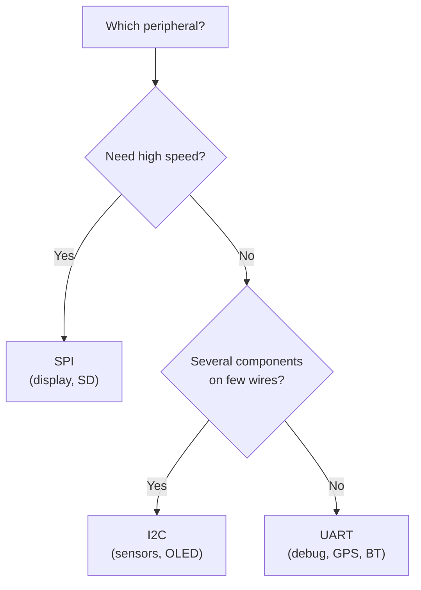

## Making components talk

A microcontroller is rarely alone: it drives a display, queries a temperature sensor, exchanges with a Bluetooth module. All these components still need to understand each other, to speak the same language.

These common languages are the **communication buses**. Like humans, components have several ways of talking: two of them in a corridor (**UART**), in a small group where everyone answers to their name (**I2C**), or over a very fast dedicated line (**SPI**). This concept presents these three "dialects" and helps you choose the right one.

**By the end of this concept, you will know how to:**

- tell UART, I2C and SPI apart;
- choose the right bus for the need;
- wire an I2C bus (pull-ups) and find a component's address.

## Why buses?

Connecting each peripheral to the CPU with one wire per bit would be impractical: the course's display (240 × 320 pixels) receives more than 150,000 bytes per frame. **Serial communication buses** carry data over a small number of wires, sending the bits **one after the other**. A **parallel** link, conversely, sends several bits at the same time, one per wire: faster at the same frequency, but far bulkier.


### Four questions to compare two links

| Question | The two possible answers |
|---|---|
| How many parties? | **Point-to-point** (two devices) or **multipoint** (several on the same wires) |
| A shared clock? | **Synchronous** (a clock wire paces the bits) or **asynchronous** (each side counts on its own, at an agreed speed) |
| Both directions at once? | **Full-duplex** (yes, over two data wires) or **half-duplex** (taking turns, on the same wire) |
| How is the recipient chosen? | An **address** written in the message (software) or a **select wire** per component (hardware) |

For the direction of traffic, think of the telephone and the walkie-talkie: on the phone, both parties can talk at the same time (full-duplex); on a walkie-talkie, you have to wait your turn (half-duplex).

These four answers are enough to describe the three buses on this page, and most others: RS-232 and SATA are point-to-point, RS-485, Ethernet and USB multipoint, CAN asynchronous like UART...

## UART: Universal Asynchronous Receiver-Transmitter

### Principle

UART is the simplest bus: **two wires**, point-to-point (a direct link between two devices only), with no shared clock.

| Wire | Role |
|---|---|
| **TX** | Transmission (µC output) |
| **RX** | Reception (µC input) |

The speed is set in advance on both sides: this is the **baud rate**. Here, a two-level signal carries one bit per symbol, so 1 baud equals 1 bit/s (this is not true of all links). The usual speeds are standardised: 1,200, 2,400, 4,800, **9,600** and **115,200** baud, the most common on a modern microcontroller. The two devices also share their **ground** (GND): without a common reference, a voltage level means nothing.




### Anatomy of a frame


Without a shared clock, how does the receiver know when to read? By convention: the line idles `HIGH`, and each byte is framed by synchronisation bits.

- a **start bit** (going `LOW`) announces the beginning;
- the **data bits** (most often 8), from least to most significant;
- an optional **parity bit** (error check);
- one or two **stop bits** (back to `HIGH`).

This is what the **`8N1`** notation sums up: 8 data bits, `N`o parity, 1 stop bit. Both ends must share exactly the same format **and** the same speed, otherwise the bytes are split wrongly. Eight bits are enough for an ASCII character (codes 0 to 127) or any byte (0 to 255).

Other formats exist, found on older or industrial devices:

- from **5 to 9** data bits;
- **parity** absent (`N`), even (`E`) or odd (`O`): a bit added so that the total number of 1s is even (or odd), which makes it possible to detect a single-bit error;
- a stop bit lasting **1, 1.5 or 2 bits**.

`7E1` thus means 7 data bits, even parity and 1 stop bit.

### Voltage levels and distance

Between two boards, the levels are those of the pins: 0 V for a 0, 3.3 V (or 5 V on an Arduino Uno board) for a 1, with the line at 1 when idle. Such a link only reaches **about one metre**: beyond that, the wires pick up interference and distort the edges.

To go further, a **level converter** (a MAX3232 chip, for example) is inserted, which turns the link into **RS-232**, the old serial port of computers: higher voltages, positive and negative, far more robust. The rule is always the same: **the lower the speed, the further you can go**. As a rough guide, count about fifteen metres at 9,600 baud, about sixty at 2,400 baud, but only two to three metres above 38,400 baud; these values depend a lot on the cables.

### Main use

- **Serial monitor** (debugging over USB)
- **Programming**: an Arduino Uno board receives its programs through its UART, connected to USB by a converter chip
- GPS, Bluetooth, GSM modules
- Communication between two µCs

```cpp
Serial.begin(115200);        // opens the serial monitor port
Serial.println("Hello !");   // sends a line
int v = analogRead(A0);
Serial.println(v);           // shows the value in the serial monitor
```

{% include message.html title="On the XIAO, Serial goes through native USB" message="On many boards, `Serial` is a real UART, converted to USB by a dedicated chip (CP2102, CH340). The XIAO ESP32S3 has none: `Serial` goes through the ESP32-S3's **native USB** (USB CDC). On the code side, nothing changes: same `Serial.begin()`, same `print`. The hardware UART0 remains available on D6 (TX) / D7 (RX) under the name `Serial0`, for example to talk to a GPS module (on the console board, these two pins are used for a button and the display's reset)." status="is-info" icon="fas fa-info-circle" %}

## I2C: Inter-Integrated Circuit

### Principle

I2C connects **several peripherals** over just **2 wires** thanks to an addressing system.

| Wire | Role |
|---|---|
| **SDA** | Data (bidirectional) |
| **SCL** | Clock (generated by the master) |

Each I2C component has a unique **7-bit address** (e.g. `0x3C` for an SSD1306 OLED display). The **master** (the device that leads the exchanges, here the ESP32-S3) always initiates communication; the others, the **slaves**, only answer when it calls on them, and never talk to each other. It is also the master that sets the speed, since it generates the clock.


It is a **multipoint**, **synchronous** (the master generates the clock on SCL) and **half-duplex** bus (SDA is used in both directions, in turn).

### How an exchange goes

An I2C exchange always follows the same ritual, orchestrated by the master:


1. **Start condition**: the master takes control of the bus.
2. **Address + R/W bit**: it sends the 7-bit address of the targeted component, followed by a "read or write" bit.
3. **ACK**: the slave concerned answers with an acknowledgement. Silence (NACK) means "nobody at this address".
4. **Data**: the bytes flow, each confirmed by an ACK.
5. **Stop condition**: the master releases the bus.

It is this acknowledgement system that allows the address scanner (below) to know "who is there".

### Writing or reading

- **Writing** is direct: the address with R/W at 0, then the bytes, each acknowledged by the slave.
- **Reading** is often done in two stages. The master first writes **what it wants to read** (the number of the slave's register, for example the temperature one), then continues without a STOP, with a **repeated start**, on the address with R/W at 1. The slave then sends its bytes; this time, it is the **master** that acknowledges each of them, except the last one, to which it answers with a **NACK** to signal that it has finished, before the STOP.

In practice, sensor libraries do all this for you; knowing how to read this sequence is mostly useful for debugging, with a logic analyser or an oscilloscope.

### Addresses

A 7-bit address offers 128 values, 16 of which are **reserved** by the standard (from `0x00` to `0x07` and from `0x78` to `0x7F`): that leaves **112** for components. The address is set by the manufacturer; some components let you choose one among two or four, with a pin to connect to GND or 3.3 V (the BME280 sensor answers at `0x76` or `0x77`).

Two components at the **same address** on the same bus answer over each other: you need to change the address of one of them, or put them on two different I2C buses (the ESP32-S3 has two). A **10-bit** address variant exists, but it remains rare.

### Standard speeds

| Mode | Speed |
|---|---|
| Standard | 100 kHz |
| Fast | 400 kHz |
| Fast+ | 1 MHz |
| High Speed | 3.4 MHz |

The faster the bus, the shorter it must be: count **one to two metres** at most, often less at 400 kHz and above.

### Main use

- Sensors (temperature, pressure, humidity with the BME280, accelerometer, IMU)
- Small OLED displays
- Converters: analog-to-digital (ADS1115), digital-to-analog (MCP4725)
- Pin expanders (PCF8574, eight more inputs/outputs for two wires)
- EEPROM memories (small rewritable non-volatile memory)
- Cases where several peripherals are chained on few pins

```cpp
#include <Wire.h>
Wire.begin(SDA_PIN, SCL_PIN);  // starts I2C
// Sensor libraries use Wire behind the scenes
```

### Wiring: the pull-up resistors

The SDA and SCL lines are **open-drain** (see [GPIO & the digital world](/workshops/microcontroleur/concepts/gpio-monde-numerique/)): components can only pull the line `LOW` or release it. Two **pull-up resistors** (typically 4.7 kΩ) connecting SDA and SCL to 3.3 V are therefore needed: without them, the bus stays stuck and nothing communicates. Their value is adjusted to the bus length and speed: the lower it is, the faster the edges rise, but the more current each component must absorb to pull the line to 0.


This is also what makes the bus safe: anyone can pull the line to 0 or release it, but nobody imposes a 1. Two components can therefore never contradict each other and create a short circuit.



### Finding a peripheral's address: the I2C scanner

You do not always know a component's address. A small program sweeps all possible addresses and displays those that answer:

```cpp
#include <Wire.h>

void setup() {
  Wire.begin(SDA_PIN, SCL_PIN);
  Serial.begin(115200);
  for (byte addr = 1; addr < 127; addr++) {
    Wire.beginTransmission(addr);
    if (Wire.endTransmission() == 0) {     // 0 = a component answered
      Serial.printf("Found at 0x%02X\n", addr);
    }
  }
}

void loop() {}
```

It is the first debugging reflex when an I2C sensor "does not answer".

## SPI: Serial Peripheral Interface

### Principle

SPI is the **fastest** bus of the three. It uses **4 wires** and master/slave logic.

| Wire | Role |
|---|---|
| **MOSI** | Master Out Slave In (data to the peripheral) |
| **MISO** | Master In Slave Out (data from the peripheral) |
| **SCK** | Clock (generated by the master) |
| **CS** | Chip Select: selects the active slave (1 wire per slave) |

Transmission is **synchronous** (the SCK clock paces each bit) and **full-duplex** (MOSI and MISO active simultaneously).


SCK, MOSI and MISO are **shared**; each slave has its own **CS** wire. No address: the master sets the CS of the slave it wants to 0, and the others leave their MISO in high impedance. Depending on the components, the pins have other names: SCLK or SCL for SCK; SS, nCS, nSS, CSN or STE for CS; SDI, DI or SI for the data input (slave side, MOSI); SDO, DO or SO for its output (MISO). MOSI and MISO each go in only one direction, unlike I2C's SDA.

### How an exchange goes


1. The master sets the slave's **CS** to 0: this wire is **active low**, idle at 1, and the master drives it like a simple GPIO output.
2. It generates the clock on **SCK**; at each pulse, a bit leaves on **MOSI** and a bit comes back on **MISO**.
3. It raises the CS: the exchange is over.

No address, no acknowledgement: nothing guarantees that the slave has received the data. That is the price of speed. When the master only writes (as to the course's display), MISO is not even wired.

### Daisy chaining

Some components (shift registers, LED drivers) are wired **in a chain** (*daisy chain*): a single CS for all, and each slave's data output connected to the next one's input.


The bytes go through the slaves one after the other: to control three of them, the master sends three bytes in a row, then raises the CS. This arrangement saves pins, but all the slaves must support it in their datasheet.

### Typical speeds

From a few MHz up to **80 MHz** on the ESP32-S3, much faster than I2C. In return, SPI only reaches short distances, a few tens of centimetres; line amplification circuits (*buffers*) make it possible to go a little further.

### Main use

- TFT displays (ST7789, ILI9341), **used in this project**
- SD cards
- Radio modules (NRF24L01, 2.4 GHz)
- External Flash memories
- Any peripheral needing a high data rate

```cpp
#include <SPI.h>
SPI.begin(SCK_PIN, MISO_PIN, MOSI_PIN, CS_PIN);
```

### The four SPI modes

The master and the slave must also agree on **the shape of the clock**: its idle level (*CPOL*, low or high) and the edge on which each bit is read (*CPHA*, first or second edge). The four combinations form the **SPI modes**:

| Mode | Idle clock (CPOL) | Bit read on edge (CPHA) |
|---|---|---|
| 0 | Low | First (rising) |
| 1 | Low | Second (falling) |
| 2 | High | First (falling) |
| 3 | High | Second (rising) |

The mode is imposed by the peripheral (its datasheet states it) and the master adapts; mode 0 is the most common. A wrong mode produces no error: the slave simply reads shifted bits, and the display stays black.



For the course's display, this call is enough to route the bus to the PCB pins: `SPI.begin(D9, -1, D10, -1)` (no MISO, CS connected to GND). The **Adafruit ST7789** library then takes care of all the frames: you never handle the bytes yourself.

## When the right bus is missing

A microcontroller handles its buses with dedicated **hardware peripherals**, listed in its datasheet: not all have the same ones (some add CAN or USB, others only have one UART). For example, the ESP32-S3 has three UARTs, two I2C and two SPI available to the user, which the GPIO matrix routes to almost any pin. The processor prepares the bytes, the peripheral takes care of the bit-by-bit timing.

When the peripheral is missing (a small chip, an exotic bus), the bus can be **emulated** by driving the pins in software, bit after bit: this is *bit-banging*. It works for modest speeds, but the processor is busy during the whole exchange, and an interrupt at the wrong moment distorts the timing. When a hardware peripheral exists, use it.

## Other buses

UART, I2C and SPI cover most needs on a board, and I2C and SPI are the two to learn first. Other buses come up as soon as you leave the board:

| Bus | Wires | Principle | Where you find it |
|---|---|---|---|
| **CAN** | 2 (differential pair) | Multipoint (twenty to thirty nodes), asynchronous, robust against interference: around 30 m at 1 Mbit/s, up to several kilometres at 10 kbit/s | Automotive, industrial machines |
| **1-Wire** | 1 data + ground (sometimes power) | Multipoint, half-duplex, a pull-up resistor, about 16 kbit/s; each component has a unique number burned in at the factory | DS18B20 temperature sensor |
| **USB** | 2 data + power | Point-to-point to a host, fast, with automatic device detection | Programming the XIAO, keyboards, USB sticks |

The ESP32-S3 includes a CAN-compatible controller (called TWAI by Espressif): you just need to add an interface chip (*transceiver*, such as the TJA1050) to join a CAN network. On a board without a CAN controller, an MCP2515 module provides one, driven over SPI. Outside electronic boards, you also come across SATA (disks), RS-485 (industrial networks) or Ethernet.

## Comparison table

| Criterion | UART | I2C | SPI |
|---|---|---|---|
| Wires (excluding ground) | 2 (TX, RX) | 2 (SDA, SCL) | 3 (SCK, MOSI, MISO) + 1 CS per slave |
| Link | Point-to-point | Multipoint | Multipoint |
| Clock | Asynchronous | Synchronous | Synchronous |
| Direction | Full-duplex | Half-duplex | Full-duplex |
| Recipient selection | None (only one) | 7-bit address | CS wire |
| Acknowledgement | No | Yes (ACK) | No |
| Speed | ~1 Mbit/s | 100 kbit/s to 3.4 Mbit/s | Up to 80 Mbit/s on the ESP32-S3 |
| Distance | About 1 m | 1 to 2 m | A few tens of cm |
| Typical use | Debugging, modules | Sensors, OLED | Displays, SD card |

These values are indicative: the usable distance depends on the speed, the quality of the wires and the components.

## How to choose?



## Quick quiz

**1. How many wires for UART, I2C and SPI?**

<details><summary>Show the answer</summary>UART: 2 (TX/RX) · I2C: 2 (SDA/SCL) · SPI: 4+ (MOSI, MISO, SCK, CS).</details>

**2. Why are pull-ups needed on an I2C bus?**

<details><summary>Show the answer</summary>The lines are open-drain: without pull-ups, they can never go back HIGH and the bus stays stuck.</details>

**3. Two identical sensors both answer at I2C address `0x76`. What do you do?**

<details><summary>Show the answer</summary>Change the address of one of them if the component allows it (a pin to connect to GND or 3.3 V, `0x77` for the BME280), or connect them to two different I2C buses.</details>

**4. Which bus should you choose for a fast TFT display?**

<details><summary>Show the answer</summary>SPI: it is the fastest (up to 80 MHz), and a display has tens of thousands of pixels to receive at each frame.</details>

## Going further

- [The modules of the kit](/workshops/microcontroleur/tutorials/entrees-boutons-joystick/): SPI in practice, with the course's display
- [SSD1306 OLED display with ESP32](/docs/tutorials/electronics/esp32-ssd1306-oled/): I2C in practice
- [VSCode and PlatformIO: serial port](/docs/tutorials/electronics/vscode-port-serie/): UART for debugging
- [Introduction aux liaisons séries filaires UART, I2C et SPI](https://passionelectronique.fr/liaisons-series-uart-i2c-spi/) (Passion Électronique, in French): a very thorough article, whose approach inspired the diagrams on this page

## Summary

- **UART**: 2 wires, point-to-point, ideal for debugging and simple modules.
- **I2C**: 2 wires, multiple slaves through addressing, moderate speed; requires two **pull-ups** (~4.7 kΩ) on SDA/SCL; a **scanner** reveals the addresses present.
- **SPI**: 4 wires, fast, full-duplex, essential for TFT displays; the clock follows one of four **modes** (0 to 3), which must match the peripheral.
- Low level: a UART frame wraps each byte (start / data / stop, `8N1`); an I2C exchange = start → address+R/W → ACK → data → stop.
- **Distance**: about one metre for UART (more with RS-232), one to two metres for I2C, a few tens of centimetres for SPI; the lower the data rate, the further you go.
- Without a hardware peripheral, a bus can be **emulated** in software (*bit-banging*), at the cost of processor time. Beyond the board: **CAN**, **1-Wire**, **USB**.
- In this project: a **serial port** for the monitor (carried by native USB on the XIAO), **SPI** for the display.
