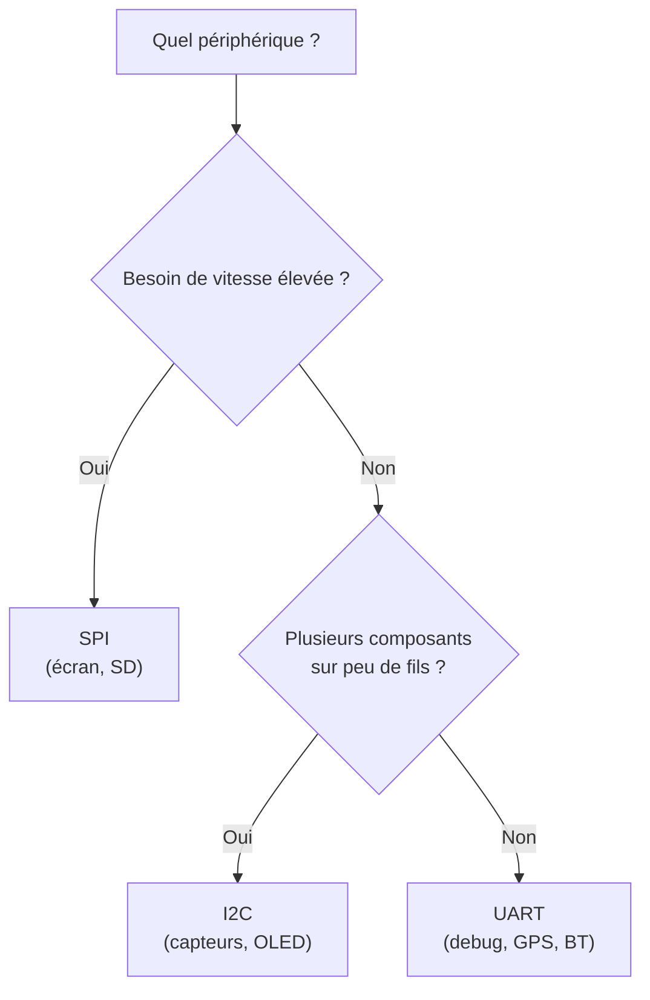

## Faire dialoguer les composants

Un microcontrôleur est rarement seul : il pilote un écran, interroge un capteur de température, échange avec un module Bluetooth. Encore faut-il que tous ces composants se comprennent, qu'ils parlent la même langue.

Ces langages communs, ce sont les **bus de communication**. Comme des humains, les composants ont plusieurs façons de discuter : à deux dans un couloir (**UART**), en petit groupe où chacun répond à son nom (**I2C**), ou par une ligne dédiée très rapide (**SPI**). Ce concept présente ces trois « dialectes » et t'aide à choisir le bon.

**À la fin de ce concept, tu sauras :**

- distinguer UART, I2C et SPI ;
- choisir le bon bus selon le besoin ;
- câbler un bus I2C (pull-ups) et trouver l'adresse d'un composant.

## Pourquoi des bus ?

Relier chaque périphérique au CPU par un fil par bit serait impraticable : l'écran de l'atelier (240 × 320 pixels) reçoit plus de 150 000 octets par image. Les **bus de communication série** transmettent les données sur un petit nombre de fils, en envoyant les bits **l'un après l'autre**. Une liaison **parallèle**, à l'inverse, envoie plusieurs bits en même temps, un par fil : plus rapide à fréquence égale, mais bien plus encombrante.


### Quatre questions pour comparer deux liaisons

| Question | Les deux réponses possibles |
|---|---|
| Combien d'interlocuteurs ? | **Point à point** (deux appareils) ou **multipoint** (plusieurs sur les mêmes fils) |
| Une horloge partagée ? | **Synchrone** (un fil d'horloge cadence les bits) ou **asynchrone** (chacun compte de son côté, à une vitesse convenue) |
| Les deux sens en même temps ? | **Full-duplex** (oui, sur deux fils de données) ou **half-duplex** (chacun son tour, sur le même fil) |
| Comment choisir le destinataire ? | Une **adresse** écrite dans le message (logiciel) ou un **fil de sélection** par composant (matériel) |

Ces quatre réponses suffisent à décrire les trois bus de cette page, et la plupart des autres (CAN, 1-Wire, USB...).

## UART : Universal Asynchronous Receiver-Transmitter

### Principe

UART est le bus le plus simple : **deux fils**, point à point (une liaison directe entre deux appareils seulement), sans horloge partagée.

| Fil | Rôle |
|---|---|
| **TX** | Transmission (sortie du µC) |
| **RX** | Réception (entrée du µC) |

La vitesse est fixée à l'avance des deux côtés (**baud rate**, en bits/s). Valeur standard : **115 200 baud**. Les deux appareils partagent aussi leur **masse** (GND) : sans référence commune, un niveau de tension ne veut rien dire.




### Anatomie d'une trame


Sans horloge partagée, comment le récepteur sait-il quand lire ? Par convention : la ligne est au repos à `HIGH`, et chaque octet est encadré de bits de synchronisation.

- un **bit de start** (passage à `LOW`) annonce le début ;
- les **bits de données** (8 le plus souvent), du poids faible au poids fort ;
- un **bit de parité** optionnel (contrôle d'erreur) ;
- un ou deux **bits de stop** (retour à `HIGH`).

C'est ce que résume la notation **`8N1`** : 8 bits de données, `N`o parité, 1 bit de stop. Les deux extrémités doivent partager exactement le même format **et** la même vitesse, sinon les octets sont mal découpés.

D'autres formats existent, que l'on rencontre sur des appareils plus anciens ou industriels :

- de **5 à 9 bits** de données ;
- une **parité** absente (`N`), paire (`E`, *even*) ou impaire (`O`, *odd*) : un bit ajouté pour que le nombre total de 1 soit pair (ou impair), ce qui permet de détecter une erreur sur un bit ;
- **1 ou 2 bits** de stop.

`7E1` désigne ainsi 7 bits de données, une parité paire et 1 bit de stop.

### Niveaux de tension et distance

Entre deux cartes, les niveaux sont ceux des broches : 0 V pour un 0, 3,3 V (ou 5 V sur une carte Arduino Uno) pour un 1, avec la ligne à 1 au repos. Une telle liaison ne porte qu'à **un mètre environ** : au-delà, les fils captent des parasites et déforment les fronts.

Pour aller plus loin, on intercale un **convertisseur de niveaux** (une puce MAX3232, par exemple) qui transforme la liaison en **RS-232**, l'ancien port série des ordinateurs : des tensions plus élevées, positives et négatives, bien plus robustes. La norme vise une quinzaine de mètres, et la règle est toujours la même : **plus la vitesse est basse, plus on peut aller loin**.

### Usage principal

- **Moniteur série** (debug via USB)
- Modules GPS, Bluetooth, GSM
- Communication entre deux µC

```cpp
Serial.begin(115200);        // ouvre le port série du moniteur
Serial.println("Hello !");   // envoie une ligne
int v = analogRead(A0);
Serial.println(v);           // affiche la valeur dans le moniteur série
```

{% include message.html title="Sur la XIAO, Serial passe par l'USB natif" message="Sur beaucoup de cartes, `Serial` est un vrai UART, converti en USB par une puce dédiée (CP2102, CH340). La XIAO ESP32S3 n'en a pas : `Serial` y passe par l'**USB natif** de l'ESP32-S3 (USB CDC). Côté code, rien ne change : même `Serial.begin()`, mêmes `print`. L'UART0 matériel reste disponible sur D6 (TX) / D7 (RX) sous le nom `Serial0`, par exemple pour dialoguer avec un module GPS (sur la carte de la console, ces deux broches servent à un bouton et au reset de l'écran)." status="is-info" icon="fas fa-info-circle" %}

## I2C : Inter-Integrated Circuit

### Principe

I2C relie **plusieurs périphériques** sur seulement **2 fils** grâce à un système d'adressage.

| Fil | Rôle |
|---|---|
| **SDA** | Données (bidirectionnel) |
| **SCL** | Horloge (générée par le maître) |

Chaque composant I2C possède une **adresse 7 bits** unique (ex : `0x3C` pour un écran OLED SSD1306). Le **maître** (l'appareil qui dirige les échanges, ici l'ESP32-S3) initie toujours la communication ; les autres, les **esclaves**, ne répondent que lorsqu'il les sollicite.


C'est un bus **multipoint**, **synchrone** (le maître génère l'horloge sur SCL) et **half-duplex** (SDA sert dans les deux sens, chacun son tour).

### Le déroulement d'un échange

Un échange I2C suit toujours le même rituel, orchestré par le maître :


1. **Condition de start** : le maître prend la main sur le bus.
2. **Adresse + bit R/W** : il émet l'adresse 7 bits du composant visé, suivie d'un bit « lecture ou écriture ».
3. **ACK** : l'esclave concerné répond par un accusé de réception. Un silence (NACK) signifie « personne à cette adresse ».
4. **Données** : les octets circulent, chacun confirmé par un ACK.
5. **Condition de stop** : le maître libère le bus.

C'est ce système d'accusé de réception qui permet au scanner d'adresses (plus bas) de savoir « qui est là ».

### Écrire ou lire

- **Écrire** est direct : l'adresse avec R/W à 0, puis les octets, chacun acquitté par l'esclave.
- **Lire** se fait souvent en deux temps. Le maître écrit d'abord **ce qu'il veut lire** (le numéro du registre de l'esclave, par exemple celui de la température), puis il enchaîne sans STOP, par un **start répété**, sur l'adresse avec R/W à 1. L'esclave envoie alors ses octets ; cette fois, c'est le **maître** qui acquitte chacun d'eux, sauf le dernier, auquel il répond par un **NACK** pour signaler qu'il a fini, avant le STOP.

En pratique, les bibliothèques de capteurs font tout cela pour toi ; savoir lire ce déroulement sert surtout à déboguer, à l'analyseur logique ou à l'oscilloscope.

### Les adresses

Une adresse sur 7 bits offre 128 valeurs, dont 16 sont **réservées** par la norme (de `0x00` à `0x07` et de `0x78` à `0x7F`) : il en reste **112** pour les composants. L'adresse est fixée par le fabricant ; certains composants permettent d'en choisir une parmi deux ou quatre, par une broche à relier à GND ou au 3,3 V (le capteur BME280 répond en `0x76` ou en `0x77`).

Deux composants à la **même adresse** sur le même bus se répondent l'un par-dessus l'autre : il faut changer l'adresse de l'un d'eux, ou les placer sur deux bus I2C différents (l'ESP32-S3 en a deux). Une variante à **10 bits** d'adresse existe, mais elle reste rare.

### Vitesses standard

| Mode | Vitesse |
|---|---|
| Standard | 100 kHz |
| Fast | 400 kHz |
| Fast+ | 1 MHz |
| High Speed | 3,4 MHz |

Plus le bus est rapide, plus il doit être court : comptez **un à deux mètres** au plus, souvent moins à 400 kHz et au-delà.

### Usage principal

- Capteurs (température, accéléromètre, IMU)
- Petits écrans OLED
- Mémoires EEPROM (petite mémoire non volatile réinscriptible)
- Cas où on chaîne plusieurs périphériques sur peu de broches

```cpp
#include <Wire.h>
Wire.begin(SDA_PIN, SCL_PIN);  // démarre I2C
// Les bibliothèques de capteurs utilisent Wire en arrière-plan
```

### Câblage : les résistances de pull-up

Les lignes SDA et SCL sont en **open-drain** (voir [GPIO & monde numérique](/workshops/microcontroleur/concepts/gpio-monde-numerique/)) : les composants ne peuvent que tirer la ligne vers `LOW` ou la relâcher. Il faut donc deux **résistances de pull-up** (typiquement 4,7 kΩ) reliant SDA et SCL au 3,3 V : sans elles, le bus reste bloqué et rien ne communique.


C'est aussi ce qui rend le bus sûr : chacun peut tirer la ligne à 0 ou la relâcher, mais personne n'impose un 1. Deux composants ne peuvent donc jamais se contredire et créer un court-circuit.



### Trouver l'adresse d'un périphérique : le scanner I2C

On ne connaît pas toujours l'adresse d'un composant. Un petit programme balaie toutes les adresses possibles et affiche celles qui répondent :

```cpp
#include <Wire.h>

void setup() {
  Wire.begin(SDA_PIN, SCL_PIN);
  Serial.begin(115200);
  for (byte adr = 1; adr < 127; adr++) {
    Wire.beginTransmission(adr);
    if (Wire.endTransmission() == 0) {     // 0 = un composant a répondu
      Serial.printf("Trouvé à 0x%02X\n", adr);
    }
  }
}

void loop() {}
```

C'est le premier réflexe de débogage quand un capteur I2C « ne répond pas ».

## SPI : Serial Peripheral Interface

### Principe

SPI est le bus **le plus rapide** des trois. Il utilise **4 fils** et une logique maître/esclave.

| Fil | Rôle |
|---|---|
| **MOSI** | Master Out Slave In (données vers le périphérique) |
| **MISO** | Master In Slave Out (données depuis le périphérique) |
| **SCK** | Horloge (générée par le maître) |
| **CS** | Chip Select : sélectionne l'esclave actif (1 fil par esclave) |

La transmission est **synchrone** (l'horloge SCK cadence chaque bit) et **full-duplex** (MOSI et MISO actifs simultanément).


SCK, MOSI et MISO sont **partagés** ; chaque esclave a son propre fil **CS**. Pas d'adresse : le maître met à 0 le CS de l'esclave qu'il veut, et les autres laissent leur MISO en haute impédance. Selon les composants, les broches portent d'autres noms : SCLK pour SCK, SS pour CS, SDI/SDO pour MOSI/MISO.

### Le déroulement d'un échange


1. Le maître met le **CS** de l'esclave à 0.
2. Il génère l'horloge sur **SCK** ; à chaque coup, un bit part sur **MOSI** et un bit revient sur **MISO**.
3. Il remonte le CS : l'échange est terminé.

Ni adresse, ni accusé de réception : rien ne garantit que l'esclave a bien reçu. C'est le prix de la vitesse. Quand le maître ne fait qu'écrire (comme vers l'écran de l'atelier), MISO n'est même pas câblé.

### Le montage en chaîne

Certains composants (des registres à décalage, des pilotes de LED) se câblent **en chaîne** (*daisy chain*) : un seul CS pour tous, et la sortie de données de chaque esclave reliée à l'entrée du suivant.


Les octets traversent les esclaves l'un après l'autre : pour en commander trois, le maître envoie trois octets d'affilée, puis remonte le CS. Ce montage économise des broches, mais tous les esclaves doivent le prévoir dans leur fiche technique.

### Vitesses typiques

De quelques MHz à **80 MHz** sur ESP32-S3, bien plus rapide que I2C.

### Usage principal

- Écrans TFT (ST7789, ILI9341), **utilisé dans ce projet**
- Cartes SD
- Mémoires Flash externes
- Tout périphérique nécessitant un haut débit

```cpp
#include <SPI.h>
SPI.begin(SCK_PIN, MISO_PIN, MOSI_PIN, CS_PIN);
```

### Les quatre modes SPI

Le maître et l'esclave doivent aussi s'accorder sur **la forme de l'horloge** : son niveau au repos (*CPOL*, bas ou haut) et le front sur lequel chaque bit est lu (*CPHA*, premier ou second front). Les quatre combinaisons forment les **modes SPI** :

| Mode | Horloge au repos (CPOL) | Bit lu sur le front (CPHA) |
|---|---|---|
| 0 | Bas | Premier (montant) |
| 1 | Bas | Second (descendant) |
| 2 | Haut | Premier (descendant) |
| 3 | Haut | Second (montant) |

Le mode est imposé par le périphérique (sa datasheet l'indique) et le maître s'y adapte ; le mode 0 est le plus courant. Un mauvais mode ne produit aucune erreur : l'esclave lit simplement des bits décalés, et l'écran reste noir.

{% include message.html title="Sans CS, le mode compte encore plus" message="Sur le PCB de l'atelier, le CS de l'écran est relié à GND : l'écran est sélectionné en permanence et ne sait pas quand une trame commence. Le ST7789 a alors besoin du **mode 3** (horloge à l'état haut au repos) pour rester synchronisé : d'où le `tft.init(240, 320, SPI_MODE3)` du tutoriel [Les modules de la mallette](/workshops/microcontroleur/tutorials/entrees-boutons-joystick/)." status="is-warning" icon="fas fa-exclamation-triangle" %}

Pour l'écran de l'atelier, cet appel suffit à router le bus sur les broches du PCB : `SPI.begin(D9, -1, D10, -1)` (pas de MISO, CS relié à GND). La bibliothèque **Adafruit ST7789** se charge ensuite de toutes les trames : tu ne manipules jamais les octets toi-même.

## Quand le bon bus manque

Un microcontrôleur gère ses bus avec des **périphériques matériels** dédiés : l'ESP32-S3 a trois UART, deux I2C et deux SPI disponibles pour l'utilisateur, que la GPIO matrix route vers presque n'importe quelle broche. Le processeur prépare les octets, le périphérique s'occupe du chronométrage bit par bit.

Quand le périphérique manque (une petite puce, un bus exotique), on peut **émuler** le bus en pilotant les broches par logiciel, bit après bit : c'est le *bit-banging*. Ça marche pour des vitesses modestes, mais le processeur est occupé pendant tout l'échange, et une interruption au mauvais moment déforme le chronométrage. Quand un périphérique matériel existe, on l'utilise.

## D'autres bus

UART, I2C et SPI couvrent l'essentiel des besoins sur une carte. D'autres bus se rencontrent dès qu'on sort de la carte :

| Bus | Fils | Principe | Où on le trouve |
|---|---|---|---|
| **CAN** | 2 (paire différentielle) | Multipoint, robuste aux parasites, jusqu'à 1 Mbit/s sur quelques dizaines de mètres, bien plus loin à bas débit | Automobile, machines industrielles |
| **1-Wire** | 1 de données + la masse | Multipoint, une résistance de tirage, chaque composant a un numéro unique gravé en usine | Capteur de température DS18B20 |
| **USB** | 2 de données + alimentation | Point à point vers un hôte, rapide, avec détection automatique des appareils | Programmation de la XIAO, claviers, clés |

L'ESP32-S3 intègre un contrôleur compatible CAN (appelé TWAI chez Espressif) : il suffit de lui ajouter une puce d'interface (*transceiver*) pour rejoindre un réseau CAN.

## Tableau comparatif

| Critère | UART | I2C | SPI |
|---|---|---|---|
| Fils (hors masse) | 2 (TX, RX) | 2 (SDA, SCL) | 3 (SCK, MOSI, MISO) + 1 CS par esclave |
| Liaison | Point à point | Multipoint | Multipoint |
| Horloge | Asynchrone | Synchrone | Synchrone |
| Sens | Full-duplex | Half-duplex | Full-duplex |
| Choix du destinataire | Aucun (un seul) | Adresse 7 bits | Fil CS |
| Accusé de réception | Non | Oui (ACK) | Non |
| Vitesse | ~1 Mbit/s | 100 kbit/s à 3,4 Mbit/s | Jusqu'à 80 Mbit/s sur ESP32-S3 |
| Distance | Environ 1 m | 1 à 2 m | Quelques dizaines de cm |
| Usage type | Debug, modules | Capteurs, OLED | Écrans, carte SD |

Ces valeurs sont indicatives : la distance utile dépend de la vitesse, de la qualité des fils et des composants.

## Comment choisir ?



## Quiz express

**1. Combien de fils pour l'UART, l'I2C et le SPI ?**

<details><summary>Voir la réponse</summary>UART : 2 (TX/RX) · I2C : 2 (SDA/SCL) · SPI : 4+ (MOSI, MISO, SCK, CS).</details>

**2. Pourquoi faut-il des pull-ups sur un bus I2C ?**

<details><summary>Voir la réponse</summary>Les lignes sont en open-drain : sans pull-up, elles ne peuvent jamais remonter à HIGH et le bus reste bloqué.</details>

**3. Deux capteurs identiques répondent tous les deux à l'adresse I2C `0x76`. Que faire ?**

<details><summary>Voir la réponse</summary>Changer l'adresse de l'un d'eux si le composant le permet (une broche à relier à GND ou au 3,3 V, `0x77` pour le BME280), ou les brancher sur deux bus I2C différents.</details>

**4. Quel bus choisir pour un écran TFT rapide ?**

<details><summary>Voir la réponse</summary>Le SPI : c'est le plus rapide (jusqu'à 80 MHz), et un écran a des dizaines de milliers de pixels à recevoir à chaque image.</details>

## Pour aller plus loin

- [Les modules de la mallette](/workshops/microcontroleur/tutorials/entrees-boutons-joystick/) : le SPI en pratique, avec l'écran de l'atelier
- [Écran OLED SSD1306 avec ESP32](/docs/tutorials/electronics/esp32-ssd1306-oled/) : l'I2C en pratique
- [VSCode et PlatformIO : port série](/docs/tutorials/electronics/vscode-port-serie/) : l'UART pour déboguer
- [Introduction aux liaisons séries filaires UART, I2C et SPI](https://passionelectronique.fr/liaisons-series-uart-i2c-spi/) (Passion Électronique) : un article très complet, dont la démarche a inspiré les schémas de cette page

## Résumé

- **UART** : 2 fils, point à point, idéal pour le debug et les modules simples.
- **I2C** : 2 fils, multi-esclaves par adressage, vitesse modérée ; exige deux **pull-ups** (~4,7 kΩ) sur SDA/SCL ; un **scanner** révèle les adresses présentes.
- **SPI** : 4 fils, rapide, full-duplex, indispensable pour les écrans TFT ; l'horloge suit l'un des quatre **modes** (0 à 3), qui doit correspondre au périphérique.
- Bas niveau : une trame UART encadre chaque octet (start / données / stop, `8N1`) ; un échange I2C = start → adresse+R/W → ACK → données → stop.
- **Distance** : environ un mètre en UART (plus en RS-232), un à deux mètres en I2C, quelques dizaines de centimètres en SPI ; plus le débit baisse, plus on va loin.
- Sans périphérique matériel, un bus peut être **émulé** par logiciel (*bit-banging*), au prix du temps processeur. Au-delà de la carte : **CAN**, **1-Wire**, **USB**.
- Dans ce projet : un **port série** pour le moniteur (transporté par l'USB natif sur la XIAO), **SPI** pour l'écran.
