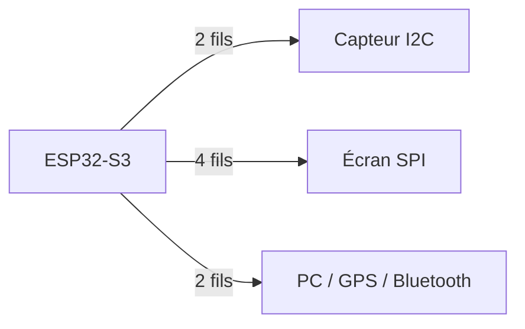
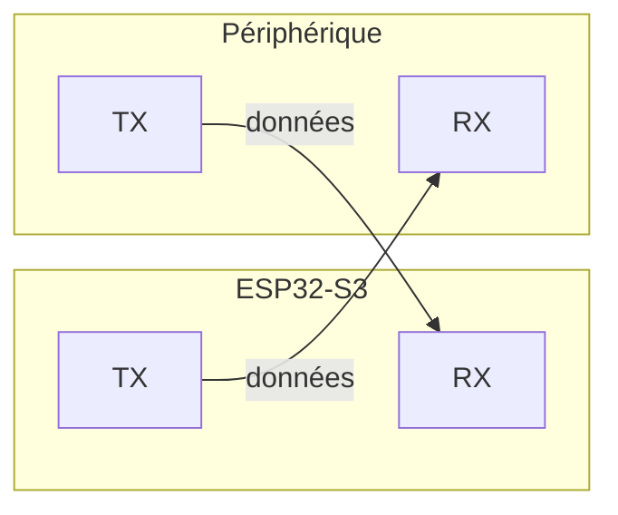
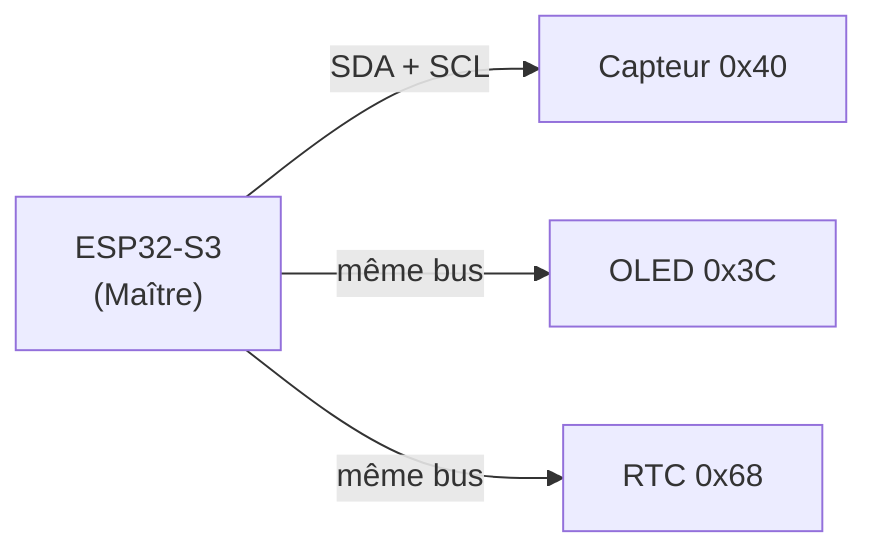
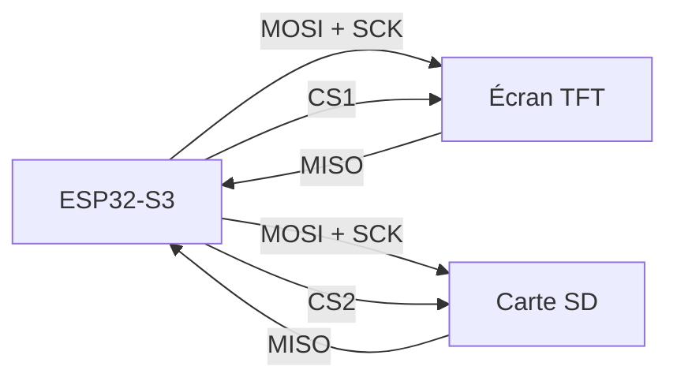
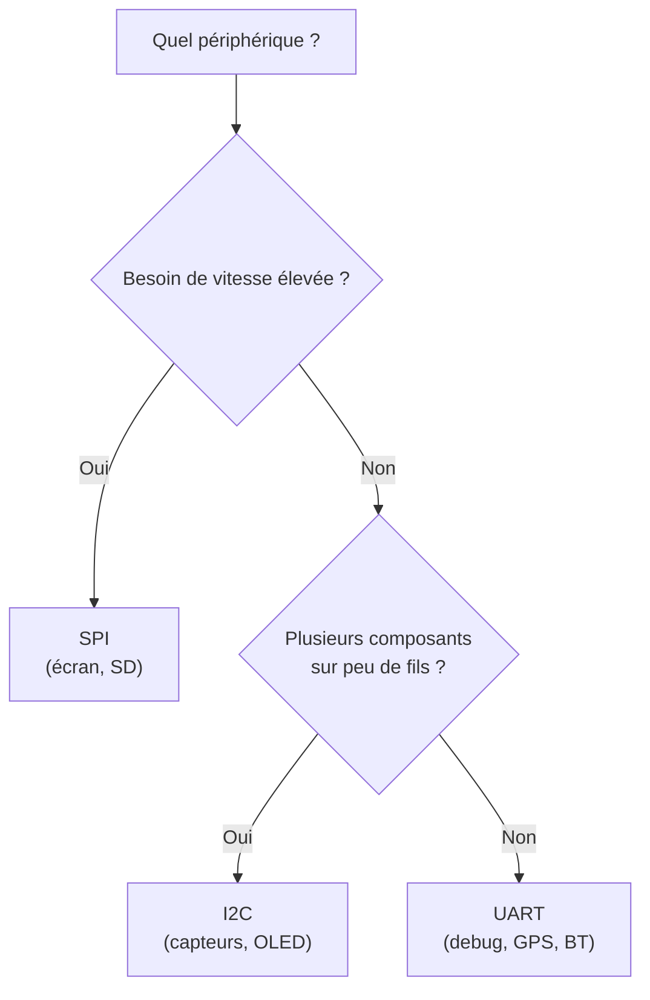

## Faire dialoguer les composants

Un microcontrôleur est rarement seul : il pilote un écran, interroge un capteur de température, échange avec un module Bluetooth. Encore faut-il que tous ces composants se comprennent - qu'ils parlent la même langue.

Ces langages communs, ce sont les **bus de communication**. Comme des humains, les composants ont plusieurs façons de discuter : à deux dans un couloir (**UART**), en petit groupe où chacun répond à son nom (**I2C**), ou par une ligne dédiée très rapide (**SPI**). Ce concept présente ces trois « dialectes » et t'aide à choisir le bon.

**À la fin de ce concept, tu sauras :**

- distinguer UART, I2C et SPI ;
- choisir le bon bus selon le besoin ;
- câbler un bus I2C (pull-ups) et trouver l'adresse d'un composant.

## Pourquoi des bus ?

Relier chaque périphérique au CPU par une broche dédiée serait impraticable : un écran 240×240 nécessiterait des milliers de fils. Les **bus de communication** permettent de transmettre des données sur un petit nombre de fils en les envoyant bit par bit ou octet par octet.



## UART - Universal Asynchronous Receiver-Transmitter

### Principe

UART est le bus le plus simple : **deux fils**, point à point (une liaison directe entre deux appareils seulement), sans horloge partagée.

| Fil | Rôle |
|---|---|
| **TX** | Transmission (sortie du µC) |
| **RX** | Réception (entrée du µC) |

La vitesse est fixée à l'avance des deux côtés (**baud rate**, en bits/s). Valeur standard : **115 200 baud**.





### Anatomie d'une trame

Sans horloge partagée, comment le récepteur sait-il quand lire ? Par convention : la ligne est au repos à `HIGH`, et chaque octet est encadré de bits de synchronisation.

- un **bit de start** (passage à `LOW`) annonce le début ;
- les **bits de données** (8 le plus souvent), du poids faible au poids fort ;
- un **bit de parité** optionnel (contrôle d'erreur) ;
- un ou deux **bits de stop** (retour à `HIGH`).

C'est ce que résume la notation **`8N1`** : 8 bits de données, `N`o parité, 1 bit de stop. Les deux extrémités doivent partager exactement le même format **et** la même vitesse, sinon les octets sont mal découpés.

### Usage principal

- **Moniteur série** (debug via USB)
- Modules GPS, Bluetooth, GSM
- Communication entre deux µC

```cpp
Serial.begin(115200);        // ouvre le port série du moniteur
Serial.println("Hello !");   // envoie une ligne
int v = analogRead(A0);
Serial.println(v);           // affiche la valeur dans le moniteur série
```

{% include message.html title="Sur la XIAO, Serial passe par l'USB natif" message="Sur beaucoup de cartes, `Serial` est un vrai UART, converti en USB par une puce dédiée (CP2102, CH340). La XIAO ESP32S3 n'en a pas : `Serial` y passe par l'**USB natif** de l'ESP32-S3 (USB CDC). Côté code, rien ne change : même `Serial.begin()`, mêmes `print`. L'UART0 matériel reste disponible sur D6 (TX) / D7 (RX) sous le nom `Serial0`, par exemple pour dialoguer avec un module GPS (sur le PCB du Pong, ces deux broches servent à un bouton et au reset de l'écran)." status="is-info" icon="fas fa-info-circle" %}

## I2C - Inter-Integrated Circuit

### Principe

I2C relie **plusieurs périphériques** sur seulement **2 fils** grâce à un système d'adressage.

| Fil | Rôle |
|---|---|
| **SDA** | Données (bidirectionnel) |
| **SCL** | Horloge (générée par le maître) |

Chaque composant I2C possède une **adresse 7 bits** unique (ex : `0x3C` pour un écran OLED SSD1306). Le **maître** (l'appareil qui dirige les échanges - ici l'ESP32-S3) initie toujours la communication ; les autres, les **esclaves**, ne répondent que lorsqu'il les sollicite.



### Le déroulement d'un échange

Un échange I2C suit toujours le même rituel, orchestré par le maître :

1. **Condition de start** : le maître prend la main sur le bus.
2. **Adresse + bit R/W** : il émet l'adresse 7 bits du composant visé, suivie d'un bit « lecture ou écriture ».
3. **ACK** : l'esclave concerné répond par un accusé de réception. Un silence (NACK) signifie « personne à cette adresse ».
4. **Données** : les octets circulent, chacun confirmé par un ACK.
5. **Condition de stop** : le maître libère le bus.

C'est ce système d'accusé de réception qui permet au scanner d'adresses (plus bas) de savoir « qui est là ».

### Vitesses standard

| Mode | Vitesse |
|---|---|
| Standard | 100 kHz |
| Fast | 400 kHz |
| Fast+ | 1 MHz |

### Usage principal

- Capteurs (température, accéléromètre, IMU)
- Petits écrans OLED
- Mémoires EEPROM (petite mémoire non volatile réinscriptible)
- Cas où on chaîne plusieurs périphériques sur peu de broches

```cpp
#include <Wire.h>
Wire.begin(SDA_PIN, SCL_PIN);  // démarre I2C
// Les bibliothèques de capteurs utilisent Wire en arrière-plan
```

### Câblage : les résistances de pull-up

Les lignes SDA et SCL sont en **open-drain** (voir [GPIO & monde numérique](/workshops/microcontroleur/concepts/gpio-monde-numerique/)) : les composants ne peuvent que tirer la ligne vers `LOW` ou la relâcher. Il faut donc deux **résistances de pull-up** (typiquement 4,7 kΩ) reliant SDA et SCL au 3,3 V - sans elles, le bus reste bloqué et rien ne communique.



### Trouver l'adresse d'un périphérique - le scanner I2C

On ne connaît pas toujours l'adresse d'un composant. Un petit programme balaie toutes les adresses possibles et affiche celles qui répondent :

```cpp
#include <Wire.h>

void setup() {
  Wire.begin(SDA_PIN, SCL_PIN);
  Serial.begin(115200);
  for (byte adr = 1; adr < 127; adr++) {
    Wire.beginTransmission(adr);
    if (Wire.endTransmission() == 0) {     // 0 = un composant a répondu
      Serial.printf("Trouvé à 0x%02X\n", adr);
    }
  }
}

void loop() {}
```

C'est le premier réflexe de débogage quand un capteur I2C « ne répond pas ».

## SPI - Serial Peripheral Interface

### Principe

SPI est le bus **le plus rapide** des trois. Il utilise **4 fils** et une logique maître/esclave.

| Fil | Rôle |
|---|---|
| **MOSI** | Master Out Slave In (données vers le périphérique) |
| **MISO** | Master In Slave Out (données depuis le périphérique) |
| **SCK** | Horloge (générée par le maître) |
| **CS** | Chip Select - sélectionne l'esclave actif (1 fil par esclave) |

La transmission est **synchrone** (l'horloge SCK cadence chaque bit) et **full-duplex** (MOSI et MISO actifs simultanément).



### Vitesses typiques

De quelques MHz à **80 MHz** sur ESP32-S3 - bien plus rapide que I2C.

### Usage principal

- Écrans TFT (ST7789, ILI9341) - **utilisé dans ce projet**
- Cartes SD
- Mémoires Flash externes
- Tout périphérique nécessitant un haut débit

```cpp
#include <SPI.h>
SPI.begin(SCK_PIN, MISO_PIN, MOSI_PIN, CS_PIN);
```

En pratique, la bibliothèque **TFT_eSPI** gère entièrement SPI pour l'écran - tu n'as pas à appeler `SPI.begin()` manuellement.

## Tableau comparatif

| Critère | UART | I2C | SPI |
|---|---|---|---|
| Fils | 2 | 2 | 4+ |
| Vitesse | ~1 Mbit/s | 100 k–1 Mbit/s | 10–80 Mbit/s |
| Multi-périphériques | Non (point à point) | Oui (adressage) | Oui (CS par esclave) |
| Full-duplex | Oui (TX et RX séparés) | Non | Oui |
| Complexité | Faible | Moyenne | Moyenne |
| Usage type | Debug, modules | Capteurs, OLED | Écrans, SD |

## Comment choisir ?



## Quiz express

**1. Combien de fils pour l'UART, l'I2C et le SPI ?**

<details><summary>Voir la réponse</summary>UART : 2 (TX/RX) · I2C : 2 (SDA/SCL) · SPI : 4+ (MOSI, MISO, SCK, CS).</details>

**2. Pourquoi faut-il des pull-ups sur un bus I2C ?**

<details><summary>Voir la réponse</summary>Les lignes sont en open-drain : sans pull-up, elles ne peuvent jamais remonter à HIGH et le bus reste bloqué.</details>

**3. Quel bus choisir pour un écran TFT rapide ?**

<details><summary>Voir la réponse</summary>Le SPI : c'est le plus rapide (jusqu'à 80 MHz) et full-duplex.</details>

## Pour aller plus loin

- [Écran SPI & game loop](/docs/tutorials/electronics/ecran-spi-game-loop/) - le SPI en pratique
- [Écran OLED SSD1306 (I2C)](/docs/tutorials/electronics/esp32-ssd1306-oled/) - l'I2C en pratique
- [Le port série sous VS Code](/docs/tutorials/electronics/vscode-port-serie/) - l'UART pour déboguer

## Résumé

- **UART** : 2 fils, point à point, idéal pour le debug et les modules simples.
- **I2C** : 2 fils, multi-esclaves par adressage, vitesse modérée - exige deux **pull-ups** (~4,7 kΩ) sur SDA/SCL ; un **scanner** révèle les adresses présentes.
- **SPI** : 4 fils, rapide, full-duplex - indispensable pour les écrans TFT.
- Bas niveau : une trame UART encadre chaque octet (start / données / stop, `8N1`) ; un échange I2C = start → adresse+R/W → ACK → données → stop.
- Dans ce projet : un **port série** pour le moniteur (transporté par l'USB natif sur la XIAO), **SPI** pour l'écran.
