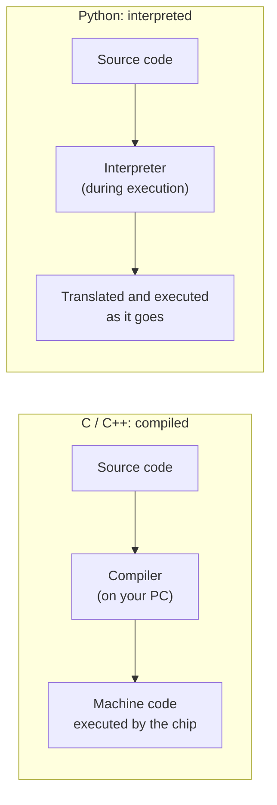
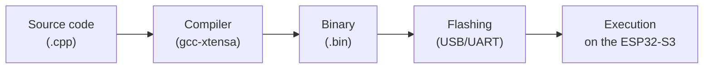
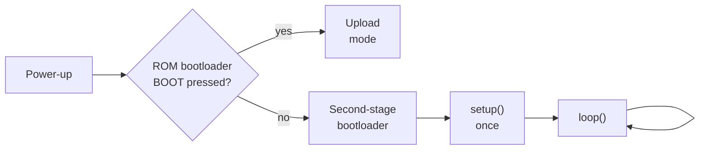

## From the keyboard to the LED

You know what a microcontroller is and what it is for. But between the code you write and the LED that starts blinking, a lot happens: when you click "Upload", what *really* happens?

This concept follows that journey from end to end, from the text you type to the electrons running through the chip. The following concepts will then open the hood to see how it is built inside.

**By the end of this concept, you will know how to:**

- explain the difference between a **compiled** language (C, C++) and an **interpreted** language (Python);
- follow the path code → compilation → flash → execution;
- understand `setup()`/`loop()` and what runs (or not) around your program;
- avoid a blocking `delay()` thanks to `millis()`.

## In which language?

On a microcontroller, you almost always program in **C** or **C++**. The **Arduino** framework, used in the course, is **C++** (C, with a few extra tools, such as objects: `Serial.println()`). You may have learned to program in **Python**: the logic stays the same, but the code is not translated for the processor at the same moment.

### Arduino: the board, the software and the framework

The word "Arduino" refers to three different things:

- development **boards** (Uno, Nano, Mega), often built around an ATmega microcontroller;
- a piece of **software**, the Arduino IDE, to write, compile and upload a program;
- a **framework**: the functions `setup()`, `loop()`, `pinMode()`, `digitalWrite()`... which simplify access to the hardware. It has been ported to hundreds of chips, including the ESP32-S3 (under the name **Arduino-ESP32**).

In the course, we use **the framework**, with PlatformIO instead of the Arduino IDE, on a XIAO ESP32S3 board rather than an Arduino board. An Arduino Uno, with its ATmega328P (8 bits, 16 MHz, 2 KB of RAM, no Wi-Fi), would be too limited for a colour display and a player connected over Wi-Fi: we keep the simplicity of the framework, and gain the power and Wi-Fi of the ESP32-S3.

### Compiled or interpreted



- **Compiled (C, C++)**: before execution, a program called a **compiler** translates all your code, once and for all, into **machine code**: the instructions the processor can execute directly. The chip only receives this machine code.
- **Interpreted (Python)**: a program called an **interpreter** reads your code **during** execution and translates it as it goes. It must therefore be present and running on the machine that executes the program.

| | Compiled (C, C++) | Interpreted (Python) |
|---|---|---|
| **When the code is translated** | Once, beforehand, on your PC | At every run, as it goes |
| **What runs on the machine** | The program alone | The program **and** the interpreter |
| **Speed** | Very fast | Slower |
| **Typos or type errors** | Detected at compile time, before flashing | Discovered when the line is executed |

### Why C/C++ on a microcontroller?

A microcontroller has little memory and often has to react quickly. A compiled language suits it perfectly: no interpreter to fit in memory, a fast program, and many errors caught by the compiler **before** the program is even sent to the board. That is why every manufacturer provides a C/C++ compiler for its chips.

## From text to electric current

A source file (`main.cpp` with PlatformIO, `.ino` with the Arduino IDE) is just text. For it to blink an LED, it must go through several transformations before reaching the chip:



Each step is handled by the **toolchain**: the set of tools that turns the code into an executable program.

## The Arduino-ESP32 toolchain

The **Arduino-ESP32** framework provides three elements:

| Element | Role |
|---|---|
| **Compiler** (gcc for Xtensa) | Translates C++ into machine instructions for the ESP32-S3's CPU |
| **Arduino core** | Library that defines `pinMode()`, `digitalWrite()`, `analogRead()`… |
| **Uploader** (esptool) | Transfers the compiled binary to the Flash over USB |

The IDE (Arduino IDE or PlatformIO) orchestrates these tools in the background when you click *Upload*, but the chain stays the same: **compile → flash → execute**.

### What the compiler really does

"Compiling" actually covers several chained steps:

1. **Preprocessor**: it handles the `#include` and `#define` directives: it pastes in the content of the libraries and replaces the macros. It is the one that reads the `#include <Arduino.h>` at the top of `main.cpp`: this line declares `pinMode()`, `digitalWrite()`, `Serial`… With the Arduino IDE, it is secretly added to `.ino` files; with PlatformIO, a `.cpp` must write it itself, otherwise the compiler knows no Arduino function.
2. **Compilation**: each C++ file is translated into **object code** (machine instructions), separately.
3. **Linking (*linker*)**: all the object files and the libraries are assembled into a single **binary**, resolving the references between them.

Telling these steps apart helps to read errors: a **compilation error** (step 2) is a syntax or type mistake in your code; a **link error** ("*undefined reference*") points to a function or library missing at step 3.

## Flashing: writing to persistent memory

Flashing means writing the compiled **binary** (the program translated into machine instructions: 0s and 1s the chip can execute) into the microcontroller's **Flash** (see [Architecture of a microcontroller](/workshops/microcontroleur/concepts/architecture-microcontroleur/)). Unlike RAM, Flash keeps its content without power: the program restarts automatically at every power-up, without intervention.



## At reset: the boot sequence

Between power-up and the execution of your `setup()`, the ESP32-S3 goes through several automatic steps:

1. **ROM bootloader**: a small program burned into the chip at the factory starts. It reads the *strapping* pins (including GPIO0) to decide: normal boot, or **upload mode** (waiting for a flash over USB/UART).
2. **Second-stage bootloader**: loaded from Flash, it initialises the clock and the memory, then chooses the application partition to launch.
3. **Your application**: finally, the compiled code runs: `setup()` once, then `loop()` over and over.



This mechanism explains the **BOOT** button: holding it down at reset forces step 1 into upload mode.

## `setup()` and `loop()`: the whole structure

An Arduino program fits in two functions:

```cpp
#include <Arduino.h>   // essential in a .cpp: declares pinMode, Serial...

constexpr int LED_PIN = D3;   // an external LED on pin D3

void setup() {
  // Run only once, at start-up
  pinMode(LED_PIN, OUTPUT);
  Serial.begin(115200);
}

void loop() {
  // Run in an infinite loop, forever
  digitalWrite(LED_PIN, HIGH);
  delay(500);
  digitalWrite(LED_PIN, LOW);
  delay(500);
}
```

- `setup()` initialises the hardware (pins, serial ports, peripherals), only once.
- `loop()` runs in an infinite loop, from start-up until the power is cut.

## No operating system… in the PC sense

On a computer, a program is one **process** among hundreds of others, managed by a full OS (Windows, Linux: files, windows, virtual memory, clean shutdown). On a microcontroller, none of that: your program is **the only** program on the chip.

On the ESP32-S3, Arduino-ESP32 does rely on a tiny **real-time kernel**, **FreeRTOS**, which stays invisible: it runs `loop()` as a **task**, alongside the Wi-Fi, Bluetooth and USB tasks. What matters for your code:

- `loop()` is **a single task**: what you write in it runs line after line, one thing at a time.
- `delay()` pauses this task: Wi-Fi keeps running behind the scenes, but **nothing in your program moves forward**, including reading the buttons.
- No clean shutdown: cutting the power stops the program instantly, with no automatic save.



This is why structuring the code (non-blocking game loop, [finite state machine](/workshops/microcontroleur/concepts/machine-etats-finis/)) becomes essential as soon as the program handles several tasks at once.

## Doing several things at once with `millis()`

The flaw of `delay()`: while it waits, **nothing else in your program runs**. Impossible to read a button, refresh a display and blink an LED "at the same time" with `delay()` calls.

The solution is never to block: instead of waiting, you **check the time**. `millis()` returns the number of milliseconds elapsed since start-up. By storing the time of the last action, you decide whether it is time to act, without ever freezing the program.

```cpp
unsigned long lastBlink = 0;
const unsigned long INTERVAL = 500;  // ms
int ledState = LOW;

void loop() {
  // ... here, the rest of the program runs freely (buttons, display…)

  if (millis() - lastBlink >= INTERVAL) {
    lastBlink = millis();
    ledState = !ledState;
    digitalWrite(LED_PIN, ledState);
  }
}
```

This pattern (comparing `millis()` with a stored time) is the foundation of the **non-blocking game loop** and combines naturally with the [finite state machine](/workshops/microcontroleur/concepts/machine-etats-finis/).


In a game, this same pattern paces a **game loop**: one frame every 16 ms, and the remaining time handed back to `loop()`.


### The size of integers

The size of an `int` depends on the chip: the same code can overflow on one and not on the other.

| Type | Arduino Uno (8-bit) | ESP32-S3 (32-bit) |
|---|---|---|
| `int` | 16 bits, up to 32,767 | 32 bits, up to 2.1 billion |
| `long`, `unsigned long` | 32 bits | 32 bits |
| `uint8_t` | 8 bits, from 0 to 255 | same |
| `uint32_t` | 32 bits | same |

The types from `<stdint.h>` (`uint8_t`, `int16_t`, `uint32_t`) have the same size everywhere: use them whenever the size matters.

### `millis()` overflow

`millis()` returns a 32-bit unsigned integer: it wraps back to 0 after 2³² ms, i.e. **49.7 days**. Depending on how the comparison is written, the program survives this wrap-around or not:

```cpp
if (millis() - lastBlink >= INTERVAL)   // always correct
if (millis() >= lastBlink + INTERVAL)   // wrong at the wrap-around
```


Subtracting two unsigned numbers gives the real gap even if the counter has gone round, like on a clock: from 11 pm to 1 am, 2 hours have passed. The second form, on the other hand, compares two times: just before the wrap to 0, `lastBlink + INTERVAL` overflows and becomes very small, and the condition fires wrongly.





## Blink, commented line by line

The simplest program ties together all the concepts seen so far:

```cpp
#include <Arduino.h>

void setup() {
  pinMode(LED_BUILTIN, OUTPUT);  // configures the pin as an output (GPIO, register)
}

void loop() {
  digitalWrite(LED_BUILTIN, HIGH);  // writes 3.3 V on the pin (register)
  delay(500);                       // pauses loop() for 500 ms: nothing else moves forward
  digitalWrite(LED_BUILTIN, LOW);   // writes 0 V on the pin
  delay(500);
}
```

- `pinMode` and `digitalWrite` write into **registers** ([Architecture of a microcontroller](/workshops/microcontroleur/concepts/architecture-microcontroleur/)).
- The pin switches between two **logic levels** ([GPIO & the digital world](/workshops/microcontroleur/concepts/gpio-monde-numerique/)).
- `delay()` suspends `loop()`: your program does **nothing else** during that time.
- On the XIAO, the orange LED uses inverted logic: `HIGH` turns it off and `LOW` turns it on, but it blinks the same way.
- This same code, once compiled and flashed, runs in an **infinite loop** as long as the board is powered.

## Adding a library

Few projects use only the Arduino core: a display, a sensor or a servo rely on a third-party **library**. You do not copy its code: you declare it, and the tool downloads it:

- **Arduino IDE**: menu *Sketch → Include Library → Manage Libraries*, then search by name.
- **PlatformIO**: add the dependency in `platformio.ini`:

```ini
lib_deps =
    adafruit/Adafruit ST7735 and ST7789 Library
    madhephaestus/ESP32Servo
```

Then, an `#include <...>` in the code is enough to use the library.

## Debugging with the serial monitor

The serial monitor is debugging tool no. 1: `Serial.println()` displays the program's state live. But both ends still need to talk at the **same speed**.



## Quick quiz

**1. Which steps turn a source file into a program running on the chip?**

<details><summary>Show the answer</summary>Compilation (toolchain) → binary → flashing into Flash → execution.</details>

**2. Why avoid `delay()` in a `loop()` that handles several tasks?**

<details><summary>Show the answer</summary>`delay()` blocks the whole program while waiting; `millis()` is used to act without blocking.</details>

**3. Why does the ESP32-S3 not need an interpreter to run your program?**

<details><summary>Show the answer</summary>C++ is a compiled language: the compiler translated the program into machine code on your computer, before flashing. The chip executes this machine code directly.</details>

**4. What does the ROM bootloader do at reset?**

<details><summary>Show the answer</summary>It reads the strapping pins (including GPIO0) to choose between normal boot and upload mode.</details>

## Going further

- [Checking the toolchain](/workshops/microcontroleur/tutorials/toolchain-blink/)
- [The serial port in VS Code](/docs/tutorials/electronics/vscode-port-serie/)

## Summary

- A microcontroller is programmed in **C or C++** (Arduino is C++): **compiled** languages, translated into machine code once and for all, before execution.
- **Python** is **interpreted**: the code is translated during execution, by an interpreter that must run on the machine.
- Full chain: source code → compilation (toolchain) → flashing (Flash) → execution.
- Arduino-ESP32 provides the compiler, the core (`pinMode`, `digitalWrite`…, declared by `#include <Arduino.h>`) and the uploader.
- Compiling = preprocessor → compilation (object code) → linking (binary); a link error = missing function or library.
- `setup()` runs once; `loop()` runs in an infinite loop until the power is cut.
- At reset: ROM bootloader (reads the strapping) → second-stage bootloader → application (`setup`/`loop`).
- No OS in the PC sense: `loop()` is a single task (under FreeRTOS on the ESP32-S3), and `delay()` pauses it.
- To move several tasks forward in parallel: compare `millis()` with a stored time rather than using `delay()`.
- Blink ties together architecture, GPIO and how `loop()` works in four lines of code.
- A **library** is added through the library manager (Arduino IDE) or `lib_deps` (PlatformIO), then an `#include`.
- Debugging: `Serial.println()` + a serial monitor at the **same baud rate** as `Serial.begin()`.
