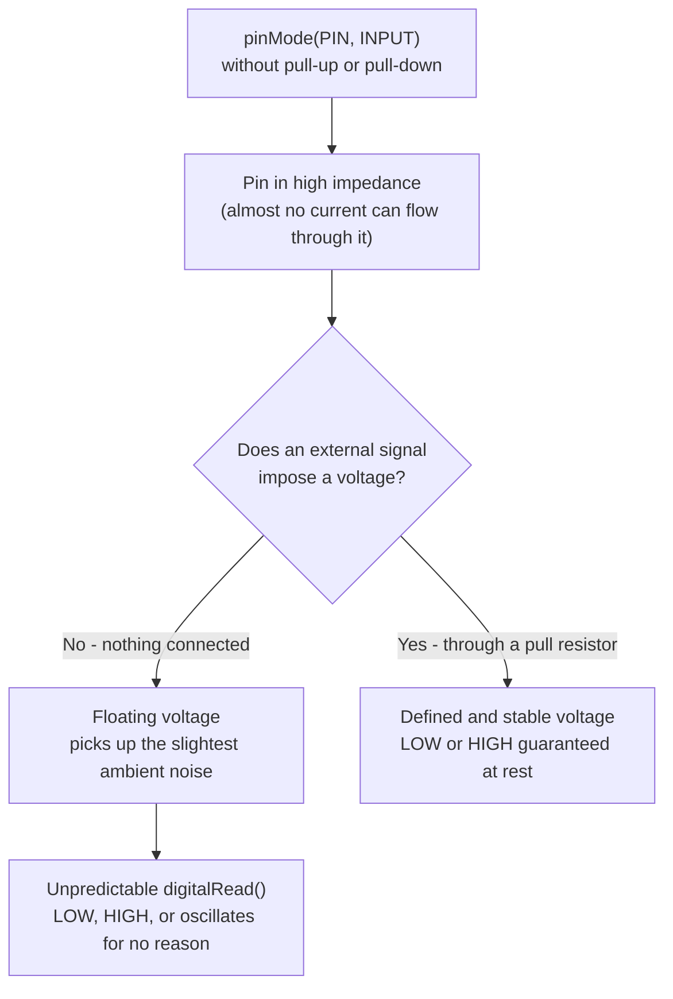
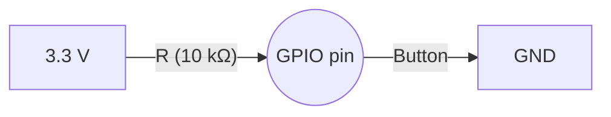
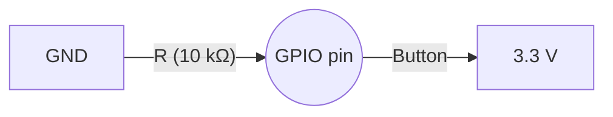

## Touching the real world

So far, the microcontroller was thinking on its own. But a chip that only computes is useless: to be useful, it must **act** on the world (turn on an LED, spin a motor) and **sense** it (know whether you are pressing a button).

This contact with the physical world goes through the chip's **pins**, the small metal legs lined up along the edges of the board. The most versatile ones are called **GPIO**, and this concept is devoted to the simplest of them: those that only handle **all-or-nothing**, like a wall switch flipped between on and off. No half-measures, and that is precisely what makes digital so reliable.

**By the end of this concept, you will know how to:**

- configure a pin as an input or an output;
- avoid the floating state with a pull-up or a pull-down;
- read a button cleanly (debouncing) and spot the pins to avoid.

## What is digital?

The digital world only knows **two states**: `0` or `1`, `LOW` or `HIGH`, `0 V` or `3.3 V`. Any intermediate signal is interpreted according to a threshold.

On the ESP32-S3 (**3.3 V** logic):

| State | Voltage | Arduino |
|---|---|---|
| LOW | 0 V | `0` / `false` / `LOW` |
| HIGH | 3.3 V | `1` / `true` / `HIGH` |

### The ESP32-S3's logic thresholds

As an input, a pin does not switch exactly at 0 V or 3.3 V: it compares the voltage read with two **thresholds**, and between the two the state is undefined. The ESP32-S3 datasheet (powered at 3.3 V) gives:

| Threshold | Value | Interpretation |
|---|---|---|
| $V_{IL}$ (max LOW input) | ≤ 0.25 × VDD ≈ **0.8 V** | Below: read as `LOW` |
| Undefined zone | ~0.8 V to ~2.5 V | To avoid: unpredictable reading |
| $V_{IH}$ (min HIGH input) | ≥ 0.75 × VDD ≈ **2.5 V** | Above: read as `HIGH` |

Anything below ~0.8 V counts as `0`, anything above ~2.5 V counts as `1`. This grey zone in the middle explains why a **floating** input (see below) gives erratic readings: its voltage drifts in this undefined range.


As an **output**, conversely, the chip guarantees clear levels: close to 0 V for `LOW` ($V_{OL}$) and close to 3.3 V for `HIGH` ($V_{OH}$).

### What the datasheet says

These values come from the **DC Characteristics** table of the [ESP32-S3 datasheet](https://www.espressif.com/sites/default/files/documentation/esp32-s3_datasheet_en.pdf) (VDD = 3.3 V, 25 °C). This is where you find the answer to most questions about a pin:

| Symbol | What it is | Value |
|---|---|---|
| $V_{IH}$ | Minimum voltage read as `HIGH` | 0.75 × VDD |
| $V_{IL}$ | Maximum voltage read as `LOW` | 0.25 × VDD |
| $V_{OH}$ | Minimum guaranteed voltage on a `HIGH` output | 0.8 × VDD |
| $V_{OL}$ | Maximum guaranteed voltage on a `LOW` output | 0.1 × VDD |
| $I_{OH}$ | Current a `HIGH` output can supply | 40 mA |
| $R_{PU}$, $R_{PD}$ | Internal pull resistors | 45 kΩ |

Just before, the **absolute maximum ratings** table gives the limit never to exceed: 3.6 V on a pin. Beyond that, the chip can be destroyed; between 3.3 V and 3.6 V, it survives but is no longer within its normal operating conditions.

Example: a sensor that signals a `HIGH` with 2.2 V is **not** read reliably, since 2.2 V is below $V_{IH}$ ≈ 2.5 V.



## GPIO: General Purpose Input/Output

Each GPIO pin (*General Purpose Input/Output*) can be configured as an **input** or an **output** by software.

```cpp
pinMode(LED_PIN, OUTPUT);   // pin configured as an output
pinMode(BTN_PIN, INPUT);    // pin configured as an input
```

### Output: driving an LED

An output pin can **source or sink** current (supply it or absorb it) to drive a component.

```cpp
digitalWrite(LED_PIN, HIGH);  // LED on (3.3 V on the pin)
digitalWrite(LED_PIN, LOW);   // LED off (0 V)
```

**Maximum current per ESP32-S3 pin: ~40 mA.** In practice, limit it to 12 mA with a series resistor.

Calculating the resistor for a red LED (Vf, the LED's forward voltage, ≈ 2 V; I = 10 mA):

$$R = \frac{V_{supply} - V_f}{I} = \frac{3.3 - 2}{0.01} = 130\ \Omega$$

Standard value: **150 Ω** (E12 series).

<div class="box">
  <p class="title is-5">LED series resistor calculator</p>
  <div class="field">
    <label class="label">Supply voltage V<sub>supply</sub> (V)</label>
    <input class="input" type="number" id="led-valim" value="3.3" step="0.1">
  </div>
  <div class="field">
    <label class="label">LED forward voltage V<sub>f</sub> (V)</label>
    <input class="input" type="number" id="led-vf" value="2" step="0.1">
  </div>
  <div class="field">
    <label class="label">Desired current I (mA)</label>
    <input class="input" type="number" id="led-i" value="10" step="1">
  </div>
  <button class="button is-primary" onclick="calcLedResistor()">Calculate</button>
  <p class="mt-3 is-size-5" id="led-result"><strong>R &asymp; 130 &Omega;</strong> &nbsp; recommended E12 value: <strong>150 &Omega;</strong></p>
</div>

<script>
function calcLedResistor() {
  var valim = parseFloat(document.getElementById('led-valim').value);
  var vf    = parseFloat(document.getElementById('led-vf').value);
  var i     = parseFloat(document.getElementById('led-i').value) / 1000; // mA -> A
  var out   = document.getElementById('led-result');
  if (isNaN(valim) || isNaN(vf) || !(i > 0) || valim <= vf) {
    out.innerHTML = "Check the values: V<sub>supply</sub> must be greater than V<sub>f</sub>, and I positive.";
    return;
  }
  var r = (valim - vf) / i;
  var e12 = [];
  [10,12,15,18,22,27,33,39,47,56,68,82].forEach(function(b){ e12.push(b, b*10, b*100, b*1000); });
  e12.sort(function(a,b){ return a - b; });
  var norm = e12.find(function(v){ return v >= r; }) || e12[e12.length - 1];
  out.innerHTML = "<strong>R &asymp; " + r.toFixed(0) + " &Omega;</strong> &nbsp; recommended E12 value: <strong>" + norm + " &Omega;</strong>";
}
</script>



### Push-pull vs open-drain: two ways of driving an output

By default, `OUTPUT` configures the pin as **push-pull**: two internal transistors make it possible to actively pull the pin `HIGH` or `LOW`. This is the mode used so far.

There is a second mode, **open-drain**: the pin can **only** pull `LOW` (a single transistor, on the ground side). To read or produce a `HIGH`, a pull resistor (internal or external) is needed to "release" the pin towards `HIGH` when nobody pulls it down.


```cpp
pinMode(PIN, OUTPUT_OPEN_DRAIN);  // the pin can only pull towards 0 V
digitalWrite(PIN, LOW);           // actively pulls to 0 V
digitalWrite(PIN, HIGH);          // releases the pin (high impedance)
```

| | Push-pull (`OUTPUT`) | Open-drain (`OUTPUT_OPEN_DRAIN`) |
|---|---|---|
| Can pull HIGH | Yes, actively | No, needs a pull-up |
| Can pull LOW | Yes, actively | Yes, actively |
| Typical use | LED, motor, classic digital output | Shared bus (I2C), interfacing with a different logic level |



### Input: reading a button

An input pin measures the voltage level present on the pin.

```cpp
int state = digitalRead(BTN_PIN);  // returns HIGH or LOW
```

## Pull-up, pull-down & floating state

### The floating state problem

An input pin connected to nothing is in a **floating state**: its voltage is undefined, it can read `HIGH` or `LOW` randomly depending on electromagnetic interference.



A pin in [**high impedance**](https://en.wikipedia.org/wiki/High_impedance) has a **very high** input resistance (several megohms): it absorbs almost no current, so nothing brings it back to 0 V or 3.3 V. The slightest surrounding electromagnetic interference (a nearby cable, the 50 Hz mains, your own hand coming closer) is then enough to shift its voltage and flip its reading. Hence the term "floating": nothing fixes its voltage at a precise value.

### The solution: a pull resistor

A pull resistor forces the pin to a defined level when no signal is applied.

#### Pull-up: HIGH at rest

The resistor connects the pin to **+3.3 V**. At rest, the pin reads `HIGH`. When the button is pressed (connection to GND), it goes `LOW`.



#### Pull-down: LOW at rest

The resistor connects the pin to **GND**. At rest, the pin reads `LOW`. When the button is pressed (connection to +3.3 V), it goes `HIGH`.



### The ESP32-S3's internal pull-up

The ESP32-S3 has **internal** pull-up (and pull-down) resistors, which can be enabled by software: no need for an external resistor in most cases.

```cpp
pinMode(BTN_PIN, INPUT_PULLUP);    // internal pull-up enabled (~45 kΩ)
// or
pinMode(BTN_PIN, INPUT_PULLDOWN);  // internal pull-down enabled
```

With `INPUT_PULLUP`: the button must connect the pin to **GND** to be detected (inverted logic: `LOW` = pressed).

## Reading a button reliably: debouncing

When you press a mechanical button, the contact is not made cleanly: the metal blades **bounce** for a few milliseconds, generating a burst of `HIGH`/`LOW` before settling. A naive `digitalRead()` then sees *several* presses where you made only one.

The simplest fix is in software: after a change of state, readings are **ignored** for a short delay (20 to 50 ms), using `millis()` (the number of milliseconds elapsed since start-up), the time it takes for the contact to settle.


```cpp
const unsigned long DEBOUNCE = 30;   // ms
int lastState = HIGH;
unsigned long lastChange = 0;

void loop() {
  int state = digitalRead(BTN_PIN);     // INPUT_PULLUP: LOW = pressed

  if (state != lastState) {
    lastChange = millis();              // the signal has just moved
    lastState = state;
  }

  if (millis() - lastChange > DEBOUNCE && state == LOW) {
    // button steadily pressed for 30 ms
    // (true at every pass as long as the button stays pressed)
  }
}
```



## Reacting without polling: the interrupt

Polling a button at every pass of `loop()` works, but can **miss** a press if the loop is busy elsewhere. An **interrupt** runs a small function as soon as the pin changes, without waiting (see [Architecture of a microcontroller](/workshops/microcontroleur/concepts/architecture-microcontroleur/)).

```cpp
volatile bool pressed = false;

void IRAM_ATTR onPress() { pressed = true; }   // ISR: as short as possible

void setup() {
  pinMode(BTN_PIN, INPUT_PULLUP);
  attachInterrupt(digitalPinToInterrupt(BTN_PIN), onPress, FALLING);
}
```

The ISR (*Interrupt Service Routine*) just raises a flag; the real processing (and the debouncing) is then done calmly in `loop()`.

## GPIO matrix: a pin is not always a simple GPIO

Beyond `digitalRead()`/`digitalWrite()`, a pin can be handled by a peripheral: UART, SPI, I2C, PWM (LEDC)... On many microcontrollers, each function is hard-wired to specific pins (fixed "alternate function").

The ESP32-S3 is more flexible: an internal **GPIO matrix** makes it possible to route almost any digital peripheral signal to almost any pin, by software.


```cpp
Serial1.begin(115200, SERIAL_8N1, D2, D3);  // UART1 routed to the XIAO's D2 (RX) / D3 (TX)
// another pair of pins would work just as well
```

If no peripheral fits, you can still drive the pins by hand, bit after bit, to emulate a bus: this is *bit-banging*, slower and more demanding in processor time (see [Communication buses](/workshops/microcontroleur/concepts/bus-communication/#when-the-right-bus-is-missing)).



## Not all pins are equal

Despite the flexibility of the GPIO matrix, some pins have a **reserved role** at boot or in the internal operation of the ESP32-S3. Using them as ordinary GPIO can prevent the board from booting, being flashed or communicating over USB.

| Pins | Reserved role | Precaution |
|---|---|---|
| **GPIO 0, 3, 45, 46** | *Strapping*: read at reset to choose the boot mode | Avoid, or do not force any level on them at boot |
| **GPIO 19, 20** | Native USB (D− / D+) | Avoid if you use USB (flashing, serial port) |
| **GPIO 43, 44** | Default UART0 (TX / RX of the serial monitor) | Free if the serial port is not used, otherwise avoid |
| **GPIO 26–32** | Connected to the internal SPI Flash | **Never use** |
| **GPIO 33–37** | Used by the PSRAM on "octal" modules | Avoid on modules fitted with PSRAM |



On the course's [XIAO ESP32S3](/docs/references/hardware/xiao-esp32s3/), this sorting has already been done by the board: only 11 pins are broken out (D0 to D10) and none of the critical pins is among them. GPIO0 is connected to the BOOT button, GPIO19/20 to the USB-C connector, the Flash and the PSRAM stay internal. Two special cases:

- **D2 (GPIO3)** is a *strapping* pin, but it only selects the JTAG source, and only if the chip's eFuses have been programmed to do so: it is used like an ordinary pin.
- **D6/D7 (GPIO43/44)** carry UART0, but the XIAO's serial monitor goes through native USB: these two pins remain usable. At boot, however, the chip **sends** its boot messages on D6: a button connecting it to GND must go through a series resistor (1 kΩ on the console board) so as not to short-circuit this output.

## Maximum current and pin protection

| Limit | ESP32-S3 value |
|---|---|
| Max current per pin | 40 mA (recommended: ≤ 12 mA) |
| Max input voltage | **3.3 V** (3.6 V absolute maximum) |



## Driving a power load: the MOSFET

A motor, an LED strip or a relay need far more than a pin's 12 mA. The pin therefore does not supply the power: it **controls** a transistor, which supplies it from a separate power supply.


This is the **low-side** circuit: an N-channel MOSFET cuts or restores the load's ground.

- The pin imposes a **voltage** on the gate, without delivering current (apart from a brief spike at each switch, limited by the 100 Ω resistor).
- The **10 kΩ** resistor between gate and source keeps the MOSFET off while the microcontroller boots and its pin floats.
- The **grounds** of the board and of the load's power supply are connected, otherwise the gate voltage has no reference.
- With `analogWrite()` on the gate, PWM sets the motor's speed (see [ADC & PWM](/workshops/microcontroleur/concepts/adc-pwm/)).

### Choosing the MOSFET

| Parameter | What it is | Target |
|---|---|---|
| $V_{GS(th)}$ | Gate voltage at which it starts conducting | Well below 3.3 V |
| $R_{DS(on)}$ | Resistance once on: it heats up | Given at 2.5 V, a few tens of mΩ |
| $I_D$ | Maximum current | At least 2 × the load's |
| $V_{DS}$ | Maximum voltage | Above the load's supply |

With 3.3 V on the gate, you need a **"logic level"** MOSFET, whose datasheet gives $R_{DS(on)}$ at 2.5 V: AO3400 (SMD) or IRLB8721 (through-hole), for example. A classic IRF540 expects 10 V on its gate: at 3.3 V, it barely conducts and heats up.

### The flyback diode

A coil (motor, relay, electromagnet) opposes any sudden change in current. When the MOSFET switches off, it produces a spike of several tens of volts that destroys the transistor. The fix is a **diode** placed across the load, cathode on the + side: it lets the current die out by circulating in the coil.



## Connecting a 5 V component: level shifting

The ESP32-S3's GPIO use 3.3 V logic: applying 5 V to an input can damage the chip (see the warning above). To talk to a 5 V component, you need to **shift the level**:

- **5 V → 3.3 V input** (reading a 5 V signal): a simple **voltage divider** made of two resistors (e.g. 10 kΩ + 20 kΩ) brings 5 V down to ~3.3 V.
- **Bus or bidirectional (I2C, SPI…)**: use a dedicated **level shifter**, which translates cleanly in both directions.
- **3.3 V → 5 V output**: many 5 V components already recognise 3.3 V as a valid `HIGH`; otherwise, a level shifter is required.




## Quick quiz

**1. An unconnected input reads random values. How do you fix it?**

<details><summary>Show the answer</summary>With a pull resistor (pull-up or pull-down), internal (`INPUT_PULLUP`) or external, which sets a defined level at rest.</details>

**2. With `INPUT_PULLUP`, what level is read when the button is pressed?**

<details><summary>Show the answer</summary>`LOW` (inverted logic): the button connects the pin to GND.</details>

**3. Why does a `digitalRead()` sometimes count several presses for a single one?**

<details><summary>Show the answer</summary>Because of the mechanical bounce of the contact; it is filtered with software debouncing (using `millis()`).</details>

## Going further

- [The modules of the kit](/workshops/microcontroleur/tutorials/entrees-boutons-joystick/): a debounce that reports each press only once

## Summary

- GPIO = pin configurable as an input (`INPUT`) or an output (`OUTPUT`).
- Output: produces `0 V` (LOW) or `3.3 V` (HIGH); ~40 mA absolute maximum, 12 mA at most in practice.
- A **push-pull** output (default) actively pulls HIGH and LOW; **open-drain** only pulls LOW (useful for a shared bus like I2C).
- Input without a pull resistor → **floating state** (random readings).
- `INPUT_PULLUP` / `INPUT_PULLDOWN` enable the ESP32-S3's internal resistor.
- With a pull-up: button connected between GPIO and GND → `LOW` when pressed.
- The **GPIO matrix** routes the digital peripherals (UART, SPI, I2C, PWM) to almost any pin, except the ADC, which is hard-wired.
- A mechanical button **bounces**: filter it with software debouncing (`millis()`) so as not to count several presses.
- Some pins are **reserved** (strapping, SPI Flash, USB): check the board's pinout before wiring.
- An **interrupt** (`attachInterrupt`) reacts to a pin change without polling; the ISR stays minimal.
- A power load is driven by a low-side **"logic level" MOSFET**, with a **flyback diode** if it is inductive.
- To connect 5 V: **voltage divider** (input) or **level shifter** (bus), never 5 V directly on a GPIO.
