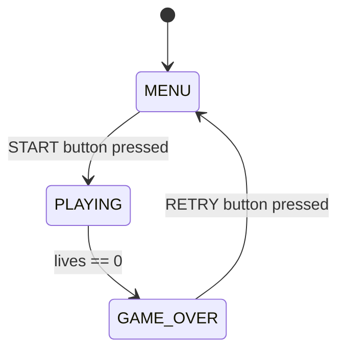
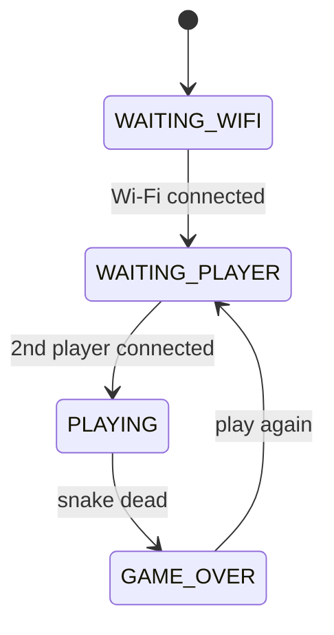
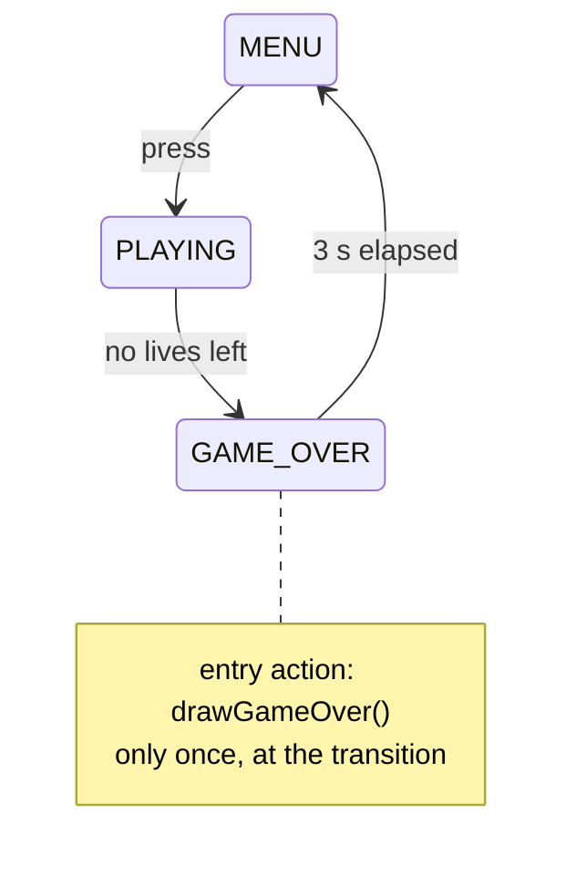
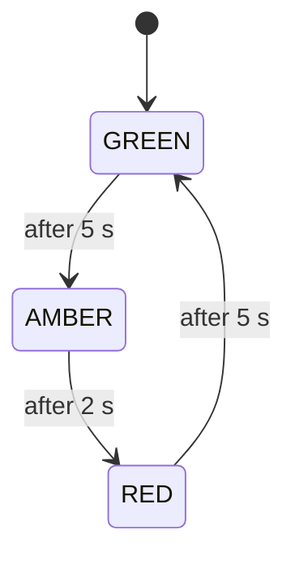

## When the code turns into spaghetti

Your program is growing. A blinking LED fits in four lines; but a game has several stages in its life: a welcome menu, a game in progress, a game over screen. Handling these phases "by hand" quickly turns the code into spaghetti: variables everywhere, tangled `if/else`, and bugs that are hard to track down.

The **finite state machine** (FSM) is the classic embedded tool for keeping a clear head. Let's start by looking at what happens without it.

**By the end of this concept, you will know how to:**

- recognise when a finite state machine is useful;
- implement it with an `enum` and a `switch`;
- handle timed transitions and entry actions.

## The problem without an FSM

A simple embedded program runs its actions line after line. As soon as several **phases** need to be handled (welcome menu → game in progress → game over), the code fills up with nested `if/else` and accumulating boolean variables:

```cpp
bool inGame = false;
bool gameOver = false;
bool menuActive = true;
// ...and it gets worse with every new phase
```

The **finite state machine** (FSM) is the classic embedded solution to this problem.

## How an FSM works

An FSM is defined by:

- a finite set of **states** (e.g. `MENU`, `PLAYING`, `GAME_OVER`)
- **transitions** between states triggered by events (button pressed, score reached…)
- a single **active state** at a time



### The transition table

An FSM can also be read as a **table**: for each state (rows) and each event (columns), what is the next state? It is a rigorous way of checking that no case has been forgotten.

| State \ Event | START | lives == 0 | RETRY |
|---|---|---|---|
| **MENU** | PLAYING | - | - |
| **PLAYING** | - | GAME_OVER | - |
| **GAME_OVER** | - | - | MENU |

A "-" cell means "the event is ignored in this state". This table then translates directly into a `switch/case`.

## Implementation with an `enum` + `switch`

### Step 1: Declare the states

```cpp
enum GameState {
  MENU,
  PLAYING,
  GAME_OVER
};

GameState state = MENU;  // initial state
```

### Step 2: The game loop with `switch`

```cpp
void loop() {
  readInputs();         // read buttons / joystick

  switch (state) {

    case MENU:
      if (startPressed()) {
        initGame();
        drawGame();           // screen drawn once, at the transition
        state = PLAYING;      // transition
      }
      break;

    case PLAYING:
      updateGame();
      redrawWhatMoved();
      if (playerLives == 0) {
        drawGameOver();
        state = GAME_OVER;    // transition
      }
      break;

    case GAME_OVER:
      if (retryPressed()) {
        drawMenu();
        state = MENU;         // transition
      }
      break;
  }
}
```

Each `case` handles **a single state**: what it does at each pass, and which state it can switch to. The welcome screen is drawn a first time in `setup()`.

Two rules avoid the most frequent bugs:

- **Draw a full screen only once**, at the moment of the transition. Calling `drawMenu()` at every pass of `loop()` would erase and rewrite the screen dozens of times per second: it would flicker.
- **Trigger a transition on a press, not on a held button.** `startPressed()` and `retryPressed()` must return `true` **only once per press** (edge detection, see [GPIO & the digital world](/workshops/microcontroleur/concepts/gpio-monde-numerique/)). With a plain `digitalRead() == LOW`, a slightly long press on the GAME_OVER screen would go back to MENU and then immediately start a new game.



## Why it is fundamental in embedded systems

### A single task for the whole game

On a PC, each screen of an application can have its own window and its own *threads* (tasks running in parallel), orchestrated by the operating system. On the microcontroller, nothing of the kind for your code: on the ESP32-S3, the FreeRTOS kernel does run Wi-Fi and USB alongside, but **your whole game lives in a single task**, `loop()`, which runs in an infinite loop. A `delay()` there freezes the whole game, and every decision about what to do at each moment goes through your code.

The FSM plays this switching role: at each pass of `loop()`, it decides which "mode" is active and what needs to be run.

### The FSM prepares the network project

In the multiplayer Snake project, the game's FSM will take on extra **network states**:



The `switch(state)` structure is the same: you just add states.

## FSM vs boolean variables

| Approach | Readability | Extensibility | Typical bugs |
|---|---|---|---|
| Booleans `inGame`, `gameOver`… | Low (implicit states) | Hard | Contradictory states (`inGame && gameOver == true`) |
| **FSM with `enum`** | High (explicit states) | Easy (add a `case`) | No contradictory state possible |

## Going further: entry actions and timed transitions

Two refinements make an FSM more expressive (assume a global variable `unsigned long stateEntry;` that stores the moment the current state was entered).

**Entry action (*onEnter*).** Some things must only be done *once*, when switching into a state (reset the score, draw a screen). So they are run **at the moment of the transition**, not at each pass of the loop:

```cpp
void goTo(GameState next) {
  state = next;
  stateEntry = millis();                      // time the state was entered
  if (next == PLAYING)   initGame();          // entry action
  if (next == GAME_OVER) drawGameOver();      // run only once
}
```

**Timed transition.** A state can switch on its own after a certain time, like a "GAME OVER" screen that goes back to the menu after 3 seconds. The FSM is combined with `millis()` (see [From hardware to software](/workshops/microcontroleur/concepts/du-materiel-au-logiciel/)): the current time is compared with the time the state was entered.



```cpp
case GAME_OVER:
  if (millis() - stateEntry > 3000) {  // 3 s elapsed
    goTo(MENU);
  }
  break;
```

## A complete example: the traffic light

The traffic light is the FSM par excellence: three states, purely **timed** transitions, no button. It brings together everything we have just seen in a complete, non-blocking program.



```cpp
enum Light { GREEN, AMBER, RED };
Light state = GREEN;
unsigned long stateEntry = 0;

void goTo(Light next) {
  state = next;
  stateEntry = millis();
  // entry action: turn on the right LED only once
}

void loop() {
  unsigned long elapsed = millis() - stateEntry;

  switch (state) {
    case GREEN: if (elapsed > 5000) goTo(AMBER); break;
    case AMBER: if (elapsed > 2000) goTo(RED);   break;
    case RED:   if (elapsed > 5000) goTo(GREEN); break;
  }
}
```

The `loop()` never blocks (no `delay()`): the program could therefore, at the same time, read a pedestrian button or animate a display. That is the whole point of coupling an FSM with `millis()`.

## Exercise: draw the Pong FSM

Before coding Lab 4, draw the Pong FSM on paper:

- What are the states? (`MENU`, `PLAYING`, `PAUSE`?, `GAME_OVER`)
- Which events trigger the transitions?
- What is the initial state?

Then compare your FSM with the rest of the group's: design differences are often revealing.

## Going further

- [Pong on the console](/workshops/microcontroleur/tutorials/collisions-fsm-pong/): putting the FSM to work in the Pong (where the states are called `Title`, `Playing` and `GameOver`)

## Summary

- An FSM = states + transitions + a single active state at a time.
- Arduino implementation: an `enum` for the states, `switch(state)` in `loop()`.
- Each `case` handles the display, the logic and the transitions of its state.
- The FSM eliminates incompatible booleans and makes the code extensible.
- An FSM can also be represented by a **transition table** (state × event → next state), useful for not forgetting any case.
- An FSM is combined with `millis()` for **timed transitions** (e.g. the traffic light), and with **entry actions** run only once per state change.
- In this project: game FSM (Lab 4) → extended to network states (Project).
