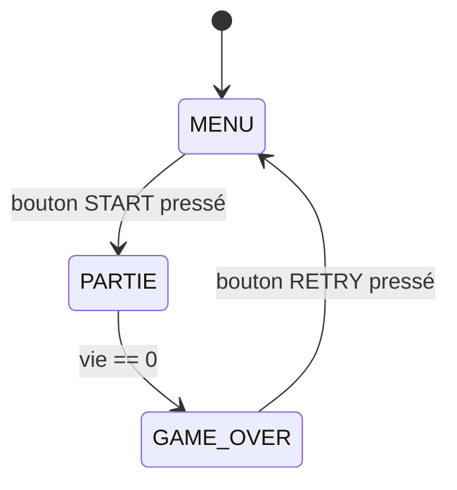
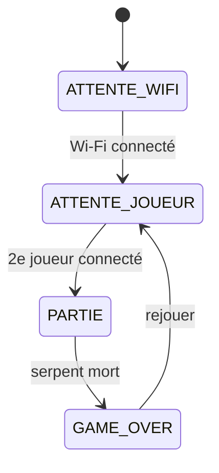
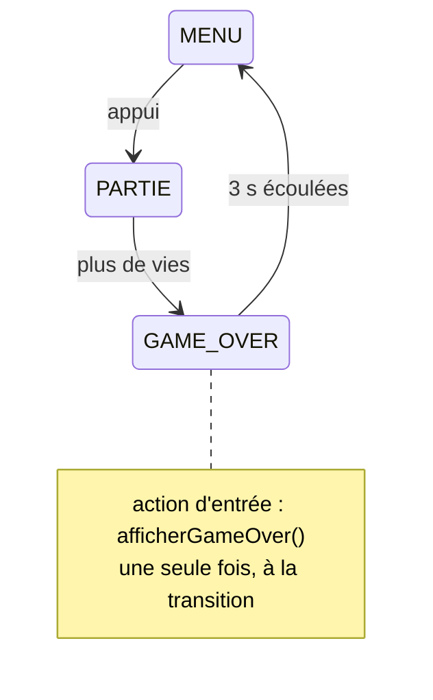
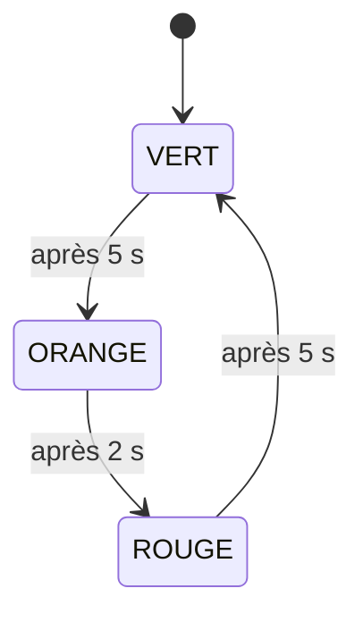
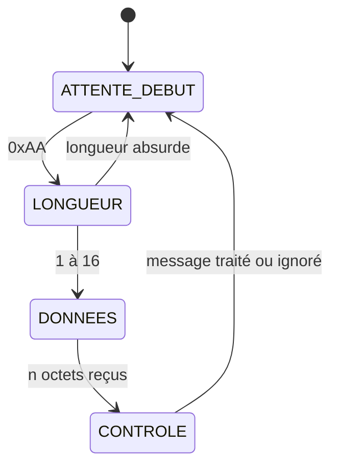

## Quand le code devient un plat de spaghettis

Ton programme grossit. Une LED qui clignote tient en quatre lignes ; mais un jeu, lui, a plusieurs moments de vie : un menu d'accueil, une partie en cours, un écran de fin. Gérer ces phases « à la main » transforme vite le code en plat de spaghettis : des variables un peu partout, des `if/else` qui s'emmêlent, et des bugs difficiles à traquer.

La **machine à états finis** (FSM) est l'outil classique de l'embarqué pour garder les idées claires. Commençons par voir ce qui se passe sans elle.

**À la fin de ce concept, tu sauras :**

- reconnaître quand une machine à états finis est utile ;
- l'implémenter avec un `enum` et un `switch` ;
- gérer des transitions temporisées et des actions d'entrée.

## Le problème sans FSM

Un programme embarqué simple enchaîne les actions ligne par ligne. Dès qu'il faut gérer plusieurs **phases** (menu d'accueil → partie en cours → game over), le code se remplit de `if/else` imbriqués et de variables booléennes qui s'accumulent :

```cpp
bool enPartie = false;
bool gameOver = false;
bool menuActif = true;
// ...et ça empire à chaque nouvelle phase
```

La **machine à états finis** (FSM, *Finite State Machine*) est la solution classique de l'embarqué pour ce problème.

## Principe d'une FSM

Une FSM est définie par :

- un ensemble fini d'**états** (ex : `MENU`, `PARTIE`, `GAME_OVER`)
- des **transitions** entre états déclenchées par des événements (bouton pressé, score atteint…)
- un seul **état actif** à la fois



### La table de transitions

Une FSM peut aussi se lire comme un **tableau** : pour chaque état (lignes) et chaque événement (colonnes), quel est l'état suivant ? C'est une façon rigoureuse de vérifier qu'aucun cas n'est oublié.

| État \ Événement | START | vie == 0 | RETRY |
|---|---|---|---|
| **MENU** | PARTIE | - | - |
| **PARTIE** | - | GAME_OVER | - |
| **GAME_OVER** | - | - | MENU |

Une case « - » signifie « l'événement est ignoré dans cet état ». Ce tableau se traduit ensuite directement en `switch/case`.

## Implémentation avec un `enum` + `switch`

### Étape 1 : Déclarer les états

```cpp
enum EtatJeu {
  MENU,
  PARTIE,
  GAME_OVER
};

EtatJeu etat = MENU;  // état initial
```

### Étape 2 : La game loop avec `switch`

```cpp
void loop() {
  lireEntrees();        // lire boutons / joystick

  switch (etat) {

    case MENU:
      if (appuiStart()) {
        initialiserPartie();
        afficherJeu();        // écran dessiné une fois, à la transition
        etat = PARTIE;        // transition
      }
      break;

    case PARTIE:
      mettreAJourJeu();
      redessinerCeQuiABouge();
      if (vieJoueur == 0) {
        afficherGameOver();
        etat = GAME_OVER;     // transition
      }
      break;

    case GAME_OVER:
      if (appuiRetry()) {
        afficherMenu();
        etat = MENU;          // transition
      }
      break;
  }
}
```

Chaque `case` gère **un seul état** : ce qu'il fait à chaque tour, et vers quel état il peut basculer. L'écran d'accueil est dessiné une première fois dans `setup()`.

Deux règles évitent les bugs les plus fréquents :

- **Dessiner un écran complet une seule fois**, au moment de la transition. Appeler `afficherMenu()` à chaque tour de `loop()` effacerait et réécrirait l'écran des dizaines de fois par seconde : il clignoterait.
- **Déclencher une transition sur un appui, pas sur un bouton enfoncé.** `appuiStart()` et `appuiRetry()` ne doivent renvoyer `true` qu'**une seule fois par appui** (détection de front, voir [GPIO & monde numérique](/workshops/microcontroleur/concepts/gpio-monde-numerique/)). Avec un simple `digitalRead() == LOW`, un appui un peu long sur l'écran GAME_OVER renverrait au MENU puis lancerait aussitôt une nouvelle PARTIE.



## Pourquoi c'est fondamental en embarqué

### Une seule tâche pour tout le jeu

Sur un PC, chaque écran d'une application peut avoir sa fenêtre et ses propres *threads* (tâches exécutées en parallèle), orchestrés par le système d'exploitation. Sur le microcontrôleur, rien de tel pour ton code : sur l'ESP32-S3, le noyau FreeRTOS fait bien tourner le Wi-Fi et l'USB à côté, mais **tout ton jeu vit dans une seule tâche**, `loop()`, qui s'exécute en boucle infinie. Un `delay()` y fige tout le jeu, et toutes les décisions sur ce qu'il faut faire à chaque instant passent par ton code.

La FSM joue ce rôle d'aiguillage : à chaque tour de `loop()`, elle décide quel « mode » est actif et ce qu'il faut exécuter.

### La FSM prépare le projet réseau

Dans le projet Snake multijoueur, la FSM du jeu accueillera des **états réseau** supplémentaires :



La structure `switch(etat)` est la même : on ajoute juste des états.

## FSM vs variables booléennes

| Approche | Lisibilité | Extensibilité | Bugs typiques |
|---|---|---|---|
| Booléens `enPartie`, `gameOver`… | Faible (états implicites) | Difficile | États contradictoires (`enPartie && gameOver == true`) |
| **FSM avec `enum`** | Élevée (états explicites) | Facile (ajouter un `case`) | Aucun état contradictoire possible |

## Aller plus loin : actions d'entrée et transitions temporisées

Deux raffinements rendent une FSM plus expressive (on suppose une variable globale `unsigned long entreeEtat;` qui mémorise l'instant d'entrée dans l'état courant).

**Action d'entrée (*onEnter*).** Certaines choses ne doivent se faire qu'*une fois*, au moment où l'on bascule dans un état (réinitialiser le score, afficher un écran). On les exécute donc **au moment de la transition**, pas à chaque tour de boucle :

```cpp
void allerVers(EtatJeu nouvel) {
  etat = nouvel;
  entreeEtat = millis();                        // date d'entrée dans l'état
  if (nouvel == PARTIE)    initialiserPartie(); // action d'entrée
  if (nouvel == GAME_OVER) afficherGameOver();  // exécutée une seule fois
}
```

**Transition temporisée.** Un état peut basculer tout seul après un certain temps, comme un écran « GAME OVER » qui revient au menu après 3 secondes. On combine la FSM avec `millis()` (voir [Du matériel au logiciel](/workshops/microcontroleur/concepts/du-materiel-au-logiciel/)) : on compare l'heure actuelle à la date d'entrée dans l'état.



```cpp
case GAME_OVER:
  if (millis() - entreeEtat > 3000) {  // 3 s écoulées
    allerVers(MENU);
  }
  break;
```

## Un exemple complet : le feu tricolore

Le feu de circulation est la FSM par excellence : trois états, des transitions purement **temporisées**, aucun bouton. Il rassemble tout ce qu'on vient de voir dans un programme complet et non bloquant.



```cpp
enum Feu { VERT, ORANGE, ROUGE };
Feu etat = VERT;
unsigned long entreeEtat = 0;

void allerVers(Feu nouvel) {
  etat = nouvel;
  entreeEtat = millis();
  // action d'entrée : allumer la bonne LED une seule fois
}

void loop() {
  unsigned long ecoule = millis() - entreeEtat;

  switch (etat) {
    case VERT:   if (ecoule > 5000) allerVers(ORANGE); break;
    case ORANGE: if (ecoule > 2000) allerVers(ROUGE);  break;
    case ROUGE:  if (ecoule > 5000) allerVers(VERT);   break;
  }
}
```

La `loop()` ne bloque jamais (aucun `delay()`) : le programme pourrait donc, en même temps, lire un bouton piéton ou animer un afficheur. C'est tout l'intérêt de coupler FSM et `millis()`.

## Un autre exemple : recevoir des messages

Une FSM ne sert pas qu'à organiser les phases d'un jeu. Elle est aussi l'outil naturel pour **lire un flux de données**, octet par octet : c'est ce qu'on appelle un **parseur**.

### Le problème : des octets, pas des messages

Sur une liaison UART (voir [Les bus de communication](/workshops/microcontroleur/concepts/bus-communication/)), le récepteur reçoit une suite d'octets, sans aucune séparation entre les messages. Rien ne lui dit où un message commence : il a pu être allumé en cours de transmission, ou un octet a pu se perdre en route. S'il se trompe d'un seul octet, il lit tout le reste de travers.

La solution est de s'entendre sur un **format de trame**, comme celui-ci :


| Champ | Taille | Rôle |
|---|---|---|
| **Début** | 1 octet, toujours `0xAA` | Repère reconnaissable : « un message commence ici » |
| **Longueur** | 1 octet | Nombre d'octets de données qui suivent |
| **Données** | autant d'octets que la longueur | Le message lui-même (par exemple un code de commande et sa valeur) |
| **Contrôle** | 1 octet | Le XOR de la longueur et des données, pour détecter une erreur |

### La somme de contrôle : une parité par colonne

L'octet de contrôle se calcule avec le **XOR** (`^` en C++), le « ou exclusif » : bit à bit, il donne 1 quand les deux bits diffèrent. Appliqué à plusieurs octets, il met un 1 dans chaque colonne qui compte un nombre **impair** de 1 :

```text
LONGUEUR   0x02   0000 0010
DONNÉE 1   0x01   0000 0001
DONNÉE 2   0x02   0000 0010
----------------------------
CONTRÔLE   0x01   0000 0001   (XOR des trois)
```

C'est exactement le **bit de parité** de l'UART, appliqué aux huit colonnes à la fois. Le récepteur refait le calcul sur ce qu'il a reçu et le compare à l'octet de contrôle : si un bit a été inversé en route, sa colonne ne tombe plus juste et le message est rejeté. Comme la parité, ce contrôle a ses limites (deux erreurs dans la même colonne se compensent) ; les protocoles exigeants utilisent un **CRC**, plus robuste, sur le même principe.

### La FSM du récepteur

Chaque octet reçu est un **événement**, et le récepteur sait toujours ce qu'il attend : c'est une machine à états.



| État | Ce qu'il fait de l'octet reçu | État suivant |
|---|---|---|
| **ATTENTE_DEBUT** | Le compare à `0xAA`, ignore tout le reste | LONGUEUR si `0xAA` |
| **LONGUEUR** | Le garde : c'est le nombre d'octets de données à recevoir | DONNEES si 1 à 16, sinon ATTENTE_DEBUT |
| **DONNEES** | Le range dans le tampon et l'ajoute au contrôle | CONTROLE au dernier octet |
| **CONTROLE** | Le compare au contrôle calculé : message traité si juste, ignoré sinon | ATTENTE_DEBUT |

Au moindre doute, le récepteur retourne à `ATTENTE_DEBUT` et se recale sur le prochain `0xAA`. Un `0xAA` peut très bien apparaître au milieu des données : si le récepteur le prend pour un début, la longueur ou le contrôle qui suivent ne tiendront pas, et il se recalera un peu plus loin.

### Le code

```cpp
enum EtatRx { ATTENTE_DEBUT, LONGUEUR, DONNEES, CONTROLE };
EtatRx etatRx = ATTENTE_DEBUT;

uint8_t tampon[16];               // les données du message en cours
uint8_t longueur, recus, somme;
unsigned long dernierOctet = 0;   // date du dernier octet reçu

void recevoirOctet(uint8_t o) {
  switch (etatRx) {
    case ATTENTE_DEBUT:
      if (o == 0xAA) etatRx = LONGUEUR;   // tout le reste est ignoré
      break;
    case LONGUEUR:
      if (o == 0 || o > sizeof(tampon)) { // longueur absurde : faux départ
        etatRx = ATTENTE_DEBUT;
        break;
      }
      longueur = o;
      recus = 0;
      somme = o;                          // la longueur compte dans le contrôle
      etatRx = DONNEES;
      break;
    case DONNEES:
      tampon[recus++] = o;
      somme ^= o;                         // la parité, colonne par colonne
      if (recus == longueur) etatRx = CONTROLE;
      break;
    case CONTROLE:
      if (o == somme) traiterMessage();   // message sûr : on l'applique
      etatRx = ATTENTE_DEBUT;             // juste ou faux, place au suivant
      break;
  }
}

void loop() {
  while (Serial1.available()) {           // seulement les octets déjà arrivés
    recevoirOctet(Serial1.read());
    dernierOctet = millis();
  }
  // message coupé en route : on abandonne au bout de 50 ms de silence
  if (etatRx != ATTENTE_DEBUT && millis() - dernierOctet > 50) {
    etatRx = ATTENTE_DEBUT;
  }
  // ... puis la game loop habituelle
}
```

`traiterMessage()` lit `tampon` et `longueur`, et applique la commande reçue. Trois points à retenir :

- la `loop()` ne **bloque jamais** : elle ne lit que les octets déjà arrivés, et un message peut s'étaler sur plusieurs tours de boucle. C'est la FSM qui se souvient d'où elle en était ;
- le délai de 50 ms est une **transition temporisée**, comme celles du feu tricolore : sans lui, un message coupé laisserait le récepteur attendre indéfiniment des données qui ne viendront pas ;
- un message faux n'est **jamais appliqué**.

### Que faire d'un message abîmé ?

Deux stratégies, selon ce que contient le message :

| Stratégie | Ce que fait le récepteur | Pour quels messages |
|---|---|---|
| **Ignorer** | Rien : le message suivant arrive bientôt | Envoyés en continu (position d'un joystick) |
| **Redemander** | Il répond NAK (`0x15`), et l'émetteur renvoie le message ; ACK (`0x06`) quand tout va bien | Uniques, qui ne doivent pas se perdre (un score, un ordre) |

ACK et NAK sont des caractères de la table ASCII, prévus pour cela. C'est la même idée que l'ACK et le NACK de l'I2C, mais à l'échelle d'un message entier.

### Et dans le projet ?

Dans le [projet Snake](/workshops/microcontroleur/projet-snake/), le joueur 2 communique par **WebSocket** : là, le découpage est fait pour toi, chaque message arrive entier. Mais le reste de la démarche ne change pas : écrire le **protocole** avant de le coder (quels messages, quel format, quel sens), et faire de la console l'**arbitre**, qui vérifie chaque message avant de l'appliquer et ignore un message invalide sans planter. C'est le réflexe de l'état `CONTROLE` : ne jamais croire ce qui arrive sur le fil.

## Exercice : dessiner la FSM du Pong

Avant de coder le TD4, dessine sur papier la FSM du Pong :

- Quels sont les états ? (`MENU`, `PARTIE`, `PAUSE` ?, `GAME_OVER`)
- Quels événements déclenchent les transitions ?
- Quel est l'état initial ?

Compare ensuite ta FSM avec celle du groupe : les différences de conception sont souvent révélatrices.

## Pour aller plus loin

- [Le Pong sur la console](/workshops/microcontroleur/tutorials/collisions-fsm-pong/) : mettre la FSM en œuvre dans le Pong (où les états s'appellent `Title`, `Playing` et `GameOver`)

## Résumé

- Une FSM = états + transitions + un seul état actif à la fois.
- Implémentation Arduino : `enum` pour les états, `switch(etat)` dans la `loop()`.
- Chaque `case` gère l'affichage, la logique et les transitions de son état.
- La FSM élimine les booléens incompatibles et rend le code extensible.
- Une FSM se représente aussi par une **table de transitions** (état × événement → état suivant), utile pour n'oublier aucun cas.
- Une FSM se combine avec `millis()` pour des **transitions temporisées** (ex. le feu tricolore), et avec des **actions d'entrée** exécutées une seule fois par changement d'état.
- Une FSM sert aussi à **lire un flux d'octets** (parseur) : début, longueur, données, contrôle ; au moindre doute, retour à l'attente du début.
- Dans ce projet : FSM du jeu (TD4) → étendue aux états réseau (Projet).
