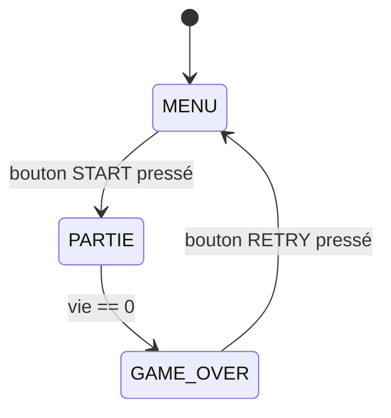
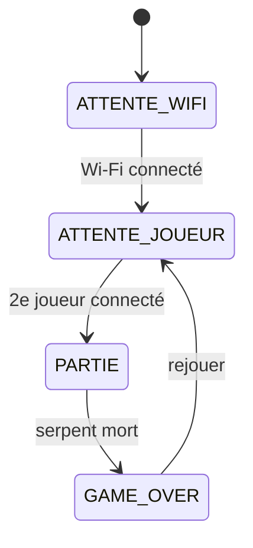
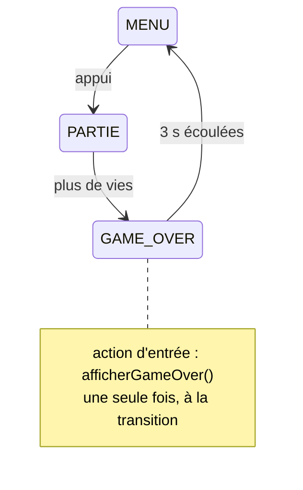
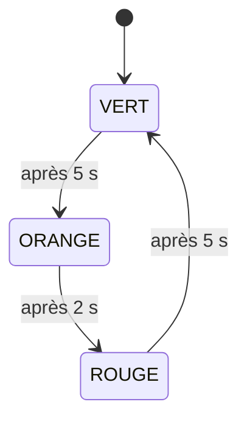
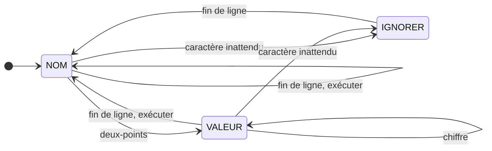

## Quand le code devient un plat de spaghettis

Ton programme grossit. Une LED qui clignote tient en quatre lignes ; mais un jeu, lui, a plusieurs moments de vie : un menu d'accueil, une partie en cours, un écran de fin. Gérer ces phases « à la main » transforme vite le code en plat de spaghettis : des variables un peu partout, des `if/else` qui s'emmêlent, et des bugs difficiles à traquer.

La **machine à états finis** (FSM) est l'outil classique de l'embarqué pour garder les idées claires. Commençons par voir ce qui se passe sans elle.

**À la fin de ce concept, tu sauras :**

- reconnaître quand une machine à états finis est utile ;
- l'implémenter avec un `enum` et un `switch` ;
- gérer des transitions temporisées et des actions d'entrée.

## Le problème sans FSM

Un programme embarqué simple enchaîne les actions ligne par ligne. Dès qu'il faut gérer plusieurs **phases** (menu d'accueil → partie en cours → game over), le code se remplit de `if/else` imbriqués et de variables booléennes qui s'accumulent :

```cpp
bool enPartie = false;
bool gameOver = false;
bool menuActif = true;
// ...et ça empire à chaque nouvelle phase
```

La **machine à états finis** (FSM, *Finite State Machine*) est la solution classique de l'embarqué pour ce problème.

## Principe d'une FSM

Une FSM est définie par :

- un ensemble fini d'**états** (ex : `MENU`, `PARTIE`, `GAME_OVER`)
- des **transitions** entre états déclenchées par des événements (bouton pressé, score atteint…)
- un seul **état actif** à la fois



### La table de transitions

Une FSM peut aussi se lire comme un **tableau** : pour chaque état (lignes) et chaque événement (colonnes), quel est l'état suivant ? C'est une façon rigoureuse de vérifier qu'aucun cas n'est oublié.

| État \ Événement | START | vie == 0 | RETRY |
|---|---|---|---|
| **MENU** | PARTIE | - | - |
| **PARTIE** | - | GAME_OVER | - |
| **GAME_OVER** | - | - | MENU |

Une case « - » signifie « l'événement est ignoré dans cet état ». Ce tableau se traduit ensuite directement en `switch/case`.

## Implémentation avec un `enum` + `switch`

### Étape 1 : Déclarer les états

```cpp
enum EtatJeu {
  MENU,
  PARTIE,
  GAME_OVER
};

EtatJeu etat = MENU;  // état initial
```

### Étape 2 : La game loop avec `switch`

```cpp
void loop() {
  lireEntrees();        // lire boutons / joystick

  switch (etat) {

    case MENU:
      if (appuiStart()) {
        initialiserPartie();
        afficherJeu();        // écran dessiné une fois, à la transition
        etat = PARTIE;        // transition
      }
      break;

    case PARTIE:
      mettreAJourJeu();
      redessinerCeQuiABouge();
      if (vieJoueur == 0) {
        afficherGameOver();
        etat = GAME_OVER;     // transition
      }
      break;

    case GAME_OVER:
      if (appuiRetry()) {
        afficherMenu();
        etat = MENU;          // transition
      }
      break;
  }
}
```

Chaque `case` gère **un seul état** : ce qu'il fait à chaque tour, et vers quel état il peut basculer. L'écran d'accueil est dessiné une première fois dans `setup()`.

Deux règles évitent les bugs les plus fréquents :

- **Dessiner un écran complet une seule fois**, au moment de la transition. Appeler `afficherMenu()` à chaque tour de `loop()` effacerait et réécrirait l'écran des dizaines de fois par seconde : il clignoterait.
- **Déclencher une transition sur un appui, pas sur un bouton enfoncé.** `appuiStart()` et `appuiRetry()` ne doivent renvoyer `true` qu'**une seule fois par appui** (détection de front, voir [GPIO & monde numérique](/workshops/microcontroleur/concepts/gpio-monde-numerique/)). Avec un simple `digitalRead() == LOW`, un appui un peu long sur l'écran GAME_OVER renverrait au MENU puis lancerait aussitôt une nouvelle PARTIE.



## Pourquoi c'est fondamental en embarqué

### Une seule tâche pour tout le jeu

Sur un PC, chaque écran d'une application peut avoir sa fenêtre et ses propres *threads* (tâches exécutées en parallèle), orchestrés par le système d'exploitation. Sur le microcontrôleur, rien de tel pour ton code : sur l'ESP32-S3, le noyau FreeRTOS fait bien tourner le Wi-Fi et l'USB à côté, mais **tout ton jeu vit dans une seule tâche**, `loop()`, qui s'exécute en boucle infinie. Un `delay()` y fige tout le jeu, et toutes les décisions sur ce qu'il faut faire à chaque instant passent par ton code.

La FSM joue ce rôle d'aiguillage : à chaque tour de `loop()`, elle décide quel « mode » est actif et ce qu'il faut exécuter.

### La FSM prépare le projet réseau

Dans le projet Snake multijoueur, la FSM du jeu accueillera des **états réseau** supplémentaires :



La structure `switch(etat)` est la même : on ajoute juste des états.

## FSM vs variables booléennes

| Approche | Lisibilité | Extensibilité | Bugs typiques |
|---|---|---|---|
| Booléens `enPartie`, `gameOver`… | Faible (états implicites) | Difficile | États contradictoires (`enPartie && gameOver == true`) |
| **FSM avec `enum`** | Élevée (états explicites) | Facile (ajouter un `case`) | Aucun état contradictoire possible |

## Aller plus loin : actions d'entrée et transitions temporisées

Deux raffinements rendent une FSM plus expressive (on suppose une variable globale `unsigned long entreeEtat;` qui mémorise l'instant d'entrée dans l'état courant).

**Action d'entrée (*onEnter*).** Certaines choses ne doivent se faire qu'*une fois*, au moment où l'on bascule dans un état (réinitialiser le score, afficher un écran). On les exécute donc **au moment de la transition**, pas à chaque tour de boucle :

```cpp
void allerVers(EtatJeu nouvel) {
  etat = nouvel;
  entreeEtat = millis();                        // date d'entrée dans l'état
  if (nouvel == PARTIE)    initialiserPartie(); // action d'entrée
  if (nouvel == GAME_OVER) afficherGameOver();  // exécutée une seule fois
}
```

**Transition temporisée.** Un état peut basculer tout seul après un certain temps, comme un écran « GAME OVER » qui revient au menu après 3 secondes. On combine la FSM avec `millis()` (voir [Du matériel au logiciel](/workshops/microcontroleur/concepts/du-materiel-au-logiciel/)) : on compare l'heure actuelle à la date d'entrée dans l'état.



```cpp
case GAME_OVER:
  if (millis() - entreeEtat > 3000) {  // 3 s écoulées
    allerVers(MENU);
  }
  break;
```

## Un exemple complet : le feu tricolore

Le feu de circulation est la FSM par excellence : trois états, des transitions purement **temporisées**, aucun bouton. Il rassemble tout ce qu'on vient de voir dans un programme complet et non bloquant.



```cpp
enum Feu { VERT, ORANGE, ROUGE };
Feu etat = VERT;
unsigned long entreeEtat = 0;

void allerVers(Feu nouvel) {
  etat = nouvel;
  entreeEtat = millis();
  // action d'entrée : allumer la bonne LED une seule fois
}

void loop() {
  unsigned long ecoule = millis() - entreeEtat;

  switch (etat) {
    case VERT:   if (ecoule > 5000) allerVers(ORANGE); break;
    case ORANGE: if (ecoule > 2000) allerVers(ROUGE);  break;
    case ROUGE:  if (ecoule > 5000) allerVers(VERT);   break;
  }
}
```

La `loop()` ne bloque jamais (aucun `delay()`) : le programme pourrait donc, en même temps, lire un bouton piéton ou animer un afficheur. C'est tout l'intérêt de coupler FSM et `millis()`.

## Un autre exemple : lire des commandes

Une FSM ne sert pas qu'à organiser les phases d'un jeu. Elle est aussi l'outil naturel pour **lire des données qui arrivent morceau par morceau** : c'est ce qu'on appelle un **parseur**.

### Le problème : des caractères, pas des messages

Imaginons que l'on veuille piloter le Pong depuis le moniteur série, pour le tester ou le régler sans reflasher : taper `VITESSE:5` pour changer la vitesse de la balle, ou `MENU` pour revenir au menu. Côté ESP32-S3, `Serial.read()` ne rend pas une commande, mais **un seul caractère** à la fois :


Et rien ne garantit qu'ils arrivent tous en même temps : une ligne peut s'étaler sur plusieurs tours de `loop()`. Le programme doit donc **se souvenir d'où il en est** entre deux tours. C'est précisément ce que fait une FSM.

Il faut d'abord fixer un **format** (un *protocole*) : ici, une commande par ligne, sous la forme `NOM:VALEUR`, ou `NOM` seul pour une commande sans valeur. La fin de ligne (`\n`, envoyée par la touche Entrée) marque la fin de la commande. Selon son réglage, le moniteur ajoute aussi un retour chariot (`\r`) juste avant : le parseur l'ignore.

### La FSM du récepteur

Chaque caractère reçu est un **événement**, et le récepteur passe par trois états :



| État | Lettre | `:` | Chiffre | Fin de ligne | Autre |
|---|---|---|---|---|---|
| **NOM** | ajoutée au nom | → VALEUR | → IGNORER | exécuter (commande sans valeur) | → IGNORER |
| **VALEUR** | → IGNORER | → IGNORER | ajouté à la valeur | exécuter, → NOM | → IGNORER |
| **IGNORER** | ignorée | ignoré | ignoré | → NOM | ignoré |

L'état `IGNORER` est la clé de la robustesse : dès qu'une ligne ne respecte pas le format, le parseur cesse de l'interpréter et attend la fin de ligne pour repartir de zéro. Une ligne fausse est perdue, mais la suivante est lue correctement.

### Le code

```cpp
enum EtatRx { NOM, VALEUR, IGNORER };
EtatRx etatRx = NOM;

char nom[12];      // le nom en cours de lecture
uint8_t n = 0;     // nombre de lettres reçues
int valeur = 0;    // la valeur, construite chiffre par chiffre

void executer() {
  nom[n] = '\0';                             // termine la chaîne
  if (strcmp(nom, "VITESSE") == 0) vitesseBalle = valeur;
  else if (strcmp(nom, "MENU") == 0) allerVers(MENU);
  // nom inconnu : ignoré
  n = 0;
  valeur = 0;
  etatRx = NOM;                               // prêt pour la ligne suivante
}

void recevoirCaractere(char c) {
  if (c == '\r') return;                     // envoyé par certains moniteurs
  switch (etatRx) {
    case NOM:
      if (c == ':') {
        valeur = 0;
        etatRx = VALEUR;
      } else if (c == '\n') {
        executer();                           // commande sans valeur
      } else if (isalpha(c) && n < sizeof(nom) - 1) {
        nom[n++] = c;                         // on garde une place pour '\0'
      } else {
        etatRx = IGNORER;                     // chiffre, symbole, nom trop long
      }
      break;
    case VALEUR:
      if (isdigit(c)) {
        valeur = valeur * 10 + (c - '0');     // '4' puis '2' donnent 4, puis 42
      } else if (c == '\n') {
        executer();
      } else {
        etatRx = IGNORER;
      }
      break;
    case IGNORER:
      if (c == '\n') {                        // ligne suivante : on repart à zéro
        n = 0;
        etatRx = NOM;
      }
      break;
  }
}

void loop() {
  while (Serial.available()) {                // seulement ce qui est déjà arrivé
    recevoirCaractere(Serial.read());
  }
  // ... puis la game loop habituelle
}
```

Quelques points à retenir :

- la `loop()` ne **bloque jamais** : elle ne lit que les caractères déjà arrivés. Si la ligne est incomplète, la FSM s'en souvient et reprend au tour suivant ;
- `c - '0'` convertit un caractère chiffre en nombre : les caractères `'0'` à `'9'` se suivent dans la table ASCII, donc `'7' - '0'` vaut 7 ;
- le parseur **découpe**, `executer()` **décide** : il ne connaît que les commandes prévues, et ignore toutes les autres.

### Tester avec des entrées fausses

Un parseur se juge sur ce qu'il fait des entrées **mal formées**. En suivant la FSM caractère par caractère :

| Ligne tapée | Ce qui se passe |
|---|---|
| `VITESSE:5` | `vitesseBalle` vaut 5 |
| `MENU` | Retour au menu |
| `VITESSE:5x` | `x` n'est pas un chiffre : passage dans `IGNORER`, la ligne est perdue |
| `VITESE:5` | Bien découpée, mais nom inconnu : `executer()` l'ignore |
| `VITESSE:` | La valeur est vide, et `vitesseBalle` passe à **0** : c'est un bug |

Le dernier cas montre l'intérêt de ces tests. Pour le corriger, il suffit de retenir qu'au moins un chiffre a été lu (un booléen remis à `false` en entrant dans `VALEUR`), et de refuser la ligne sinon.

### Pour aller plus loin : les trames binaires

Un protocole texte est lisible et se teste à la main, mais il est verbeux. Entre deux microcontrôleurs, on préfère souvent des **trames binaires** : un octet de début reconnaissable, la longueur du message, les données, puis un **octet de contrôle**, par exemple le XOR de tous les octets. Ce XOR est un bit de parité pour chacune des huit colonnes de bits : il détecte un bit inversé en route. Le récepteur reste une FSM, avec un état par champ de la trame.

### Et dans le projet ?

Dans le [projet Snake](/workshops/microcontroleur/projet-snake/), le joueur 2 communique par **WebSocket** : chaque message arrive entier, plus besoin de le découper caractère par caractère. Mais le reste de la démarche ne change pas : écrire le **protocole** avant de le coder (quels messages, quel format, quel sens), et faire de la console l'**arbitre**, qui vérifie chaque message avant de l'appliquer et ignore un message invalide sans planter. C'est le rôle d'`executer()` : ne jamais croire ce qui arrive sur le fil.

## Exercice : dessiner la FSM du Pong

Avant de coder le TD4, dessine sur papier la FSM du Pong :

- Quels sont les états ? (`MENU`, `PARTIE`, `PAUSE` ?, `GAME_OVER`)
- Quels événements déclenchent les transitions ?
- Quel est l'état initial ?

Compare ensuite ta FSM avec celle du groupe : les différences de conception sont souvent révélatrices.

## Pour aller plus loin

- [Le Pong sur la console](/workshops/microcontroleur/tutorials/collisions-fsm-pong/) : mettre la FSM en œuvre dans le Pong (où les états s'appellent `Title`, `Playing` et `GameOver`)

## Résumé

- Une FSM = états + transitions + un seul état actif à la fois.
- Implémentation Arduino : `enum` pour les états, `switch(etat)` dans la `loop()`.
- Chaque `case` gère l'affichage, la logique et les transitions de son état.
- La FSM élimine les booléens incompatibles et rend le code extensible.
- Une FSM se représente aussi par une **table de transitions** (état × événement → état suivant), utile pour n'oublier aucun cas.
- Une FSM se combine avec `millis()` pour des **transitions temporisées** (ex. le feu tricolore), et avec des **actions d'entrée** exécutées une seule fois par changement d'état.
- Une FSM sert aussi à **lire des commandes** caractère par caractère (parseur) : une ligne mal formée part dans un état `IGNORER`, et la fin de ligne remet le parseur à zéro.
- Dans ce projet : FSM du jeu (TD4) → étendue aux états réseau (Projet).
