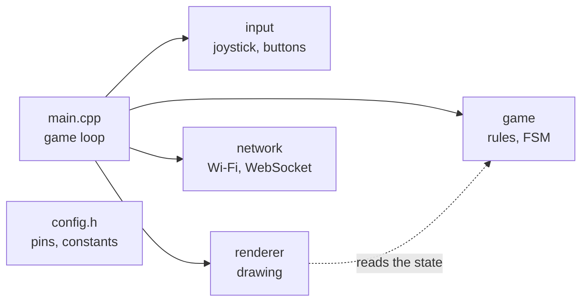
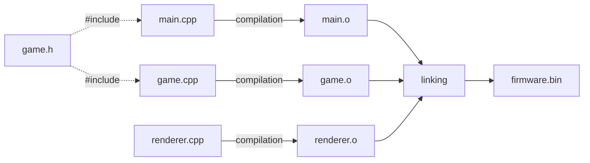

## When main.cpp overflows

The Pong of Lab 4 fits in a single `main.cpp`: a few hundred lines, which you can still take in at a glance. A Snake with a second networked player quickly doubles that. Put everything in one file, and every change forces you to reread the whole thing, two people can no longer work at the same time without conflicts, and a drawing function ends up changing the score "because it was convenient".

A **module** is a piece of the program that has **a single responsibility** and only shows the others what they need. In C++, a module is a pair of files: a `.h` and a `.cpp`.

## The .h and the .cpp

| File | Role | Content |
|---|---|---|
| `game.h` (header) | What the module **offers**: its user manual | Types (`struct`, `enum class`), function declarations |
| `game.cpp` (source) | **How** it does it | The code of the functions, the internal functions and variables |

The other files include the `.h` (`#include "game.h"`) and never need to read the `.cpp`. An example with the Pong logic:

```cpp
// include/game.h: what the module offers
#pragma once
#include <Arduino.h>

enum class GameState { Title, Playing, GameOver };

struct Game {
    GameState state;
    int score;
    int lives;
    // ... paddle, ball
};

void gameUpdate(Game& g, float joystickX, bool startPressed, uint32_t nowMs);
```

```cpp
// src/game.cpp: how it does it
#include "game.h"
#include "config.h"

static void serveBall(Game& g, uint32_t nowMs) {   // internal to the module
    // ...
}

void gameUpdate(Game& g, float joystickX, bool startPressed, uint32_t nowMs) {
    // ... the state machine from Lab 4
}
```

With PlatformIO, the `.h` files go in `include/` and the `.cpp` files in `src/`: all the `.cpp` files in `src/` are compiled, without declaring anything else.

## Three keywords to know

### `#pragma once`

A `.h` can be included several times in the same compilation (`main.cpp` includes `game.h` and `renderer.h`, which also includes `game.h`). Without protection, the compiler would see the definition of `Game` twice and refuse. `#pragma once`, on the first line of each `.h`, tells it to read the content only once.

### `static`

In front of a function or a global variable of a `.cpp`, `static` makes it **private to the file**: the other modules do not see it, and two modules can each have their own `static void reset()` without conflict. By default, everything that does not appear in the `.h` should be `static`.

### `extern` (to avoid)

To share a **variable** between modules, you declare it `extern int score;` in the `.h` and define it only once in a `.cpp`. It is possible, but a variable that can be modified from anywhere is exactly what modules try to avoid. It is better to pass the data as a parameter, like `gameUpdate(Game& g, ...)`.

## A split for a game



| Module | Responsibility | What it **never** does |
|---|---|---|
| `config.h` | Pins and game constants | Code |
| `input` | Read the joystick and the buttons, return ready-to-use values | Decide what happens next in the game |
| `game` | The rules and the state machine | Draw, read a pin |
| `renderer` | Draw the game state | Modify the game state |
| `network` | Access point, web page, WebSocket messages | Apply a rule without going through `game` |
| `main.cpp` | `setup()` and the game loop: read, compute, display | Contain logic |

The `game` module depends neither on the display nor on the pins: you can reread it, and even test it, without the board. This is the sign of a good split.

## Typical errors

Splitting into modules brings out errors that match the compilation steps seen in Lecture 1:



Each `.cpp` is compiled **separately**, knowing about the others only through the `.h` files it includes; linking then assembles the pieces and checks that each function called exists somewhere, exactly once.

| Message | Step | Likely cause |
|---|---|---|
| `'gameUpdate' was not declared in this scope` | Compilation | The `.h` is not included in the file that calls the function |
| `undefined reference to 'gameUpdate(...)'` | Linking | The function is declared in the `.h` but never defined, or its `.cpp` is not in `src/`, or the parameters differ between `.h` and `.cpp` |
| `multiple definition of 'score'` | Linking | A variable is **defined** in a `.h` included by several `.cpp` files: declare it `extern` in the `.h`, define it in a single `.cpp` |
| `redefinition of 'struct Game'` | Compilation | `#pragma once` is missing at the top of the `.h` |



## Going further

- [Pong on the console](/workshops/microcontroleur/tutorials/collisions-fsm-pong/): the program to split, and its section "Splitting the program into modules"
- [From hardware to software](/workshops/microcontroleur/concepts/du-materiel-au-logiciel/): compilation and linking

## Summary

- One module = one responsibility = a `.h` (what it offers) and a `.cpp` (how it does it).
- `#pragma once` at the top of each `.h`; the other files include the `.h`, never the `.cpp`.
- `static` makes a function or a variable private to its file: it is the default choice.
- Share data through parameters rather than through `extern` global variables.
- `game` does not draw, `renderer` does not decide, `main.cpp` only runs the game loop.
- "not declared": an `#include` is missing; "undefined reference" or "multiple definition": a linking problem.
