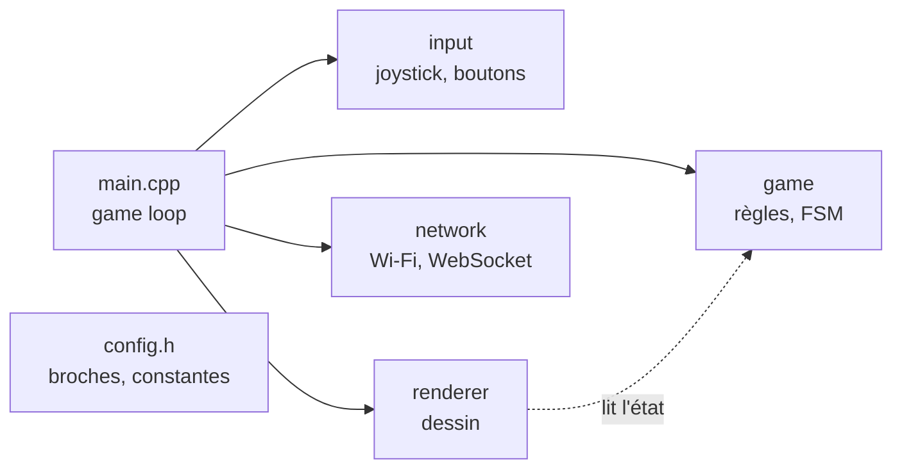

## Quand main.cpp déborde

Le Pong du TD4 tient dans un seul `main.cpp` : quelques centaines de lignes, qu'on parcourt encore d'un coup d'œil. Un Snake avec un second joueur en réseau en fait vite le double. Tout dans un fichier, et chaque modification oblige à relire l'ensemble, deux personnes ne peuvent plus travailler en même temps sans conflit, et une fonction de dessin finit par modifier le score « parce que c'était pratique ».

Un **module** est un morceau du programme qui a **une seule responsabilité** et qui ne montre aux autres que ce dont ils ont besoin. En C++, un module, c'est un couple de fichiers : un `.h` et un `.cpp`.

## Le .h et le .cpp

| Fichier | Rôle | Contenu |
|---|---|---|
| `game.h` (en-tête) | Ce que le module **offre** : son mode d'emploi | Types (`struct`, `enum class`), déclarations de fonctions |
| `game.cpp` (source) | **Comment** il le fait | Le code des fonctions, les fonctions et variables internes |

Les autres fichiers incluent le `.h` (`#include "game.h"`) et n'ont jamais besoin de lire le `.cpp`. Un exemple avec la logique du Pong :

```cpp
// include/game.h : ce que le module offre
#pragma once
#include <Arduino.h>

enum class GameState { Title, Playing, GameOver };

struct Game {
    GameState state;
    int score;
    int lives;
    // ... raquette, balle
};

void gameUpdate(Game& g, float joystickX, bool startPressed, uint32_t nowMs);
```

```cpp
// src/game.cpp : comment il le fait
#include "game.h"
#include "config.h"

static void serveBall(Game& g, uint32_t nowMs) {   // interne au module
    // ...
}

void gameUpdate(Game& g, float joystickX, bool startPressed, uint32_t nowMs) {
    // ... la machine à états du TD4
}
```

Sous PlatformIO, les `.h` vont dans `include/` et les `.cpp` dans `src/` : tous les `.cpp` de `src/` sont compilés, sans rien déclarer de plus.

## Trois mots-clés à connaître

### `#pragma once`

Un `.h` peut être inclus plusieurs fois dans la même compilation (`main.cpp` inclut `game.h` et `renderer.h`, qui inclut lui aussi `game.h`). Sans protection, le compilateur verrait deux fois la définition de `Game` et refuserait. `#pragma once`, en première ligne de chaque `.h`, lui demande de n'en lire le contenu qu'une fois.

### `static`

Devant une fonction ou une variable globale d'un `.cpp`, `static` la rend **privée au fichier** : les autres modules ne la voient pas, et deux modules peuvent avoir chacun leur `static void reset()` sans conflit. Par défaut, tout ce qui n'apparaît pas dans le `.h` devrait être `static`.

### `extern` (à éviter)

Pour partager une **variable** entre modules, on la déclare `extern int score;` dans le `.h` et on la définit une seule fois dans un `.cpp`. C'est possible, mais une variable modifiable de partout est exactement ce que les modules cherchent à éviter. Mieux vaut passer les données en paramètre, comme `gameUpdate(Game& g, ...)`.

## Un découpage pour un jeu



| Module | Responsabilité | Ce qu'il ne fait **jamais** |
|---|---|---|
| `config.h` | Broches et constantes du jeu | Du code |
| `input` | Lire le joystick et les boutons, renvoyer des valeurs prêtes à l'emploi | Décider de la suite du jeu |
| `game` | Les règles et la machine à états | Dessiner, lire une broche |
| `renderer` | Dessiner l'état du jeu | Modifier l'état du jeu |
| `network` | Point d'accès, page web, messages WebSocket | Appliquer une règle sans passer par `game` |
| `main.cpp` | `setup()` et la game loop : lire, calculer, afficher | Contenir de la logique |

Le module `game` ne dépend ni de l'écran ni des broches : on peut le relire, et même le tester, sans la carte. C'est le signe d'un bon découpage.

## Les erreurs typiques

Découper en modules fait apparaître des erreurs qui correspondent aux étapes de la compilation vues au CM1 :

| Message | Étape | Cause probable |
|---|---|---|
| `'gameUpdate' was not declared in this scope` | Compilation | Le `.h` n'est pas inclus dans le fichier qui appelle la fonction |
| `undefined reference to 'gameUpdate(...)'` | Édition de liens | La fonction est déclarée dans le `.h` mais jamais définie, ou son `.cpp` n'est pas dans `src/`, ou les paramètres diffèrent entre `.h` et `.cpp` |
| `multiple definition of 'score'` | Édition de liens | Une variable est **définie** dans un `.h` inclus par plusieurs `.cpp` : la déclarer `extern` dans le `.h`, la définir dans un seul `.cpp` |
| `redefinition of 'struct Game'` | Compilation | Il manque `#pragma once` en tête du `.h` |



## Pour aller plus loin

- [Le Pong sur la console](/workshops/microcontroleur/tutorials/collisions-fsm-pong/) : le programme à découper, et sa section « Découper le programme en modules »
- [Du matériel au logiciel](/workshops/microcontroleur/concepts/du-materiel-au-logiciel/) : compilation et édition de liens

## Résumé

- Un module = une responsabilité = un `.h` (ce qu'il offre) et un `.cpp` (comment il le fait).
- `#pragma once` en tête de chaque `.h` ; les autres fichiers incluent le `.h`, jamais le `.cpp`.
- `static` rend une fonction ou une variable privée à son fichier : c'est le choix par défaut.
- Partager des données par paramètres plutôt que par variables globales `extern`.
- `game` ne dessine pas, `renderer` ne décide pas, `main.cpp` ne fait que la game loop.
- « not declared » : un `#include` manque ; « undefined reference » ou « multiple definition » : un problème d'édition de liens.
