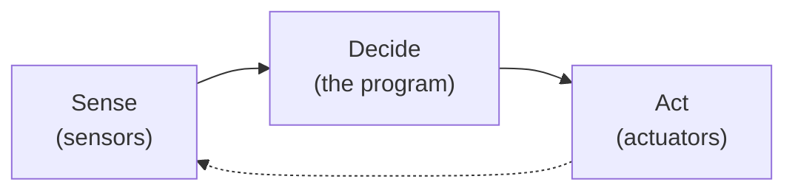

## You come across dozens without knowing it

A **microcontroller** is a complete computer shrunk to the size of a fingernail, sitting on a single small chip. No screen, no keyboard, no humming fan: just the essentials to do *one* thing, and do it well.

You probably have a dozen of them within reach right now:

- the **microwave oven** that counts the seconds and turns the plate,
- the **washing machine** that runs washing, rinsing, spinning one after the other,
- the **remote control**, the **wireless earbuds**, the game **controller**,
- the **electric scooter**, the **thermostat**, the blinking **toy**,
- and dozens of them in a car (windows, indicators, airbags…).

None of these objects needs a "real" computer: they need a small, cheap, robust chip that starts instantly and does its task over and over. That is exactly the role of a microcontroller.

**By the end of this concept, you will know:**

- what a microcontroller is and where you find them in everyday life;
- how to describe its *sense → decide → act* cycle;
- what sets it apart from a regular computer;
- who makes microcontrollers, and why the course chose Espressif's ESP32-S3.

## Sense, decide, act

Whatever the object, a microcontroller always runs the same three-step loop:

1. **Sense**: it reads **sensors**: a pressed button, a temperature, a distance, the ambient light…
2. **Decide**: it runs its **program**: a sequence of instructions you write, which says what to do depending on what was sensed.
3. **Act**: it drives **actuators**: turn on an LED, spin a motor, make a sound, display some text…

A concrete example: a **thermostat** *senses* the temperature, *decides* "it is too cold", then *acts* by turning on the heating. Then it starts again, forever. The whole course is about writing the "decide" part.



## How is it different from a regular computer?

Your laptop is a versatile machine: it does *everything* (browsing, gaming, writing), but it is expensive, power-hungry and takes time to start. A microcontroller makes the opposite bet.

| | Regular computer | Microcontroller |
|---|---|---|
| **Tasks** | Thousands, at the same time | A single one, in a loop |
| **Price** | Several hundred € | A few euros, sometimes cents |
| **Power** | Plugs into the mains | Can run for months on a battery |
| **Start-up** | Several seconds | Instant |
| **Screen / system** | Screen + operating system | Neither, usually |

This **frugality** is what makes it so widespread: you can put them everywhere, for next to nothing, without thinking about it.



## Who makes microcontrollers?

Tens of billions of microcontrollers are sold every year, by a handful of large manufacturers. The top five by revenue (Infineon, NXP, Renesas, STMicroelectronics and Microchip) share most of the market, driven by the **automotive** industry (a recent car contains dozens of them) and **industry**. Others, smaller, dominate a specific niche.

| Manufacturer | Country | Well-known families | Speciality |
|---|---|---|---|
| **STMicroelectronics** | France / Italy | STM32 | A huge range, very present in industry |
| **NXP** | Netherlands | LPC, Kinetis, i.MX RT | Automotive, industry, contactless payment |
| **Infineon** | Germany | AURIX, XMC, PSoC | Automotive, power electronics |
| **Renesas** | Japan | RA, RX, RL78 | Automotive; the RA4M1 of the Arduino Uno R4 |
| **Microchip** | United States | PIC, AVR, SAM | The ATmega328 of the original Arduino Uno |
| **Texas Instruments** | United States | MSP430, MSPM0 | Very low power |
| **Nordic Semiconductor** | Norway | nRF52, nRF54 | Bluetooth Low Energy |
| **Raspberry Pi** | United Kingdom | RP2040, RP2350 | The Pico boards, education |
| **Espressif** | China | ESP8266, ESP32 | Built-in Wi-Fi, at low cost |

All these manufacturers offer hundreds of parts, from the small microcontroller costing a few cents to the processor able to drive a touchscreen. Choosing a chip means finding in these catalogues the one that has just what the project needs.

## Espressif, Wi-Fi for everyone

**Espressif Systems** is a company founded in Shanghai in 2008. It is not among the largest manufacturers by revenue, but it changed the game in one specific field: **Wi-Fi connected devices**.

- In 2014, its **ESP8266** puts a complete, programmable Wi-Fi chip within everyone's reach for a few euros. Until then, connecting a device to Wi-Fi required an expensive module next to the microcontroller.
- In 2016, the **ESP32** adds a second core, Bluetooth and many more peripherals.
- Makers adopt it: Arduino libraries, open documentation, thousands of projects shared online. In industry, its chips equip connected plugs and bulbs, home sensors, household appliances.

Since then, Espressif has turned the ESP32 into a family of chips, each with its speciality:

| Chip | Core(s) | Radio | Strengths |
|---|---|---|---|
| ESP32 | 2 × Xtensa LX6, 240 MHz | Wi-Fi + Bluetooth | The original, versatile |
| ESP32-S2 | 1 × Xtensa LX7, 240 MHz | Wi-Fi | Native USB, no Bluetooth |
| **ESP32-S3** | **2 × Xtensa LX7, 240 MHz** | **Wi-Fi + Bluetooth LE 5** | **The most powerful of the Wi-Fi chips: light AI, display, camera, native USB** |
| ESP32-C3 | 1 × RISC-V, 160 MHz | Wi-Fi + Bluetooth LE 5 | Small and very cheap |
| ESP32-C6 | RISC-V, 160 MHz | Wi-Fi 6 + Bluetooth LE + Thread / Zigbee | The smart home (Matter standard) |
| ESP32-H2 | RISC-V | Bluetooth LE + Thread / Zigbee, no Wi-Fi | Very low power sensors |
| ESP32-P4 | 2 × RISC-V, 400 MHz | None | High-end multimedia and interfaces |

The letter gives the trend: **S** for the highest-performance series, **C** for the low-cost chips with a RISC-V core, **H** for low power without Wi-Fi, **P** for high performance without radio. The ESP32-S3 sits at the **top of the connected range**: the most powerful Wi-Fi chip of the family.

## Why the ESP32-S3 in this course?

In this course, we use the **ESP32-S3**, mounted on a board the size of a postage stamp, the [XIAO ESP32S3](/docs/references/hardware/xiao-esp32s3/). It was chosen for five reasons:

1. **Built-in Wi-Fi and Bluetooth**: the Snake project brings in a second player from a web browser. No module to add, no extra wiring.
2. **Power to spare**: two cores at 240 MHz and several megabytes of memory are more than enough for a game, a colour display and the network at the same time.
3. **Native USB**: the board is programmed directly, with no driver to install, on Windows, macOS and Linux.
4. **An accessible ecosystem**: the Arduino framework and PlatformIO to get started, Espressif's official tool (ESP-IDF) to go further, and huge documentation and community.
5. **A development board price**: a XIAO ESP32S3 board costs less than ten euros, and an ESP32-S3 module is found in real industrial products. What you learn here is useful outside school.

It has its limits too: it consumes more than a low-power microcontroller (a battery would not last for months with Wi-Fi on), and its pins work at **3.3 V**, not 5 V.



## And under the hood?

You now know *what* a microcontroller *is for* and *what it does*. The next step is to open the hood and see *how* it is built inside (the processor, the memories, the pins) in the concept [Architecture of a microcontroller](/workshops/microcontroleur/concepts/architecture-microcontroleur/).

## Quick quiz

**1. Can a microcontroller run several applications like a computer?**

Show the answer
No: it is designed for a single task, repeated in a loop: this is what makes it simple, cheap and frugal.

**2. What are the three steps of its operating loop?**

Show the answer
Sense (sensors) → decide (the program) → act (actuators).

**3. Who writes the "decide" part?**

Show the answer
You: without a program, the chip stays inert.

**4. Why does the course use an ESP32-S3 rather than an ATmega328 (Arduino Uno)?**

Show the answer
The project needs Wi-Fi for the browser player, enough power and memory for a colour display, and the ESP32-S3 has native USB. The ATmega328 has neither Wi-Fi nor the necessary power.

## Going further

Ready to get hands-on? The first tutorial installs the tools and flashes your very first program:

- [Checking the toolchain](/workshops/microcontroleur/tutorials/toolchain-blink/)

## Summary

- A microcontroller is a **complete miniature computer on a single chip**, found in a host of everyday objects.
- It always works in three steps: **sense** (sensors) → **decide** (the program) → **act** (actuators), in a loop.
- **You write the "decide" part**: without a program, the chip does nothing.
- Compared with a regular computer, it does **a single task**, costs little, consumes little and starts instantly.
- The large manufacturers (Infineon, NXP, Renesas, STMicroelectronics, Microchip) dominate automotive and industry; **Espressif** made **built-in Wi-Fi** accessible to everyone.
- In this course, we program an **ESP32-S3**, the top of Espressif's Wi-Fi range: two cores, Wi-Fi, Bluetooth and native USB, for less than ten euros per board.
