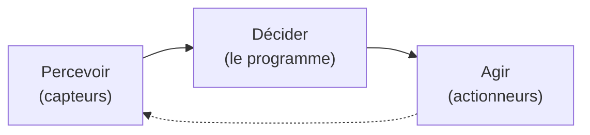

## Tu en côtoies des dizaines sans le savoir

Un **microcontrôleur**, c'est un ordinateur complet réduit à la taille d'un ongle, posé sur une seule petite puce. Pas d'écran, pas de clavier, pas de ventilateur qui ronronne : juste l'essentiel pour faire *une* chose, et la faire bien.

Tu en as sûrement une dizaine à portée de main en ce moment :

- le **micro-ondes** qui compte les secondes et fait tourner le plateau,
- la **machine à laver** qui enchaîne lavage, rinçage, essorage,
- la **télécommande**, les **écouteurs sans fil**, la **manette** de jeu,
- la **trottinette électrique**, le **thermostat**, le **jouet** qui clignote,
- et par dizaines dans une voiture (vitres, clignotants, airbags…).

Aucun de ces objets n'a besoin d'un « vrai » ordinateur : ils ont besoin d'une petite puce bon marché, robuste, qui démarre instantanément et fait sa tâche en boucle. C'est exactement le rôle d'un microcontrôleur.

**À la fin de ce concept, tu sauras :**

- ce qu'est un microcontrôleur et où on en trouve au quotidien ;
- décrire son cycle *percevoir → décider → agir* ;
- ce qui le distingue d'un ordinateur classique ;
- qui fabrique les microcontrôleurs, et pourquoi l'atelier a choisi l'ESP32-S3 d'Espressif.

## Percevoir, décider, agir

Peu importe l'objet, un microcontrôleur fait toujours la même boucle en trois temps :

1. **Percevoir** : il lit des **capteurs** : un bouton pressé, une température, une distance, la lumière ambiante…
2. **Décider** : il exécute son **programme** : une suite d'instructions que tu écris, qui dit quoi faire selon ce qui a été perçu.
3. **Agir** : il commande des **actionneurs** : allumer une LED, faire tourner un moteur, émettre un son, afficher un texte…

Un exemple concret : un **thermostat** *perçoit* la température, *décide* « il fait trop froid », puis *agit* en allumant le chauffage. Puis il recommence, indéfiniment. Tout l'atelier consiste à écrire la partie « décider ».



## En quoi c'est différent d'un ordinateur classique ?

Ton ordinateur portable est une machine polyvalente : il fait *tout* (naviguer, jouer, écrire), mais il est cher, gourmand en énergie et met du temps à démarrer. Un microcontrôleur fait le pari inverse.

| | Ordinateur classique | Microcontrôleur |
|---|---|---|
| **Tâches** | Des milliers, en même temps | Une seule, en boucle |
| **Prix** | Plusieurs centaines d'€ | Quelques euros, parfois centimes |
| **Énergie** | Se branche au secteur | Peut tenir des mois sur une pile |
| **Démarrage** | Plusieurs secondes | Instantané |
| **Écran / système** | Écran + système d'exploitation | Ni l'un ni l'autre, en général |

C'est cette **sobriété** qui le rend si présent : on peut en mettre partout, pour presque rien, sans y penser.



## Qui fabrique les microcontrôleurs ?

Des dizaines de milliards de microcontrôleurs sont vendus chaque année, par une poignée de grands fabricants. Les cinq premiers en chiffre d'affaires (Infineon, NXP, Renesas, STMicroelectronics et Microchip) se partagent l'essentiel du marché, tiré par l'**automobile** (une voiture récente en contient des dizaines) et l'**industrie**. D'autres, plus petits, dominent un créneau précis.

| Fabricant | Pays | Familles connues | Spécialité |
|---|---|---|---|
| **STMicroelectronics** | France / Italie | STM32 | Une gamme immense, très présente dans l'industrie |
| **NXP** | Pays-Bas | LPC, Kinetis, i.MX RT | Automobile, industrie, paiement sans contact |
| **Infineon** | Allemagne | AURIX, XMC, PSoC | Automobile, électronique de puissance |
| **Renesas** | Japon | RA, RX, RL78 | Automobile ; le RA4M1 de l'Arduino Uno R4 |
| **Microchip** | États-Unis | PIC, AVR, SAM | L'ATmega328 de l'Arduino Uno historique |
| **Texas Instruments** | États-Unis | MSP430, MSPM0 | Très basse consommation |
| **Nordic Semiconductor** | Norvège | nRF52, nRF54 | Bluetooth Low Energy |
| **Raspberry Pi** | Royaume-Uni | RP2040, RP2350 | Les cartes Pico, l'éducation |
| **Espressif** | Chine | ESP8266, ESP32 | Le Wi-Fi intégré, à bas coût |

Tous ces fabricants proposent des centaines de références, du petit microcontrôleur à quelques centimes au processeur capable de piloter un écran tactile. Choisir une puce, c'est trouver dans ces catalogues celle qui a juste ce qu'il faut pour le projet.

## Espressif, le Wi-Fi pour tous

**Espressif Systems** est une entreprise fondée à Shanghai en 2008. Elle ne figure pas parmi les plus gros fabricants en chiffre d'affaires, mais elle a changé la donne dans un domaine précis : les **objets connectés en Wi-Fi**.

- En 2014, son **ESP8266** met une puce Wi-Fi complète, programmable, à la portée de tous pour quelques euros. Jusque-là, connecter un objet au Wi-Fi demandait un module coûteux à côté du microcontrôleur.
- En 2016, l'**ESP32** ajoute un second cœur, le Bluetooth et beaucoup plus de périphériques.
- Les makers s'en emparent : bibliothèques Arduino, documentation ouverte, des milliers de projets partagés en ligne. Dans l'industrie, ses puces équipent des prises et des ampoules connectées, des capteurs domestiques, des appareils électroménagers.

Depuis, Espressif décline l'ESP32 en une famille de puces, chacune avec sa spécialité :

| Puce | Cœur(s) | Radio | Points forts |
|---|---|---|---|
| ESP32 | 2 × Xtensa LX6, 240 MHz | Wi-Fi + Bluetooth | L'original, polyvalent |
| ESP32-S2 | 1 × Xtensa LX7, 240 MHz | Wi-Fi | USB natif, sans Bluetooth |
| **ESP32-S3** | **2 × Xtensa LX7, 240 MHz** | **Wi-Fi + Bluetooth LE 5** | **Le plus puissant des puces Wi-Fi : IA légère, écran, caméra, USB natif** |
| ESP32-C3 | 1 × RISC-V, 160 MHz | Wi-Fi + Bluetooth LE 5 | Petit et très bon marché |
| ESP32-C6 | RISC-V, 160 MHz | Wi-Fi 6 + Bluetooth LE + Thread / Zigbee | La maison connectée (norme Matter) |
| ESP32-H2 | RISC-V | Bluetooth LE + Thread / Zigbee, sans Wi-Fi | Capteurs à très basse consommation |
| ESP32-P4 | 2 × RISC-V, 400 MHz | Aucune | Multimédia et interfaces haut de gamme |

La lettre donne la tendance : **S** pour les séries les plus performantes, **C** pour les puces économiques à cœur RISC-V, **H** pour la basse consommation sans Wi-Fi, **P** pour la haute performance sans radio. L'ESP32-S3 occupe le **haut de la gamme connectée** : la puce Wi-Fi la plus puissante de la famille.

## Pourquoi l'ESP32-S3 dans cet atelier ?

Dans cet atelier, on utilise l'**ESP32-S3**, monté sur une carte grande comme un timbre-poste, la [XIAO ESP32S3](/docs/references/hardware/xiao-esp32s3/). Il a été choisi pour cinq raisons :

1. **Le Wi-Fi et le Bluetooth intégrés** : le projet Snake fait jouer un second joueur depuis un navigateur. Pas de module à ajouter, pas de câblage en plus.
2. **De la puissance en réserve** : deux cœurs à 240 MHz et plusieurs mégaoctets de mémoire suffisent largement pour un jeu, un écran couleur et le réseau en même temps.
3. **L'USB natif** : la carte se programme directement, sans pilote à installer, sous Windows, macOS et Linux.
4. **Un écosystème accessible** : le framework Arduino et PlatformIO pour débuter, l'outil officiel d'Espressif (ESP-IDF) pour aller plus loin, et une documentation et une communauté immenses.
5. **Un prix de carte de développement** : une carte XIAO ESP32S3 coûte moins de dix euros, et un module ESP32-S3 se retrouve dans de vrais produits industriels. Ce que vous apprenez ici sert hors de l'école.

Ses limites existent aussi : il consomme plus qu'un microcontrôleur basse consommation (une pile ne tiendrait pas des mois, Wi-Fi allumé), et ses broches sont en **3,3 V**, pas en 5 V.



## Et sous le capot ?

Tu sais maintenant *à quoi sert* un microcontrôleur et *ce qu'il fait*. La prochaine étape est d'ouvrir le capot pour voir *comment* il est fait à l'intérieur (le processeur, les mémoires, les broches) dans le concept [Architecture d'un microcontrôleur](/workshops/microcontroleur/concepts/architecture-microcontroleur/).

## Quiz express

**1. Un microcontrôleur peut-il faire tourner plusieurs applications comme un ordinateur ?**

Voir la réponse
Non : il est conçu pour une seule tâche, répétée en boucle : c'est ce qui le rend simple, bon marché et économe.

**2. Quelles sont les trois étapes de sa boucle de fonctionnement ?**

Voir la réponse
Percevoir (capteurs) → décider (le programme) → agir (actionneurs).

**3. Qui écrit la partie « décider » ?**

Voir la réponse
Toi : sans programme, la puce reste inerte.

**4. Pourquoi l'atelier utilise-t-il un ESP32-S3 plutôt qu'un ATmega328 (Arduino Uno) ?**

Voir la réponse
Le projet a besoin du Wi-Fi pour le joueur du navigateur, d'assez de puissance et de mémoire pour un écran couleur, et l'ESP32-S3 a l'USB natif. L'ATmega328 n'a ni Wi-Fi ni la puissance nécessaire.

## Pour aller plus loin

Prêt à passer à la pratique ? Le premier tutoriel installe les outils et flashe ton tout premier programme :

- [Vérification de la toolchain](/workshops/microcontroleur/tutorials/toolchain-blink/)

## Résumé

- Un microcontrôleur est un **ordinateur miniature complet sur une seule puce**, présent dans une foule d'objets du quotidien.
- Il fonctionne toujours en trois temps : **percevoir** (capteurs) → **décider** (le programme) → **agir** (actionneurs), en boucle.
- C'est **toi qui écris la partie « décider »** : sans programme, la puce ne fait rien.
- Comparé à un ordinateur classique, il fait **une seule tâche**, coûte peu, consomme peu et démarre instantanément.
- Les grands fabricants (Infineon, NXP, Renesas, STMicroelectronics, Microchip) dominent l'automobile et l'industrie ; **Espressif** a rendu le **Wi-Fi intégré** accessible à tous.
- Dans cet atelier, on programme un **ESP32-S3**, le haut de la gamme Wi-Fi d'Espressif : deux cœurs, Wi-Fi, Bluetooth et USB natif, pour moins de dix euros la carte.
