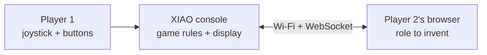

## In short

| | |
|---|---|
| **Team** | In pairs |
| **Equipment** | Your console, soldered in Lab 4: XIAO ESP32S3, TFT display, joystick and two buttons on the course board |
| **Starting point** | Your Pong from Lab 4, and everything it taught you: game loop, collisions, flicker-free display, state machine |
| **What's new** | A new game mechanic (Snake), and a second player **in a web browser**, connected over Wi-Fi |
| **Deliverable** | A repo created from the MakerSpace template, and a live demonstration |

## The challenge

The first player plays **Snake** on the console: they steer a snake with the joystick, eat to grow, and lose if they hit a wall or their own body.

The second player has no controller: they join the game **from their phone**, connected to the console's Wi-Fi, on a web page served by the console itself. They do **not** play the same game as the first player: it is **asymmetric** multiplayer. It is up to you to invent their role. They can help the snake, set traps for it, bet against it, referee the game... as long as their actions **really change** the course of the game, and each of the two players has a reason to play.

## What the console must do

These requirements are the same for every pair. They are checked during the demonstration.

| # | Requirement |
|---|---|
| C1 | The snake moves on a **grid**, cell by cell, at a steady pace, and is steered with the joystick in all four directions |
| C2 | The snake cannot turn back on itself |
| C3 | Food appears on a free cell; the snake that eats it grows, and the score increases |
| C4 | The game stops when the snake hits a wall or its own body |
| C5 | The game has at least a waiting screen, the game itself and a game over screen, handled by a **state machine** |
| C6 | The display does not flicker: only what changes is redrawn |
| C7 | No `delay()` in the main loop: the game, the display and the network all move forward at the same time |
| C8 | The demonstration is done **on your soldered board**, not on a breadboard |

## What the browser player must be able to do

The role is free, the technical requirements are not.

| # | Requirement |
|---|---|
| N1 | The console creates its own **Wi-Fi access point** and **serves player 2's web page**: no other device, no Internet connection |
| N2 | The console and the page exchange in real time over **WebSocket**, both ways |
| N3 | Player 2 has a role **different** from player 1's, and their actions really change the game |
| N4 | The page displays what player 2 needs to play (at least: the game phase and the score) |
| N5 | The **console is the referee**: it validates each request from the browser before applying it, and ignores invalid messages without crashing |
| N6 | A browser disconnection is **planned for** in the state machine (pause, wait, game over... your choice), and the page reconnects on its own |
| N7 | The **protocol** (the list of messages, their format and their meaning) is written and documented before being coded |

### Ideas, not a list

To get you started, a few possible roles. You can take one, combine them, or (better) invent your own:

- **The game master** places food and obstacles on the grid, shown in their page.
- **The saboteur** has powers with a cooldown: speed the snake up, reverse its controls for a few seconds, scramble an area of the screen.
- **The ally** guides the snake towards bonuses and can save it once per game.
- **The gambler** bets their points on when the snake is going to lose.

A good asymmetric role can be recognised by two questions: **can each player win?** and **do both players have something to do at every moment?** Test your idea on paper, playing both roles by hand, before writing a single line of code.

## Your console

The project starts on the **board you soldered in Lab 4**, with the Pong as a starting point. Nothing to design on the hardware side: its pinout is the one from the labs, and your test programs from Lab 2 are still useful to check that it still works. If in doubt about the board, run the tests of [Soldering and testing the board](/workshops/microcontroleur/tutorials/souder-tester-carte/) again.

## Learning on your own: the transition is yours

Unlike the Pong, **no step-by-step tutorial leads you to the Snake**. This is on purpose: moving from a game you were guided to build to a game you design yourselves is the heart of the project. Search, try, compare solutions, and keep track of your choices.

A few questions to ask yourselves, to which you will find **your own** answers:

- How do you represent the grid, and how do you go from a cell to pixels on the screen?
- How do you store the snake's body, knowing that it grows? What happens in memory at each move?
- Does the snake move at every frame (16 ms)? If not, how do you make it move at its own pace within the same game loop?
- What needs to be redrawn when the snake moves by one cell? (Hint: much less than the whole snake.)
- How do you read the joystick in four directions, and what do you do with a diagonal?
- How do you pick a random free cell, even when the snake fills almost the whole grid?
- Which states should be added to the Pong's state machine, and which network events trigger their transitions?

An approach that works:

1. **On paper**: the grid, the data structures, the state machine, the network protocol.
2. **A minimal prototype**: a fixed-length snake moving straight ahead. Then the direction, then the growth, then the collisions. Validate each step before the next one.
3. **The network on its own**: get the WebSocket tutorial working alone, then write your protocol, before plugging it into the game.
4. **The integration**, then the **robustness**: disconnections, invalid messages, games played back to back.



### The course resources

| To... | See |
|---|---|
| Structure the game | [Pong on the console](/workshops/microcontroleur/tutorials/collisions-fsm-pong/) (game loop, collisions, rendering) and the concept [Finite state machine](/workshops/microcontroleur/concepts/machine-etats-finis/) |
| Split the code into modules | The concept [Organising your code into modules](/workshops/microcontroleur/concepts/organiser-code-modules/): `.h` and `.cpp`, `static`, an `input` / `game` / `renderer` / `network` split |
| Read the joystick as directions | [The modules of the kit](/workshops/microcontroleur/tutorials/entrees-boutons-joystick/) and the concept [ADC & PWM](/workshops/microcontroleur/concepts/adc-pwm/) |
| Draw without flicker | The step "Displaying without flicker" of [Pong on the console](/workshops/microcontroleur/tutorials/collisions-fsm-pong/) |
| Understand the network | The concept [Wi-Fi, HTTP and WebSocket](/docs/concepts/reseau-wifi-websocket/) |
| Set up the network | The tutorial [ESP32, Wi-Fi and WebSocket](/docs/tutorials/electronics/esp32-wifi-websocket/) |
| Debug | The guide [Debugging an embedded program](/docs/how-to-guides/deboguer-programme-embarque/), [VSCode and PlatformIO: serial port](/docs/tutorials/electronics/vscode-port-serie/), and the browser's developer console (<kbd>F12</kbd> key on a PC) |
| Place food at random | `random(n)` returns an integer from 0 to n − 1. On the ESP32, it relies on the chip's hardware generator: no need for `randomSeed()`. Conversely, `randomSeed(42)` makes the sequence reproducible, handy to replay a bug |

On the browser side, the reference documentation is MDN's: the [WebSocket API](https://developer.mozilla.org/en-US/docs/Web/API/WebSocket) and the [canvas element](https://developer.mozilla.org/en-US/docs/Web/API/Canvas_API) to draw a grid.

## Project stages

A suggested breakdown, to turn into milestones and issues in your repo:

| Milestone | Expected outcome |
|---|---|
| 1. Single-player Snake | The Snake can be fully played on the console, without network (C1 to C8); player 2's role is imagined on paper |
| 2. Network skeleton | Access point, page served, WebSocket open both ways; protocol written (N1, N2, N7) |
| 3. Player 2 | The asymmetric role is playable end to end (N3, N4, N5) |
| 4. Robustness | Disconnections planned for, invalid messages ignored, games played back to back without restarting (N6) |
| 5. Documentation and demo | The repo is complete, the demonstration is rehearsed |



## Deliverables

The project is submitted in a **repo created from the MakerSpace template**, tracked on GitHub throughout the project. The tutorials of the [Project Methodology](/workshops/methodologie-de-projet/) course detail each part:

| Deliverable | Expected content | Guide |
|---|---|---|
| The repo | Created from the template, organised into issues and milestones | [Creating your repo from the template](/workshops/methodologie-de-projet/tutorials/creer-repo-template/), [Managing your project with GitHub](/workshops/methodologie-de-projet/tutorials/gerer-projet-github/) |
| The firmware | The source code, split into modules, with the state machine (diagram) and the **network protocol** (table of messages) | [Documenting your code and firmware](/workshops/methodologie-de-projet/tutorials/documenter-code-firmware/) |
| The board | Your schematic and routing from Lab 3, the photos and tests of the board soldered in Lab 4, included so that the repo describes the whole console (assessed with the labs) | [Documenting an electronic board](/workshops/methodologie-de-projet/tutorials/documenter-carte-electronique/) |
| The tests | Requirements C1 to C8 and N1 to N7 checked one by one, with the results | [Documenting tests and results](/workshops/methodologie-de-projet/tutorials/documenter-tests-resultats/) |
| The logbook | Your research, your trials, your choices, and the sources of what you reused | [Keeping a logbook](/workshops/methodologie-de-projet/tutorials/journal-de-bord/) |
| The presentation | A short demonstration video, or a poster | [Creating the presentation poster and video](/workshops/methodologie-de-projet/tutorials/poster-video-presentation/) |

The **final demonstration** is done live: the two players play at least one complete game, then the browser disconnects and reconnects during the game.

## Assessment

The project counts for **70 %** of the course mark (the board is assessed with the labs), and the mark is shared by the pair:

| Criterion | Weight |
|---|---|
| The game on the console (C1 to C8) | 25 % |
| The browser player (N1 to N7, originality, balance) | 25 % |
| The code and its robustness | 10 % |
| The repo and the demonstration | 10 % |

The detail of each criterion is on the [Course assessment](/workshops/microcontroleur/evaluation/) page. Since the mark is shared, each of the two members of the pair must be able to explain the whole project, including the part they did not code.
