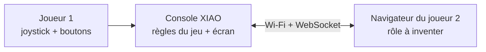
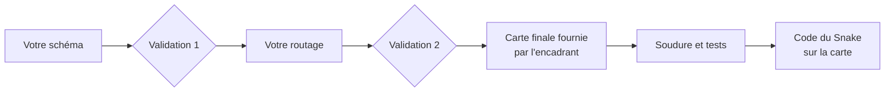

## En bref

| | |
|---|---|
| **Équipe** | En binôme |
| **Matériel** | La console de l'atelier : XIAO ESP32S3, écran TFT, joystick, deux boutons, sur un PCB que vous concevez, puis que vous soudez |
| **Point de départ** | Votre Pong des TD, et tout ce qu'il vous a appris : game loop, modules, machine à états |
| **Nouveauté** | Une nouvelle mécanique de jeu (Snake), et un second joueur **dans un navigateur**, relié en Wi-Fi |
| **Rendu** | Un repo créé depuis le template du MakerSpace, et une démonstration en direct |

## Le défi

Le premier joueur joue au **Snake** sur la console : il dirige un serpent au joystick, mange pour grandir, et perd s'il heurte un mur ou son propre corps.

Le second joueur ne tient pas de manette : il rejoint la partie **depuis son téléphone**, connecté au Wi-Fi de la console, sur une page web servie par la console elle-même. Il ne joue **pas** au même jeu que le premier : c'est un multijoueur **asymétrique**. À vous d'inventer son rôle. Il peut aider le serpent, lui tendre des pièges, parier contre lui, arbitrer la partie... tant que ses actions **changent vraiment** le cours de la partie, et que chacun des deux joueurs a une raison de jouer.

## Ce que la console doit faire

Ces exigences sont communes à tous les binômes. Elles se vérifient pendant la démonstration.

| # | Exigence |
|---|---|
| C1 | Le serpent avance sur une **grille**, case par case, à une cadence régulière, et se dirige au joystick dans les quatre directions |
| C2 | Le serpent ne peut pas faire demi-tour sur lui-même |
| C3 | La nourriture apparaît sur une case libre ; le serpent qui la mange grandit, et le score augmente |
| C4 | La partie s'arrête quand le serpent heurte un mur ou son propre corps |
| C5 | Le jeu a au moins un écran d'attente, la partie et un écran de fin, gérés par une **machine à états** |
| C6 | L'écran ne scintille pas : on ne redessine que ce qui change |
| C7 | Aucun `delay()` dans la boucle principale : le jeu, l'écran et le réseau avancent en même temps |
| C8 | La démonstration finale se fait **sur le PCB soudé**, pas sur breadboard |

## Ce que le joueur du navigateur doit pouvoir faire

Le rôle est libre, les exigences techniques ne le sont pas.

| # | Exigence |
|---|---|
| N1 | La console crée son propre **point d'accès Wi-Fi** et **sert la page web** du joueur 2 : aucun autre appareil, aucune connexion à Internet |
| N2 | La console et la page échangent en temps réel par **WebSocket**, dans les deux sens |
| N3 | Le joueur 2 a un rôle **différent** de celui du joueur 1, et ses actions changent réellement la partie |
| N4 | La page affiche ce dont le joueur 2 a besoin pour jouer (au minimum : la phase de jeu et le score) |
| N5 | La **console est l'arbitre** : elle valide chaque demande du navigateur avant de l'appliquer, et ignore les messages invalides sans planter |
| N6 | La déconnexion du navigateur est **prévue** par la machine à états (pause, attente, fin... à vous de choisir), et la page se reconnecte seule |
| N7 | Le **protocole** (la liste des messages, leur format et leur sens) est écrit et documenté avant d'être codé |

### Des pistes, pas une liste

Pour vous lancer, quelques rôles possibles. Vous pouvez en reprendre un, les combiner, ou (mieux) inventer le vôtre :

- **Le maître du jeu** pose la nourriture et des obstacles sur la grille, affichée dans sa page.
- **Le saboteur** dispose de pouvoirs à recharge : accélérer le serpent, inverser ses commandes quelques secondes, brouiller une zone de l'écran.
- **L'allié** guide le serpent vers des bonus et peut le sauver une fois par partie.
- **Le parieur** mise ses points sur le moment où le serpent va perdre.

Un bon rôle asymétrique se reconnaît à deux questions : **chaque joueur peut-il gagner ?** et **les deux joueurs ont-ils quelque chose à faire à chaque instant ?** Testez votre idée sur papier, en jouant les deux rôles à la main, avant d'écrire la moindre ligne de code.

## La carte de la console

Le projet **commence par la carte**. Chaque binôme conçoit le PCB de la console sous KiCad, en deux étapes validées par l'encadrant : d'abord le schéma, puis le routage. Pour éviter les délais de fabrication, l'encadrant vous remet ensuite **sa** carte finale, déjà fabriquée, que vous soudez et testez. C'est sur cette carte que vous écrivez ensuite le code du Snake. Son brochage est celui des TD : votre Pong y tourne sans modification.

| Étape | Guide |
|---|---|
| Cahier des charges, schéma (validation 1), routage (validation 2) | [Concevoir la carte de la console](/workshops/microcontroleur/tutorials/conception-carte-kicad/) |
| Soudure au fer et tests | [Souder et tester la carte](/workshops/microcontroleur/tutorials/souder-tester-carte/) |

Rien ne vous empêche de réfléchir au jeu (sur papier) et à votre rôle asymétrique pendant que vous concevez la carte : c'est même conseillé. Mais le code du projet s'écrit et se teste sur la carte soudée.

## Se former : la transition est à vous

Contrairement au Pong, **aucun tutoriel pas à pas ne vous mène au Snake**. C'est volontaire : passer d'un jeu que l'on vous a guidé à construire à un jeu que vous concevez vous-mêmes est le cœur du projet. Cherchez, essayez, comparez des solutions, et gardez trace de vos choix.

Quelques questions à vous poser, auxquelles vous trouverez **vos** réponses :

- Comment représenter la grille, et comment passer d'une case à des pixels de l'écran ?
- Comment mémoriser le corps du serpent, sachant qu'il grandit ? Que se passe-t-il en mémoire à chaque déplacement ?
- Le serpent avance-t-il à chaque image (16 ms) ? Sinon, comment le faire avancer à sa propre cadence dans la même game loop ?
- Que faut-il redessiner quand le serpent avance d'une case ? (Indice : beaucoup moins que tout le serpent.)
- Comment lire le joystick en quatre directions, et que faire d'une diagonale ?
- Comment tirer une case libre au hasard, même quand le serpent occupe presque toute la grille ?
- Quels états ajouter à la machine à états du Pong, et quels événements réseau déclenchent leurs transitions ?

Une démarche qui marche :

1. **Sur papier** : la grille, les structures de données, la machine à états, le protocole réseau.
2. **Un prototype minimal** : un serpent de longueur fixe qui avance tout droit. Puis la direction, puis la croissance, puis les collisions. Validez chaque étape avant la suivante.
3. **Le réseau à part** : faites marcher le tutoriel WebSocket seul, puis écrivez votre protocole, avant de le brancher sur le jeu.
4. **L'intégration**, puis la **robustesse** : déconnexions, messages invalides, parties qui s'enchaînent.



### Les ressources de l'atelier

| Pour... | Voir |
|---|---|
| Structurer le jeu | [Collisions, score et machine à états](/workshops/microcontroleur/tutorials/collisions-fsm-pong/) (game loop, modules, rendu) et le concept [Machine à états finis](/workshops/microcontroleur/concepts/machine-etats-finis/) |
| Lire le joystick en directions | [Boutons, joystick et moniteur série](/workshops/microcontroleur/tutorials/entrees-boutons-joystick/) et le concept [ADC & PWM](/workshops/microcontroleur/concepts/adc-pwm/) |
| Dessiner sans scintiller | [Écran SPI et game loop](/docs/tutorials/electronics/ecran-spi-game-loop/) |
| Comprendre le réseau | Le concept [Wi-Fi, HTTP et WebSocket](/docs/concepts/reseau-wifi-websocket/) |
| Mettre le réseau en place | Le tutoriel [ESP32, Wi-Fi et WebSocket](/docs/tutorials/electronics/esp32-wifi-websocket/) |
| Déboguer | [VSCode et PlatformIO : port série](/docs/tutorials/electronics/vscode-port-serie/), et la console de développement du navigateur (touche <kbd>F12</kbd> sur PC) |

Côté navigateur, la documentation de référence est celle de MDN : l'[API WebSocket](https://developer.mozilla.org/fr/docs/Web/API/WebSocket) et l'[élément canvas](https://developer.mozilla.org/fr/docs/Web/API/Canvas_API) pour dessiner une grille.

## Les étapes du projet

Un découpage indicatif, à transformer en jalons et en issues dans votre repo :

| Jalon | Résultat attendu |
|---|---|
| 1. Schéma | Le schéma de votre carte est validé par l'encadrant ; le jeu et le rôle du joueur 2 sont imaginés sur papier |
| 2. Routage | Le routage de votre carte est validé par l'encadrant |
| 3. Carte soudée | La carte fournie est soudée et testée, et votre Pong y tourne (C8) |
| 4. Snake en solo | Le Snake se joue entièrement sur la console, sans réseau (C1 à C7) |
| 5. Squelette réseau | Point d'accès, page servie, WebSocket ouvert dans les deux sens ; protocole écrit (N1, N2, N7) |
| 6. Le joueur 2 | Le rôle asymétrique est jouable de bout en bout, déconnexions comprises (N3 à N6) |
| 7. Documentation et démo | Le repo est complet, la démonstration est répétée |



## Livrables

Le projet se rend dans un **repo créé depuis le template du MakerSpace**, suivi sur GitHub tout au long du projet. Les tutoriels de l'atelier [Méthodologie de projet](/workshops/methodologie-de-projet/) détaillent chaque partie :

| Livrable | Contenu attendu | Guide |
|---|---|---|
| Le repo | Créé depuis le template, organisé en issues et jalons | [Créer son repo depuis le template](/workshops/methodologie-de-projet/tutorials/creer-repo-template/), [Gérer son projet avec GitHub](/workshops/methodologie-de-projet/tutorials/gerer-projet-github/) |
| Le firmware | Le code source, découpé en modules, avec la machine à états (diagramme) et le **protocole réseau** (tableau des messages) | [Documenter son code et son firmware](/workshops/methodologie-de-projet/tutorials/documenter-code-firmware/) |
| La carte | Votre schéma et votre routage validés, la justification de vos choix de conception, les photos et les tests de la carte soudée | [Documenter une carte électronique](/workshops/methodologie-de-projet/tutorials/documenter-carte-electronique/) |
| Les tests | Les exigences C1 à C8 et N1 à N7 vérifiées une par une, avec les résultats | [Documenter les tests et résultats](/workshops/methodologie-de-projet/tutorials/documenter-tests-resultats/) |
| Le journal de bord | Vos recherches, vos essais, vos choix, et les sources de ce que vous avez repris | [Tenir un journal de bord](/workshops/methodologie-de-projet/tutorials/journal-de-bord/) |
| La présentation | Une courte vidéo de démonstration, ou un poster | [Créer le poster et la vidéo de présentation](/workshops/methodologie-de-projet/tutorials/poster-video-presentation/) |

La **démonstration finale** se fait en direct : les deux joueurs enchaînent au moins une partie complète, puis le navigateur se déconnecte et se reconnecte pendant le jeu.

## Évaluation

L'évaluation porte sur :

- **Le jeu sur la console** : les exigences C1 à C8 tenues pendant la démonstration ;
- **Le rôle du joueur 2** : son originalité, l'équilibre entre les deux joueurs, et l'intérêt réel de l'interaction ;
- **La robustesse** : déconnexions, messages invalides, parties qui s'enchaînent sans redémarrer la carte ;
- **La qualité du code** : modules, machine à états, absence de `delay()`, lisibilité ;
- **La carte** : la conception (schéma et routage validés, choix justifiés), puis la soudure et les tests de la carte fournie ;
- **Le repo** : documentation, protocole, tests, journal de bord ;
- **L'oral** : chacun des deux membres du binôme sait expliquer l'ensemble du projet, y compris la partie qu'il n'a pas codée.

La pondération de ces critères vous est communiquée en début de projet.
