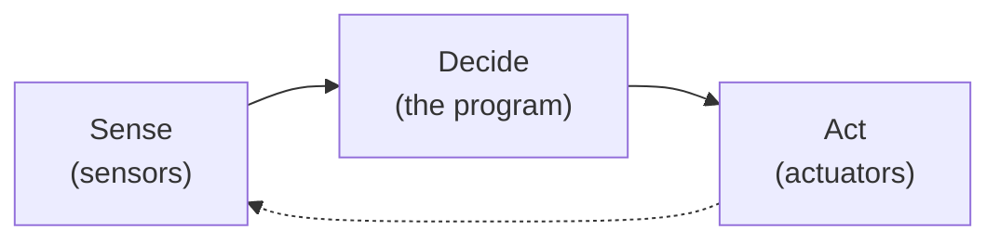
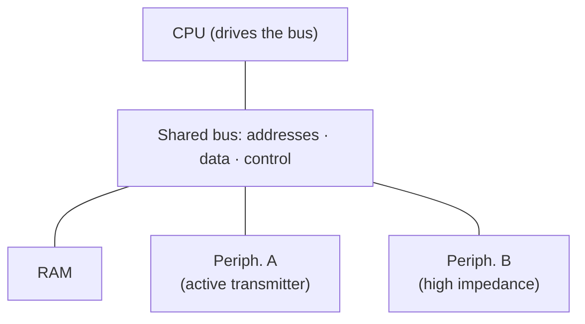
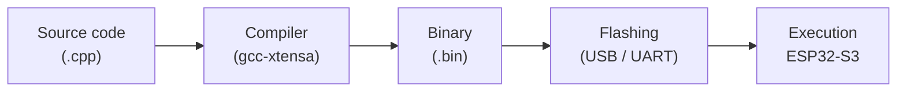

## On the agenda

1. The course
2. A computer on a chip
3. Under the hood
4. From the code to the chip

<aside class="notes" markdown="1">
1 h 30 lecture, no hands-on work. Common thread of the whole course: the game console (Pong in the labs, multiplayer Snake in the project).
Part 1 (about 10 min): where to find the documentation, the course schedule, what they will learn and what it will be useful for.
Parts 2 and 3: the vocabulary and the chip. Part 4: the development toolchain and time in `loop()`, more concrete, to keep for the second half when attention drops.
Part 4 opens with compiled / interpreted (about 5 min): start from Python, which they know, without going into syntax.
</aside>

---

## What you will be able to do

### By the end of this lecture, you will be able to:

- understand what a microcontroller is, and what sets it apart from a PC
- name the blocks of a chip: CPU, Flash, RAM, peripherals, bus
- explain what a **register** is, and what an **interrupt** is for
- say what distinguishes a **compiled** language (C/C++) from an **interpreted** language (Python)
- follow the path from the source code to execution on the chip
- say why `delay()` is a problem in a `loop()`

Common thread of the course: a **Pong**, then a **multiplayer Snake**.
{: .caption}

[The Microcontrollers course](/workshops/microcontroleur/){: .doc-link}

---

<!-- .slide: class="slide-section" -->

## The course

Where to find help, what lies ahead, and why

---

## Everything is on the website

**doc.makerspace-amiens.fr**, **Workshops** section, then **Microcontrollers**.

- The **syllabus** and the **assessment**
- The **slides** of each lecture, including these
- The **concepts**: the theory, to reread before each lab
- The **tutorials**: each lab, step by step
- The **guides**: when something does not work

Each slide ends with a badge that opens the matching page. **↓** for the course page.
{: .caption}

[The Microcontrollers course](/workshops/microcontroleur/){: .doc-link}

<!-- .down -->

## The course page

<iframe class="page-preview" data-src="/workshops/microcontroleur/" title="Microcontrollers course page"></iframe>

---

## Finding the right page

| You want to... | Go and see |
|---|---|
| Understand a notion | A **concept** (GPIO, bus, state machine...) |
| Do it, step by step | The lab's **tutorial** |
| Get unstuck | A **guide** (board not found, black screen) |
| A component's characteristic | Its **reference sheet** (XIAO, display) |
| The full details of a chip | Its **datasheet**, on the manufacturer's website |
{: .table-dense}

The site's **search** bar finds a page by keyword. The **Need help?** button, at the bottom right, opens the MakerSpace's AI assistant.
{: .caption}

[Course syllabus](/workshops/microcontroleur/syllabus/){: .doc-link} [Recovering an ESP32-S3 board](/docs/how-to-guides/esp32-s3-carte-introuvable/){: .doc-link}

---

## Outside the site: the official sources

- **Espressif**: the ESP32-S3 datasheet, the Arduino-ESP32 documentation
- **Seeed Studio**: the XIAO ESP32S3 board wiki
- **Libraries**: their GitHub page, its README and its examples
- **PlatformIO**: its documentation, for the project configuration

A forum or an AI assistant helps you search. But when two sources contradict each other, the **manufacturer's documentation** settles it.
{: .highlight-red}

[XIAO ESP32S3](/docs/references/hardware/xiao-esp32s3/){: .doc-link}

---

## The course schedule

| Session | Duration | What you do |
|---|---|---|
| Lectures 1, 2, 3 | 3 × 1 h 30 | The concepts, in lectures |
| Lab 1 | 1 h 30 | Install, flash a first program |
| Lab 2 | 3 h | Test the modules of the kit |
| Lab 3 | 3 h | Design your board in KiCad |
| Lab 4 | 3 h | Solder the board, run a Pong on it |
| Project | 24 h | A multiplayer Snake, in pairs |
{: .table-dense}

The three lectures first, then the labs, then the project. Each stage builds on the previous one.
{: .caption}

[Course syllabus](/workshops/microcontroleur/syllabus/){: .doc-link}

---

## How you are assessed

<div class="columns" markdown="1">
<div markdown="1">

<p class="big-number">30 %</p>

**The labs**: each checkpoint validated in session, including the two validations of your board

</div>
<div markdown="1">

<p class="big-number">70 %</p>

**The project**: the game, the browser player, the code, the repo and the demonstration

</div>
</div>

A checkpoint is validated **in session**, on your setup: come with work that works.
{: .caption}

[Course assessment](/workshops/microcontroleur/evaluation/){: .doc-link}

---

## What you are going to cover

<div class="columns" markdown="1">
<div markdown="1">

### Electronics

- Read and test a component
- Wire on a breadboard
- Design a board, solder it

### Embedded software

- Program in C/C++
- Never block the program
- Structure with a state machine

</div>
<div markdown="1">

### Networking

- Wi-Fi, web page, WebSocket
- Design a protocol

### Method

- Test, validate, document
- Run a project in pairs

</div>
</div>

[Course syllabus](/workshops/microcontroleur/syllabus/){: .doc-link}

---

## And in your life as an engineer?

- Microcontrollers are **everywhere**: cars, medical, industry, energy
- You will **choose** them, **specify** them, **integrate** them into your products
- You will **speak the same language** as electronics engineers
- You will be able to **prototype** a sensor, a test bench, a demonstrator on your own
- Test, design, document: reflexes for any project

Even if you do not program microcontrollers every day, you will work with those who do.
{: .caption}

[The Microcontrollers course](/workshops/microcontroleur/){: .doc-link}

---

## Activity: what is it, for you?

### What is a microcontroller, for you?

- One answer per person, out loud: a word, a sentence, an example
- No right or wrong answer

<aside class="notes" markdown="1">
Let all the answers come, even wrong or vague ones ("a small processor", "an Arduino", "a chip in a washing machine"...): they will serve as a starting point. Rephrase out loud what relates to the nature (a computer, a chip), the examples (everyday objects) and the role (control, measure).
The following slides pick up these answers: quote the class's answers along the way to complete or correct them.
</aside>

---

<!-- .slide: class="slide-section" -->

## A computer on a chip

Sense, decide, act

---

## There are hundreds of them around you

- Every **phone** contains several: touchscreen, battery, radio
- **Wireless earbuds**, **watches**, access **badges**
- In every room: **projector**, **smoke detector**, **thermostat**
- In the corridor: the **printer**, the **vending machine**, the **badge readers**
- At home: the **microwave**, the **washing machine**, the **remote control**
- And **50 to 150** in a recent car: windows, airbags, injection

None of them needs a "real" computer. They need a chip costing a few euros, which starts instantly and does its task in a loop.
{: .caption}

[What is a microcontroller?](/workshops/microcontroleur/concepts/qu-est-ce-qu-un-microcontroleur/){: .doc-link}

---

## Always the same loop



A thermostat *senses* the temperature, *decides* it is too cold, *acts* by turning on the heating. Then it starts again, forever.

You will find this loop exactly as is in your Pong: read the joystick, compute the ball's position, redraw the screen.
{: .caption}

[What is a microcontroller?](/workshops/microcontroleur/concepts/qu-est-ce-qu-un-microcontroleur/){: .doc-link} [Sensors](/docs/concepts/capteurs/){: .doc-link}

---

## The "decide" part is you.

<pre><code class="language-cpp" data-trim data-line-numbers="2|3|4">
void loop() {
  int temperature = readSensor();    // sense
  if (temperature &lt; 19) {           // decide
    turnOnHeating();                 // act
  }
}
</code></pre>

The microcontroller cannot do anything on its own. Without a program, it is an inert chip: the 19 °C threshold and what is done with it, nobody will write them for you.
{: .caption}

---

## The course vocabulary

| Term | What it is | Examples from the project |
|---|---|---|
| **Sensor** | Turns a physical quantity into an electrical signal | button, joystick, potentiometer |
| **Actuator** | Turns an electrical signal into an action | LED, display, motor, buzzer |
| **Pin** | A leg of the chip, connected to the outside world | D5, D0 (GPIO6, GPIO1) |
| **Program** | The sequence of instructions you write | `main.cpp` |
{: .table-dense}

A button is a sensor, an LED is an actuator.
{: .caption}

[Sensors](/docs/concepts/capteurs/){: .doc-link}

---

## The physical world does not wait

A microcontroller is judged on its **punctuality**, not its power.

- An **airbag** must fire 20 ms after the impact, never 100
- The **Pong** screen is redrawn every 16 ms, otherwise it stutters
- A **servo motor** expects a pulse every 20 ms, within 10 µs
- {: .highlight-red} Meeting the deadline **at every pass** matters more than being fast once

**Deterministic**: the same inputs produce the same actions, in the same time, at every pass. On a PC a 200 ms delay goes unnoticed, here it breaks the system. **Real time** does not mean "fast", it means "on time".
{: .caption}

<aside class="notes" markdown="1">
The slide that prepares everything that follows: it is because the chip is connected to the physical world that it must be predictable, and this determinism explains why a PC operating system is not run on it (part 3) and the hunt for `delay()`.
Useful counter-example: on a PC, an antivirus waking up steals 300 ms from the program. Nobody complains. A servo motor, however, shakes.
</aside>

[What is a microcontroller?](/workshops/microcontroleur/concepts/qu-est-ce-qu-un-microcontroleur/){: .doc-link}

---

## Why not a "real" computer?

| | Regular computer | Microcontroller |
|---|---|---|
| **Tasks** | Thousands, at the same time | A single one, in a loop |
| **Price** | Several hundred € | A few euros, sometimes cents |
| **Power** | Plugs into the mains | Months on a battery |
| **Start-up** | Several seconds | Instant |
| **System** | A full OS | None, usually |
{: .table-dense}

This frugality is what makes it so widespread: you can put them everywhere, for next to nothing, without thinking about it.
{: .caption}

[What is a microcontroller?](/workshops/microcontroleur/concepts/qu-est-ce-qu-un-microcontroleur/){: .doc-link}

---

## What about the Raspberry Pi?

<div class="columns" markdown="1">
<div markdown="1">

### Microcontroller

A single task, real time, very little energy, instant start-up.

**ESP32-S3, Arduino, STM32**

</div>
<div markdown="1">

### Single-board computer

A real operating system (Linux), a screen, full networking, plenty of memory.

**Raspberry Pi**

</div>
</div>

The question to ask is not "which is the most powerful" but "what do I really need". A Raspberry Pi that takes 20 seconds to boot cannot fire an airbag.
{: .caption}

[What is a microcontroller?](/workshops/microcontroleur/concepts/qu-est-ce-qu-un-microcontroleur/){: .doc-link}

---

## Who makes microcontrollers?

| Manufacturer | Country | Families | Speciality |
|---|---|---|---|
| STMicroelectronics | France / Italy | STM32 | Industry, huge range |
| NXP | Netherlands | LPC, i.MX RT | Automotive, contactless |
| Infineon | Germany | AURIX, PSoC | Automotive, power |
| Renesas | Japan | RA, RX | Automotive, Arduino Uno R4 |
| Microchip | United States | PIC, AVR | The Arduino Uno's ATmega |
| Espressif | China | ESP32 | Built-in Wi-Fi, at low cost |
{: .table-dense}

The top five share most of the market, driven by the automotive industry. Others rule a niche: Nordic for Bluetooth, Raspberry Pi for education.
{: .caption}

[What is a microcontroller?](/workshops/microcontroleur/concepts/qu-est-ce-qu-un-microcontroleur/){: .doc-link}

---

## Espressif, Wi-Fi for everyone

- **2008**: founded in Shanghai
- **2014**: the **ESP8266** puts a programmable Wi-Fi chip on sale for a few euros
- **2016**: the **ESP32** adds a second core and Bluetooth
- Makers adopt it: Arduino, open documentation, thousands of projects
- So does industry: connected plugs, bulbs, sensors

Not the biggest manufacturer, but the reference for Wi-Fi connected devices.
{: .caption}

[What is a microcontroller?](/workshops/microcontroleur/concepts/qu-est-ce-qu-un-microcontroleur/){: .doc-link}

---

## The ESP32 family

| Chip | Cores | Radio | What for |
|---|---|---|---|
| ESP32 | 2 × 240 MHz | Wi-Fi, Bluetooth | The original, versatile |
| ESP32-S2 | 1 × 240 MHz | Wi-Fi | Native USB |
| **ESP32-S3** | **2 × 240 MHz** | **Wi-Fi, BLE 5** | **The most powerful with Wi-Fi** |
| ESP32-C3 | 1 × 160 MHz | Wi-Fi, BLE 5 | Low price, RISC-V core |
| ESP32-C6 | 1 × 160 MHz | Wi-Fi 6, BLE, Thread | Smart home |
| ESP32-P4 | 2 × 400 MHz | None | Multimedia |
{: .table-dense}

**S**: performance, **C**: low-cost (RISC-V), **P**: high performance without radio. The ESP32-S3 is the **top of the connected range**.
{: .caption}

[What is a microcontroller?](/workshops/microcontroleur/concepts/qu-est-ce-qu-un-microcontroleur/){: .doc-link}

---

## Why the ESP32-S3?

- **Built-in Wi-Fi and Bluetooth**: player 2 plays from a browser
- **Power to spare**: game, colour display and network at the same time
- **Native USB**: programmed without a driver, on every system
- **An accessible ecosystem**: Arduino, PlatformIO, ESP-IDF
- **Less than €10 per board**, and the same chip in real products

In return: it consumes more than a low-power chip, and it lives at **3.3 V**.
{: .caption}

[What is a microcontroller?](/workshops/microcontroleur/concepts/qu-est-ce-qu-un-microcontroleur/){: .doc-link}

---

## Chip, module or development board?

<div class="columns is-3" markdown="1">
<div markdown="1">

### The chip

{: .img-sm}

- The µC alone, 7 × 7 mm
- Unusable on its own

</div>
<div markdown="1">

### The module

{: .img-sm}

- Chip, Flash, crystal
- Antenna, shielding

</div>
<div markdown="1">

### The dev board

{: .img-sm}

- USB, regulator
- Buttons, pins

</div>
</div>

You program **the chip**. The **dev board** (XIAO) adds what is needed to connect it to the PC. **↓** to see what it contains.
{: .caption}

[XIAO ESP32S3](/docs/references/hardware/xiao-esp32s3/){: .doc-link}

<!-- .down -->

## What is on the XIAO

{: .img-md}

The ESP32-S3 chip in the middle, its 40 MHz crystal, its 8 MB Flash, the antenna and the decoupling capacitors. Schematic: Seeed Studio.
{: .caption}

[XIAO ESP32S3](/docs/references/hardware/xiao-esp32s3/){: .doc-link}

<!-- .down -->

## The XIAO pinout

{: .img-md}

11 pins, D0 to D10, each with several possible functions. Image: Seeed Studio.
{: .caption}

[XIAO ESP32S3](/docs/references/hardware/xiao-esp32s3/){: .doc-link}

---



[GPIO and the digital world](/workshops/microcontroleur/concepts/gpio-monde-numerique/){: .doc-link}

---

<!-- .slide: class="slide-section" -->

## Under the hood

CPU, memories, peripherals, bus

---

## The block diagram, your mental map

{: .img-md}

Each concept of the course details one of these building blocks.
{: .caption}

[Architecture of a microcontroller](/workshops/microcontroleur/concepts/architecture-microcontroleur/){: .doc-link}

---

## Five building blocks, a single chip

| Block | Role | Software access |
|---|---|---|
| **CPU** | Executes the instructions one by one | direct |
| **Flash** | Stores the program (persistent) | read at run time |
| **RAM** | Variables, call stack (volatile) | fast read/write |
| **Peripherals** | GPIO, ADC, UART, SPI, PWM | through **registers** |
| **Bus** | Connects everyone | transparent with Arduino |
{: .table-dense}

Everything is on the same silicon: a **System on Chip**. Powering it is all it takes.
{: .caption}

[Architecture of a microcontroller](/workshops/microcontroleur/concepts/architecture-microcontroleur/){: .doc-link}

---

<!-- .slide: data-auto-animate -->

## The CPU can only do one thing

<div class="demo-flow">
  <div class="demo-box is-big" data-id="fetch">Fetch</div>
</div>

**Fetch**: get the next instruction from Flash, at the address given by the program counter.

---

<!-- .slide: data-auto-animate -->

## The CPU can only do one thing

<div class="demo-flow">
  <div class="demo-box" data-id="fetch">Fetch</div>
  <span class="demo-arrow" data-id="a1">→</span>
  <div class="demo-box is-big" data-id="decode">Decode</div>
</div>

**Decode**: understand what the instruction asks for, and on which data.

---

<!-- .slide: data-auto-animate -->

## The CPU can only do one thing

<div class="demo-flow">
  <div class="demo-box" data-id="fetch">Fetch</div>
  <span class="demo-arrow" data-id="a1">→</span>
  <div class="demo-box" data-id="decode">Decode</div>
  <span class="demo-arrow" data-id="a2">→</span>
  <div class="demo-box is-accent is-big" data-id="execute">Execute</div>
</div>

**Execute**: compute in the **ALU**, or transfer a piece of data. Then start again, **240 million times per second**.

Deep down, a CPU only does two things: compute, and move bytes from one place to another.
{: .caption}

[Architecture of a microcontroller](/workshops/microcontroleur/concepts/architecture-microcontroleur/){: .doc-link}

---

## 240 MHz, what does that mean?

| Operation | Order of magnitude |
|---|---|
| An integer multiplication | one or two cycles |
| A `digitalWrite()` | a few dozen cycles |
| Redrawing the 240 × 320 screen over SPI | a few million cycles |
| Establishing a Wi-Fi connection | several hundred million |
{: .table-dense}

At 60 frames per second, each frame has **4 million cycles**.
{: .highlight-red}

[Architecture of a microcontroller](/workshops/microcontroleur/concepts/architecture-microcontroleur/){: .doc-link}

<!-- .down -->

## The clock, up close

{: .img-md}

Each edge moves the CPU forward one step: 240 million times per second.
{: .caption}

[Architecture of a microcontroller](/workshops/microcontroleur/concepts/architecture-microcontroleur/){: .doc-link}

---

## Two cores, and the right to sleep

- The ESP32-S3 has **two** Xtensa LX7 **cores**: with Arduino, `setup()`/`loop()` run on core 1, Wi-Fi occupies core 0 in the background, under the control of a small kernel (FreeRTOS)
- Cutting the clock of an unused peripheral saves energy
- **Sleep modes** (*light sleep*, *deep sleep*) switch off all or part of the chip
- The **RTC** keeps running in deep sleep to wake the board up at the set time

This is what lets a battery-powered sensor last for months: it sleeps 99.9 % of the time.
{: .caption}

[Architecture of a microcontroller](/workshops/microcontroleur/concepts/architecture-microcontroleur/){: .doc-link}

---

## Two memories, two uses

| | Flash | RAM (SRAM) |
|---|---|---|
| **Content** | Compiled program, constants | Variables, stack, heap |
| **Persistence** | Survives a reset | Lost at power-off |
| **Speed** | Slower | Very fast |
| **Size** | 8 MB | 512 KB (+ 8 MB PSRAM) |
{: .table-dense}

Two separate address spaces: a **modified Harvard** architecture. **↓** to locate them on the block diagram.
{: .caption}

[Architecture of a microcontroller](/workshops/microcontroleur/concepts/architecture-microcontroleur/){: .doc-link}

<!-- .down -->

## The memories on the block diagram

{: .img-md}

Find the **ROM** (the boot program burned in at the factory), the internal **SRAM**, and the link to the **Flash** and the **PSRAM**, outside the chip.
{: .caption}

[Architecture of a microcontroller](/workshops/microcontroleur/concepts/architecture-microcontroleur/){: .doc-link}

---

## The peripherals glossary

| Acronym | Full name | Role |
|---|---|---|
| **GPIO** | General Purpose Input/Output | Digital input or output |
| **ADC** | Analog to Digital Converter | Voltage to number |
| **UART / I2C / SPI** | | Serial buses |
| **Timer** | Hardware counter | Periodic events, PWM |
| **DMA** | Direct Memory Access | Transfer without the CPU |
| **RTC** | Real-Time Clock | Clock, even in sleep |
| **Watchdog** | Watchdog timer | Restarts if stuck |
{: .table-dense}

Each acronym will get its own slide in Lecture 2 or Lecture 3.
{: .caption}

[Architecture of a microcontroller](/workshops/microcontroleur/concepts/architecture-microcontroleur/){: .doc-link}

---



[ADC and PWM](/workshops/microcontroleur/concepts/adc-pwm/){: .doc-link}

---

## The bus: a shared highway



Three bundles: the **address** says who we are talking to, the **data** travels, the **control** specifies "I am reading" or "I am writing".

[Architecture of a microcontroller](/workshops/microcontroleur/concepts/architecture-microcontroleur/){: .doc-link}

---

## Only one component talks at a time

If two peripherals pushed a value onto the data bus at the same time, one forcing a 0 and the other a 1, it would be a **short circuit**.

Hence **three-state** outputs: on top of 0 and 1, a **high impedance** state that electrically disconnects the component from the line.

At any moment, only one transmitter is active; all the others are listening. The address designates the one allowed to answer.
{: .highlight-red}

Remember the term **high impedance**: it will come back in Lecture 2 with floating inputs, and in Lecture 3 with I2C.
{: .caption}

[Architecture of a microcontroller](/workshops/microcontroleur/concepts/architecture-microcontroleur/){: .doc-link}

---

## Registers: the hardware / software interface

Each peripheral is driven through **registers**: simple memory cells at a fixed address.

- Writing to a register turns on an LED
- Reading a register gives the state of a button
- {: .highlight-red} `digitalWrite(LED, HIGH)` writes to the right register

Storing a variable and turning on an LED: the same operation, putting a value at an address.
{: .caption}

[Architecture of a microcontroller](/workshops/microcontroleur/concepts/architecture-microcontroleur/){: .doc-link}

---

## A register is 32 switches

A 32-bit register often drives 32 things at once: one bit per pin, one bit per option. You only touch the targeted bit, with C's **bitwise** operators:

```cpp
reg |=  (1 << n);      // sets bit n to 1, without touching the others
reg &= ~(1 << n);      // sets bit n to 0
reg ^=  (1 << n);      // toggles bit n
if (reg & (1 << n))    // tests bit n
```

This is the language of datasheets: the reference manual describes each register bit by bit.
{: .caption}

[Architecture of a microcontroller](/workshops/microcontroleur/concepts/architecture-microcontroleur/){: .doc-link}

---

## Breaking down `reg |= (1 << n)`

The instruction combines three operations:

1. **The shift `1 << n`**: the value 1 (`00000001`) shifted *n* positions to the left. For *n* = 3: `00001000`. It is a **mask**: only the targeted bit is 1.
2. **The bitwise OR `|`**: 1 OR x gives 1, so the targeted bit becomes 1; 0 OR x gives x, so the others do not change.
3. **The assignment `|=`**: the shorthand for `reg = reg | (1 << n);`.

[Architecture of a microcontroller](/workshops/microcontroleur/concepts/architecture-microcontroleur/){: .doc-link}

---

## An example, bit by bit

We want to set bit 3 to 1, without touching the others:

```text
reg            1010 0001
1 << 3         0000 1000   the mask
reg | mask     1010 1001   only bit 3 has changed
```

Bits are numbered **from right to left**, starting from 0. The same idea works for the other lines: `& ~mask` sets the bit to 0, `^ mask` toggles it, `& mask` tests it.
{: .caption}

[Architecture of a microcontroller](/workshops/microcontroleur/concepts/architecture-microcontroleur/){: .doc-link}

<!-- .down -->

## The mask, cell by cell

{: .img-md}

The first eight bits of a 32-bit register: only the targeted bit changes.
{: .caption}

[Architecture of a microcontroller](/workshops/microcontroleur/concepts/architecture-microcontroleur/){: .doc-link}

---

## Under `digitalWrite()`, a write

```cpp
digitalWrite(21, HIGH);                   // the Arduino version
REG_WRITE(GPIO_OUT_W1TS_REG, 1 << 21);    // the register, directly
REG_WRITE(GPIO_OUT_W1TC_REG, 1 << 21);    // sets the pin back to 0
```

`GPIO_OUT_W1TS_REG` is just a name for the address `0x60004008`. *W1TS*: *write 1 to set*, only the bits written as 1 become 1, the others do not move.

Why not `GPIO_OUT_REG |= ...`? It has to read, modify, rewrite: if an interrupt changes the register in the meantime, its change is lost. W1TS does it in **a single write**.
{: .caption}

[Architecture of a microcontroller](/workshops/microcontroleur/concepts/architecture-microcontroleur/){: .doc-link} [ESP32-S3 Technical Reference Manual](https://www.espressif.com/sites/default/files/documentation/esp32-s3_technical_reference_manual_en.pdf){: .doc-link}

<aside class="notes" markdown="1">
Nobody will write a register by hand in the course: the goal is to show that there is no magic under `digitalWrite()`. It is also what makes Arduino code portable: the function is the same, only the address and the bit change from one chip to another.
</aside>

---

## Activity: Flash or RAM?

### In your Pong, where does each of these live?

- The code of `loop()`
- The game score
- A sprite's image, declared `const`
- The ball's position
- The Wi-Fi network name, hard-coded
- A local counter, in a function

<aside class="notes" markdown="1">
Bonus question to break ties: which ones survive a press on RESET? Answer on the next slide: everything in Flash (the code, the constants, the hard-coded text), nothing in RAM. The score goes back to zero.
</aside>

---

## Where your variables live

| What you write | Where it lives | For how long |
|---|---|---|
| The code, hard-coded strings | Flash | survives a reset |
| `const uint16_t SPRITE[] = {...};` | Flash | survives a reset |
| `int score;` outside the functions | RAM | the whole program |
| `int i;` in a function | RAM, on the **stack** | the duration of the call |
{: .table-dense}

The `const` keyword moves a large array from RAM to Flash: precious for a game's images.
{: .caption}

[Architecture of a microcontroller](/workshops/microcontroleur/concepts/architecture-microcontroleur/){: .doc-link}

---

## The stack and the heap

<div class="columns" markdown="1">
<div markdown="1">

### The stack

- Local variables, parameters
- Taken at the call, given back on return
- Fast, automatic, but small

</div>
<div markdown="1">

### The heap

- Memory reserved on demand
- Used by `String`, Wi-Fi
- Fragments over time

</div>
</div>

A large array declared in a function can **overflow the stack**: the chip restarts. In a game, prefer fixed-size global variables.
{: .caption}

<aside class="notes" markdown="1">
The stack is a stack of plates: each function call puts down a plate (its local variables), the return removes it. Everything is automatic, but the stack is small (a few KB for the `loop()` task).
The heap is a car park: you take a space when you need one, you give it back when you leave. With all the arrivals and departures, scattered free spaces remain, too small for a big car: that is fragmentation. Arduino's `String` and the Wi-Fi stack use it behind the scenes.
</aside>

[Architecture of a microcontroller](/workshops/microcontroleur/concepts/architecture-microcontroleur/){: .doc-link}

<!-- .down -->

## The memory map

{: .img-md}

If the stack and the heap meet, the chip restarts.
{: .caption}

[Architecture of a microcontroller](/workshops/microcontroleur/concepts/architecture-microcontroleur/){: .doc-link}

---

<!-- .slide: class="slide-section" -->

## From the code to the chip

Compile, flash, execute

---

## In which language?

- On a microcontroller, you program in **C** or **C++**
- **Arduino** is **C++**
- You know Python: the logic is the same

What changes is **when** the code is translated into instructions for the processor.
{: .caption}

[From hardware to software](/workshops/microcontroleur/concepts/du-materiel-au-logiciel/){: .doc-link}

---

## Arduino: three things under one name

<div class="columns is-3" markdown="1">
<div markdown="1">

### Boards

Uno, Nano, Mega: development boards, often built around an ATmega

</div>
<div markdown="1">

### Software

The Arduino IDE, to write, compile and upload

</div>
<div markdown="1">

### A framework

`setup()`, `loop()`, `digitalWrite()`... ported to hundreds of chips, including the ESP32-S3

</div>
</div>

In the course, we use **the framework** (Arduino-ESP32), with PlatformIO. Neither the board nor the IDE.
{: .highlight-red}

[From hardware to software](/workshops/microcontroleur/concepts/du-materiel-au-logiciel/){: .doc-link}

---

## Why not an Arduino Uno board?

| | Arduino Uno | XIAO ESP32S3 |
|---|---|---|
| **Processor** | ATmega328P, 8-bit, 16 MHz | ESP32-S3, 2 32-bit cores, 240 MHz |
| **RAM** | 2 KB | 512 KB + 8 MB |
| **Wi-Fi, Bluetooth** | No | Yes |
| **Logic voltage** | 5 V | 3.3 V |
| **Size** | 69 × 53 mm | 21 × 18 mm |
{: .table-dense}

The Arduino framework brings **simplicity**; the ESP32-S3, the **power** and **Wi-Fi** needed for a colour display and the browser player.
{: .caption}

[What is a microcontroller?](/workshops/microcontroleur/concepts/qu-est-ce-qu-un-microcontroleur/){: .doc-link}

---

## Compiled or interpreted

<div class="columns" markdown="1">
<div markdown="1">

### C / C++: compiled

The **compiler** translates the whole program **beforehand**, on your PC, into **machine code**.

The chip executes it directly.

</div>
<div markdown="1">

### Python: interpreted

An **interpreter** translates the code **during** execution, as it goes.

It must run on the machine that executes it.

</div>
</div>

[From hardware to software](/workshops/microcontroleur/concepts/du-materiel-au-logiciel/){: .doc-link}

---

## Why C/C++ on a microcontroller?

- **No interpreter** to fit in the chip's small memory
- **Fast**: the chip executes the machine code directly
- **Errors caught early**: the compiler reports them before flashing

[From hardware to software](/workshops/microcontroleur/concepts/du-materiel-au-logiciel/){: .doc-link}

---

## The full journey



A click on **Upload** triggers the four steps, always in this order. When something fails, the first question is: **at which step?**

[From hardware to software](/workshops/microcontroleur/concepts/du-materiel-au-logiciel/){: .doc-link}

---

## The Arduino-ESP32 toolchain

| Element | Role |
|---|---|
| **Compiler** (gcc for Xtensa) | Translates C++ into machine instructions |
| **Arduino core** | Provides `pinMode()`, `digitalWrite()`, `analogRead()` |
| **Uploader** (esptool) | Transfers the binary to the Flash, over USB |
{: .table-dense}

The IDE only orchestrates these three tools. Arduino IDE or PlatformIO, the chain stays the same: **compile, flash, execute**.
{: .caption}

[PlatformIO](/docs/references/software/platformIO/){: .doc-link} [Arduino IDE](/docs/references/software/arduino-ide/){: .doc-link}

---

## "Compiling" covers three steps

1. **Preprocessor**: handles the `#include` and `#define` directives, pastes in the content of the libraries
2. **Compilation**: each C++ file becomes object code, separately
3. **Linking**: all the objects are assembled into a binary, resolving the references

Telling them apart means knowing how to read an error. It is the most profitable skill of the semester.
{: .caption}

[From hardware to software](/workshops/microcontroleur/concepts/du-materiel-au-logiciel/){: .doc-link}

---

## Reading an error

| Message | Step | Likely cause |
|---|---|---|
| `expected ';' before ...` | compilation | a syntax mistake, often one line **before** |
| `'x' was not declared` | compilation | misspelled variable, or missing `#include` |
| `undefined reference to ...` | linking | library missing from `lib_deps` |
| `A fatal error occurred: Failed to connect` | flashing | wrong port, charge-only cable, **BOOT** button |
{: .table-dense}

Fix the **first** error, not the next 40.
{: .highlight-red}

[From hardware to software](/workshops/microcontroleur/concepts/du-materiel-au-logiciel/){: .doc-link}

---

## Reading a successful build

```text
RAM:   [=         ]   6.0% (used 19736 bytes from 327680 bytes)
Flash: [=         ]   8.1% (used 270213 bytes from 3342336 bytes)
========== [SUCCESS] Took 4.21 seconds ==========
```

A simple Blink already weighs **270 KB**: the Arduino core, FreeRTOS and the USB drivers are compiled along with your ten lines.

- **RAM**: the global variables (neither the stack nor the heap)
- **Flash**: the code and the constants, what flashing writes

Indicative values on the XIAO ESP32S3. Keep an eye on these two lines when you add images.
{: .caption}

[From hardware to software](/workshops/microcontroleur/concepts/du-materiel-au-logiciel/){: .doc-link}

---



[Checking the toolchain](/workshops/microcontroleur/tutorials/toolchain-blink/){: .doc-link}

---

## A whole program in two functions

```cpp
void setup() {                      // only once, at start-up
  pinMode(LED_PIN, OUTPUT);
  Serial.begin(115200);
}

void loop() {                       // in a loop, until power is cut
  digitalWrite(LED_PIN, HIGH);
  delay(500);
  digitalWrite(LED_PIN, LOW);
  delay(500);
}
```

No `main()`: the Arduino core writes it, and calls `setup()` then `loop()`. With PlatformIO, `main.cpp` starts with `#include <Arduino.h>`: without it, none of these functions exist.
{: .caption}

[From hardware to software](/workshops/microcontroleur/concepts/du-materiel-au-logiciel/){: .doc-link}

---

## No PC operating system

On a computer, your program is one process among hundreds. Here, it is **the only** program on the chip:

- a small kernel (FreeRTOS) runs Wi-Fi and USB alongside, but all your code lives in **a single task**: `loop()`
- a `delay()` pauses this task: **nothing** in your program moves forward, buttons included
- no clean shutdown: cutting the power stops the program dead

In return, your code is sole master of its time: its behaviour is **predictable**.
{: .caption}

[From hardware to software](/workshops/microcontroleur/concepts/du-materiel-au-logiciel/){: .doc-link}

---

## Activity: find the bug

```cpp
void loop() {
  digitalWrite(LED, HIGH);
  delay(500);
  digitalWrite(LED, LOW);
  delay(500);

  if (digitalRead(BUTTON) == LOW) {
    fire();
  }
}
```

### The user presses the button. What happens?

<aside class="notes" markdown="1">
Expected answer: the button is only read once per second, and only at the exact moment the program reaches the line. A 200 ms press has a one in five chance of being seen. Move on to the next slide.
</aside>

---

## Answer: the button is almost never read

The program spends **1 second out of 1** in the `delay()` calls. The `digitalRead()` is only reached once per pass.

- A short 200 ms press: seen one time in five
- Add a screen to refresh: the game becomes unplayable
- {: .highlight-red} The solution is not to shorten the `delay()`, it is to **never** block

[From hardware to software](/workshops/microcontroleur/concepts/du-materiel-au-logiciel/){: .doc-link}

---

## Never block: check the time

<pre><code class="language-cpp" data-trim data-line-numbers="1-3|6-10|7">
unsigned long lastBlink = 0;
const unsigned long INTERVAL = 500;   // ms
int ledState = LOW;

void loop() {
  if (millis() - lastBlink >= INTERVAL) {
    lastBlink = millis();
    ledState = !ledState;
    digitalWrite(LED_PIN, ledState);
  }
}
</code></pre>

The time is compared with a stored time: nothing is ever frozen.

[From hardware to software](/workshops/microcontroleur/concepts/du-materiel-au-logiciel/){: .doc-link}

<!-- .down -->

## delay() versus millis()

{: .img-md}

Same LED, same pace: only the second program still sees the button.
{: .caption}

[From hardware to software](/workshops/microcontroleur/concepts/du-materiel-au-logiciel/){: .doc-link}

---

## How big is an `int`?

| Type | Arduino Uno (8-bit) | ESP32-S3 (32-bit) |
|---|---|---|
| `int` | 16 bits, up to 32,767 | 32 bits, up to 2.1 billion |
| `long`, `unsigned long` | 32 bits | 32 bits |
| `uint8_t` | 8 bits, from 0 to 255 | same |
| `uint32_t` | 32 bits | same |
{: .table-dense}

The size of an `int` depends on the chip: the same code can overflow on one and not on the other. The types from `<stdint.h>` (`uint8_t`, `int16_t`, `uint32_t`) have the same size everywhere: use them whenever the size matters.
{: .caption}

[From hardware to software](/workshops/microcontroleur/concepts/du-materiel-au-logiciel/){: .doc-link}

---

## `millis()` goes round the dial

`millis()` returns a 32-bit unsigned integer: it wraps back to 0 after 2³² ms, i.e. **49.7 days**.

```cpp
if (millis() - lastBlink >= INTERVAL)   // always correct
if (millis() >= lastBlink + INTERVAL)   // wrong at the wrap-around
```

Subtracting two unsigned numbers gives the real gap even if the counter has gone round, like on a clock: from 11 pm to 1 am, 2 hours have passed.
{: .caption}

Always write `now - time >= duration`.
{: .highlight-red}

[From hardware to software](/workshops/microcontroleur/concepts/du-materiel-au-logiciel/){: .doc-link}

<aside class="notes" markdown="1">
49 days is long for a Pong, but not for a sensor, a kiosk or a thermostat that is never switched off. The bug never shows up in testing, only in production: the best argument for picking up the right habit right away.
</aside>

<!-- .down -->

## The millis() dial

{: .img-md}

Like on a clock: from 11 pm to 1 am, 2 hours have passed.
{: .caption}

[From hardware to software](/workshops/microcontroleur/concepts/du-materiel-au-logiciel/){: .doc-link}

---



[From hardware to software](/workshops/microcontroleur/concepts/du-materiel-au-logiciel/){: .doc-link}

---

## Or get notified: the interrupt

<pre><code class="language-cpp" data-trim data-line-numbers="1|3-5|9">
volatile bool pressDetected = false;

void IRAM_ATTR onPress() {
  pressDetected = true;   // as short as possible
}

void setup() {
  pinMode(BTN_PIN, INPUT_PULLUP);
  attachInterrupt(digitalPinToInterrupt(BTN_PIN), onPress, FALLING);
}
</code></pre>

On an edge of the button, the hardware **suspends** `loop()`, runs this very short function, then **resumes** exactly where it left off. `IRAM_ATTR` places it in internal RAM: without it, the chip ends up crashing.
{: .caption}

<aside class="notes" markdown="1">
The mechanism first: registers are the software talking to the hardware; the interrupt is the hardware talking to the software. Then the syntax, now that `setup()` and `loop()` are known.
Insist: while this function runs, everything else is suspended, including other interrupts. Never a `Serial.println()`, never a `delay()`, never a library call inside it. It raises a flag, `loop()` does the work. Lecture 2 comes back to it with button bounce, and the role of `volatile`.
</aside>

[Architecture of a microcontroller](/workshops/microcontroleur/concepts/architecture-microcontroleur/){: .doc-link} [GPIO and the digital world](/workshops/microcontroleur/concepts/gpio-monde-numerique/){: .doc-link}

<!-- .down -->

## The interrupt over time

{: .img-md}

The ISR notes, loop() handles.
{: .caption}

[Architecture of a microcontroller](/workshops/microcontroleur/concepts/architecture-microcontroleur/){: .doc-link}

---

## Key takeaways

- A µC = CPU + Flash + RAM + peripherals, on **a single chip**
- Sense, decide, act: the "decide" part is your program
- Flash = the program (persistent), RAM = the data (volatile)
- Peripherals are driven through **registers**
- Code → compilation → linking → flashing → execution
- A single task, `loop()`: `delay()` freezes it, `millis()` blocks nothing
- {: .highlight-red} Logic voltage: **3.3 V**

[Architecture of a microcontroller](/workshops/microcontroleur/concepts/architecture-microcontroleur/){: .doc-link} [From hardware to software](/workshops/microcontroleur/concepts/du-materiel-au-logiciel/){: .doc-link}

---

## To do on your side

1. Install **VSCode**, then the **PlatformIO** extension
2. Let PlatformIO download the `espressif32` platform: it is long, do not leave it until the last minute
3. Go through the toolchain check tutorial to know what lies ahead

A working development toolchain before the hands-on work saves a whole session.
{: .caption}

[Installing VSCode](/docs/tutorials/software/vscode-platformio/installation-vscode/){: .doc-link} [Installing PlatformIO](/docs/tutorials/software/vscode-platformio/installation-platformio/){: .doc-link} [Checking the toolchain](/workshops/microcontroleur/tutorials/toolchain-blink/){: .doc-link}
