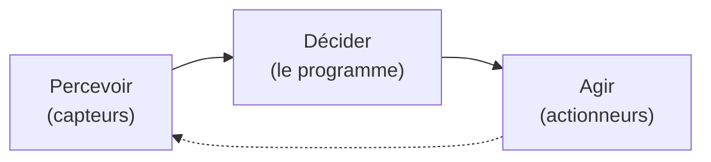
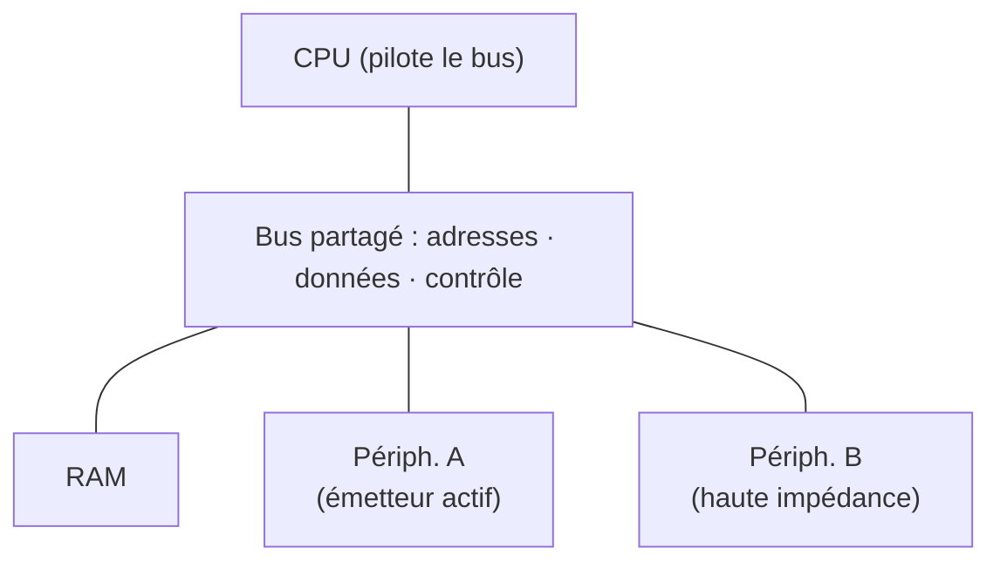
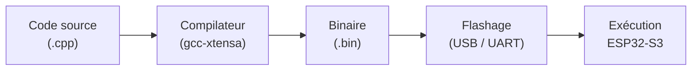

## Au programme

1. L'atelier
2. Un ordinateur sur une puce
3. Sous le capot
4. Du code à la puce

<aside class="notes" markdown="1">
1 h 30 de cours, sans manipulation. Fil rouge de tout l'atelier : la console de jeu (Pong en TD, Snake multijoueur en projet).
Partie 1 (environ 10 min) : où trouver la documentation, le déroulé du module, ce qu'ils vont y apprendre et à quoi ça leur servira.
Parties 2 et 3 : le vocabulaire et la puce. Partie 4 : la chaîne de développement et le temps dans `loop()`, plus concrète, à garder pour la seconde moitié quand l'attention baisse.
La partie 4 s'ouvre sur compilé / interprété (environ 5 min) : partir de Python, qu'ils connaissent, sans entrer dans la syntaxe.
</aside>

---

## Ce que vous saurez faire

### À la fin de ce cours, vous saurez :

- comprendre ce qu'est un microcontrôleur, et ce qui le distingue d'un PC
- nommer les blocs d'une puce : CPU, Flash, RAM, périphériques, bus
- expliquer ce qu'est un **registre**, et à quoi sert une **interruption**
- dire ce qui distingue un langage **compilé** (C/C++) d'un langage **interprété** (Python)
- suivre le trajet du code source jusqu'à l'exécution sur la puce
- dire pourquoi `delay()` pose problème dans une `loop()`

Fil rouge de l'atelier : un **Pong**, puis un **Snake multijoueur**.
{: .caption}

[L'atelier Microcontrôleurs](/workshops/microcontroleur/){: .doc-link}

---

<!-- .slide: class="slide-section" -->

## L'atelier

Où trouver l'aide, ce qui vous attend, et pourquoi

---

## Tout est sur le site

**doc.makerspace-amiens.fr**, rubrique **Ateliers**, puis **Microcontrôleurs**.

- Le **syllabus** et l'**évaluation**
- Les **slides** de chaque cours, dont celles-ci
- Les **concepts** : la théorie, à relire avant chaque TD
- Les **tutoriels** : chaque TD, pas à pas
- Les **guides** : quand quelque chose ne marche pas

Chaque slide se termine par une pastille qui ouvre la page correspondante. **↓** pour la page de l'atelier.
{: .caption}

[L'atelier Microcontrôleurs](/workshops/microcontroleur/){: .doc-link}

<!-- .down -->

## La page de l'atelier

<iframe class="page-preview" data-src="/workshops/microcontroleur/" title="Page de l'atelier Microcontrôleurs"></iframe>

---

## Trouver la bonne page

| Vous voulez... | Allez voir |
|---|---|
| Comprendre une notion | Un **concept** (GPIO, bus, machine à états...) |
| Faire, étape par étape | Le **tutoriel** du TD |
| Débloquer un problème | Un **guide** (carte introuvable, écran noir) |
| Une caractéristique d'un composant | Sa **fiche de référence** (XIAO, écran) |
| Le détail complet d'une puce | Sa **datasheet**, sur le site du fabricant |
{: .table-dense}

La barre de **recherche** du site trouve une page par mot-clé. Le bouton **Besoin d'aide ?**, en bas à droite, ouvre l'assistant IA du MakerSpace.
{: .caption}

[Syllabus de l'atelier](/workshops/microcontroleur/syllabus/){: .doc-link} [Récupérer une carte ESP32-S3](/docs/how-to-guides/esp32-s3-carte-introuvable/){: .doc-link}

---

## Hors du site : les sources officielles

- **Espressif** : la datasheet de l'ESP32-S3, la documentation Arduino-ESP32
- **Seeed Studio** : le wiki de la carte XIAO ESP32S3
- **Les bibliothèques** : leur page GitHub, son README et ses exemples
- **PlatformIO** : sa documentation, pour la configuration du projet

Un forum ou un assistant IA aide à chercher. Mais quand deux sources se contredisent, c'est la **documentation du fabricant** qui tranche.
{: .highlight-red}

[XIAO ESP32S3](/docs/references/hardware/xiao-esp32s3/){: .doc-link}

---

## Le déroulé du module

| Séance | Durée | Ce que vous faites |
|---|---|---|
| CM1, CM2, CM3 | 3 × 1 h 30 | Les concepts, en cours |
| TD1 | 1 h 30 | Installer, flasher un premier programme |
| TD2 | 3 h | Tester les modules de la mallette |
| TD3 | 3 h | Concevoir votre carte sous KiCad |
| TD4 | 3 h | Souder la carte, y faire tourner un Pong |
| Projet | 24 h | Un Snake multijoueur, en binôme |
{: .table-dense}

Les trois cours d'abord, puis les TD, puis le projet. Chaque étape s'appuie sur la précédente.
{: .caption}

[Syllabus de l'atelier](/workshops/microcontroleur/syllabus/){: .doc-link}

---

## Comment vous êtes évalués

<div class="columns" markdown="1">
<div markdown="1">

<p class="big-number">30 %</p>

**Les TD** : chaque checkpoint validé en séance, dont les deux validations de votre carte

</div>
<div markdown="1">

<p class="big-number">70 %</p>

**Le projet** : le jeu, le joueur du navigateur, le code, le repo et la démonstration

</div>
</div>

Un checkpoint se valide **en séance**, sur votre montage : venir avec un travail qui marche.
{: .caption}

[Évaluation de l'atelier](/workshops/microcontroleur/evaluation/){: .doc-link}

---

## Ce que vous allez aborder

<div class="columns" markdown="1">
<div markdown="1">

### Électronique

- Lire et tester un composant
- Câbler sur breadboard
- Concevoir une carte, la souder

### Informatique embarquée

- Programmer en C/C++
- Ne jamais bloquer le programme
- Structurer avec une machine à états

</div>
<div markdown="1">

### Réseau

- Wi-Fi, page web, WebSocket
- Concevoir un protocole

### Méthode

- Tester, valider, documenter
- Mener un projet en binôme

</div>
</div>

[Syllabus de l'atelier](/workshops/microcontroleur/syllabus/){: .doc-link}

---

## Et dans votre vie d'ingénieur ?

- Les microcontrôleurs sont **partout** : voiture, médical, industrie, énergie
- Vous en **choisirez**, en **spécifierez**, en **intégrerez** dans vos produits
- Vous **parlerez la même langue** que les électroniciens
- Vous saurez **prototyper** seul un capteur, un banc de test, un démonstrateur
- Tester, concevoir, documenter : des réflexes pour tout projet

Même sans programmer de microcontrôleur au quotidien, vous travaillerez avec ceux qui le font.
{: .caption}

[L'atelier Microcontrôleurs](/workshops/microcontroleur/){: .doc-link}

---

## Activité : c'est quoi, pour vous ?

### Qu'est-ce que c'est, pour vous, un microcontrôleur ?

- Une réponse par personne, à voix haute : un mot, une phrase, un exemple
- Pas de bonne ou de mauvaise réponse

<aside class="notes" markdown="1">
Laisser venir toutes les réponses, même fausses ou floues (« un petit processeur », « une Arduino », « une puce dans une machine à laver »...) : elles serviront de point de départ. Reformuler à l'oral ce qui relève de la nature (un ordinateur, une puce), des exemples (objets du quotidien) et du rôle (commander, mesurer).
Les slides suivantes reprennent ces réponses : citer celles de la classe au passage pour les compléter ou les corriger.
</aside>

---

<!-- .slide: class="slide-section" -->

## Un ordinateur sur une puce

Percevoir, décider, agir

---

## Il y en a des centaines autour de vous

- Chaque **téléphone** en contient plusieurs : tactile, batterie, radio
- Les **écouteurs sans fil**, les **montres**, les **badges** d'accès
- Dans chaque salle : **vidéoprojecteur**, **détecteur de fumée**, **thermostat**
- Dans le couloir : l'**imprimante**, le **distributeur**, les **lecteurs de badge**
- Chez vous : le **micro-ondes**, la **machine à laver**, la **télécommande**
- Et **50 à 150** dans une voiture récente : vitres, airbags, injection

Aucun n'a besoin d'un « vrai » ordinateur. Ils ont besoin d'une puce à quelques euros, qui démarre instantanément et fait sa tâche en boucle.
{: .caption}

[Qu'est-ce qu'un microcontrôleur ?](/workshops/microcontroleur/concepts/qu-est-ce-qu-un-microcontroleur/){: .doc-link}

---

## Toujours la même boucle



Un thermostat *perçoit* la température, *décide* qu'il fait trop froid, *agit* en allumant le chauffage. Puis il recommence, indéfiniment.

Cette boucle, vous la retrouverez telle quelle dans votre Pong : lire le joystick, calculer la position de la balle, redessiner l'écran.
{: .caption}

[Qu'est-ce qu'un microcontrôleur ?](/workshops/microcontroleur/concepts/qu-est-ce-qu-un-microcontroleur/){: .doc-link} [Les capteurs](/docs/concepts/capteurs/){: .doc-link}

---

## Le « décider », c'est vous.

<pre><code class="language-cpp" data-trim data-line-numbers="2|3|4">
void loop() {
  int temperature = lireCapteur();   // percevoir
  if (temperature &lt; 19) {           // décider
    allumerChauffage();              // agir
  }
}
</code></pre>

Le microcontrôleur ne sait rien faire tout seul. Sans programme, c'est une puce inerte : le seuil de 19 °C et ce qu'on en fait, personne ne les écrira pour vous.
{: .caption}

---

## Le vocabulaire de l'atelier

| Terme | Ce que c'est | Exemples du projet |
|---|---|---|
| **Capteur** | Traduit une grandeur physique en signal électrique | bouton, joystick, potentiomètre |
| **Actionneur** | Transforme un signal électrique en action | LED, écran, moteur, buzzer |
| **Broche** (*pin*) | Une patte de la puce, reliée au monde extérieur | D5, D0 (GPIO6, GPIO1) |
| **Programme** | La suite d'instructions que vous écrivez | `main.cpp` |
{: .table-dense}

Un bouton est un capteur, une LED est un actionneur.
{: .caption}

[Les capteurs](/docs/concepts/capteurs/){: .doc-link}

---

## Le monde physique n'attend pas

Un microcontrôleur est jugé sur sa **ponctualité**, pas sur sa puissance.

- Un **airbag** doit se déclencher 20 ms après le choc, jamais 100
- L'écran du **Pong** se redessine toutes les 16 ms, sinon ça saccade
- Un **servomoteur** attend une impulsion toutes les 20 ms, à 10 µs près
- {: .highlight-red} Tenir le délai **à chaque tour** compte plus qu'aller vite une fois

**Déterministe** : les mêmes entrées produisent les mêmes actions, dans le même temps, à chaque tour. Sur un PC un retard de 200 ms passe inaperçu, ici il casse le système. Le **temps réel**, ce n'est pas « vite », c'est « à l'heure ».
{: .caption}

<aside class="notes" markdown="1">
La slide qui prépare toute la suite : c'est parce que la puce est branchée sur le monde physique qu'elle doit être prévisible, et c'est ce déterminisme qui explique qu'on n'y fasse pas tourner un système d'exploitation de PC (partie 3) et la chasse aux `delay()`.
Contre-exemple utile : sur un PC, un antivirus qui se réveille vole 300 ms au programme. Personne ne s'en plaint. Un servomoteur, lui, tremble.
</aside>

[Qu'est-ce qu'un microcontrôleur ?](/workshops/microcontroleur/concepts/qu-est-ce-qu-un-microcontroleur/){: .doc-link}

---

## Pourquoi pas un « vrai » ordinateur ?

| | Ordinateur classique | Microcontrôleur |
|---|---|---|
| **Tâches** | Des milliers, en même temps | Une seule, en boucle |
| **Prix** | Plusieurs centaines d'€ | Quelques euros, parfois centimes |
| **Énergie** | Se branche au secteur | Des mois sur une pile |
| **Démarrage** | Plusieurs secondes | Instantané |
| **Système** | Un OS complet | Aucun, en général |
{: .table-dense}

C'est cette sobriété qui le rend si présent : on peut en mettre partout, pour presque rien, sans y penser.
{: .caption}

[Qu'est-ce qu'un microcontrôleur ?](/workshops/microcontroleur/concepts/qu-est-ce-qu-un-microcontroleur/){: .doc-link}

---

## Et le Raspberry Pi, alors ?

<div class="columns" markdown="1">
<div markdown="1">

### Microcontrôleur

Une seule tâche, du temps réel, très peu d'énergie, démarrage immédiat.

**ESP32-S3, Arduino, STM32**

</div>
<div markdown="1">

### Nano-ordinateur

Un vrai système d'exploitation (Linux), un écran, le réseau complet, beaucoup de mémoire.

**Raspberry Pi**

</div>
</div>

La question à se poser n'est pas « lequel est le plus puissant » mais « de quoi ai-je réellement besoin ». Un Raspberry Pi qui met 20 secondes à démarrer ne peut pas déclencher un airbag.
{: .caption}

[Qu'est-ce qu'un microcontrôleur ?](/workshops/microcontroleur/concepts/qu-est-ce-qu-un-microcontroleur/){: .doc-link}

---

## Qui fabrique les microcontrôleurs ?

| Fabricant | Pays | Familles | Spécialité |
|---|---|---|---|
| STMicroelectronics | France / Italie | STM32 | Industrie, gamme immense |
| NXP | Pays-Bas | LPC, i.MX RT | Automobile, sans contact |
| Infineon | Allemagne | AURIX, PSoC | Automobile, puissance |
| Renesas | Japon | RA, RX | Automobile, Arduino Uno R4 |
| Microchip | États-Unis | PIC, AVR | L'ATmega de l'Arduino Uno |
| Espressif | Chine | ESP32 | Le Wi-Fi intégré, à bas coût |
{: .table-dense}

Les cinq premiers se partagent l'essentiel du marché, tiré par l'automobile. D'autres règnent sur un créneau : Nordic pour le Bluetooth, Raspberry Pi pour l'éducation.
{: .caption}

[Qu'est-ce qu'un microcontrôleur ?](/workshops/microcontroleur/concepts/qu-est-ce-qu-un-microcontroleur/){: .doc-link}

---

## Espressif, le Wi-Fi pour tous

- **2008** : création à Shanghai
- **2014** : l'**ESP8266** met une puce Wi-Fi programmable à quelques euros
- **2016** : l'**ESP32** ajoute un second cœur et le Bluetooth
- Les makers s'en emparent : Arduino, documentation ouverte, milliers de projets
- L'industrie aussi : prises, ampoules, capteurs connectés

Pas le plus gros fabricant, mais la référence de l'objet connecté en Wi-Fi.
{: .caption}

[Qu'est-ce qu'un microcontrôleur ?](/workshops/microcontroleur/concepts/qu-est-ce-qu-un-microcontroleur/){: .doc-link}

---

## La famille ESP32

| Puce | Cœurs | Radio | Pour quoi |
|---|---|---|---|
| ESP32 | 2 × 240 MHz | Wi-Fi, Bluetooth | L'original, polyvalent |
| ESP32-S2 | 1 × 240 MHz | Wi-Fi | USB natif |
| **ESP32-S3** | **2 × 240 MHz** | **Wi-Fi, BLE 5** | **Le plus puissant en Wi-Fi** |
| ESP32-C3 | 1 × 160 MHz | Wi-Fi, BLE 5 | Petit prix, cœur RISC-V |
| ESP32-C6 | 1 × 160 MHz | Wi-Fi 6, BLE, Thread | Maison connectée |
| ESP32-P4 | 2 × 400 MHz | Aucune | Multimédia |
{: .table-dense}

**S** : performance, **C** : économique (RISC-V), **P** : haute performance sans radio. L'ESP32-S3 est le **haut de la gamme connectée**.
{: .caption}

[Qu'est-ce qu'un microcontrôleur ?](/workshops/microcontroleur/concepts/qu-est-ce-qu-un-microcontroleur/){: .doc-link}

---

## Pourquoi l'ESP32-S3 ?

- **Wi-Fi et Bluetooth intégrés** : le joueur 2 joue depuis un navigateur
- **De la puissance en réserve** : jeu, écran couleur et réseau en même temps
- **USB natif** : on programme sans pilote, sur tous les systèmes
- **Un écosystème accessible** : Arduino, PlatformIO, ESP-IDF
- **Moins de 10 € la carte**, et la même puce dans de vrais produits

En contrepartie : il consomme plus qu'une puce basse consommation, et il vit en **3,3 V**.
{: .caption}

[Qu'est-ce qu'un microcontrôleur ?](/workshops/microcontroleur/concepts/qu-est-ce-qu-un-microcontroleur/){: .doc-link}

---

## Puce, module ou carte de développement ?

<div class="columns is-3" markdown="1">
<div markdown="1">

### La puce

{: .img-sm}

- Le µC seul, 7 × 7 mm
- Inutilisable seule

</div>
<div markdown="1">

### Le module

{: .img-sm}

- Puce, Flash, quartz
- Antenne, blindage

</div>
<div markdown="1">

### La carte de dev

{: .img-sm}

- USB, régulateur
- Boutons, broches

</div>
</div>

Vous programmez **la puce**. La **carte de dev** (XIAO) ajoute ce qu'il faut pour la brancher au PC. **↓** pour voir ce qu'elle contient.
{: .caption}

[XIAO ESP32S3](/docs/references/hardware/xiao-esp32s3/){: .doc-link}

<!-- .down -->

## Ce qu'il y a sur la XIAO

{: .img-md}

La puce ESP32-S3 au centre, son quartz à 40 MHz, sa Flash de 8 Mo, l'antenne et les condensateurs de découplage. Schéma : Seeed Studio.
{: .caption}

[XIAO ESP32S3](/docs/references/hardware/xiao-esp32s3/){: .doc-link}

<!-- .down -->

## Le brochage de la XIAO

{: .img-md}

11 broches, D0 à D10, chacune avec plusieurs fonctions possibles. Image : Seeed Studio.
{: .caption}

[XIAO ESP32S3](/docs/references/hardware/xiao-esp32s3/){: .doc-link}

---



[GPIO et monde numérique](/workshops/microcontroleur/concepts/gpio-monde-numerique/){: .doc-link}

---

<!-- .slide: class="slide-section" -->

## Sous le capot

CPU, mémoires, périphériques, bus

---

## Le schéma-bloc, votre carte mentale

{: .img-md}

Chaque concept de l'atelier détaille l'une de ces briques.
{: .caption}

[Architecture d'un microcontrôleur](/workshops/microcontroleur/concepts/architecture-microcontroleur/){: .doc-link}

---

## Cinq briques, une seule puce

| Bloc | Rôle | Accès logiciel |
|---|---|---|
| **CPU** | Exécute les instructions une par une | direct |
| **Flash** | Stocke le programme (persistant) | lecture à l'exécution |
| **RAM** | Variables, pile d'appels (volatile) | lecture/écriture rapide |
| **Périphériques** | GPIO, ADC, UART, SPI, PWM | via **registres** |
| **Bus** | Relie tout le monde | transparent sous Arduino |
{: .table-dense}

Tout est sur le même silicium : un **système sur puce**. Il suffit de l'alimenter.
{: .caption}

[Architecture d'un microcontrôleur](/workshops/microcontroleur/concepts/architecture-microcontroleur/){: .doc-link}

---

<!-- .slide: data-auto-animate -->

## Le CPU ne sait faire qu'une chose

<div class="demo-flow">
  <div class="demo-box is-big" data-id="fetch">Fetch</div>
</div>

**Fetch** : aller chercher en Flash l'instruction suivante, à l'adresse indiquée par le compteur de programme.

---

<!-- .slide: data-auto-animate -->

## Le CPU ne sait faire qu'une chose

<div class="demo-flow">
  <div class="demo-box" data-id="fetch">Fetch</div>
  <span class="demo-arrow" data-id="a1">→</span>
  <div class="demo-box is-big" data-id="decode">Decode</div>
</div>

**Decode** : comprendre ce que l'instruction demande, et sur quelles données.

---

<!-- .slide: data-auto-animate -->

## Le CPU ne sait faire qu'une chose

<div class="demo-flow">
  <div class="demo-box" data-id="fetch">Fetch</div>
  <span class="demo-arrow" data-id="a1">→</span>
  <div class="demo-box" data-id="decode">Decode</div>
  <span class="demo-arrow" data-id="a2">→</span>
  <div class="demo-box is-accent is-big" data-id="execute">Execute</div>
</div>

**Execute** : calculer dans l'**ALU**, ou transférer une donnée. Puis recommencer, **240 millions de fois par seconde**.

Au fond, un CPU ne fait que deux choses : calculer, et déplacer des octets d'un endroit à un autre.
{: .caption}

[Architecture d'un microcontrôleur](/workshops/microcontroleur/concepts/architecture-microcontroleur/){: .doc-link}

---

## 240 MHz, ça veut dire quoi ?

| Opération | Ordre de grandeur |
|---|---|
| Une multiplication entière | un ou deux cycles |
| Un `digitalWrite()` | quelques dizaines de cycles |
| Redessiner l'écran 240 × 320 en SPI | quelques millions de cycles |
| Établir une connexion Wi-Fi | plusieurs centaines de millions |
{: .table-dense}

À 60 images par seconde, chaque image dispose de **4 millions de cycles**.
{: .highlight-red}

[Architecture d'un microcontrôleur](/workshops/microcontroleur/concepts/architecture-microcontroleur/){: .doc-link}

<!-- .down -->

## L'horloge, vue de près

{: .img-md}

Chaque front fait avancer le CPU d'un pas : 240 millions de fois par seconde.
{: .caption}

[Architecture d'un microcontrôleur](/workshops/microcontroleur/concepts/architecture-microcontroleur/){: .doc-link}

---

## Deux cœurs, et le droit de dormir

- L'ESP32-S3 a **deux cœurs** Xtensa LX7 : sous Arduino, `setup()`/`loop()` tournent sur le cœur 1, le Wi-Fi occupe le cœur 0 en arrière-plan, sous la conduite d'un petit noyau (FreeRTOS)
- Couper l'horloge d'un périphérique inutilisé économise de l'énergie
- Les **modes veille** (*light sleep*, *deep sleep*) éteignent tout ou partie de la puce
- Le **RTC** continue de tourner en veille profonde pour réveiller la carte à l'heure dite

C'est ce qui permet à un capteur sur pile de tenir des mois : il dort 99,9 % du temps.
{: .caption}

[Architecture d'un microcontrôleur](/workshops/microcontroleur/concepts/architecture-microcontroleur/){: .doc-link}

---

## Deux mémoires, deux usages

| | Flash | RAM (SRAM) |
|---|---|---|
| **Contenu** | Programme compilé, constantes | Variables, pile, heap |
| **Persistance** | Survit au reset | Perdue à l'extinction |
| **Vitesse** | Plus lente | Très rapide |
| **Taille** | 8 Mo | 512 Ko (+ 8 Mo PSRAM) |
{: .table-dense}

Deux espaces d'adressage séparés : une architecture **Harvard modifiée**. **↓** pour les situer sur le schéma-bloc.
{: .caption}

[Architecture d'un microcontrôleur](/workshops/microcontroleur/concepts/architecture-microcontroleur/){: .doc-link}

<!-- .down -->

## Les mémoires sur le schéma-bloc

{: .img-md}

Repérez la **ROM** (le programme de démarrage gravé en usine), la **SRAM** interne, et le lien vers la **Flash** et la **PSRAM**, externes à la puce.
{: .caption}

[Architecture d'un microcontrôleur](/workshops/microcontroleur/concepts/architecture-microcontroleur/){: .doc-link}

---

## Le glossaire des périphériques

| Sigle | Nom complet | Rôle |
|---|---|---|
| **GPIO** | General Purpose Input/Output | Entrée ou sortie numérique |
| **ADC** | Analog to Digital Converter | Tension vers nombre |
| **UART / I2C / SPI** | | Bus série |
| **Timer** | Compteur matériel | Événements périodiques, PWM |
| **DMA** | Direct Memory Access | Transfert sans le CPU |
| **RTC** | Real-Time Clock | Horloge, même en veille |
| **Watchdog** | Chien de garde | Redémarre si blocage |
{: .table-dense}

Chaque sigle aura sa slide au CM2 ou au CM3.
{: .caption}

[Architecture d'un microcontrôleur](/workshops/microcontroleur/concepts/architecture-microcontroleur/){: .doc-link}

---



[ADC et PWM](/workshops/microcontroleur/concepts/adc-pwm/){: .doc-link}

---

## Le bus : une autoroute partagée



Trois faisceaux : l'**adresse** dit à qui on parle, les **données** transitent, le **contrôle** précise « je lis » ou « j'écris ».

[Architecture d'un microcontrôleur](/workshops/microcontroleur/concepts/architecture-microcontroleur/){: .doc-link}

---

## Un seul composant parle à la fois

Si deux périphériques poussaient une valeur en même temps sur le bus de données, l'un forçant un 0 et l'autre un 1, ce serait un **court-circuit**.

D'où les sorties **trois états** : en plus de 0 et 1, un état de **haute impédance** qui déconnecte électriquement le composant de la ligne.

À tout instant, un seul émetteur est actif ; tous les autres sont à l'écoute. C'est l'adresse qui désigne celui qui a le droit de répondre.
{: .highlight-red}

Retenez le mot **haute impédance** : il reviendra au CM2 avec les entrées flottantes, et au CM3 avec l'I2C.
{: .caption}

[Architecture d'un microcontrôleur](/workshops/microcontroleur/concepts/architecture-microcontroleur/){: .doc-link}

---

## Les registres : l'interface matériel / logiciel

Chaque périphérique se pilote par des **registres** : de simples cases mémoire à une adresse fixe.

- Écrire dans un registre allume une LED
- Lire un registre donne l'état d'un bouton
- {: .highlight-red} `digitalWrite(LED, HIGH)` écrit dans le bon registre

Ranger une variable et allumer une LED : la même opération, poser une valeur à une adresse.
{: .caption}

[Architecture d'un microcontrôleur](/workshops/microcontroleur/concepts/architecture-microcontroleur/){: .doc-link}

---

## Un registre, c'est 32 interrupteurs

Un registre de 32 bits pilote souvent 32 choses à la fois : un bit par broche, un bit par option. On ne touche qu'au bit visé, avec les opérateurs **bit à bit** du C :

```cpp
reg |=  (1 << n);      // met le bit n à 1, sans toucher aux autres
reg &= ~(1 << n);      // met le bit n à 0
reg ^=  (1 << n);      // inverse le bit n
if (reg & (1 << n))    // teste le bit n
```

C'est la langue des fiches techniques : le manuel de référence décrit chaque registre bit par bit.
{: .caption}

[Architecture d'un microcontrôleur](/workshops/microcontroleur/concepts/architecture-microcontroleur/){: .doc-link}

---

## Décomposer `reg |= (1 << n)`

L'instruction combine trois opérations :

1. **Le décalage `1 << n`** : la valeur 1 (`00000001`) décalée de *n* positions vers la gauche. Pour *n* = 3 : `00001000`. C'est un **masque** : seul le bit visé vaut 1.
2. **Le OU bit à bit `|`** : 1 OU x donne 1, donc le bit visé passe à 1 ; 0 OU x donne x, donc les autres ne changent pas.
3. **L'affectation `|=`** : le raccourci de `reg = reg | (1 << n);`.

[Architecture d'un microcontrôleur](/workshops/microcontroleur/concepts/architecture-microcontroleur/){: .doc-link}

---

## Un exemple, bit par bit

On veut mettre le bit 3 à 1, sans toucher aux autres :

```text
reg            1010 0001
1 << 3         0000 1000   le masque
reg | masque   1010 1001   seul le bit 3 a changé
```

Les bits se numérotent **de droite à gauche**, en partant de 0. La même idée sert pour les autres lignes : `& ~masque` met le bit à 0, `^ masque` l'inverse, `& masque` le teste.
{: .caption}

[Architecture d'un microcontrôleur](/workshops/microcontroleur/concepts/architecture-microcontroleur/){: .doc-link}

<!-- .down -->

## Le masque, case par case

{: .img-md}

Les huit premiers bits d'un registre de 32 : seul le bit visé change.
{: .caption}

[Architecture d'un microcontrôleur](/workshops/microcontroleur/concepts/architecture-microcontroleur/){: .doc-link}

---

## Sous `digitalWrite()`, une écriture

```cpp
digitalWrite(21, HIGH);                   // la version Arduino
REG_WRITE(GPIO_OUT_W1TS_REG, 1 << 21);    // le registre, directement
REG_WRITE(GPIO_OUT_W1TC_REG, 1 << 21);    // remet la broche à 0
```

`GPIO_OUT_W1TS_REG` n'est qu'un nom pour l'adresse `0x60004008`. *W1TS* : *write 1 to set*, seuls les bits écrits à 1 passent à 1, les autres ne bougent pas.

Pourquoi pas `GPIO_OUT_REG |= ...` ? Il faut lire, modifier, réécrire : si une interruption change le registre entre-temps, sa modification est perdue. W1TS le fait en **une seule écriture**.
{: .caption}

[Architecture d'un microcontrôleur](/workshops/microcontroleur/concepts/architecture-microcontroleur/){: .doc-link} [ESP32-S3 Technical Reference Manual](https://www.espressif.com/sites/default/files/documentation/esp32-s3_technical_reference_manual_en.pdf){: .doc-link}

<aside class="notes" markdown="1">
Personne n'écrira de registre à la main dans l'atelier : le but est de montrer qu'il n'y a pas de magie sous `digitalWrite()`. C'est aussi ce qui rend le code Arduino portable : la fonction est la même, seuls l'adresse et le bit changent d'une puce à l'autre.
</aside>

---

## Activité : Flash ou RAM ?

### Dans votre Pong, où vit chacun de ces éléments ?

- Le code de `loop()`
- Le score de la partie
- L'image d'un sprite, déclarée `const`
- La position de la balle
- Le nom du réseau Wi-Fi, écrit en dur
- Un compteur local, dans une fonction

<aside class="notes" markdown="1">
Question bonus pour départager : lesquels survivent à un appui sur RESET ? Réponse sur la slide suivante : tout ce qui est en Flash (le code, les constantes, le texte écrit en dur), rien de ce qui est en RAM. Le score repart à zéro.
</aside>

---

## Où vivent vos variables

| Ce que vous écrivez | Où ça vit | Combien de temps |
|---|---|---|
| Le code, les chaînes écrites en dur | Flash | survit au reset |
| `const uint16_t SPRITE[] = {...};` | Flash | survit au reset |
| `int score;` en dehors des fonctions | RAM | tout le programme |
| `int i;` dans une fonction | RAM, sur la **pile** | le temps de l'appel |
{: .table-dense}

Le mot `const` déplace un grand tableau de la RAM vers la Flash : précieux pour les images d'un jeu.
{: .caption}

[Architecture d'un microcontrôleur](/workshops/microcontroleur/concepts/architecture-microcontroleur/){: .doc-link}

---

## La pile et le tas

<div class="columns" markdown="1">
<div markdown="1">

### La pile (*stack*)

- Variables locales, paramètres
- Prise à l'appel, rendue au retour
- Rapide, automatique, mais petite

</div>
<div markdown="1">

### Le tas (*heap*)

- Mémoire réservée à la demande
- Utilisé par `String`, le Wi-Fi
- Se fragmente à la longue

</div>
</div>

Un grand tableau déclaré dans une fonction peut faire **déborder la pile** : la puce redémarre. Dans un jeu, préférez des variables globales de taille fixe.
{: .caption}

<aside class="notes" markdown="1">
La pile, c'est une pile d'assiettes : chaque appel de fonction pose une assiette (ses variables locales), le retour la retire. Tout est automatique, mais la pile est petite (quelques Ko pour la tâche de `loop()`).
Le tas, c'est un parking : on prend une place quand on en a besoin, on la rend quand on part. À force d'arrivées et de départs, il reste des places libres éparpillées, trop petites pour une grande voiture : c'est la fragmentation. Les `String` d'Arduino et la pile Wi-Fi s'en servent en coulisse.
</aside>

[Architecture d'un microcontrôleur](/workshops/microcontroleur/concepts/architecture-microcontroleur/){: .doc-link}

<!-- .down -->

## La carte de la mémoire

{: .img-md}

Si la pile et le tas se rejoignent, la puce redémarre.
{: .caption}

[Architecture d'un microcontrôleur](/workshops/microcontroleur/concepts/architecture-microcontroleur/){: .doc-link}

---

<!-- .slide: class="slide-section" -->

## Du code à la puce

Compiler, flasher, exécuter

---

## En quel langage ?

- Sur un microcontrôleur, on programme en **C** ou en **C++**
- **Arduino**, c'est du **C++**
- Vous connaissez Python : la logique est la même

Ce qui change, c'est **quand** le code est traduit en instructions pour le processeur.
{: .caption}

[Du matériel au logiciel](/workshops/microcontroleur/concepts/du-materiel-au-logiciel/){: .doc-link}

---

## Arduino : trois choses sous un même nom

<div class="columns is-3" markdown="1">
<div markdown="1">

### Des cartes

Uno, Nano, Mega : des cartes de développement, souvent autour d'un ATmega

</div>
<div markdown="1">

### Un logiciel

L'Arduino IDE, pour écrire, compiler et téléverser

</div>
<div markdown="1">

### Un framework

`setup()`, `loop()`, `digitalWrite()`... porté sur des centaines de puces, dont l'ESP32-S3

</div>
</div>

Dans l'atelier, on utilise **le framework** (Arduino-ESP32), avec PlatformIO. Ni la carte, ni l'IDE.
{: .highlight-red}

[Du matériel au logiciel](/workshops/microcontroleur/concepts/du-materiel-au-logiciel/){: .doc-link}

---

## Pourquoi pas une carte Arduino Uno ?

| | Arduino Uno | XIAO ESP32S3 |
|---|---|---|
| **Processeur** | ATmega328P, 8 bits, 16 MHz | ESP32-S3, 2 cœurs 32 bits, 240 MHz |
| **RAM** | 2 Ko | 512 Ko + 8 Mo |
| **Wi-Fi, Bluetooth** | Non | Oui |
| **Tension logique** | 5 V | 3,3 V |
| **Taille** | 69 × 53 mm | 21 × 18 mm |
{: .table-dense}

Le framework Arduino apporte la **simplicité** ; l'ESP32-S3, la **puissance** et le **Wi-Fi** qu'exigent un écran couleur et le joueur du navigateur.
{: .caption}

[Qu'est-ce qu'un microcontrôleur ?](/workshops/microcontroleur/concepts/qu-est-ce-qu-un-microcontroleur/){: .doc-link}

---

## Compilé ou interprété

<div class="columns" markdown="1">
<div markdown="1">

### C / C++ : compilé

Le **compilateur** traduit tout le programme **avant**, sur votre PC, en **code machine**.

La puce l'exécute directement.

</div>
<div markdown="1">

### Python : interprété

Un **interpréteur** traduit le code **pendant** l'exécution, au fur et à mesure.

Il doit tourner sur la machine qui exécute.

</div>
</div>

[Du matériel au logiciel](/workshops/microcontroleur/concepts/du-materiel-au-logiciel/){: .doc-link}

---

## Pourquoi le C/C++ sur un microcontrôleur ?

- **Pas d'interpréteur** à loger dans la petite mémoire de la puce
- **Rapide** : la puce exécute directement le code machine
- **Des erreurs repérées tôt** : le compilateur les signale avant de flasher

[Du matériel au logiciel](/workshops/microcontroleur/concepts/du-materiel-au-logiciel/){: .doc-link}

---

## Le voyage complet



Un clic sur **Upload** déclenche les quatre étapes, toujours dans cet ordre. Quand quelque chose échoue, la première question est : **à quelle étape ?**

[Du matériel au logiciel](/workshops/microcontroleur/concepts/du-materiel-au-logiciel/){: .doc-link}

---

## La toolchain Arduino-ESP32

| Élément | Rôle |
|---|---|
| **Compilateur** (gcc pour Xtensa) | Traduit le C++ en instructions machine |
| **Core Arduino** | Fournit `pinMode()`, `digitalWrite()`, `analogRead()` |
| **Uploader** (esptool) | Transfère le binaire vers la Flash, par USB |
{: .table-dense}

L'IDE ne fait qu'orchestrer ces trois outils. Arduino IDE ou PlatformIO, la chaîne reste la même : **compiler, flasher, exécuter**.
{: .caption}

[PlatformIO](/docs/references/software/platformIO/){: .doc-link} [Arduino IDE](/docs/references/software/arduino-ide/){: .doc-link}

---

## « Compiler » recouvre trois étapes

1. **Préprocesseur** : traite les `#include` et les `#define`, colle le contenu des bibliothèques
2. **Compilation** : chaque fichier C++ devient du code objet, séparément
3. **Édition de liens** : tous les objets sont assemblés en un binaire, en résolvant les références

Savoir les distinguer, c'est savoir lire une erreur. C'est la compétence la plus rentable du semestre.
{: .caption}

[Du matériel au logiciel](/workshops/microcontroleur/concepts/du-materiel-au-logiciel/){: .doc-link}

---

## Lire une erreur

| Message | Étape | Cause probable |
|---|---|---|
| `expected ';' before ...` | compilation | une faute de syntaxe, souvent une ligne **avant** |
| `'x' was not declared` | compilation | variable mal orthographiée, ou `#include` manquant |
| `undefined reference to ...` | édition de liens | bibliothèque absente de `lib_deps` |
| `A fatal error occurred: Failed to connect` | flashage | mauvais port, câble sans data, bouton **BOOT** |
{: .table-dense}

Corrigez la **première** erreur, pas les 40 suivantes.
{: .highlight-red}

[Du matériel au logiciel](/workshops/microcontroleur/concepts/du-materiel-au-logiciel/){: .doc-link}

---

## Lire une compilation réussie

```text
RAM:   [=         ]   6.0% (used 19736 bytes from 327680 bytes)
Flash: [=         ]   8.1% (used 270213 bytes from 3342336 bytes)
========== [SUCCESS] Took 4.21 seconds ==========
```

Un simple Blink pèse déjà **270 Ko** : le core Arduino, FreeRTOS et les pilotes USB sont compilés avec vos dix lignes.

- **RAM** : les variables globales (ni la pile, ni le tas)
- **Flash** : le code et les constantes, ce que le flashage écrit

Valeurs indicatives sur la XIAO ESP32S3. Surveillez ces deux lignes quand vous ajouterez des images.
{: .caption}

[Du matériel au logiciel](/workshops/microcontroleur/concepts/du-materiel-au-logiciel/){: .doc-link}

---



[Vérification de la toolchain](/workshops/microcontroleur/tutorials/toolchain-blink/){: .doc-link}

---

## Tout un programme en deux fonctions

```cpp
void setup() {                      // une seule fois, au démarrage
  pinMode(LED_PIN, OUTPUT);
  Serial.begin(115200);
}

void loop() {                       // en boucle, jusqu'à la coupure
  digitalWrite(LED_PIN, HIGH);
  delay(500);
  digitalWrite(LED_PIN, LOW);
  delay(500);
}
```

Pas de `main()` : le core Arduino l'écrit, et appelle `setup()` puis `loop()`. Sous PlatformIO, `main.cpp` commence par `#include <Arduino.h>` : sans elle, aucune de ces fonctions n'existe.
{: .caption}

[Du matériel au logiciel](/workshops/microcontroleur/concepts/du-materiel-au-logiciel/){: .doc-link}

---

## Pas de système d'exploitation de PC

Sur un ordinateur, votre programme est un processus parmi des centaines. Ici, c'est **le seul** programme de la puce :

- un petit noyau (FreeRTOS) fait tourner Wi-Fi et USB à côté, mais tout votre code vit dans **une seule tâche** : `loop()`
- un `delay()` met cette tâche en pause : **rien** de votre programme n'avance, boutons compris
- pas d'arrêt propre : couper le courant coupe le programme net

En contrepartie, votre code est seul maître de son temps : son comportement est **prévisible**.
{: .caption}

[Du matériel au logiciel](/workshops/microcontroleur/concepts/du-materiel-au-logiciel/){: .doc-link}

---

## Activité : trouvez le bug

```cpp
void loop() {
  digitalWrite(LED, HIGH);
  delay(500);
  digitalWrite(LED, LOW);
  delay(500);

  if (digitalRead(BOUTON) == LOW) {
    tirer();
  }
}
```

### L'utilisateur appuie sur le bouton. Que se passe-t-il ?

<aside class="notes" markdown="1">
Réponse attendue : le bouton n'est lu qu'une fois par seconde, et seulement à l'instant précis où le programme atteint la ligne. Un appui de 200 ms a une chance sur cinq d'être vu. Enchaîner sur la slide suivante.
</aside>

---

## Correction : le bouton n'est presque jamais lu

Le programme passe **1 seconde sur 1** dans les `delay()`. Le `digitalRead()` n'est atteint qu'une fois par tour.

- Un appui court de 200 ms : vu une fois sur cinq
- Ajoutez un écran à rafraîchir : le jeu devient injouable
- {: .highlight-red} La solution n'est pas de raccourcir le `delay()`, c'est de ne **jamais** bloquer

[Du matériel au logiciel](/workshops/microcontroleur/concepts/du-materiel-au-logiciel/){: .doc-link}

---

## Ne jamais bloquer : regarder l'heure

<pre><code class="language-cpp" data-trim data-line-numbers="1-3|6-10|7">
unsigned long dernierClignotement = 0;
const unsigned long INTERVALLE = 500;   // ms
int etatLed = LOW;

void loop() {
  if (millis() - dernierClignotement >= INTERVALLE) {
    dernierClignotement = millis();
    etatLed = !etatLed;
    digitalWrite(LED_PIN, etatLed);
  }
}
</code></pre>

On compare l'heure à une date mémorisée : rien n'est jamais figé.

[Du matériel au logiciel](/workshops/microcontroleur/concepts/du-materiel-au-logiciel/){: .doc-link}

<!-- .down -->

## delay() contre millis()

{: .img-md}

Même LED, même cadence : seul le second programme voit encore le bouton.
{: .caption}

[Du matériel au logiciel](/workshops/microcontroleur/concepts/du-materiel-au-logiciel/){: .doc-link}

---

## Un `int`, c'est combien ?

| Type | Arduino Uno (8 bits) | ESP32-S3 (32 bits) |
|---|---|---|
| `int` | 16 bits, jusqu'à 32 767 | 32 bits, jusqu'à 2,1 milliards |
| `long`, `unsigned long` | 32 bits | 32 bits |
| `uint8_t` | 8 bits, de 0 à 255 | identique |
| `uint32_t` | 32 bits | identique |
{: .table-dense}

La taille d'un `int` dépend de la puce : le même code peut déborder sur l'une et pas sur l'autre. Les types de `<stdint.h>` (`uint8_t`, `int16_t`, `uint32_t`) ont la même taille partout : utilisez-les dès que la taille compte.
{: .caption}

[Du matériel au logiciel](/workshops/microcontroleur/concepts/du-materiel-au-logiciel/){: .doc-link}

---

## `millis()` fait le tour du cadran

`millis()` renvoie un entier non signé de 32 bits : il repasse à 0 au bout de 2³² ms, soit **49,7 jours**.

```cpp
if (millis() - dernierClignotement >= INTERVALLE)   // juste, toujours
if (millis() >= dernierClignotement + INTERVALLE)   // faux au passage à 0
```

La soustraction de deux non signés donne l'écart réel même si le compteur a fait le tour, comme sur une horloge : de 23 h à 1 h, il s'est écoulé 2 h.
{: .caption}

Écrivez toujours `maintenant - date >= durée`.
{: .highlight-red}

[Du matériel au logiciel](/workshops/microcontroleur/concepts/du-materiel-au-logiciel/){: .doc-link}

<aside class="notes" markdown="1">
49 jours, c'est long pour un Pong, mais pas pour un capteur, une borne ou un thermostat qui ne s'éteint jamais. Le bug n'apparaît jamais en test, seulement en production : le meilleur argument pour prendre la bonne habitude tout de suite.
</aside>

<!-- .down -->

## Le cadran de millis()

{: .img-md}

Comme sur une horloge : de 23 h à 1 h, il s'est écoulé 2 h.
{: .caption}

[Du matériel au logiciel](/workshops/microcontroleur/concepts/du-materiel-au-logiciel/){: .doc-link}

---



[Du matériel au logiciel](/workshops/microcontroleur/concepts/du-materiel-au-logiciel/){: .doc-link}

---

## Ou se faire prévenir : l'interruption

<pre><code class="language-cpp" data-trim data-line-numbers="1|3-5|9">
volatile bool appuiDetecte = false;

void IRAM_ATTR surAppui() {
  appuiDetecte = true;    // aussi court que possible
}

void setup() {
  pinMode(BTN_PIN, INPUT_PULLUP);
  attachInterrupt(digitalPinToInterrupt(BTN_PIN), surAppui, FALLING);
}
</code></pre>

Sur un front du bouton, le matériel **suspend** `loop()`, exécute cette fonction très courte, puis **reprend** exactement où il s'était arrêté. `IRAM_ATTR` la place en RAM interne : sans lui, la puce finit par planter.
{: .caption}

<aside class="notes" markdown="1">
Le mécanisme d'abord : les registres, c'est le logiciel qui parle au matériel ; l'interruption, c'est le matériel qui parle au logiciel. Puis la syntaxe, maintenant que `setup()` et `loop()` sont connus.
Insister : tant que cette fonction s'exécute, tout le reste est suspendu, y compris les autres interruptions. Jamais de `Serial.println()`, jamais de `delay()`, jamais d'appel à une bibliothèque dedans. Elle lève un drapeau, la `loop()` fait le travail. Le CM2 y revient sur les rebonds du bouton, avec le rôle de `volatile`.
</aside>

[Architecture d'un microcontrôleur](/workshops/microcontroleur/concepts/architecture-microcontroleur/){: .doc-link} [GPIO et monde numérique](/workshops/microcontroleur/concepts/gpio-monde-numerique/){: .doc-link}

<!-- .down -->

## L'interruption dans le temps

{: .img-md}

L'ISR note, loop() traite.
{: .caption}

[Architecture d'un microcontrôleur](/workshops/microcontroleur/concepts/architecture-microcontroleur/){: .doc-link}

---

## À retenir

- Un µC = CPU + Flash + RAM + périphériques, sur **une seule puce**
- Percevoir, décider, agir : le « décider », c'est votre programme
- Flash = le programme (persistant), RAM = les données (volatile)
- Les périphériques se pilotent par des **registres**
- Code → compilation → édition de liens → flashage → exécution
- Une seule tâche, `loop()` : `delay()` la fige, `millis()` ne bloque rien
- {: .highlight-red} Tension logique : **3,3 V**

[Architecture d'un microcontrôleur](/workshops/microcontroleur/concepts/architecture-microcontroleur/){: .doc-link} [Du matériel au logiciel](/workshops/microcontroleur/concepts/du-materiel-au-logiciel/){: .doc-link}

---

## À faire de votre côté

1. Installer **VSCode**, puis l'extension **PlatformIO**
2. Laisser PlatformIO télécharger la plateforme `espressif32` : c'est long, ne le faites pas au dernier moment
3. Parcourir le tutoriel de vérification de la toolchain pour savoir ce qui vous attend

Une chaîne de développement qui fonctionne avant de manipuler, c'est une séance entière de gagnée.
{: .caption}

[Installer VSCode](/docs/tutorials/software/vscode-platformio/installation-vscode/){: .doc-link} [Installer PlatformIO](/docs/tutorials/software/vscode-platformio/installation-platformio/){: .doc-link} [Vérification de la toolchain](/workshops/microcontroleur/tutorials/toolchain-blink/){: .doc-link}
